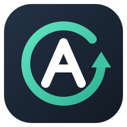
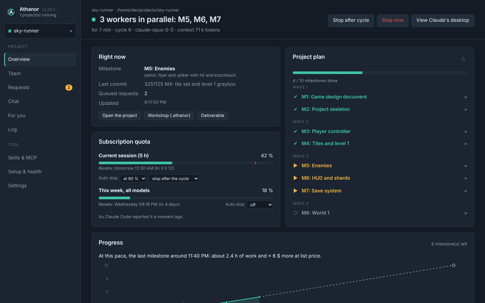
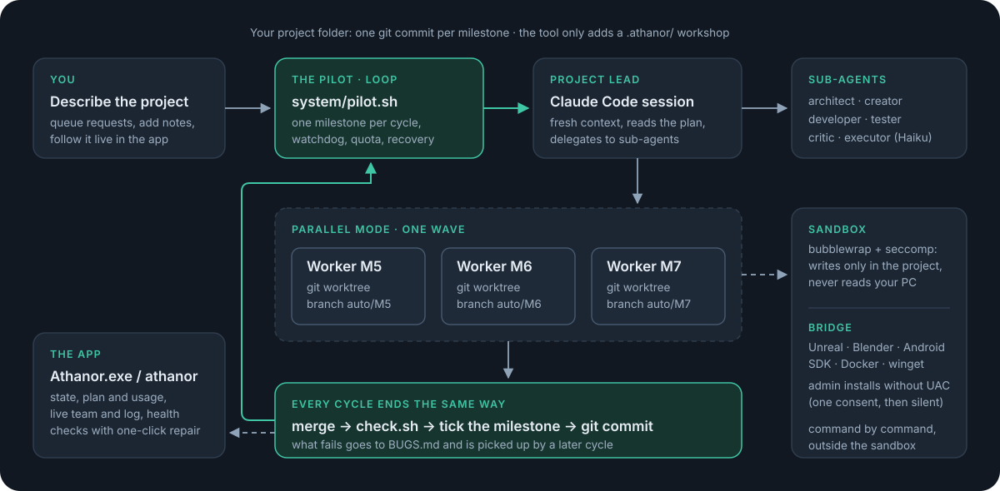
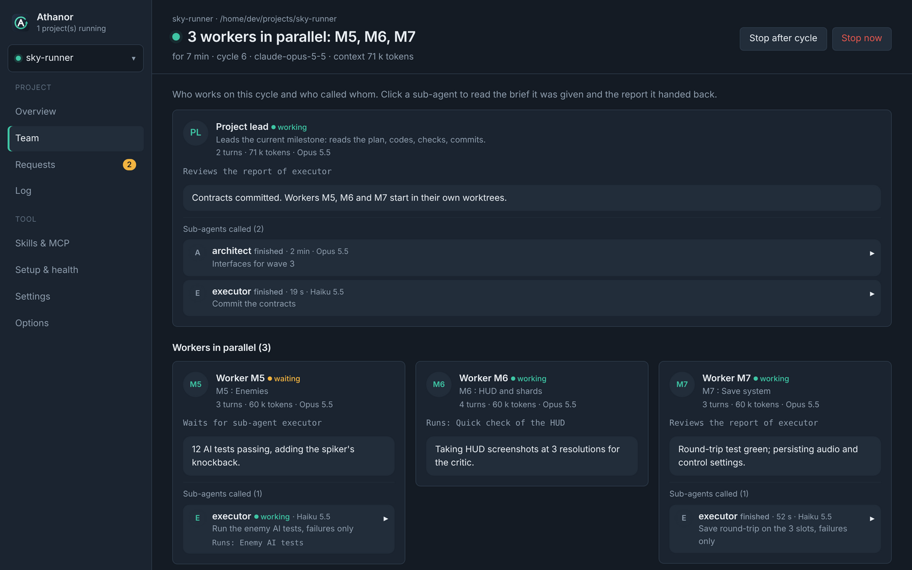
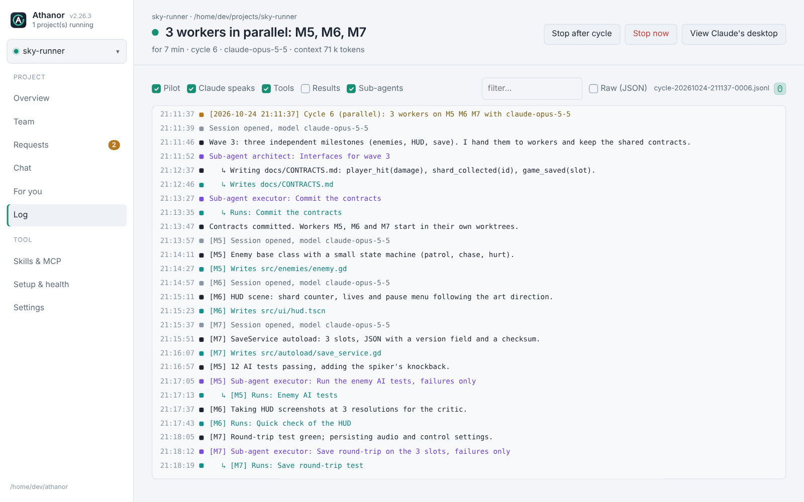
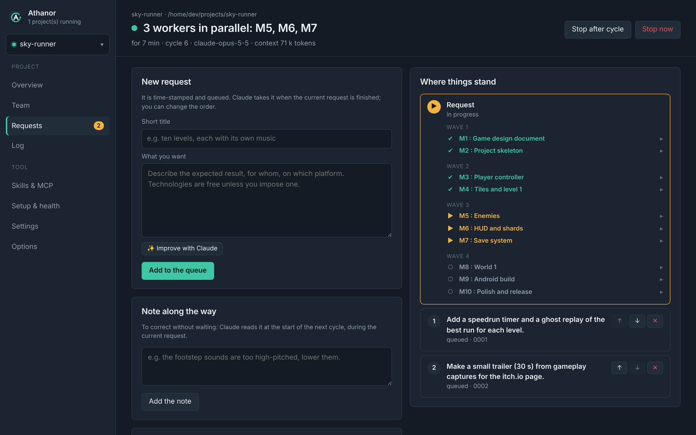
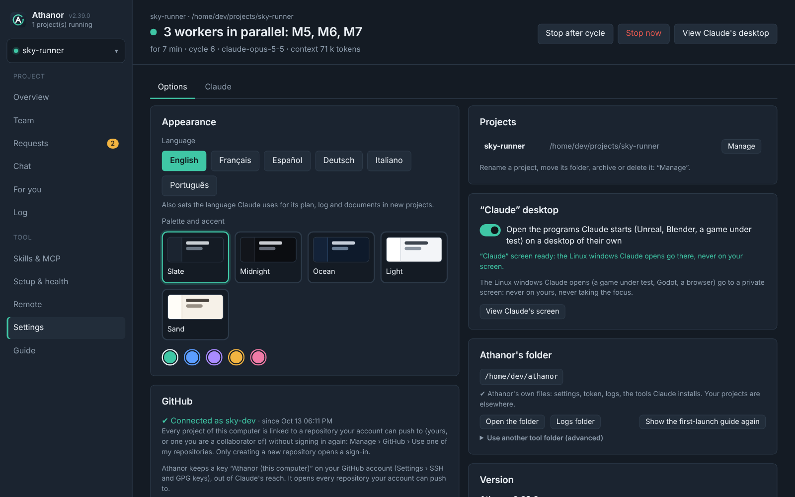
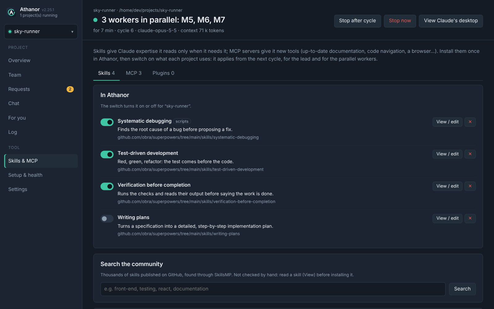
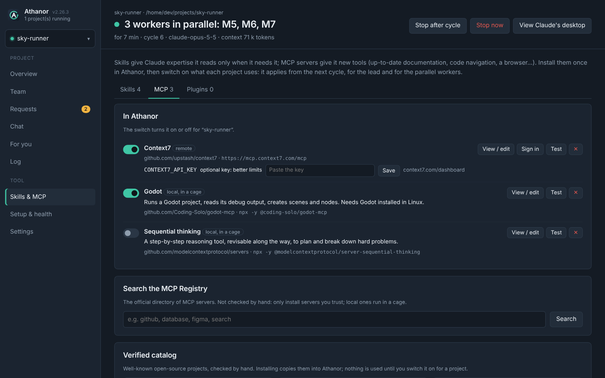

<p align="center">
  
</p>

<h1 align="center">Athanor</h1>

<h3 align="center">Laissez Claude Code construire des projets entiers pendant que vous faites autre chose.</h3>

<p align="center">
  <i>L'athanor était le four des alchimistes, conçu pour brûler des jours entiers sans s'éteindre et sans que personne ne le surveille.</i>
</p>

<p align="center">
  <a href="LICENSE"></a>
  
  <a href="https://claude.com/claude-code"></a>
  
  
</p>

<p align="center">
  <a href="#démarrage-rapide"><b>Démarrage rapide</b></a> ·
  <a href="#comment-ça-marche"><b>Comment ça marche</b></a> ·
  <a href="#mode-parallèle"><b>Mode parallèle</b></a> ·
  <a href="#lapplication"><b>L'application</b></a> ·
  <a href="#sécurité"><b>Sécurité</b></a> ·
  <a href="#faq"><b>FAQ</b></a> ·
  <a href="#dépannage"><b>Dépannage</b></a> ·
  <a href="README.md"><b>English</b></a>
</p>

<p align="center">
  <a href="https://github.com/Aprilox/Athanor/releases/latest"></a>
</p>

<p align="center">
  
</p>

Vous décrivez ce que vous voulez : un jeu, un site, une application, un outil. Athanor lance [Claude Code](https://claude.com/claude-code) **cycle après cycle** sur votre propre PC, avec votre abonnement Claude. Chaque cycle termine **un jalon du plan** : Claude fait le travail, lance les vérifications du projet, coche le jalon et le commite. Puis une session neuve prend le suivant, jusqu'à la livraison. Vous pouvez fermer l'application, la verrouiller ou aller dormir : le four continue de brûler.

> [!NOTE]
> Athanor est un projet open source indépendant. Il n'est ni affilié à Anthropic ni approuvé par Anthropic. Il pilote la commande officielle Claude Code avec votre propre abonnement.

---

## Points forts

| | |
|---|---|
| **Une boucle autonome** | Un jalon par cycle et un contexte neuf à chaque fois : les tours restent économes et le projet ne dérive pas. Quota atteint → pause jusqu'à sa réouverture, ou bascule sur un modèle de secours. Erreur → nouvel essai avec un délai croissant. Cycle muet ou trop long → coupé et repris. PC redémarré → reprise là où il s'était arrêté. Tout l'état est dans des fichiers. |
| **Mode parallèle** | Un interrupteur par projet. Un plan fin avec dépendances ; jusqu'à 10 ouvriers réalisent des jalons indépendants en même temps, chacun dans sa copie de travail git ; le pilote fusionne chacun dès qu'il termine et lance le suivant, et le chef vérifie une fois à la fin. |
| **Une vraie équipe** | Un chef de projet et des sous-agents : `architect`, `creator`, `developer`, `tester`, `critic`, et un `executor` bon marché (Haiku par défaut) pour le travail mécanique. Le plan, les tests indépendants et la critique finale sont toujours délégués. |
| **Skills & MCP** | Donnez à Claude de l'expertise et des outils : un catalogue vérifié (skills d'Anthropic, superpowers, Context7, Serena, Playwright, GitHub…), une recherche dans des milliers de skills communautaires (SkillsMP) et dans le registre officiel MCP, n'importe quel skill depuis un lien GitHub, vos propres skills, n'importe quel serveur MCP collé depuis son README. Activés projet par projet, pour le chef comme pour les ouvriers en parallèle. Les serveurs MCP locaux tournent dans une cage, loin de vos fichiers et du jeton Claude. |
| **Une barrière** | Les commandes de Claude tournent sous bubblewrap + seccomp. Elles ne peuvent écrire que dans le projet et ne lisent jamais le reste de votre machine ; Internet reste ouvert. |
| **Vos logiciels** | Unreal Engine, Blender, le SDK Android, Docker et winget sont joignables par un pont contrôlé, commande par commande. |
| **Aucune fenêtre UAC** | Sur autorisation. Un seul consentement, puis Claude installe et lance ce dont le projet a besoin avec les droits administrateur, sans rien vous demander. |
| **Une application de bureau** | Un seul fichier. Elle montre l'équipe en direct, le plan, la consommation, le journal lisible et la file des demandes, avec des vérifications qui se réparent en un clic. Elle fait aussi tourner plusieurs projets à la fois et garde les programmes que Claude lance sur leur propre bureau, loin de vous. Thèmes, 6 langues. |
| **GitHub, un dépôt à la fois** | Liez un projet à un nouveau dépôt privé ou à un des vôtres : ses commits y partent après chaque jalon. La clé avec laquelle Athanor envoie ne marche que pour ce dépôt et reste hors de portée de Claude ; chaque envoi est vérifié à la recherche de secrets et n'est jamais forcé. |
| **Des projets propres** | Un projet est n'importe quel dossier de votre PC. Athanor n'y ajoute qu'un atelier `.athanor/`, avec ses documents de travail (exigences, design, architecture), tenu hors de git sur votre ordinateur seulement, jamais via votre `.gitignore` : supprimez-le à la fin et il ne reste aucune trace. |
| **Économe par conception** | Règles de lecture ciblées, vérification rapide pendant le jalon et complète une seule fois, captures assemblées en planches, carte du projet refaite avant chaque cycle, archives automatiques, compression des sorties de commandes. La page *Suivi* montre en direct quelle part de chaque session est relue depuis le cache. |

---

## Démarrage rapide

**Il faut :** Windows 10/11 (WSL2 est installé pour vous) ou Linux, et un abonnement Claude (Pro, Max ou Team). Facultatif : Unreal Engine 5.8, Blender, Docker Desktop.

### 1. Récupérer Athanor

<table>
<tr>
<th width="50%">Option A · Télécharger une version <i>(recommandé)</i></th>
<th width="50%">Option B · Le compiler soi-même</th>
</tr>
<tr>
<td valign="top">

Depuis la [**dernière version**](https://github.com/Aprilox/Athanor/releases/latest) :

- **Windows** : `Athanor-X.Y.Z-Windows.zip`, à dézipper où vous voulez (sur le Bureau, par exemple).
- **Linux** : `Athanor-X.Y.Z-Linux.tar.gz`, puis `tar xzf Athanor-X.Y.Z-Linux.tar.gz`.

Chaque téléchargement est l'outil complet, prêt à l'emploi.

</td>
<td valign="top">

Depuis le code source, avec [Go](https://go.dev/dl/) 1.24 ou plus.

**Windows** (PowerShell) :

```powershell
git clone https://github.com/Aprilox/Athanor.git
cd Athanor
.\build.cmd
```

Pas de git ? *Code → Download ZIP*, dézippez, double-cliquez sur `build.cmd`. Si Go manque, `build.cmd` propose de l'installer avec winget.

**Linux** :

```bash
git clone https://github.com/Aprilox/Athanor.git
cd Athanor
./build.sh
```

</td>
</tr>
</table>

Les deux options donnent le même dossier : `Athanor.exe` (ou `athanor`) à côté de `commands/`, `system/` et `template/`. L'application en a besoin : gardez toujours le dossier entier.

> [!TIP]
> Avec une version téléchargée, Windows SmartScreen peut afficher *« Windows a protégé votre ordinateur »* au premier lancement, parce que l'application n'est pas signée. Cliquez sur *Informations complémentaires → Exécuter quand même*. Un `Athanor.exe` compilé par vous-même ne le déclenche pas.

### 2. Premier lancement

**Windows**

1. Double-cliquez sur **`Athanor.exe`**. Choisissez la langue, le thème et l'accent : le guide du premier démarrage vous accompagne ensuite. La langue vaut pour l'application **et** pour les documents que Claude écrit dans vos nouveaux projets.
2. **Installer** : une fenêtre installe WSL2, Claude Code et la barrière. Linux demande un mot de passe une fois. La toute première fois, un redémarrage peut être nécessaire : ouvrez ensuite « Ubuntu » une fois pour créer votre utilisateur, puis relancez l'installation.
3. **Se connecter** : *Installation & santé* → *Tout vérifier*. Sur la ligne *Jeton et accès au modèle*, cliquez sur *Réparer* : une fenêtre vous connecte à votre compte Claude. Collez le jeton dans *Réglages*.
4. **Facultatif, recommandé** : *Installation & santé* → *Droits administrateur pour les installations* → *Réparer*. Windows vous demande votre accord **une seule fois** ; Claude n'aura plus jamais besoin d'un clic UAC.
5. **Ajouter un projet** : un nom, son dossier (existant ou à créer, sur n'importe quel disque) et ce que vous voulez. Les technologies sont libres sauf si vous en imposez. ✨ *Améliorer avec Claude* transforme quelques mots en une demande complète ; vous pouvez revenir à la vôtre.
6. **Démarrer.** Ajoutez d'autres projets de la même façon et faites-les tourner en même temps.

**Linux** (les scripts tournent nativement, sans WSL)

```bash
cd athanor                   # ou Athanor, si vous l'avez compilé depuis les sources
commands/install.sh          # Claude Code, barrière, outils (sudo demandé une fois)
commands/configure.sh        # jeton, modèles, options
./athanor                    # l'application, s'ouvre dans votre navigateur
```

Ajoutez ensuite un projet et démarrez-le, comme sous Windows (étapes 5 et 6).

### 3. Mettre à jour

| Vous avez installé | Pour mettre à jour |
|---|---|
| une version téléchargée | fermez l'application, téléchargez la nouvelle version et extrayez-la au même endroit, pour que son dossier `athanor` se fusionne avec le vôtre |
| depuis les sources | fermez l'application, puis `git pull` et relancez `build.cmd` (ou `./build.sh`) |

Votre `.env`, vos réglages, `logs/` et `tools/` ne sont jamais touchés par une mise à jour. Les applications Windows et Linux gardent des fichiers de réglages séparés (`athanor-config.json`, `athanor-config-linux.json`) : un dossier de l'outil partagé entre les deux systèmes (double démarrage, par exemple) fonctionne avec les deux.

L'application n'utilise que la bibliothèque standard de Go et trois paquets embarqués pour la fenêtre WebView2 : une fois les sources sur votre disque, la compilation ne demande aucun accès réseau.

---

## Comment ça marche

<p align="center">
  
</p>

**Un cycle.** Le pilote (`system/pilot.sh`) synchronise la demande, archive les vieux jalons, refait la carte du projet (`.athanor/MAP.md`), ouvre l'éditeur Unreal si le projet en a un, puis lance une session Claude Code avec [`template/CLAUDE.md`](template/CLAUDE.md) comme consignes, dans votre langue. Claude prend le premier jalon non coché de `.athanor/PLAN.md`, le réalise, lance `check.sh`, le coche, le note dans `LOG.md` et commite. Le pilote ferme le cycle peu après le commit et lance le suivant.

**La vie d'un projet.**

| Phase | Ce qui se passe |
|---|---|
| Cadrage | `.athanor/docs/REQUIREMENTS.md`, `DESIGN.md`, `ARCHITECTURE.md` (documents de travail, dans l'atelier), et un plan de 8 à 25 jalons, chacun avec des critères d'acceptation vérifiables |
| Squelette | un squelette exécutable et le `check.sh` propre au projet (compilation, tests, captures) |
| Tranche complète | une fonctionnalité qui marche de bout en bout, vérifiée par le `tester` |
| Production | les jalons restants, un par cycle, ou plusieurs à la fois en mode parallèle |
| Finition | le `critic` utilise le résultat comme un utilisateur exigeant et note les bugs dans `BUGS.md` |
| Livraison | `deliverable/`, `TEST_GUIDE.md`, puis `FINAL_REPORT.md` avec `STATUS: DONE`. Le pilote prend la demande suivante de la file, ou s'arrête |

---

## Mode parallèle

*Suivi → Mode de travail → Mode parallèle*, par projet, avec 2 à 10 ouvriers en même temps.

1. Le chef écrit un **plan fin avec des dépendances explicites** : beaucoup de petits jalons autonomes, chacun avec les fichiers qu'il touche, `Depends on:` les jalons dont il a besoin, et ses critères d'acceptation. M1 est toujours la fondation (squelette, `check.sh`, contrats partagés).
2. Le pilote fait tourner un **ordonnanceur** : chaque jalon dont les dépendances sont fusionnées reçoit un **ouvrier** (sa propre session Claude, sa propre copie de travail git `.athanor/work/M5` et sa branche `auto/M5`), jusqu'au nombre choisi en même temps.
3. Dès qu'un ouvrier termine, le pilote **fusionne sa branche immédiatement** quand elle s'applique sans conflit, coche le jalon et lance les jalons suivants devenus prêts. Personne n'attend l'ouvrier le plus lent.
4. En fin de cycle, **une seule** session du chef vérifie tout : elle fusionne les branches en conflit, lance la vérification complète, corrige ce que les fusions ont cassé et note le reste dans `BUGS.md`.
5. **Les demandes en attente n'attendent pas.** Au début de chaque cycle, elles rejoignent la demande en cours : le chef ajoute leurs jalons au plan, avec leurs dépendances.

Chaque ouvrier ne porte que son jalon en contexte : le travail est découpé en petites sessions économes au lieu d'une seule énorme. Un ouvrier peut confier ses longues séries de tests et ses recherches à `executor` (modèle bon marché) et ne lire que les échecs ; il n'appelle aucun autre sous-agent. La page *Équipe* montre une carte par ouvrier avec les sous-agents qu'il a appelés, et le *Journal* étiquette leurs lignes `[M5]`. Le mode parallèle consomme plus de quota par heure (une session par ouvrier) mais beaucoup moins de temps.

---

---

## L'équipe

| Agent | Rôle | Modèle |
|---|---|---|
| **Chef de projet** | lit le plan, code les jalons ordinaires, délègue, relit chaque rapport, commite | `MODEL` |
| `architect` | exigences, architecture et plan des jalons ; révise le plan si besoin | `SUBAGENT_MODEL` |
| `creator` | contenus : histoire, monde, dialogues, textes d'interface, ressources 2D/3D/son générées par programme | `SUBAGENT_MODEL` |
| `developer` | une tâche de développement précise, avec ses tests | `SUBAGENT_MODEL` |
| `tester` | tests automatiques, captures, rapports de bugs (ne corrige jamais le code lui-même) | `SUBAGENT_MODEL` |
| `critic` | utilise le résultat comme un utilisateur final exigeant, sans complaisance (lecture seule) | `SUBAGENT_MODEL` |
| `executor` | travail mécanique sans décision de conception : sorties de commandes longues, recherches, modifications en série, copies de fichiers ; le seul sous-agent que les ouvriers en parallèle peuvent appeler | `CHEAP_MODEL` (Haiku) |

Les agents sont dans [`template/.claude/agents/`](template/.claude/agents) : modifiez-les pour changer la façon de travailler de votre équipe.

**Vos propres sous-agents.** Sur la page *Équipe*, **+ Nouveau sous-agent** ajoute un spécialiste à vous (un traducteur, un chercheur dans un domaine, un level designer…) : un nom, quand le chef doit l'appeler, ses consignes (**✨ Améliorer avec Claude** transforme quelques lignes en consignes structurées), un modèle (comme les autres, économique ou le plus puissant), lecture seule ou non, ce projet ou tous vos projets. Le chef peut aussi en proposer un quand un besoin revient : il écrit `.athanor/agents/<nom>.md`, le pilote le vérifie et l'ajoute à l'équipe au cycle suivant, marqué *proposé par le chef* ; vous le gardez, le modifiez ou le retirez (une proposition retirée n'est jamais refaite). Ces sous-agents fonctionnent comme les autres : même barrière, skills, outils MCP et fichiers joints, appelables par le chef et par les ouvriers en parallèle ; le chef les trouve dans `.athanor/TEAM.md`, et une demande peut en nommer un (« fais faire les textes par `traducteur` »). Ils sont rangés dans `extensions/agents.json` (12 par projet au maximum).

---

## L'application

| | |
|:---:|:---:|
| <br>**Équipe** : qui a appelé qui, ce que fait chacun, en direct | <br>**Journal** : lisible ou brut, filtrable, ouvriers étiquetés |
| <br>**Demandes** : une file réordonnable, des remarques en cours de route | <br>**Options** : 6 langues, 5 palettes × 5 accents |
| <br>**Skills** : installés une fois, activés par projet | <br>**MCP** : distants ou locaux dans une cage, testés en un clic |

Les captures sont en anglais ; l'interface s'affiche dans la langue choisie.

| Page | Ce qu'on y fait |
|---|---|
| **Suivi** | état en une phrase, jalon en cours, dernier commit, plan coché, consommation (cycles, durée, coût catalogue, cache) ; *Démarrer*, *Arrêter après le cycle*, *Arrêter maintenant*, *Mode de travail* |
| **Équipe** | un arbre : le chef et chaque ouvrier avec les sous-agents qu'il a appelés ; un clic sur un sous-agent montre la consigne reçue et le rapport rendu ; le modèle de chacun ; qui peut être appelé, et vos propres sous-agents (créer, modifier, retirer) |
| **Demandes** | la demande en cours et son plan, les demandes à la suite (horodatées, réordonnables), les remarques en cours de route ; ✨ *Améliorer avec Claude* reformule une demande plus claire et plus complète, et vous pouvez revenir à la vôtre ; 📎 joignez des fichiers à une demande (cahier des charges, maquettes, photos, PDF, données) : ils restent dans l'atelier et Claude les lit avec la demande |
| **Journal** | le journal lisible (Claude parle, outils, résultats, sous-agents, pilote) ou brut (JSON), filtrable |
| **Gérer** | renommer le projet ; déplacer ou renommer son dossier ; le faire pointer vers un autre dossier (le plan et les demandes suivent, les jalons sont vérifiés d'après son contenu) ; vérifier les jalons ; l'archiver ; le supprimer (de la liste, son atelier ou tout le dossier, à la corbeille) ; le lier à GitHub |
| **Skills & MCP** | la bibliothèque (catalogue vérifié, recherche dans SkillsMP et le registre MCP, lien GitHub, vos propres skills, configurations MCP collées), un interrupteur par projet, les clés d'API des serveurs (rangées à part, jamais réaffichées), *Tester* démarre un serveur dans sa cage et liste ses outils |
| **Installation & santé** | *Tout vérifier*, *Tout installer*, *Tester la barrière* pour de vrai, *Réparer* ligne par ligne, *Demander à Claude* de réparer ou d'installer quelque chose |
| **Réglages** | le `.env` (jeton masqué, modèles, effort, surveillance…), *Enregistrer et redémarrer après le cycle* |
| **Options** | langue, palette et accent, liste des projets (retirer de la liste ne touche jamais au dossier), relance des pilotes à l'ouverture, démarrage avec l'ordinateur, bureau « Claude », mot de passe, dossier de l'outil |

**Skills & MCP, en sécurité** : les skills sont chargés comme un plugin de session (`--plugin-dir`) : Claude ne lit un skill que quand il en a besoin, et peut les lire mais jamais les modifier. Les serveurs MCP s'ajoutent à la configuration MCP de la session ; un serveur local démarre dans une cage bubblewrap (`system/mcp-jail.sh`) : système en lecture seule, seuls le projet et les caches de l'outil en écriture, ni dossier personnel, ni disques Windows, ni dossier d'Athanor, ni jeton Claude. Les skills demandent une version de Claude Code qui a `--plugin-dir`.

**Des projets qui suivent leur dossier** : quand un projet pointe vers un autre dossier, Athanor compare les jalons cochés avec ce qui s'y trouve. Dans un dossier vide, plus rien n'est fait ; un jalon dont les fichiers listés manquent est décoché ; quand les fichiers reviennent, il se recoche tout seul. Au démarrage suivant, Claude vérifie chaque jalon plus en profondeur (`.athanor/REVERIFY`) et décoche ce qui manque vraiment. Les projets archivés quittent la liste et ne sont jamais relancés : *Projets archivés*, en bas de la liste des projets, les ramène.

**GitHub, automatiquement** : à la création d'un projet, ou plus tard dans *Gérer*, choisissez *Créer un dépôt privé* ou *Utiliser un de mes dépôts*. Une fenêtre s'ouvre une seule fois pour vous connecter à GitHub ; Athanor donne alors à ce dépôt sa propre clé (une *deploy key* GitHub, acceptée pour ce dépôt et rien d'autre) puis se déconnecte : aucune connexion GitHub n'est gardée sur votre PC (vous pouvez aussi révoquer « GitHub CLI » dans vos réglages GitHub, la clé n'en a pas besoin). Ensuite, le pilote envoie après chaque jalon et à la livraison (désactivez-le pour n'envoyer qu'avec *Envoyer maintenant*). Les envois ne sont jamais forcés : si GitHub a des commits que le projet n'a pas, Athanor s'arrête et le dit. Avant chaque envoi, les nouveaux commits sont vérifiés à la recherche de secrets (clés, jetons, fichiers `.env`, clés privées) ; si un secret est trouvé, rien n'est envoyé, et Claude le retire des commits non envoyés à son cycle suivant. Une modification des workflows GitHub Actions du dépôt (du code que GitHub exécute, avec les secrets du dépôt) vous attend : vérifiez-la, puis *Envoyer quand même*. Le même encadré règle l'**auteur des commits** (votre nom, et votre email GitHub ou votre adresse GitHub privée *noreply*, proposés depuis votre compte) et si Claude apparaît en co-auteur ; Claude écrit chaque titre de commit sous la forme `M3: ce que le jalon apporte`.

**Le plan se façonne** : un clic sur un jalon montre ses fichiers, ses dépendances et ses critères d'acceptation ; on peut le monter, le descendre ou le retirer (les autres jalons n'en dépendent plus), ou éditer `PLAN.md` en entier.

**Démarrage avec l'ordinateur** : *Ouvrir Athanor au démarrage de l'ordinateur* l'ouvre avec sa fenêtre, sous Windows comme dans une session de bureau Linux. Avec *Relancer les pilotes qui tournaient*, les projets que vous aviez démarrés, ni arrêtés ni livrés, repartent. Relancer Athanor alors qu'il tourne déjà ramène simplement sa fenêtre : il n'y en a jamais deux.

**Cadenas** : avec un mot de passe (*Options*), le bouton 🔒 verrouille l'application. Claude continue, mais rien n'est visible ni modifiable (jeton compris) sans le mot de passe, et l'application démarre verrouillée.

**Bureau « Claude »** : les programmes que Claude lance ne s'ouvrent jamais sur votre écran. Ils n'interrompent ni votre travail ni un jeu en plein écran.
- **Windows** : Unreal, Blender, un jeu en test et tout ce qu'ils lancent s'ouvrent sur un bureau Windows à part, comme celui de l'invite UAC (les passerelles les lancent avec `Athanor.exe --isole`). Ils ne peuvent pas prendre la main. *Voir le bureau Claude* bascule l'écran dessus ; la barre en haut, ou Ctrl + Alt + B, vous ramène.
- **Linux**, et les programmes Linux sous WSL que WSLg afficherait sur Windows : chaque pilote fait tourner un serveur X privé (Xvfb). Claude, ses outils et ses serveurs MCP ne voient que cet écran (`system/ecran.sh`), et votre affichage, X11 ou Wayland, leur est inaccessible. *Voir l'écran de Claude* l'affiche en direct dans l'application.
- Option désactivée, les nouveaux programmes s'ouvrent à nouveau sur votre écran. Ceux qui tournent déjà restent où ils sont jusqu'à leur fermeture : l'application vous laisse aller les fermer.

L'interface est traduite en anglais, français, espagnol, allemand, italien et portugais.

---

## Ce que Claude peut et ne peut pas faire

| | |
|---|---|
| Écrire | seulement dans le dossier du projet (et dans `tools/` de l'outil pour ce qu'il installe) |
| Lire | seulement le projet, `tools/` et les fichiers du système Linux ; ni vos documents, ni les disques Windows, ni `.env` |
| Internet | oui, librement |
| Installer des outils | oui : dans `tools/` (outils Linux, logiciels Windows portables dans `tools/windows/`), ou dans un conteneur Docker jetable ; chaque installation est notée dans `tools/INSTALLS.md` |
| Installer des logiciels Windows | oui, avec winget ou un installateur : pour votre utilisateur, ou avec les droits administrateur si vous l'avez autorisé (une seule demande Windows) |
| Pare-feu Windows | réglé tout seul avec la même autorisation : les programmes du projet peuvent recevoir des connexions **du réseau local seulement** |
| Vos logiciels Windows | oui, par les passerelles prévues (voir ci-dessous). **C'est une sortie voulue de la barrière** : ces programmes tournent avec vos droits Windows |
| `cmd.exe`, `powershell.exe` | non, bloqués depuis la barrière (les passerelles restent possibles) |
| Modifier le pilote, la barrière, ses réglages | non (`system/` est hors de ses dossiers) |

---

## Vos outils

Claude travaille sous Linux (WSL2 sous Windows) et atteint vos logiciels Windows par des passerelles. Le pont exécute chaque commande **hors** de la barrière, avec vos droits :

| Passerelle | Ce qu'elle fait |
|---|---|
| `unreal-editor`, `unreal-cmd`, `unreal-uat` | ouvre l'éditeur Unreal (piloté par Unreal MCP si activé), lance commandlets et tests, fabrique les versions Windows et Android |
| `blender` | le Blender du PC, généralement en arrière-plan avec un script Python (`blender -b -P scene.py`) |
| `adb` | l'outil Android du PC : installer et tester sur un téléphone branché en USB |
| `tool IMAGE CMD…` | lance une commande dans un conteneur Docker jetable qui ne voit que le projet |
| `install-windows ID` / `--file setup.exe` | installe un logiciel Windows (winget ou installateur), avec élévation si autorisée |
| `pc-exec [--admin] programme.exe` | lance un programme Windows construit ou téléchargé par le projet |
| `windows-var NOM CHEMIN` | définit une variable d'environnement Windows pour les outils de développement (`ANDROID_HOME`, `JAVA_HOME`…) |

Les logiciels installés sont détectés sur **tous les disques** (`C:`, `D:`…), et la version la plus récente l'emporte. La liste détectée est écrite avant chaque cycle dans `.athanor/PC_TOOLS.md`. Si la détection manque un logiciel, indiquez son chemin dans *Réglages* (`UE_DIR`, `BLENDER_EXE`, `ANDROID_SDK_DIR`).

**Unreal Engine (MCP)** : mettez `UNREAL_MCP=1` dans *Réglages* et lancez une fois `commands\unreal-network.cmd`. Claude active lui-même les plugins du MCP dans le projet Unreal, et le pilote ouvre l'éditeur avant chaque cycle. Claude le pilote (acteurs, lumières, matériaux, tests), lance tests et captures avec `unreal-cmd`, et fabrique le jeu Windows avec `unreal-uat` dans `deliverable/`. Le MCP d'Unreal est expérimental : s'il ne répond pas, Claude continue sans.

**Logiciels manquants** : Claude se débrouille seul (version portable dans `tools/windows/`, sinon winget, sinon la tâche administrateur si elle est autorisée). Si une installation échoue, il l'écrit dans `.athanor/TODO_FOR_YOU.md` et continue autrement.

**Jeu mobile (Unreal)** : Android d'abord (SDK et Java portables, `.apk` installé sur le téléphone branché en USB), iOS gardé portable (`docs/IOS_PORT.md`).

**Docker (facultatif)** : il faut Docker Desktop avec *Settings > Resources > WSL integration*.

---

## Réglages

Tout se modifie dans l'application (*Réglages*), ou dans `.env` ([`.env.example`](.env.example) documente chaque clé).

| Clé | Rôle |
|---|---|
| `CLAUDE_CODE_OAUTH_TOKEN` | jeton de votre abonnement (`claude setup-token`), jamais partagé |
| `MODEL` | modèle du chef : `claude-fable-5-1`, `claude-opus-5-5`, `claude-sonnet-5-5` (plus économe), `claude-haiku-5-5`, ou les alias `fable`, `opus`, `sonnet` |
| `FALLBACK_MODEL` | pris **automatiquement** quand le quota de `MODEL` est épuisé, jusqu'à sa réouverture, puis retour au principal. Vide = pause |
| `SUBAGENT_MODEL` | modèle des sous-agents ; vide = le même que le chef, `claude-sonnet-5-5` économise le quota |
| `CHEAP_MODEL` | modèle du sous-agent `executor` (par défaut `haiku`) : le contexte et le quota du chef restent pour la réflexion |
| `EFFORT` | effort de réflexion : vide = normal, `low` à `max` |
| `LANGUAGE` | langue dans laquelle Claude travaille et documente (réglée par l'application) |
| `MAX_HOURS` | arrêt de sécurité (168 par défaut, une semaine) |
| `QUOTA_WAIT_MIN` | attente quand l'heure de réouverture du quota est illisible |
| `IDLE_MAX_MIN`, `CYCLE_MAX_MIN`, `CLOSE_AFTER_MILESTONE` | surveillance des cycles (muet 30 min ou plus long que 3 h → coupé et repris), un jalon par cycle |
| `RTK`, `TZ` | compression des sorties de commandes, fuseau horaire des journaux (vide = celui du système) |
| `UNREAL_MCP`, `UNREAL_MCP_URL` | laisser Claude piloter l'éditeur Unreal ouvert |
| `UE_DIR`, `BLENDER_EXE`, `ANDROID_SDK_DIR`, `ANDROID_JDK_DIR` | chemins des outils quand la détection automatique les manque (facultatifs, absents par défaut) |

Si le quota global est épuisé (tous modèles), le pilote attend la réouverture et reprend seul.

---

## Sécurité

Ce que la barrière garantit, et ce qu'elle ne fait volontairement pas :

- **Les commandes de Claude** tournent dans le bac à sable de Claude Code (bubblewrap + seccomp). Elles ne peuvent écrire que dans le dossier du projet et `tools/`. Elles ne peuvent lire ni le reste de votre dossier Linux, ni les disques Windows, ni lancer `cmd.exe` ou `powershell.exe` directement. *Installation & santé → Tester la barrière* le prouve avec une vraie session. Les outils de fichiers de Claude (Read, Edit, Write…) sont limités de la même façon par un garde-fou ([`system/guard.py`](system/guard.py)).
- **Les logiciels Windows sont une sortie voulue.** Les passerelles tournent hors de la barrière, avec vos droits, et `pc-exec` lance n'importe quel programme Windows que Claude dépose dans le projet ou dans `tools/windows`. Traitez un projet comme du code que vous lanceriez vous-même.
- **Les droits administrateur sont sur autorisation.** *Droits administrateur pour les installations → Réparer* vous demande votre accord une fois et crée une tâche planifiée élevée (`Athanor - installations`). Son script est copié dans `C:\ProgramData\Athanor`, que seuls les administrateurs peuvent modifier. La tâche ne lance que des paquets winget et des programmes situés dans vos dossiers de projets ou dans `tools\windows`. Elle laisse aussi les programmes du projet accepter des connexions du réseau local sans la fenêtre du pare-feu. Retirez-la quand vous voulez avec `commands\allow-admin.cmd remove`.
- **Le pilote ne fait jamais confiance au dossier du projet.** Il garde son propre état (pid, verrou, réglages de la barrière, consignes, compteurs) dans `logs/`, hors de portée de Claude, et n'écrit jamais à travers un lien symbolique posé dans `.athanor/`. Il vérifie chaque valeur relue, et appelle git sans hooks, filtres, fsmonitor ni diff externe. Il lance Claude Code avec ses seuls réglages et serveurs MCP (`--setting-sources user`, `--strict-mcp-config` quand la commande les connaît), et `tools/` n'est jamais dans son `PATH`.
- **L'application** n'écoute que sur `127.0.0.1` et refuse tout autre en-tête `Host` (DNS rebinding). Seules les fenêtres qu'elle ouvre elle-même peuvent s'en servir : chacune s'ouvre sur une adresse à usage unique qui lui donne un cookie, si bien qu'un programme de l'ordinateur qui trouve le port (une commande lancée par Claude, par exemple) n'obtient ni la page ni l'API. Elle exige aussi un en-tête secret propre à la session sur chaque appel et stocke le mot de passe salé et haché. Elle n'envoie jamais les secrets du `.env` sans demande, et, verrouillée, n'affiche que « en marche / phase / cycle ». Elle refuse un dossier de projet qui contiendrait l'outil, une racine de disque ou tout votre dossier personnel.
- **Les sessions « Demander à Claude »** (réparation de l'outillage) tournent hors de la barrière, dans le dossier de l'outil, sans `sudo` : c'est voulu, pour réparer l'outillage lui-même. Ce qui demande `sudo` ou Windows est écrit pour vous dans `logs/TODO_FOR_YOU.md`.
- **GitHub** : la connexion qui sert à lier un projet vit dans un dossier temporaire, supprimé une fois le lien fait. Les envois utilisent une clé que GitHub n'accepte que pour le dépôt du projet, gardée dans votre dossier personnel Linux (`~/.local/share/athanor/github`), que la barrière ne peut pas lire ; même une clé volée ne peut pas toucher vos autres dépôts. Le pilote envoie depuis un dossier git privé : rien du `.git` du projet (que Claude peut écrire) n'est utilisé, l'identité du serveur de GitHub est vérifiée avec les clés que GitHub publie, et `GH_TOKEN`/`GITHUB_TOKEN` sont retirés de l'environnement de Claude.
- **Rien de personnel n'est jamais commité** : `.env`, `logs/`, `tools/` et les réglages de l'application sont ignorés par git, et les projets vivent hors du dossier de l'outil.

Vous avez trouvé une faille ? Ouvrez plutôt un [avis de sécurité privé](https://github.com/Aprilox/Athanor/security/advisories/new) qu'une issue publique.

---

## Laisser tourner plusieurs jours

- Les pilotes tournent dans WSL sans fenêtre : vous pouvez fermer l'application.
- Empêchez la mise en veille (*Paramètres > Système > Alimentation > Veille : Jamais*).
- *Options* : « Ouvrir l'application à l'allumage de Windows (sans fenêtre) » et « Relancer les pilotes qui tournaient, à l'ouverture de l'application ».
- Arrêt de sécurité au bout de `MAX_HOURS` (depuis le premier démarrage du projet) ; pour continuer, augmentez la valeur dans *Réglages*.

## Projet terminé, suite, nouveau projet

- **Demandes à la suite** : page *Demandes*. Dès que la demande en cours est terminée, le pilote prend la première de la file, l'ajoute à `REQUEST.md` et rouvre le projet avec un jalon de reprise.
- **Remarque en cours de route** : page *Demandes*, lue au début du cycle suivant, sans redémarrage.
- **Rouvrir à la main** : remplacez `STATUS: DONE` par `STATUS: REOPENED` dans `.athanor/FINAL_REPORT.md`, puis *Démarrer*.
- **Nouveau projet** : sélecteur → *+ Nouveau projet*. **Nettoyer un projet fini** : supprimez son dossier `.athanor/` (et `.claude/` s'il existe).

---

## Les commandes à la main (sans l'application)

Dans `commands/` : sous Windows, double-clic ou `commands\start.cmd D:\Dev\mon-projet` ; sous Linux, les `.sh` depuis le dossier de l'outil, avec le dossier du projet en argument.

| Windows | Linux / WSL | Pour |
|---|---|---|
| `commands\install.cmd` | `commands/install.sh` | tout installer ou réparer |
| `commands\configure.cmd` | `commands/configure.sh` | jeton, modèles, options (la langue se règle dans l'application) |
| `commands\start.cmd DOSSIER` | `commands/start.sh --background DOSSIER` | lancer le pilote sur un projet |
| `commands\follow.cmd DOSSIER` | `commands/follow.sh DOSSIER` | suivre en direct |
| `commands\stop-after-cycle.cmd DOSSIER` | `commands/stop-after-cycle.sh DOSSIER` | arrêter proprement à la fin du jalon en cours |
| `commands\stop.cmd DOSSIER` | `commands/stop.sh DOSSIER` | arrêter tout de suite |
| `commands\test-sandbox.cmd` | `commands/test-sandbox.sh` | prouver la barrière avec une vraie session |
| `commands\allow-admin.cmd [remove]` | | autoriser ou retirer les installations administrateur |
| `commands\unreal-network.cmd` | | réseau WSL pour le MCP d'Unreal (une fois) |

Sans dossier, les commandes utilisent `<outil>\projet`. La demande se lit et s'écrit dans `DOSSIER\.athanor\REQUEST.md`, les demandes suivantes dans `DOSSIER\.athanor\queue\` (un fichier par demande, prises dans l'ordre).

## Où regarder

- `.athanor/STATE.json` : phase, cycle, modèle, jalon en cours, reprise prévue ; `stats.tsv` : une ligne par cycle.
- `.athanor/PLAN.md`, `LOG.md` ; `pilot.log` (cycles, quotas, bascules) ; `logs/` (brut de chaque cycle).
- À la fin : `.athanor/FINAL_REPORT.md`, `TEST_GUIDE.md`, et le livrable dans `deliverable/`.
- Côté outil : `logs/` (réparations, test de la barrière, `TODO_FOR_YOU.md`).

## Organisation du dépôt

```
Athanor.exe, athanor   l'application pour Windows / Linux (dans la version téléchargée, ou construite par build.cmd / build.sh)
app/                   les sources Go de l'application, l'interface (HTML, CSS, JS sans dépendance), ressources Windows
commands/              install, configure, start, stop, stop-after-cycle, follow, test-sandbox, repair,
                       allow-admin, unreal-network (.cmd pour Windows, .sh pour Linux/WSL)
system/                pilot.sh (la boucle), parallel.sh (ordonnanceur, ouvriers, fusions), equipe.py (l'équipe), safety.sh, bridge.py,
                       extensions.py + mcp-jail.sh (Skills & MCP), ecran.sh (écran de Claude), github.sh (GitHub),
                       settings.py (barrière), guard.py, detect-tools.sh, athanor.py (carte, archives, captures),
                       bin/ (passerelles), windows/ (aides PowerShell)
template/              CLAUDE.md (consignes de Claude), PC_TOOLS_GUIDE.md, .claude/agents/ (l'équipe)
docs/images/           images du README
docs/releases/         les nouveautés de chaque version (affichées sur la page de la version)
.env.example           tous les réglages, documentés
logs/, tools/,         créés à l'usage, jamais commités
extensions/
```

---

## FAQ

<details>
<summary><b>Combien ça coûte ?</b></summary>

Seulement votre abonnement Claude : Athanor enchaîne des sessions Claude Code, rien d'autre. Les modèles les plus puissants consomment le quota le plus vite ; Sonnet dure plus longtemps. `FALLBACK_MODEL` prend le relais quand le quota du modèle principal est épuisé, et `CHEAP_MODEL` s'occupe du travail mécanique. La page *Suivi* montre le coût de chaque cycle au prix catalogue, c'est-à-dire ce que paie le quota de votre abonnement.
</details>

<details>
<summary><b>Que peut-il construire ?</b></summary>

Tout ce que Claude Code peut construire et vérifier seul dans un dossier : sites et applications web, outils de bureau et en ligne de commande, jeux (Unreal Engine, Godot, web), applications Android, bibliothèques. Les projets qui ont besoin de vos logiciels Windows passent par les passerelles. Les vérifications sont écrites par Claude pour chaque projet (`check.sh`), avec des captures pour tout ce qui est visuel.
</details>

<details>
<summary><b>Puis-je le guider pendant qu'il travaille ?</b></summary>

Oui. *Demandes → Remarque en cours de route* est lue au début du cycle suivant. Les nouvelles demandes vont dans la file et se réordonnent. *Arrêter après le cycle* termine le jalon en cours, l'enregistre, puis s'arrête : rien n'est perdu.
</details>

<details>
<summary><b>Va-t-il me gêner pendant que j'utilise le PC ?</b></summary>

Les pilotes tournent dans WSL sans fenêtre. Les programmes qu'ils ouvrent (un éditeur, un jeu en test) vont sur le bureau « Claude », jamais sur votre écran. Pensez à désactiver la mise en veille pour les longues sessions.
</details>

<details>
<summary><b>Le projet reste-t-il propre ?</b></summary>

Oui : supprimez `.athanor/` à la fin, ainsi que `.claude/` si votre version de Claude Code ne connaissait pas `--agents`. Les deux sont exclus de git par `.git/info/exclude`.
</details>

<details>
<summary><b>Puis-je l'utiliser sur plusieurs PC ?</b></summary>

Oui. Rien n'est lié à un nom d'utilisateur ni à une lettre de disque : les chemins viennent de votre profil, le dossier de l'outil peut être n'importe où, et les logiciels sont détectés sur tous les disques. Copiez le dossier ou clonez le dépôt, puis lancez l'installation sur chaque PC.
</details>

---

## Dépannage

| Symptôme | Solution |
|---|---|
| « Lancez d'abord install.cmd » / WSL en défaut dans la santé | *Tout installer* (ou `install.cmd`) n'a pas encore choisi la distribution WSL |
| Le pilote s'arrête aussitôt, message sur la barrière | *Réparer* sur la ligne *Barrière du système* : bubblewrap, socat ou le filtre seccomp manquent |
| Test de la barrière : « cmd.exe lancé depuis la barrière » | le filtre seccomp manque : *Réparer* sur la ligne *Barrière du système* |
| Unreal : « MCP indisponible pour ce cycle » | éditeur 5.8 avec les plugins Unreal MCP, *Auto Start Server* coché, réseau WSL « mirrored » (`unreal-network.cmd`) |
| `tool` : « Docker introuvable » | lancez Docker Desktop, activez *WSL integration* |
| « Quota atteint, Claude patiente » | normal ; avec `FALLBACK_MODEL`, Claude continue sur le modèle de secours |
| « Problème de connexion » | jeton absent ou faux : *Réglages*, ou *Réparer* sur la ligne *Jeton et accès au modèle* |
| Une installation demande les droits administrateur | *Installation & santé* → *Droits administrateur pour les installations* → *Réparer* (une seule fois) |
| Un script `.sh` échoue avec `$'\r'` | fins de ligne Windows : réenregistrez-le en « LF » (le dépôt l'impose via `.gitattributes`) |

---

## Publier une version

Poussez un tag de version : GitHub compile les deux applications et publie la version ([`.github/workflows/release.yml`](.github/workflows/release.yml)).

```bash
git tag v2.10.0 && git push origin v2.10.0
```

Gardez la version de [`app/winres/athanor.rc`](app/winres/athanor.rc) alignée sur le tag, et écrivez les nouveautés dans `docs/releases/VERSION.md` (par ex. [`docs/releases/2.10.0.md`](docs/releases/2.10.0.md)) : elles ouvrent la page de la version.

## Contribuer

Les issues et pull requests sont les bienvenues. Avant d'en ouvrir une :

- `cd app && go vet . && GOOS=windows go vet .` doit passer, ainsi que `go test ./...`.
- Les scripts shell doivent passer `bash -n` et `shellcheck -S warning`.
- Les commentaires et les textes de l'interface sont en anglais. Certains identifiants internes sont en français, parce que le projet a commencé en français ; gardez les noms existants quand vous les touchez. Les nouveaux textes d'interface passent par `t()` et reçoivent leurs traductions dans [`app/static/i18n.js`](app/static/i18n.js).

## Remerciements

- [Claude Code](https://claude.com/claude-code), qui fait le vrai travail.
- [VirtualDesktop](https://github.com/MScholtes/VirtualDesktop) de Markus Scholtes (MIT), compilé au premier usage : solution de secours quand le bureau « Claude » ne peut pas être créé (fenêtres déplacées sur un bureau virtuel).
- [go-webview2](https://github.com/jchv/go-webview2) (MIT) pour la fenêtre Windows, et [bubblewrap](https://github.com/containers/bubblewrap) pour la barrière.

## Licence

[MIT](LICENSE) © Aprilox
