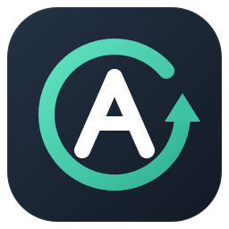
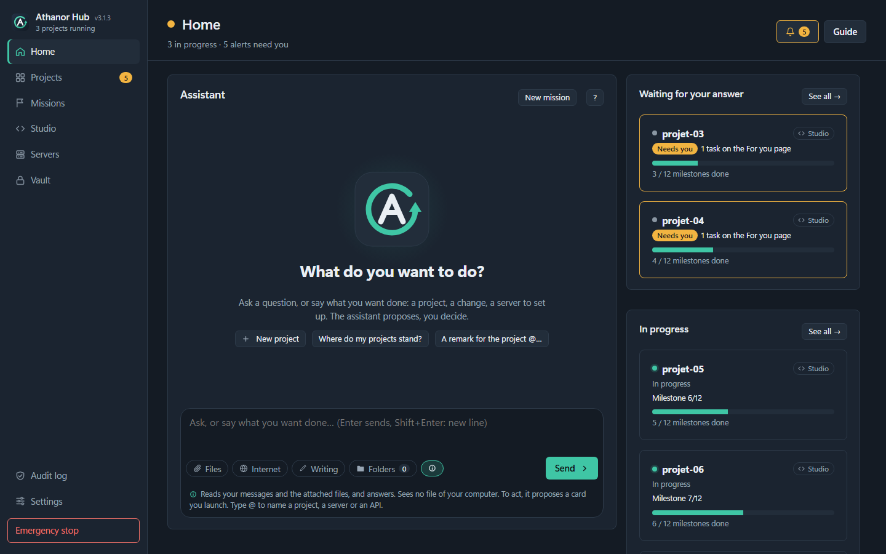
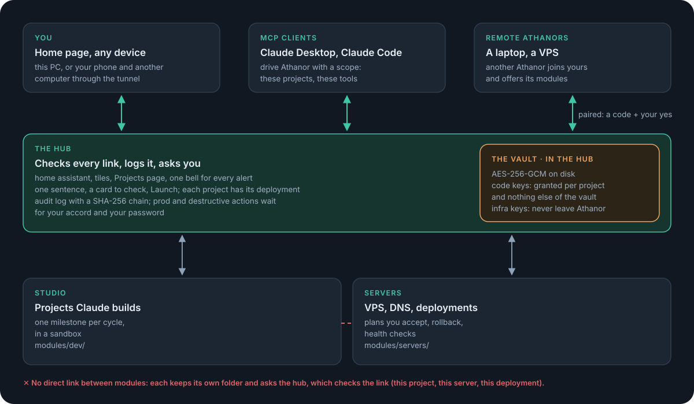

<p align="center">
  
</p>

<h1 align="center">Athanor Hub</h1>

<h3 align="center">Un seul hub sur votre PC : Claude Code construit vos projets, les met en ligne, et ne détient jamais les clés.</h3>

<p align="center">
  <i>L'athanor était le four des alchimistes, conçu pour brûler des jours entiers sans s'éteindre et sans que personne ne le surveille.</i>
</p>

<p align="center">
  <a href="LICENSE"></a>
  
  <a href="https://claude.com/claude-code"></a>
  
  
</p>

<p align="center">
  <a href="#ce-quil-permet-de-faire"><b>Ce qu'il permet</b></a> ·
  <a href="#démarrage-rapide"><b>Démarrage rapide</b></a> ·
  <a href="#guides"><b>Guides</b></a> ·
  <a href="#la-sécurité-en-bref"><b>Sécurité</b></a> ·
  <a href="docs/FAQ.fr.md"><b>FAQ</b></a> ·
  <a href="docs/releases/3.1.6.md"><b>Nouveautés</b></a> ·
  <a href="README.md"><b>English</b></a>
</p>

<p align="center">
  <a href="https://github.com/Aprilox/Athanor/releases/latest"></a>
</p>

<p align="center">
  
</p>

Athanor Hub est un **hub** : un seul programme, une seule fenêtre, d'où vous pilotez des **modules** qui travaillent ensemble, sans jamais accéder aux données ni aux secrets les uns des autres. **Studio** lance [Claude Code](https://claude.com/claude-code) cycle après cycle sur votre propre PC, avec votre propre abonnement Claude, jusqu'à la livraison d'un jeu, d'un site, d'une application ou d'un outil. **Serveurs** prépare votre VPS, son DNS et ses certificats, et met en ligne ce que Studio construit. Le **coffre** garde chaque clé chiffrée et ne donne à chaque projet que ce que vous lui accordez. Une seule phrase sur la page d'accueil peut tous les mettre au travail :

> *Fais un site pour la boulangerie Martin et mets-le en ligne sur martin.fr sur mon VPS.*

Athanor répond par une **carte** : le projet que Studio va construire, avec son dossier, et son déploiement (le serveur, l'adresse, les clés d'API dont il a besoin, le plan avec vos mots, quand déployer). Vous appuyez sur **Lancer**. Votre VPS est préparé pendant que le site se construit, le premier déploiement se fait tout seul, puis le projet passe en ligne au moment que vous avez choisi, après chaque jalon ou à la livraison, et est vérifié de l'extérieur. L'IA demande ; Athanor agit avec la clé, qu'il ne remet jamais. Vous pouvez fermer l'application, la verrouiller ou aller dormir : le four continue de brûler.

> [!TIP]
> **La 3.0 est un tournant.** Athanor était un pilote qui construisait un projet avec Claude ; il devient un hub qui prépare et fait aussi tourner vos serveurs (un pilote serveurs autonome, un déploiement décidé par votre plan), garde chaque clé hors de portée de l'IA, et relie le tout en missions, depuis votre ordinateur ou votre téléphone. Le Studio marche toujours seul, comme avant. [Nouveautés de la 3.0.0](docs/releases/3.0.0.md).

> [!NOTE]
> Athanor est un projet indépendant à source disponible. Il n'est ni affilié à Anthropic ni approuvé par Anthropic. Il pilote la commande officielle Claude Code avec votre propre abonnement. Le programme, ses fichiers de téléchargement et son dossier de données gardent le nom *Athanor* : chaque ancien Athanor se met à jour vers Athanor Hub tout seul.

---

## Ce qu'il permet de faire

- **Construire un projet entier pendant que vous faites autre chose.** Décrivez un jeu, un site, une app ou un outil avec vos mots. Claude Code travaille cycle après cycle, un jalon à chaque fois, teste et committe, des heures ou des jours, jusqu'à la livraison : limites d'usage, erreurs, redémarrages et nuits compris.
- **Aller plus vite, ou dépenser moins.** Le mode parallèle met jusqu'à 10 ouvriers sur des jalons indépendants à la fois, le mode éco ménage le quota, le mode fast garde la vérification complète pour la fin ; plusieurs ordinateurs peuvent même construire un projet ensemble, par son dépôt GitHub.
- **Une vraie équipe, de vrais outils.** Un chef de projet avec des éclaireurs, un architecte, des développeurs, un testeur et un critique ; des skills et des serveurs MCP d'un catalogue vérifié ; les logiciels de votre PC (Unreal Engine, Blender, le SDK Android, Docker) par une passerelle contrôlée.
- **Le mettre en ligne sur vos propres serveurs.** Ajoutez un VPS : Athanor le lit, le prépare, règle son DNS et son HTTPS par Cloudflare, déploie après chaque jalon ou à la livraison, vérifie le site toutes les 15 minutes et revient à la version précédente en un clic.
- **Gérer vos serveurs en le demandant.** Une mission sur des serveurs seuls (*installe nginx sur web-1 et PostgreSQL sur db-1, et relie-les*) : un pilote des serveurs la découpe en jalons, propose chaque changement et vous demande avant tout ce qui est risqué, ou travaille seul si vous l'y autorisez.
- **Garder chaque clé hors de portée de l'IA.** Clés d'API, jetons et clés SSH vivent dans un coffre chiffré ; chaque projet reçoit exactement les clés que vous cochez ; l'IA demande, Athanor agit avec la clé, et chaque action va dans un journal d'audit.
- **Tout suivre, de partout.** Une page d'accueil et une cloche pour tout ; votre téléphone, appairé par un code, montre le même Athanor et vous prévient quand Claude a besoin de vous ou qu'un projet est livré ; Claude Desktop peut piloter Athanor par son MCP.
- **Ce que Claude ne peut pas faire, il vous le demande.** Créer un compte, payer, un code reçu par SMS deviennent des tâches aux étapes précises dans *Pour vous*, pendant que Claude continue le reste.

---

## Les modules

| Module | Ce qu'il fait | Où |
|---|---|---|
| **[Le hub](docs/HUB.fr.md#le-hub)** | La page d'accueil : une conversation avec un assistant qui connaît Athanor, une tuile par module avec ses chiffres en direct, ce qui est en cours et ce qui vous attend. Une seule cloche pour toutes les alertes, une page *Projets* pour tout ce qui est en cours, un Guide et un court tutoriel pour chaque partie. | *Accueil*, *Projets* |
| **[Studio](docs/STUDIO.fr.md#studio--les-projets-que-claude-construit)** | Les projets que Claude construit, un jalon par cycle : plan, équipe de sous-agents, modes parallèle, éco et fast, plusieurs ordinateurs sur un même projet, skills et serveurs MCP, GitHub, tâches pour vous. | *Studio* |
| **[Coffre et accès](docs/VAULT.fr.md#coffre-et-accès)** | Vos clés, jetons et réglages, chiffrés et classés dans vos propres catégories. *Collez* un bloc `.env` et chaque clé est reconnue ; *Tester* la vérifie auprès de son propre service. Cochez une clé pour un projet (ou glissez-la) : le pilote reçoit exactement cela. | *Coffre*, *Studio › Accès* |
| **[Serveurs](docs/SERVERS.fr.md#serveurs)** | Vos VPS et serveurs maison : une fiche lue en une minute, un agent d'exploitation qui propose des plans que vous acceptez, DNS et HTTPS Cloudflare, des déploiements avec retour arrière en un clic, des bilans de santé toutes les 15 minutes. | *Serveurs* |
| **[Missions](docs/HUB.fr.md#missions)** | Un seul formulaire relie un projet Studio, ses serveurs et ses clés API (ou seulement des serveurs) : ce qu'il faut faire, le projet, le serveur avec un choix parmi trois (*A besoin de moi*, *Autonome avec l'IA* ou *Autonomie totale*), la clé ; *Lancer*. Chaque mission a son cadre : le projet et ses jalons, le serveur et son état (terminal, arrêter, relancer), la clé ; pause, arrêt, reprise, modification et suppression dans tout état. | *Missions* |
| **[Déploiement et approbations](docs/SERVERS.fr.md#déploiement-et-approbations)** | Chaque projet a un onglet *Déploiement* : un serveur, une adresse, un plan avec vos mots et quand déployer ; Athanor prépare le serveur et met le projet en ligne. Chaque demande d'un agent vous parvient sous forme d'approbation ; tout est écrit dans un journal d'audit chaîné ; un bouton rouge arrête tout. | *Studio › Déploiement*, *Pour vous*, *Journal d'audit* |
| **[MCP et Athanor distants](docs/HUB.fr.md#mcp-et-athanor-distants)** | Claude Desktop ou Claude Code pilotent Athanor par son MCP ; un autre Athanor (un portable, un VPS qui fait tourner Serveurs seul) rejoint le vôtre. Toujours appairé par un code **et** votre accord à l'écran. | *Réglages* |

Chaque module garde ses propres données (`modules/<nom>/` dans le dossier d'Athanor) et ne parle aux autres que par le hub, qui vérifie, journalise et vous demande quand c'est important. *Guide › Se repérer* en fait le tour, dans la fenêtre et dans le [terminal](docs/HUB.fr.md#dans-un-terminal).

---

<p align="center">
  
</p>

## Démarrage rapide

**Il faut :** Windows 10/11, Linux ou macOS, et un abonnement Claude (Pro, Max ou Team).

### 1. Récupérer Athanor

Un seul fichier (un zip sur le Mac). Depuis la [**dernière version**](https://github.com/Aprilox/Athanor/releases/latest) :

| Votre système | Téléchargement |
|---|---|
| **Windows 10 / 11** | [**Athanor-Windows-x64.exe**](https://github.com/Aprilox/Athanor/releases/latest/download/Athanor-Windows-x64.exe) (un PC ARM, Snapdragon… : [Athanor-Windows-ARM64.exe](https://github.com/Aprilox/Athanor/releases/latest/download/Athanor-Windows-ARM64.exe)) |
| **macOS** 11 ou plus récent | [**Athanor-macOS.zip**](https://github.com/Aprilox/Athanor/releases/latest/download/Athanor-macOS.zip) : **Athanor.app**, pour les Mac Apple Silicon comme Intel ; voir [macOS, pas à pas](#macos-pas-à-pas) |
| **Linux** | [**Athanor-Linux-x64**](https://github.com/Aprilox/Athanor/releases/latest/download/Athanor-Linux-x64) (un PC ARM : [Athanor-Linux-ARM64](https://github.com/Aprilox/Athanor/releases/latest/download/Athanor-Linux-ARM64)) |

Gardez le fichier où vous voulez (sur le Bureau, par exemple ; sur le Mac, Athanor.app dans *Applications*) : c'est lui qui ouvre Athanor, et il n'écrit jamais rien à côté de lui.

> [!TIP]
> Windows SmartScreen peut afficher *« Windows a protégé votre ordinateur »* au premier lancement, parce que l'application n'est pas signée. Cliquez sur *Informations complémentaires → Exécuter quand même*.

### 2. Premier lancement

La première fois, Athanor dit où il va ranger ses fichiers et demande avant d'écrire quoi que ce soit (*Non* : il se ferme, rien n'a été écrit) :

| Système | Dossier d'Athanor |
|---|---|
| Windows | `%LOCALAPPDATA%\Athanor` |
| Linux | `~/.local/share/athanor` |
| macOS | `~/Library/Application Support/Athanor` |

Tout ce qui est à lui y va : sa copie de l'exécutable, ses réglages et votre jeton, ses journaux, les outils qu'il installe. Dans vos projets, il n'ajoute qu'un dossier `.athanor/`.

**Windows**

1. Double-cliquez sur **`Athanor-Windows-x64.exe`**, puis *Oui*. Choisissez la langue, l'endroit du raccourci (le Bureau par défaut), le thème et l'accent : le guide du premier démarrage vous accompagne ensuite.
2. **Installer** : une installation neuve démarre en **Windows natif** (rien d'autre à installer : *Tout installer* pose Git pour Windows, Python, Node.js, quelques petits outils et Claude Code pour Windows). Pour Claude dans une barrière, ouvrez l'onglet **WSL** d'*Installation & santé* : *Tout installer* y installe WSL2, Claude Code et la barrière (Linux demande un mot de passe une fois ; la toute première fois, un redémarrage peut être nécessaire, ouvrez ensuite « Ubuntu » une fois pour créer votre utilisateur et relancez l'installation). Une courte visite montre ensuite le mode, *Installation & santé*, un nouveau projet et *Démarrer*.
3. **Se connecter** : *Installation & santé* → *Tout vérifier*. Sur la ligne *Jeton et accès au modèle*, cliquez sur *Réparer* : une fenêtre vous connecte à votre compte Claude. Collez le jeton dans *Réglages*.
4. **Facultatif, recommandé** : *Installation & santé* → *Droits administrateur pour les installations* → *Réparer*. Windows vous demande votre accord **une seule fois** ; Claude n'aura plus jamais besoin d'un clic UAC.
5. **Ajouter un projet** : un nom, son dossier (existant ou à créer, sur n'importe quel disque) et ce que vous voulez. Les technologies sont libres sauf si vous en imposez. ✨ *Améliorer avec Claude* transforme quelques mots en une demande complète ; vous pouvez revenir à la vôtre.
6. **Démarrer.** Ajoutez d'autres projets de la même façon et faites-les tourner en même temps.
7. **GitHub** (facultatif) : *Réglages → Options → GitHub → Se connecter à GitHub*, une fois ; ensuite *Gérer → GitHub* lie chaque projet à un dépôt (voir [GitHub](docs/STUDIO.fr.md#github) plus bas, et le *Guide* de l'application).

**Linux** (tout tourne nativement, sans WSL)

```bash
chmod +x Athanor-Linux-x64    # une fois : un fichier téléchargé n'est pas encore exécutable
./Athanor-Linux-x64           # l'application, dans une fenêtre d'application de Chrome/Edge/Chromium, sinon votre navigateur
./Athanor-Linux-x64 tui       # un ordinateur sans écran (en SSH : d'elle-même) : son état, et l'appairage du téléphone
```

Puis *Installation & santé* → *Tout installer* (Claude Code, la barrière et les outils ; Linux demande votre mot de passe une fois), le jeton dans *Réglages*, un projet et *Démarrer*, comme sous Windows (étapes 3, 5 et 6).

#### macOS, pas à pas

1. Téléchargez [**Athanor-macOS.zip**](https://github.com/Aprilox/Athanor/releases/latest/download/Athanor-macOS.zip). Safari l'ouvre tout seul : **Athanor.app** est dans *Téléchargements* (avec un autre navigateur, double-cliquez une fois sur le zip). Une application est un dossier, c'est pourquoi elle voyage zippée. Athanor.app marche depuis *Téléchargements* ; dans *Applications*, il est chez lui (macOS l'y rouvre ensuite après une mise à jour et à l'ouverture de session).
2. Ouvrez Athanor.app (double-clic). La première fois, macOS dit qu'il ne peut pas vérifier l'application, parce qu'elle n'est pas signée par Apple : cliquez sur *Terminé*, ouvrez *Réglages Système → Confidentialité et sécurité*, descendez jusqu'à *« Athanor » a été bloqué* et cliquez sur **Ouvrir quand même**, puis votre mot de passe. Une seule fois.
3. *Créer* : le dossier d'Athanor est créé, puis sa fenêtre s'ouvre. Juste après la langue, elle propose un raccourci dans *Applications* : l'Athanor.app téléchargé ne sert alors plus.
4. *Installation & santé* → *Tout installer*, *Tout vérifier*, puis la ligne *Jeton* → *Réparer*, et collez le jeton dans *Réglages*.
5. Ajoutez un projet et *Démarrer*.

Ce que *Tout installer* met sur le Mac, sa fenêtre et sa barrière : [macOS en détail](docs/REFERENCE.fr.md#macos-en-détail).

### 3. Vos dix premières minutes

1. **L'accueil.** Athanor s'ouvre sur son hub. Posez à l'assistant n'importe quelle question sur Athanor, ou dites ce que vous voulez faire : il propose une carte, et rien ne démarre avant que vous appuyiez sur *Lancer*. *Guide*, à côté de la cloche, ouvre le Guide ; chaque module (Accueil, Studio, Coffre, Serveurs) montre une courte visite à votre première venue, à rejouer depuis *Guide › Tutoriels*.
2. **Un mot de passe.** *Réglages → Options → Verrouiller*. Il verrouille l'application, protège les clés de serveurs du coffre et est redemandé à chaque approbation : définissez-le avant d'ajouter un serveur. Pas encore défini ? La première action qui en a besoin (donner une clé à un projet, par exemple) vous demande de le choisir sur place.
3. **Le coffre.** *Coffre → Coller* : un bloc `.env`, un jeton ou une configuration MCP. Athanor reconnaît chaque clé et la garde chiffrée ; *Tester* la vérifie auprès de son propre service. Les clés de vos projets existants y sont déjà (importées au premier démarrage, rien n'a changé pour leurs pilotes).
4. **Un projet.** *Studio → Nouveau projet* : un nom et ce que vous voulez, avec vos mots ; le dossier vous est proposé (✨ *Améliorer avec Claude* transforme quelques mots en une demande complète), puis *Démarrer*. Son onglet *Accès* dit quelles clés du coffre le pilote reçoit.
5. **Facultatif : un serveur.** *Serveurs → Ajouter un serveur* : son adresse, puis son empreinte à confirmer, puis une clé. Sa fiche apparaît une minute plus tard. Essayez d'abord sur un serveur sans importance ([docs/SERVEUR_DE_TEST.md](docs/SERVEUR_DE_TEST.md)).
6. **Facultatif : le mettre en ligne.** L'onglet *Déploiement* du projet : choisissez le serveur et l'adresse, dites avec vos mots ce qu'il faut installer, et enregistrez. Ou dites-le sur l'*Accueil*, en une phrase qui nomme le projet et le serveur avec `@` : vérifiez la carte et *Lancer*.

### 4. Mettre à jour

**Depuis l'application** : quand une nouvelle version sort, un bouton *Mettre à jour (X.Y.Z)* apparaît en haut de la fenêtre (Athanor regarde à son ouverture ; *Réglages → Options → Version* regarde tout de suite, et peut ne plus regarder à l'ouverture). *Mettre à jour maintenant* télécharge le fichier de votre système, le vérifie avec les empreintes de la version, puis Athanor se ferme, met la nouvelle version en place et se rouvre. Les pilotes en cours continuent.

**À la main** : fermez Athanor, téléchargez le nouveau fichier et ouvrez-le : il met à jour le dossier d'Athanor de la même façon. Sur le Mac, Athanor.app se télécharge une seule fois : ses mises à jour viennent ensuite de l'application (un Athanor.app plus ancien ouvre l'Athanor plus récent gardé dans son dossier).

Votre jeton, vos réglages, vos projets, `logs/` et `tools/` ne sont jamais touchés par une mise à jour ([ce qu'une mise à jour garde et nettoie](docs/REFERENCE.fr.md#ce-quune-mise-à-jour-garde)).

<details>
<summary><b>Le compiler soi-même</b> (depuis le code source)</summary>

Avec [Go](https://go.dev/dl/) 1.27.4 ou plus (Go 1.21 ou plus télécharge seul la 1.27.4 ; pas de Go ? `winget install GoLang.Go`, `sudo apt install golang-go` ou `brew install go`) :

```bash
git clone https://github.com/Aprilox/Athanor.git
cd Athanor/app
go run . construire
```

Pareil sous Windows (PowerShell), Linux et macOS : cela construit `Athanor.exe` et `athanor` dans le dossier `Athanor`, chacun portant tout ce que porte une version publiée. Lancée là, une copie du code source est son propre dossier d'outil (son `template/` est utilisé tel quel) ; mettez-la à jour avec `git pull` puis à nouveau `go run . construire`. `go run . construire --all` compile tous les systèmes dans `dist/`, les fichiers que publie une version, et `dist/Athanor.app` (les deux exécutables Mac en un). L'application n'utilise que la bibliothèque standard de Go et quatre paquets embarqués (la fenêtre WebView2 sous Windows, l'icône du Dock sur le Mac) : une fois les sources sur votre disque, la compilation ne demande aucun accès réseau.
</details>

---

## Guides

| Guide | Ce que vous y trouvez |
|---|---|
| [Le hub](docs/HUB.fr.md) | L'accueil et *Projets*, s'y retrouver, les missions, l'assistant d'accueil, l'accès à distance depuis un téléphone, les clients MCP et les Athanor distants, l'interface terminal |
| [Studio](docs/STUDIO.fr.md) | Comment le pilote construit un projet jalon après jalon : modes parallèle, éco et fast, économiser le quota, plusieurs ordinateurs, l'équipe, les pages, GitHub, ce que Claude peut faire ou non |
| [Coffre et accès](docs/VAULT.fr.md) | Le coffre chiffré et les clés que reçoit chaque projet |
| [Serveurs et déploiement](docs/SERVERS.fr.md) | Ajouter un serveur, l'agent ops et ses plans, le déploiement d'un projet, les approbations, le journal d'audit et l'arrêt d'urgence |
| [Modèle de sécurité](docs/SECURITY.fr.md) | Contre quoi Athanor protège et contre quoi non, les huit règles et comment chacune est prouvée, la barrière |
| [Référence](docs/REFERENCE.fr.md) | Chaque réglage, les commandes sans l'app, le dossier d'Athanor, le dépôt, la publication |
| [FAQ et dépannage](docs/FAQ.fr.md) | Le coût, le quota, les mises à jour, et les solutions aux problèmes courants |

Pour aller plus loin : [les déploiements](docs/DEPLOY.fr.md), [les missions](docs/MISSIONS.fr.md), [Cloudflare](docs/CLOUDFLARE.md), [les clients MCP](docs/MCP.fr.md), [les Athanor distants](docs/REMOTE.fr.md), [le module Serveurs seul](docs/MODULE.md), [un serveur de test](docs/SERVEUR_DE_TEST.md), [une nouvelle machine](docs/MACHINE_NEUVE.md) ; les nouveautés de chaque version : [docs/releases](docs/releases/). Dans l'app, le *Guide* couvre les mêmes sujets, dans chaque langue.

---

## La sécurité en bref

Chaque garde est dans le code d'Athanor lui-même, jamais dans une consigne donnée à Claude : elle tient même si un agent obéit à un attaquant.

- **Les clés restent hors de portée de l'IA.** L'agent d'un projet ne reçoit que les clés que vous lui avez données ; les clés des serveurs et les jetons d'infrastructure ne quittent jamais Athanor : l'IA demande, Athanor agit avec la clé.
- **Le coffre est chiffré** (AES-256-GCM) et s'ouvre avec votre mot de passe ; tant qu'il est verrouillé, aucune action d'infrastructure ne part.
- **La production et les actions destructrices vous attendent**, avec le mot de passe d'Athanor, et chaque action entre modules va dans un journal d'audit dont la chaîne montre toute modification.
- **Rien n'écoute sur le réseau** hors de `127.0.0.1` : l'accès à distance passe par un tunnel, vers des appareils appairés par un code et votre accord à l'écran.
- **Claude travaille dans une barrière** (bubblewrap et seccomp sous Linux et WSL, Seatbelt sous macOS) et n'écrit que dans le projet ; le mode Windows natif n'en a pas, et le dit.

Les huit règles, comment chacune est testée, et ce contre quoi Athanor ne protège pas : [Modèle de sécurité](docs/SECURITY.fr.md). Une vulnérabilité ? Ouvrez plutôt une [alerte de sécurité privée](https://github.com/Aprilox/Athanor/security/advisories/new) qu'une issue publique.

---

## Contribuer

Les issues et pull requests sont les bienvenues. Avant d'en ouvrir une :

- `cd app && go vet . && GOOS=windows go vet .` doit passer, ainsi que `go test ./...`.
- Les commentaires et les textes de l'interface sont en anglais. Certains identifiants internes sont en français, parce que le projet a commencé en français ; gardez les noms existants quand vous les touchez. Les nouveaux textes d'interface passent par `t()` et reçoivent leurs traductions dans [`app/static/i18n.js`](app/static/i18n.js).

## Remerciements

- [Claude Code](https://claude.com/claude-code), qui fait le vrai travail.
- [Ponytail](https://github.com/dietrichgebert/ponytail) de Dietrich Gebert (MIT), dont Athanor embarque les règles (`app/ponytail.go`), et [RTK](https://github.com/rtk-ai/rtk), téléchargé à l'installation, qui compresse les sorties de commandes.
- [VirtualDesktop](https://github.com/MScholtes/VirtualDesktop) de Markus Scholtes (MIT), compilé au premier usage : solution de secours quand le bureau « Claude » ne peut pas être créé (fenêtres déplacées sur un bureau virtuel).
- [go-webview2](https://github.com/jchv/go-webview2) (MIT) pour la fenêtre Windows, [purego](https://github.com/ebitengine/purego) (Apache 2.0) pour l'icône du Dock sur le Mac, et [bubblewrap](https://github.com/containers/bubblewrap) pour la barrière.
- [cloudflared](https://github.com/cloudflare/cloudflared) (Apache 2.0), téléchargé au premier usage, pour le tunnel de l'accès à distance, et [rsc.io/qr](https://github.com/rsc/qr) (BSD-3-Clause) pour ses QR codes.
- [xterm.js](https://github.com/xtermjs/xterm.js) et son module d'ajustement (MIT), copiés dans `app/static/xterm` avec leur licence, qui dessinent le terminal des serveurs.
- Les paquets Go [x/crypto](https://pkg.go.dev/golang.org/x/crypto) et [x/sys](https://pkg.go.dev/golang.org/x/sys) (BSD-3-Clause), pour les connexions SSH aux serveurs et les appels système.

## Licence

© 2026 Aprilox. Tous droits réservés. Athanor est à source disponible, pas open source : toutes ses versions sont sous la [licence PolyForm Strict 1.0.0](https://polyformproject.org/licenses/strict/1.0.0) avec des conditions en plus : une autorisation supplémentaire et une mention obligatoire ([LICENSE](LICENSE), dont le texte anglais fait foi ; ce qui suit en est un résumé).

- **Utilisation libre**, pour tout usage non commercial (personnel, loisir, étude, recherche, enseignement, associations…), et pour un usage commercial quand il est gratuit (personne ne paie pour le logiciel, son accès ou son utilisation) et que ce que vous créez avec n'est pas destiné à être vendu (travail pour un client payant compris).
- **Mention obligatoire** : tout projet créé ou modifié avec Athanor porte la ligne *Made with Athanor (https://github.com/Aprilox/Athanor), created by Aprilox.* dans son README et dans un fichier `NOTICE` à la racine de son code, gardée dans toute copie partagée ou publiée. Les fichiers qu'Athanor écrit dans un projet (ses guides dans `.athanor/`) peuvent être publiés avec lui, sans modification.
- **Sur demande** : le modifier, réutiliser une partie de son code dans une autre œuvre, le partager ou le diffuser, tout autre usage commercial. Demandez-le dans une issue ([CONTRIBUTING.md](CONTRIBUTING.md)) ; seule une autorisation écrite d'Aprilox compte.
- **Réservé à Aprilox** : vendre ou diffuser le logiciel, ou toute œuvre qui en dérive, contre paiement, et se servir de son code pour faire un outil tiers payant.
- Les composants tiers gardent leur propre licence (Remerciements ci-dessus). Les versions jusqu'à la 2.51.0 ont d'abord été publiées sous licence MIT ; depuis la 2.51.1, toutes les versions, celles-là comprises, ne sont plus proposées que sous cette licence, et les copies obtenues sous MIT avant cette date la gardent.
