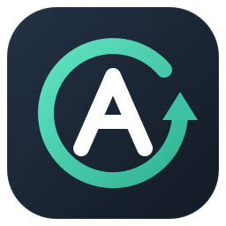
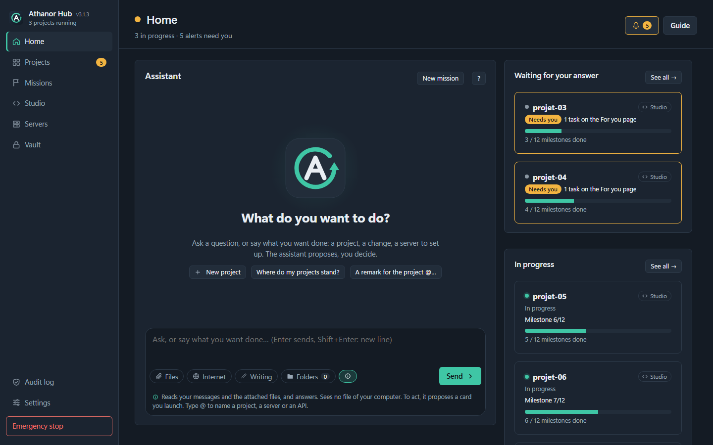
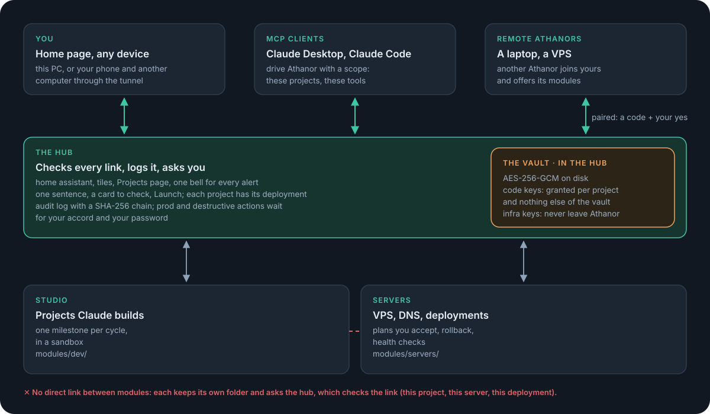

<p align="center">
  
</p>

<h1 align="center">Athanor Hub</h1>

<h3 align="center">One hub on your PC: Claude Code builds your projects, puts them online, and never holds the keys.</h3>

<p align="center">
  <i>The athanor was the alchemist's furnace, built to burn for days without going out and without anyone tending it.</i>
</p>

<p align="center">
  <a href="LICENSE"></a>
  
  <a href="https://claude.com/claude-code"></a>
  
  
</p>

<p align="center">
  <a href="#what-it-can-do-for-you"><b>What it can do</b></a> ·
  <a href="#quick-start"><b>Quick start</b></a> ·
  <a href="#guides"><b>Guides</b></a> ·
  <a href="#security-in-short"><b>Security</b></a> ·
  <a href="docs/FAQ.md"><b>FAQ</b></a> ·
  <a href="docs/releases/3.1.7.md"><b>What's new</b></a> ·
  <a href="README.fr.md"><b>Français</b></a>
</p>

<p align="center">
  <a href="https://github.com/Aprilox/Athanor/releases/latest"></a>
</p>

<p align="center">
  
</p>

Athanor Hub is a **hub**: one program, one window, from which you drive **modules** that work together, without ever reaching each other's data or secrets. **Studio** runs [Claude Code](https://claude.com/claude-code) cycle after cycle on your own PC, with your own Claude subscription, until a game, a website, an app or a tool is delivered. **Servers** prepares your VPS, its DNS and its certificates, and puts online what Studio builds. The **vault** keeps every key encrypted, and gives each project only what you grant it. One sentence on the home page can set them all to work:

> *Make a site for the Martin bakery and put it online at martin.fr on my VPS.*

Athanor answers with a **card**: the project Studio will build, with its folder, and its deployment (the server, the address, the API keys it needs, the plan in your words, when to deploy). You press **Launch**. Your VPS is prepared while the site is built, the first deployment is made by itself, then the project goes online at the moment you chose, after each milestone or at delivery, and is checked from outside. The AI asks; Athanor acts with the key, which it never hands over. You can close the app, lock it or go to bed: the furnace keeps burning.

> [!TIP]
> **3.0 is a turning point.** Athanor was a pilot that built one project with Claude; it becomes a hub that also sets up and runs your servers (an autonomous servers pilot, a deployment your plan decides), keeps every key out of the AI's reach, and ties it all in missions, from your computer or your phone. The Studio still works alone, as before. [What's new in 3.0.0](docs/releases/3.0.0.md).

> [!NOTE]
> Athanor is an independent, source-available project. It is not affiliated with or endorsed by Anthropic. It drives the official Claude Code CLI with your own subscription. The program, its download files and its data folder keep the name *Athanor*, so every older Athanor updates to Athanor Hub by itself.

---

## What it can do for you

- **Build a whole project while you do something else.** Describe a game, a website, an app or a tool in your own words. Claude Code works cycle after cycle, one milestone each time, tests and commits, for hours or days, until it is delivered: usage limits, errors, restarts and nights included.
- **Go faster, or spend less.** Parallel mode puts up to 10 workers on independent milestones at once, eco mode spares the quota, fast mode keeps the full check for the end; several computers can even build one project together through its GitHub repository.
- **A real team, real tools.** A project lead with scouts, an architect, developers, a tester and a critic; skills and MCP servers from a verified catalog; your PC's software (Unreal Engine, Blender, the Android SDK, Docker) through a controlled bridge.
- **Put it online on your own servers.** Add a VPS: Athanor reads it, prepares it, sets its DNS and HTTPS through Cloudflare, deploys after each milestone or at delivery, checks the site every 15 minutes and goes back to the previous version in one click.
- **Run your servers by asking.** A mission on servers alone (*install nginx on web-1 and PostgreSQL on db-1, and link them*): a servers pilot cuts it into milestones, proposes each change and asks you before anything risky, or works on its own if you allow it.
- **Keep every key out of the AI's reach.** API keys, tokens and SSH keys live in an encrypted vault; each project gets exactly the keys you tick; the AI asks, Athanor acts with the key, and every action goes into an audit log.
- **Follow everything from anywhere.** One home page and one bell for all of it; your phone, paired by a code, shows the same Athanor and tells you when Claude needs you or a project is delivered; Claude Desktop can drive Athanor through its MCP.
- **What Claude cannot do, it asks you.** Creating an account, paying, a code received by SMS become tasks with exact steps on *For you*, while Claude carries on with the rest.

---

## The modules

| Module | What it does | Where |
|---|---|---|
| **[The hub](docs/HUB.md#the-hub)** | The home page: a conversation with an assistant that knows Athanor, one tile per module with its live figures, what is in progress and what needs you. One bell for every alert, one *Projects* page for everything under way, a Guide and a short tutorial for each part. | *Home*, *Projects* |
| **[Studio](docs/STUDIO.md#studio-projects-claude-builds)** | The projects Claude builds, one milestone per cycle: plan, team of sub-agents, parallel, eco and fast modes, several computers on one project, skills and MCP servers, GitHub, tasks for you. | *Studio* |
| **[Vault and access](docs/VAULT.md#vault-and-access)** | Your keys, tokens and settings, encrypted and sorted into your own categories. *Paste* a `.env` block and each key is recognised; *Test* checks it with its own service. Tick a key for a project (or drag it there): the pilot gets exactly that. | *Vault*, *Studio › Access* |
| **[Servers](docs/SERVERS.md#servers)** | Your VPS and home servers: a sheet read in a minute, an ops agent that proposes plans you accept, Cloudflare DNS and HTTPS, deployments with a one-click rollback, health checks every 15 minutes. | *Servers* |
| **[Missions](docs/HUB.md#missions)** | One form links a Studio project, its servers and API keys (or servers only): what to do, the project, the server with one of three choices (*Needs me*, *Autonomous with the AI* or *Full autonomy*), the key; *Launch*. Each mission has its frame: the project and its milestones, the server and its state (terminal, stop, launch again), the key; pause, stop, resume, edit and delete in any state. | *Missions* |
| **[Deployment and approvals](docs/SERVERS.md#deployment-and-approvals)** | Each project has one *Deployment* tab: a server, an address, a plan in your words and when to deploy; Athanor prepares the server and puts the project online. Every agent request comes to you as an approval; everything is written to a chained audit log; one red button stops it all. | *Studio › Deployment*, *For you*, *Audit log* |
| **[MCP and remote Athanors](docs/HUB.md#mcp-and-remote-athanors)** | Claude Desktop or Claude Code drive Athanor through its MCP; another Athanor (a laptop, a VPS running Servers alone) joins yours. Always paired by a code **and** your yes on screen. | *Settings* |

Each module keeps its own data (`modules/<name>/` in Athanor's folder) and talks to the others only through the hub, which checks, logs, and asks you when it matters. *Guide › Finding your way* walks through it, in the window and in the [terminal](docs/HUB.md#in-a-terminal).

---

<p align="center">
  
</p>

## Quick start

**You need:** Windows 10/11, Linux or macOS, and a Claude subscription (Pro, Max or Team).

### 1. Get Athanor

One file (a zip on the Mac). From the [**latest release**](https://github.com/Aprilox/Athanor/releases/latest):

| Your system | Download |
|---|---|
| **Windows 10 / 11** | [**Athanor-Windows-x64.exe**](https://github.com/Aprilox/Athanor/releases/latest/download/Athanor-Windows-x64.exe) (an ARM PC, Snapdragon…: [Athanor-Windows-ARM64.exe](https://github.com/Aprilox/Athanor/releases/latest/download/Athanor-Windows-ARM64.exe)) |
| **macOS** 11 or later | [**Athanor-macOS.zip**](https://github.com/Aprilox/Athanor/releases/latest/download/Athanor-macOS.zip): **Athanor.app**, for Apple Silicon and Intel Macs alike; see [macOS, step by step](#macos-step-by-step) |
| **Linux** | [**Athanor-Linux-x64**](https://github.com/Aprilox/Athanor/releases/latest/download/Athanor-Linux-x64) (an ARM PC: [Athanor-Linux-ARM64](https://github.com/Aprilox/Athanor/releases/latest/download/Athanor-Linux-ARM64)) |

Keep the file wherever you like (the Desktop, for example; on the Mac, Athanor.app in *Applications*): it is how you open Athanor, and it never writes anything next to itself.

> [!TIP]
> Windows SmartScreen may show *"Windows protected your PC"* the first time, because the app is not code-signed. Click *More info → Run anyway*.

### 2. First launch

The first time, Athanor says where it will keep its files and asks before writing anything (*No*: it closes, nothing was written):

| System | Athanor's folder |
|---|---|
| Windows | `%LOCALAPPDATA%\Athanor` |
| Linux | `~/.local/share/athanor` |
| macOS | `~/Library/Application Support/Athanor` |

Everything of its own goes there: its copy of the executable, its settings and your token, its logs, the tools it installs. In your projects it only adds a `.athanor/` folder.

**Windows**

1. Double-click **`Athanor-Windows-x64.exe`**, then *Yes*. Pick a language, a place for the shortcut (the Desktop by default), a theme and an accent: the first-launch guide takes you through the rest.
2. **Install**: a fresh install starts in **native Windows** (nothing else to install: *Install everything* puts Git for Windows, Python, Node.js, a few small tools and Claude Code for Windows). For Claude in a sandbox, open the **WSL** tab of *Setup & health*: *Install everything* there installs WSL2, Claude Code and the sandbox (Linux asks for a password once; the very first time may need a restart, then open "Ubuntu" once to create your user and run the installation again). A short tour then shows the mode, *Setup & health*, a new project and *Start*.
3. **Connect**: *Setup & health* → *Check everything*. On the *Token and model access* line, click *Repair*: a window signs you in to your Claude account. Paste the token in *Settings*.
4. **Optional, recommended**: *Setup & health* → *Administrator rights for installations* → *Repair*. Windows asks for your consent **once**; Claude never needs a UAC click again.
5. **Add a project**: a name, its folder (existing or new, on any drive) and what you want. Technologies are free unless you impose some. ✨ *Improve with Claude* turns a few words into a complete request; you can go back to yours.
6. **Start.** Add more projects the same way and run them side by side.
7. **GitHub** (optional): *Settings → Options → GitHub → Connect to GitHub*, once; then *Manage → GitHub* links each project to a repository (see [GitHub](docs/STUDIO.md#github) below, and the in-app *Guide*).

**Linux** (everything runs natively, without WSL)

```bash
chmod +x Athanor-Linux-x64    # once: a downloaded file is not executable yet
./Athanor-Linux-x64           # the app, in an application window of Chrome/Edge/Chromium, else your browser
./Athanor-Linux-x64 tui       # a computer without a screen (through SSH: by itself): its state, and pairing your phone
```

Then *Setup & health* → *Install everything* (Claude Code, the sandbox and the tools; Linux asks for your password once), the token in *Settings*, a project and *Start*, as on Windows (steps 3, 5 and 6).

#### macOS, step by step

1. Download [**Athanor-macOS.zip**](https://github.com/Aprilox/Athanor/releases/latest/download/Athanor-macOS.zip). Safari opens it by itself: **Athanor.app** is in *Downloads* (with another browser, double-click the zip once). An application is a folder, which is why it travels zipped. Athanor.app works from *Downloads*; in *Applications* it is at home (macOS then reopens it from there after an update and at login).
2. Open Athanor.app (a double-click). The first time, macOS says it cannot check the app, because it is not signed by Apple: click *Done*, open *System Settings → Privacy & Security*, scroll down to *"Athanor" was blocked* and click **Open Anyway**, then your password. Once only.
3. *Create*: Athanor's folder is made, then its window opens. Right after the language, it offers a shortcut in *Applications*: the downloaded Athanor.app is then no longer needed.
4. *Setup & health* → *Install everything*, *Check everything*, then the *Token* line → *Repair*, and paste the token in *Settings*.
5. Add a project and *Start*.

What *Install everything* puts on the Mac, its window and its sandbox: [macOS in detail](docs/REFERENCE.md#macos-in-detail).

### 3. Your first ten minutes

1. **Home.** Athanor opens on its hub. Ask the assistant anything about Athanor, or say what you want done: it proposes a card, and nothing starts before you press *Launch*. *Guide*, beside the bell, opens the Guide; each module (Home, Studio, the Vault, Servers) shows a short tour on your first visit, replayed from *Guide › Tutorials*.
2. **A password.** *Settings → Options → Lock*. It locks the app, protects the vault's server keys and is asked again for every approval: set it before adding a server. Not set yet? The first action that needs it (giving a key to a project, for instance) asks you to choose it on the spot.
3. **The vault.** *Vault → Paste*: a `.env` block, a token or an MCP configuration. Athanor recognises each key and keeps it encrypted; *Test* checks it with its own service. The keys of your existing projects are already there (imported at the first start, nothing changed for their pilots).
4. **A project.** *Studio → New project*: a name and what you want, in your words; the folder is proposed for you (✨ *Improve with Claude* turns a few words into a complete request), then *Start*. Its *Access* tab says which vault keys the pilot gets.
5. **Optional: a server.** *Servers → Add a server*: its address, then its fingerprint to confirm, then a key. Its sheet appears a minute later. Try it first on a server of no importance ([docs/SERVEUR_DE_TEST.md](docs/SERVEUR_DE_TEST.md)).
6. **Optional: put it online.** The project's *Deployment* tab: choose the server and the address, say in your words what to set up, and save. Or say it on *Home*, in one sentence that names the project and the server with `@`: check the card and *Launch*.

### 4. Updating

**From the app**: when a new version is out, an *Update to X.Y.Z* button shows at the top of the window (Athanor looks when it opens; *Settings → Options → Version* looks now, and can stop looking at opening). *Update now* downloads the file of your system, checks it against the release's checksums, then Athanor closes, puts the new version in place and opens again. Running pilots go on.

**By hand**: close Athanor, download the new file and open it: it updates Athanor's folder the same way. On the Mac, Athanor.app is downloaded once: its updates then come from the app (an older Athanor.app opens the newer Athanor kept in Athanor's folder).

Your token, settings, projects, `logs/` and `tools/` are never touched by an update ([what an update keeps and cleans](docs/REFERENCE.md#what-an-update-keeps)).

<details>
<summary><b>Build it yourself</b> (from the source code)</summary>

With [Go](https://go.dev/dl/) 1.27.4 or later (Go 1.21 or later downloads 1.27.4 by itself; no Go? `winget install GoLang.Go`, `sudo apt install golang-go` or `brew install go`):

```bash
git clone https://github.com/Aprilox/Athanor.git
cd Athanor/app
go run . construire
```

The same on Windows (PowerShell), Linux and macOS: it builds `Athanor.exe` and `athanor` into the `Athanor` folder, each carrying everything a release carries. Run there, a copy of the source code is its own tool folder (its `template/` is used as it is); update it with `git pull` and `go run . construire` again. `go run . construire --all` builds every system into `dist/`, the files a release publishes, and `dist/Athanor.app` (both Mac executables in one). The app only uses Go's standard library plus four vendored packages (the WebView2 window on Windows, the Dock icon on the Mac), so building needs no network access once the source is on your disk.
</details>

---

## Guides

| Guide | What you find there |
|---|---|
| [The hub](docs/HUB.md) | Home and *Projects*, finding your way, missions, the home assistant, remote access from a phone, MCP clients and remote Athanors, the terminal interface |
| [Studio](docs/STUDIO.md) | How the pilot builds a project milestone by milestone: parallel, eco and fast modes, saving the quota, several computers, the team, the pages, GitHub, what Claude can and cannot do |
| [Vault and access](docs/VAULT.md) | The encrypted vault and the keys each project receives |
| [Servers and deployment](docs/SERVERS.md) | Adding a server, the ops agent and its plans, a project's deployment, approvals, the audit log and the emergency stop |
| [Security model](docs/SECURITY.md) | What Athanor guards against and what it does not, the eight rules and how each one is proved, the sandbox |
| [Reference](docs/REFERENCE.md) | Every setting, the commands without the app, Athanor's folder, the repository, releasing |
| [FAQ and troubleshooting](docs/FAQ.md) | Cost, quota, updates, and the fixes for the usual problems |

In depth: [deployments](docs/DEPLOY.md), [missions](docs/MISSIONS.md), [Cloudflare](docs/CLOUDFLARE.md), [MCP clients](docs/MCP.md), [remote Athanors](docs/REMOTE.md), [the Servers module alone](docs/MODULE.md), [a test server](docs/SERVEUR_DE_TEST.md), [a new machine](docs/MACHINE_NEUVE.md); what is new in each version: [docs/releases](docs/releases/). In the app, the *Guide* covers the same ground in every language.

---

## Security in short

Every guard is in Athanor's own code, never in an instruction to Claude, so it holds even if an agent obeys an attacker.

- **Keys stay out of the AI's reach.** A project's agent receives only the keys you granted it; server keys and infrastructure tokens never leave Athanor: the AI asks, Athanor acts with the key.
- **The vault is encrypted** (AES-256-GCM) and opens with your password; while it is locked, no infrastructure action runs.
- **Production and destructive actions wait for you**, with Athanor's password, and every action between modules goes into an audit log whose chain shows any change.
- **Nothing listens on the network** but `127.0.0.1`: remote access goes through a tunnel, to devices paired with a code and your yes on screen.
- **Claude works in a sandbox** (bubblewrap and seccomp on Linux and WSL, Seatbelt on macOS) and writes only in the project; the native Windows mode has none, and says so.

The eight rules, how each one is tested, and what Athanor does not guard against: [Security model](docs/SECURITY.md). Found a vulnerability? Please open a [private security advisory](https://github.com/Aprilox/Athanor/security/advisories/new) rather than a public issue.

---

## Contributing

Issues and pull requests are welcome. Before opening one:

- `cd app && go vet . && GOOS=windows go vet .` must pass, as well as `go test ./...`.
- Comments and user-facing strings are in English. Some internal identifiers are in French, because the project started in French; keep the existing names when you touch them. New interface strings go through `t()` and get their translations in [`app/static/i18n.js`](app/static/i18n.js).

## Acknowledgements

- [Claude Code](https://claude.com/claude-code), which does the actual work.
- [Ponytail](https://github.com/dietrichgebert/ponytail) by Dietrich Gebert (MIT), whose rules Athanor carries (`app/ponytail.go`), and [RTK](https://github.com/rtk-ai/rtk) (Apache 2.0), downloaded at installation, which compresses the command outputs.
- [VirtualDesktop](https://github.com/MScholtes/VirtualDesktop) by Markus Scholtes (MIT), compiled on first use: fallback when the "Claude" desktop cannot be created (windows moved to a virtual desktop).
- [go-webview2](https://github.com/jchv/go-webview2) (MIT) for the Windows window, [purego](https://github.com/ebitengine/purego) (Apache 2.0) for the Mac's Dock icon, and [bubblewrap](https://github.com/containers/bubblewrap) for the sandbox.
- [cloudflared](https://github.com/cloudflare/cloudflared) (Apache 2.0), downloaded on first use, for the remote-access tunnel, and [rsc.io/qr](https://github.com/rsc/qr) (BSD-3-Clause) for its QR codes.
- [xterm.js](https://github.com/xtermjs/xterm.js) and its fit add-on (MIT), copied into `app/static/xterm` with their licence, which draw the servers' terminal.
- The Go [x/crypto](https://pkg.go.dev/golang.org/x/crypto) and [x/sys](https://pkg.go.dev/golang.org/x/sys) packages (BSD-3-Clause), for SSH connections to servers and system calls.

## License

© 2026 Aprilox. All rights reserved. Athanor is source-available, not open source: every version of it is licensed under the [PolyForm Strict License 1.0.0](https://polyformproject.org/licenses/strict/1.0.0) with additional terms: an additional permission and an attribution condition ([LICENSE](LICENSE)).

- **Free to use**, for any noncommercial purpose (personal, hobby, study, research, education, charities…), and for a commercial purpose when it is free of charge (nobody pays for the software, for access to it or for its use) and what you create with it is not intended to be sold (work for a paying client included).
- **Attribution, always**: every project made or changed with Athanor carries the line *Made with Athanor (https://github.com/Aprilox/Athanor), created by Aprilox.* in its README and in a `NOTICE` file at the root of its code, kept in every copy shared or published. The files Athanor writes into a project (its guides in `.athanor/`) may be published with it, unchanged.
- **On request**: changing it, reusing any part of its code in another work, sharing or distributing it, any other commercial use. Ask in an issue ([CONTRIBUTING.md](CONTRIBUTING.md)); only a written permission from Aprilox counts.
- **Reserved to Aprilox**: selling or distributing it, or any work based on it, for a fee, and using its code to build a paid third-party tool.
- Third-party components keep their own licenses (Acknowledgements above). Versions up to 2.51.0 were first published under the MIT License; since 2.51.1, every version, those included, is offered only under this license, and copies obtained under the MIT License before then keep it.
