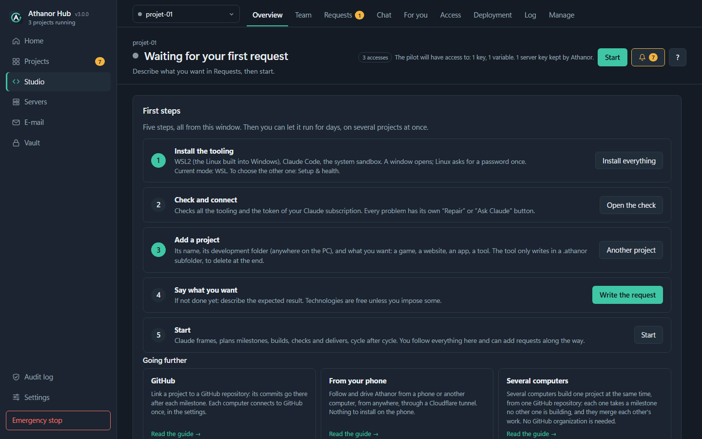
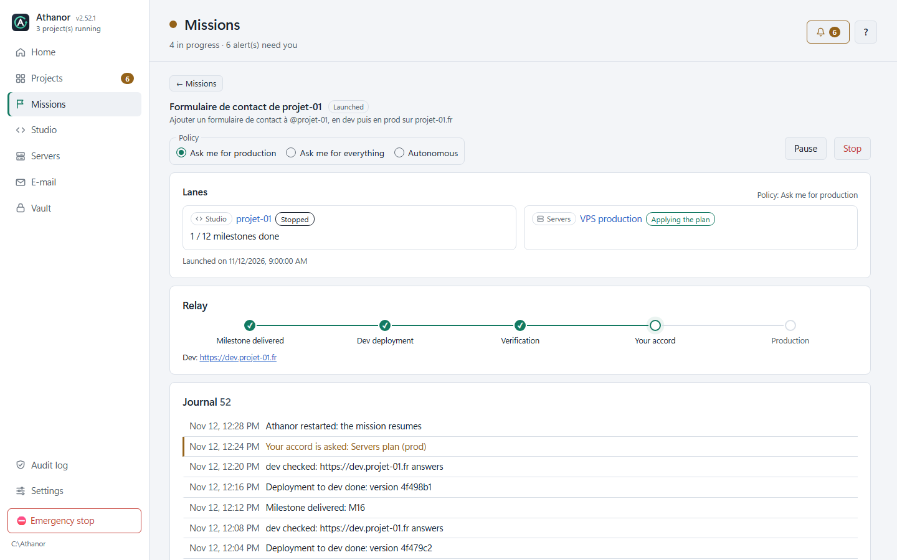
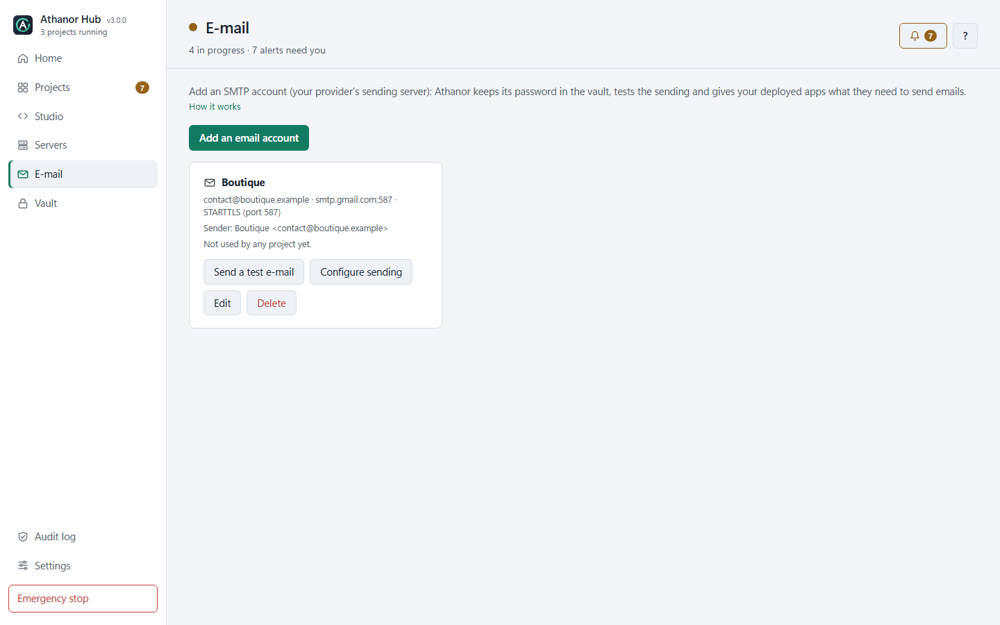

<p align="center">
  
</p>

<h1 align="center">Athanor Hub</h1>

<h3 align="center">One hub on your PC: Claude Code builds your projects, puts them online, and never holds the keys.</h3>

<p align="center">
  <i>The athanor was the alchemist's furnace, built to burn for days without going out and without anyone tending it.</i>
</p>

<p align="center">
  <a href="LICENSE"></a>
  
  <a href="https://claude.com/claude-code"></a>
  
  
</p>

<p align="center">
  <a href="#quick-start"><b>Quick start</b></a> ·
  <a href="#the-hub"><b>The hub</b></a> ·
  <a href="#studio-projects-claude-builds"><b>Studio</b></a> ·
  <a href="#vault-and-access"><b>Vault</b></a> ·
  <a href="#servers"><b>Servers</b></a> ·
  <a href="#missions-and-approvals"><b>Missions</b></a> ·
  <a href="#e-mail"><b>E-mail</b></a> ·
  <a href="#mcp-and-remote-athanors"><b>MCP</b></a> ·
  <a href="#security-model"><b>Security</b></a> ·
  <a href="#faq"><b>FAQ</b></a> ·
  <a href="README.fr.md"><b>Français</b></a>
</p>

<p align="center">
  <a href="https://github.com/Aprilox/Athanor/releases/latest"></a>
</p>

<p align="center">
  
</p>

Athanor Hub is a **hub**: one program, one window, from which you drive **modules** that work together on **missions**, without ever reaching each other's data or secrets. **Studio** runs [Claude Code](https://claude.com/claude-code) cycle after cycle on your own PC, with your own Claude subscription, until a game, a website, an app or a tool is delivered. **Servers** prepares your VPS, its DNS and its certificates, and deploys what Studio builds. The **vault** keeps every key encrypted, and gives each project only what you grant it. One sentence on the home page can set them all to work:

> *Make a site for the Martin bakery and put it online at martin.fr on my VPS.*

Athanor answers with a **mission card**: what Studio will build, what Servers will prepare (DNS, certificates, reverse proxy, protection, firewall), which keys each one gets, and when it will ask for your accord. You press **Launch**. Your VPS is prepared while the site is built; each milestone is deployed and checked from outside, and the site goes live when you say so. The AI asks; Athanor acts with the key, which it never hands over. You can close the app, lock it or go to bed: the furnace keeps burning.

> [!NOTE]
> Athanor is an independent, source-available project. It is not affiliated with or endorsed by Anthropic. It drives the official Claude Code CLI with your own subscription. The program, its download files and its data folder keep the name *Athanor*, so every older Athanor updates to Athanor Hub by itself.

---

## The modules

| Module | What it does | Where |
|---|---|---|
| **[The hub](#the-hub)** | The home page: a conversation with an assistant that knows Athanor, one tile per module with its live figures, what is in progress and what needs you. One bell for every alert, one *Projects* page for everything under way, a Guide and a short tutorial for each part. | *Home*, *Projects* |
| **[Studio](#studio-projects-claude-builds)** | The projects Claude builds, one milestone per cycle: plan, team of sub-agents, parallel, eco and fast modes, several computers on one project, skills and MCP servers, GitHub, tasks for you. | *Studio* |
| **[Vault and access](#vault-and-access)** | Your keys, tokens and settings, encrypted. *Paste* a `.env` block and each key is recognised; *Test* checks it with its provider. Tick a key for a project (or drag it there): the pilot gets exactly that. | *Vault*, *Studio › Access* |
| **[Servers](#servers)** | Your VPS and home servers: a sheet read in a minute, an ops agent that proposes plans you accept, Cloudflare DNS and HTTPS, deployments with a one-click rollback, health checks every 15 minutes. | *Servers* |
| **[Missions and approvals](#missions-and-approvals)** | One sentence, several modules: a card to check, *Launch*, then lanes and a relay up to production. Every agent request comes to you as an approval; everything is written to a chained audit log; one red button stops it all. | *Home*, *Missions*, *For you*, *Audit log* |
| **[E-mail](#e-mail)** | The SMTP accounts your deployed apps send through: a test in one click, the settings given to a project's environment, the password kept in the vault. | *E-mail* |
| **[MCP and remote Athanors](#mcp-and-remote-athanors)** | Claude Desktop or Claude Code drive Athanor through its MCP; another Athanor (a laptop, a VPS running Servers alone) joins yours. Always paired by a code **and** your yes on screen. | *Settings* |

Each module keeps its own data (`modules/<name>/` in Athanor's folder) and talks to the others only through the hub, which checks, logs, and asks you when it matters. *Guide › Finding your way* walks through it, in the window and in the [terminal](#in-a-terminal).

---

<p align="center">
  
</p>

## Quick start

**You need:** Windows 10/11, Linux or macOS, and a Claude subscription (Pro, Max or Team).

### 1. Get Athanor

One file (a zip on the Mac). From the [**latest release**](https://github.com/Aprilox/Athanor/releases/latest):

| Your system | Download |
|---|---|
| **Windows 10 / 11** | [**Athanor-Windows-x64.exe**](https://github.com/Aprilox/Athanor/releases/latest/download/Athanor-Windows-x64.exe) (an ARM PC, Snapdragon…: [Athanor-Windows-ARM64.exe](https://github.com/Aprilox/Athanor/releases/latest/download/Athanor-Windows-ARM64.exe)) |
| **macOS** 11 or later | [**Athanor-macOS.zip**](https://github.com/Aprilox/Athanor/releases/latest/download/Athanor-macOS.zip): **Athanor.app**, for Apple Silicon and Intel Macs alike; see [macOS, step by step](#macos-step-by-step) |
| **Linux** | [**Athanor-Linux-x64**](https://github.com/Aprilox/Athanor/releases/latest/download/Athanor-Linux-x64) (an ARM PC: [Athanor-Linux-ARM64](https://github.com/Aprilox/Athanor/releases/latest/download/Athanor-Linux-ARM64)) |

Keep the file wherever you like (the Desktop, for example; on the Mac, Athanor.app in *Applications*): it is how you open Athanor, and it never writes anything next to itself.

> [!TIP]
> Windows SmartScreen may show *"Windows protected your PC"* the first time, because the app is not code-signed. Click *More info → Run anyway*.

### 2. First launch

The first time, Athanor says where it will keep its files and asks before writing anything (*No*: it closes, nothing was written):

| System | Athanor's folder |
|---|---|
| Windows | `%LOCALAPPDATA%\Athanor` |
| Linux | `~/.local/share/athanor` |
| macOS | `~/Library/Application Support/Athanor` |

Everything of its own goes there: its copy of the executable, its settings and your token, its logs, the tools it installs. In your projects it only adds a `.athanor/` folder.

**Windows**

1. Double-click **`Athanor-Windows-x64.exe`**, then *Yes*. Pick a language, a place for the shortcut (the Desktop by default), a theme and an accent: the first-launch guide takes you through the rest.
2. **Install**: a fresh install starts in **native Windows** (nothing else to install: *Install everything* puts Git for Windows, Python, Node.js, a few small tools and Claude Code for Windows). For Claude in a sandbox, open the **WSL** tab of *Setup & health*: *Install everything* there installs WSL2, Claude Code and the sandbox (Linux asks for a password once; the very first time may need a restart, then open "Ubuntu" once to create your user and run the installation again). A short tour then shows the mode, *Setup & health*, a new project and *Start*.
3. **Connect**: *Setup & health* → *Check everything*. On the *Token and model access* line, click *Repair*: a window signs you in to your Claude account. Paste the token in *Settings*.
4. **Optional, recommended**: *Setup & health* → *Administrator rights for installations* → *Repair*. Windows asks for your consent **once**; Claude never needs a UAC click again.
5. **Add a project**: a name, its folder (existing or new, on any drive) and what you want. Technologies are free unless you impose some. ✨ *Improve with Claude* turns a few words into a complete request; you can go back to yours.
6. **Start.** Add more projects the same way and run them side by side.
7. **GitHub** (optional): *Settings → Options → GitHub → Connect to GitHub*, once; then *Manage → GitHub* links each project to a repository (see [GitHub](#github) below, and the in-app *Guide*).

**Linux** (everything runs natively, without WSL)

```bash
chmod +x Athanor-Linux-x64    # once: a downloaded file is not executable yet
./Athanor-Linux-x64           # the app, in an application window of Chrome/Edge/Chromium, else your browser
./Athanor-Linux-x64 tui       # the same app in the terminal (through SSH or without a screen: by itself)
```

Then *Setup & health* → *Install everything* (Claude Code, the sandbox and the tools; Linux asks for your password once), the token in *Settings*, a project and *Start*, as on Windows (steps 3, 5 and 6).

#### macOS, step by step

1. Download [**Athanor-macOS.zip**](https://github.com/Aprilox/Athanor/releases/latest/download/Athanor-macOS.zip). Safari opens it by itself: **Athanor.app** is in *Downloads* (with another browser, double-click the zip once). An application is a folder, which is why it travels zipped. Athanor.app works from *Downloads*; in *Applications* it is at home (macOS then reopens it from there after an update and at login).
2. Open Athanor.app (a double-click). The first time, macOS says it cannot check the app, because it is not signed by Apple: click *Done*, open *System Settings → Privacy & Security*, scroll down to *"Athanor" was blocked* and click **Open Anyway**, then your password. Once only.
3. *Create*: Athanor's folder is made, then its window opens. Right after the language, it offers a shortcut in *Applications*: the downloaded Athanor.app is then no longer needed.
4. *Setup & health* → *Install everything*, *Check everything*, then the *Token* line → *Repair*, and paste the token in *Settings*.
5. Add a project and *Start*.

**What *Install everything* puts on the Mac**, through the official installers only: [Homebrew](https://brew.sh) if it is missing (its own installer asks for your password and Enter); seven command-line tools through Homebrew: `git`, `jq`, `ripgrep`, `node`, `imagemagick`, `ffmpeg`, `gh`; Claude Code (Anthropic's installer, into `~/.local/bin`, with one line in `~/.zshrc`); RTK, which shortens command output to save tokens, into Athanor's folder. Nothing with a window, nothing that starts by itself. The sandbox is macOS's own (Seatbelt): only checked. Everything is written to `logs/install-mac.log` in Athanor's folder.

**Its window is its own**, the Mac's web engine (WebKit) inside Athanor: no browser opens. **While it runs**, Athanor has its icon in the Dock and a flame near the clock (the menu bar); both show the pilots at work and open the window again. The red button hides the window: Athanor goes on. **Quit** (⌘Q, or the Dock icon's menu) with pilots running offers to keep Athanor in the menu bar (the Dock icon goes, the pilots go on, the flame stays) or to stop them and quit; *Quit* from the flame quits, the pilots going on or not, as you choose. The Mac stays awake while a pilot runs (`caffeinate`; a closed MacBook still sleeps, unless it is plugged in with an external screen).

Claude works in Seatbelt, the sandbox built into macOS (the same one Claude Code uses): it only writes in the project. The MCP servers have a Seatbelt cage of their own. Unreal, Blender, Roblox Studio, Xcode and the Android SDK are found in their usual places and Claude runs them directly; Windows programs and Docker through `tool` are Windows and Linux only. On the Mac, the programs Claude opens show on your screen (there is no separate desktop as on Windows).

### 3. Your first ten minutes

1. **Home.** Athanor opens on its hub. Ask the assistant anything about Athanor, or say what you want done: it proposes a card, and nothing starts before you press *Launch*. The *?* beside the bell opens the Guide; each module (Home, Studio, the Vault, Servers, E-mail, Missions) shows a short tour on your first visit, replayed from *Guide › Tutorials*.
2. **A password.** *Settings → Options → Lock*. It locks the app, protects the vault's server keys and is asked again for every approval: set it before adding a server. Not set yet? The first action that needs it (giving a key to a project, for instance) asks you to choose it on the spot.
3. **The vault.** *Vault → Paste*: a `.env` block, a token or an MCP configuration. Athanor recognises each key and keeps it encrypted; *Test* checks it with its provider. The keys of your existing projects are already there (imported at the first start, nothing changed for their pilots).
4. **A project.** *Studio → New project*: a name, a folder and what you want, in your words (✨ *Improve with Claude* turns a few words into a complete request), then *Start*. Its *Access* tab says which vault keys the pilot gets, environment by environment.
5. **Optional: a server.** *Servers → Add a server*: its address, then its fingerprint to confirm, then a key. Its sheet appears a minute later. Try it first on a server of no importance ([docs/SERVEUR_DE_TEST.md](docs/SERVEUR_DE_TEST.md)).
6. **Optional: a mission.** Back on *Home*, one sentence that names a project or a server with `@`, then *Create a mission*, check the card and *Launch*.

### 4. Updating

**From the app**: when a new version is out, an *Update to X.Y.Z* button shows at the top of the window (Athanor looks when it opens; *Settings → Options → Version* looks now, and can stop looking at opening). *Update now* downloads the file of your system, checks it against the release's checksums, then Athanor closes, puts the new version in place and opens again. Running pilots go on.

**By hand**: close Athanor, download the new file and open it: it updates Athanor's folder the same way. On the Mac, Athanor.app is downloaded once: its updates then come from the app (an older Athanor.app opens the newer Athanor kept in Athanor's folder).

Your token, settings, projects, `logs/` and `tools/` are never touched by an update. An installation made before 2.26 (a folder with `Athanor.exe`, `template/` and `athanor-config.json` side by side) stays where it is: put the new executable in it, or use the button. An update also cleans such a folder up: the files of the older versions that no version uses any more (`commands/`, the bash and Python scripts of `system/`, `docs/`, the README…) go when they are exactly as shipped; one you changed is moved into `logs/ancien-kit/<date>/`, and `logs/nettoyage-<date>.txt` lists what went. Nothing else of the folder is touched.

<details>
<summary><b>Build it yourself</b> (from the source code)</summary>

With [Go](https://go.dev/dl/) 1.27.4 or later (Go 1.21 or later downloads 1.27.4 by itself; no Go? `winget install GoLang.Go`, `sudo apt install golang-go` or `brew install go`):

```bash
git clone https://github.com/Aprilox/Athanor.git
cd Athanor/app
go run . construire
```

The same on Windows (PowerShell), Linux and macOS: it builds `Athanor.exe` and `athanor` into the `Athanor` folder, each carrying everything a release carries. Run there, a copy of the source code is its own tool folder (its `template/` is used as it is); update it with `git pull` and `go run . construire` again. `go run . construire --all` builds every system into `dist/`, the files a release publishes, and `dist/Athanor.app` (both Mac executables in one). The app only uses Go's standard library plus four vendored packages (the WebView2 window on Windows, the Dock icon on the Mac), so building needs no network access once the source is on your disk.
</details>

---

## The hub

**Home** is the page Athanor opens on: a conversation with the [home assistant](#the-home-assistant), one tile per module with its state and live figures (Studio: projects running, milestones done today, projects that need you, quota; Servers, Missions, E-mail…), each figure opening its page, and *In progress*: what waits for you first, then what is working, with *See all*. The *Missions* block shows the last three missions.

**Projects** lists everything under way in every module: its state, its progress, what it is doing now (“Milestone 5/14: …”), what waits for you and why, a direct link; filters *All*, *Needs me*, *In progress*; *New project*, *Join a project*, the archived projects. The projects of a [remote Athanor](#mcp-and-remote-athanors) come in as `name@instance`.

**Finding your way**: the menu on the left has one level: *Home*, *Projects*, one entry per module (**Studio**, the projects Claude builds, the **Vault**, **Servers**, **E-mail**, **Missions**), the *Audit log* and *Settings* at the bottom; a module's entry reopens the page you last saw in it. A module's pages are tabs at the top: Studio's (the project picker, then Overview, Team, Requests, Chat, For you, Access, Log, Manage) are the pages described above; Settings holds Settings, Skills & MCP, Setup & health and Remote. On a phone, ☰ opens the menu and the tabs scroll sideways. The **bell**, at the top of every page, gathers what needs you in every module, one line each with its reason: *View* opens the right page, *Ignore* hides the line without deleting anything (*Ignored alerts* keeps it, *Reopen* brings it back, and it returns by itself when its reason changes). The **?** beside it opens the Guide. **Tutorials**: Home, Studio and the Vault each show a short tour on your first visit; the Guide's *Tutorials* replays them and *Settings → Options* shows them all again. The update to the hub moves nothing: projects, settings, keys and old links stay where they were. The *Missions* block shows the last three missions. *Guide › Finding your way* walks through it, and the terminal opens on the same home page (*H*).

**Only Studio?** Nothing changes: Studio works on its own, for one project or many, as Athanor did before; Servers, E-mail and Missions ask for nothing until you open them. **Deploying from home**: one sentence in the home page's bar (“Put @my-shop online at shop.example.com”) becomes a [mission](#missions) card, Studio builds and Servers prepares where it runs, and nothing starts before you press *Launch*. A Studio project never deploys itself and never asks for a server's access: it ends ready to deploy, and the mission's Servers lane puts it online.

**Start with the computer**: *Open Athanor when the computer starts* opens it with its window, on Windows, in a Linux desktop session and on macOS (at login). With *Restart the pilots that were running*, the projects you started and neither stopped nor saw delivered start again. Launching Athanor while it already runs only brings its window back: there is never a second copy.

**Opening scene**: when Athanor Hub starts, a short scene (the Athanor Hub mark, about two seconds) plays once, then the home page appears; the app loads underneath meanwhile, so it never slows the start. A click, any key or Esc skips it. With a password for Athanor, the scene goes on as the lock screen: the mark stays on screen with a soft glow and a padlock is drawn in line while the password field already has the focus (you can type at once, even during the first part); a wrong password gives a short shake and a message, the right one opens the padlock and the glow spreads into the home page. The scene is decoration only: before the password the page loads no project, key or list, and the data routes stay refused on the Go side. It does not play again when you reload the page or reopen the window, pauses while the window is hidden, becomes a simple fade with *reduce motion* turned on in your system, and is lighter on a phone. *Settings → Options → Startup → Show the launch animation when Athanor Hub starts* turns it off (the lock screen then appears without the scene). The terminal interface (`tui`) has no animation.

### Remote access, from your phone or another computer

**Remote access**: *Remote* → switch it on. Athanor downloads Cloudflare's tunnel program once (`cloudflared`, checked against its release's checksum) and opens a "quick tunnel": an `https://….trycloudflare.com` address, no account. Scan the QR code with your phone's camera (or open the link on another computer), then type the 6-digit code the *Remote* page shows when you move the mouse over it (renewed every 20 seconds): the device becomes trusted and finds the same Athanor, laid out for its screen, live; on a phone, *Add to Home Screen* makes it an app. Everything works from there except what only the computer should do: the secrets, the remote access itself, the password, opening folders on the computer. The *Remote* page lists the devices, connected now or not, and ✕ removes one at once: its next click is refused. While remote access is on, the computer does not go to sleep (the screen can still turn off). The tunnel survives Athanor's restarts (an update), but its address changes when the computer restarts: scan the code again then. Cloudflare gives no uptime guarantee for quick tunnels.

**Notifications on the phone**: on a paired phone, *Remote → This device → Notifications on this device*. The phone then gets a notification even with Athanor closed on it, when Claude needs you, when a milestone is done, when a project is delivered and when a computer of a team is stuck; a tap opens the right page. On an iPhone or iPad, add Athanor to the Home Screen first (iOS 16.4 or later) and switch them on from there.

**Your own domain, a fixed address**: with a free Cloudflare account and a domain whose DNS is at Cloudflare, *Remote → Address → Use my domain* gives an address that never changes (`athanor.example.com`). Athanor opens Cloudflare's sign-in once, in the browser, then creates a tunnel of this computer and points the name to it (an existing DNS record is never replaced); the account's certificate and the tunnel's credentials stay in Athanor's folder. The devices then keep their access across restarts of the computer. The page's guide sets up **Cloudflare Access** in a few clicks of Cloudflare's dashboard: Cloudflare then asks for your e-mail and a code before anything reaches the computer, so a stranger who finds the address does not even see Athanor. *Back to a temporary address* deletes the tunnel at Cloudflare.

**Lock**: with a password (*Settings → Options*), the 🔒 button locks the app. Claude keeps working, but nothing can be seen or changed (token included) without the password, and the app starts locked. The window also locks itself after a time without activity (1 hour by default, *Settings → Options*): only the interface locks, so AIs, missions, tasks and SSH sessions keep running and keep the vault keys without asking for the password again; the 🔒 button and the emergency stop close the vault keys as well.

The interface is translated into English, French, Spanish, German, Italian and Portuguese. The language you choose is also the one Claude writes the plan, log and documents in.

### The home assistant

The home page is a conversation with an assistant that knows Athanor: ask a question, or say what you want done, in your words. *Enter* sends, *Shift+Enter* adds a line, *New conversation* starts again (it forgets this one and its powers are switched off). *@* opens a list of your projects, servers and vault keys, grouped by type with an icon; each group shows 5 entries and then "N more: type to filter". The chip you insert keeps its type, so a project and a server with the same name each point to their own.

- **What it reads.** Only what you give it: your messages, the files you attach (images, PDF and text files, 20 MB at most each) and the folders you point under *What the assistant can do* › *Folders*, each read only or read and write. Its working folder is empty: it sees no project, server or key by itself, only their names and states.
- **Its powers.** *Internet* (search and read the web) and *Writing* (change files, only in the folders set to read and write) are off by default and off again in each new conversation; their summary stays visible under the field. It never runs a command, never uses an MCP server and never reaches a server.
- **What it never sees.** The vault's values (a value pasted in a message or a text file is masked before it reads it, and in every answer of the API), secrets files (`.env`), Athanor's own folders and system folders. A file or a web page that gives it orders is data: it tells you what the text asks and does not follow it.
- **Cards.** To act, it proposes a card: create a project and start its pilot, start a pilot, add a request, leave a remark, prepare a mission, create a sub-agent or an MCP server, switch one on in projects. The card says what, on what and with which accesses; *Launch*, *Change* or *Refuse*. Nothing runs before *Launch*, and each decision goes into the audit log.
- **From a phone.** On a paired device the conversation is read only. The *?* at the top of the conversation replays its short tutorial; *Guide › Talk to the home assistant* has the details.

---

## Studio: projects Claude builds

You describe what you want: a game, a website, an app, a tool. Studio runs Claude Code **cycle after cycle**: every cycle finishes **one milestone of the plan**. Claude does the work, runs the project's checks, ticks the milestone and commits it; then a fresh session takes the next one, until the project is delivered.

| | |
|---|---|
| **An autonomous loop** | One milestone per cycle, a fresh context each time, so turns stay cheap and the project never drifts. Usage limit reached → pause until it reopens, or switch to a fallback model. Error → retry with a growing delay. Silent or over-long cycle → cut and resumed. PC restarted → resumes where it stopped. All state lives in files. |
| **Parallel mode** | One switch per project. A fine-grained plan with dependencies; up to 10 workers build independent milestones at once, each in its own git worktree; the pilot merges each one as soon as it finishes and starts the next, and the lead verifies once at the end. |
| **Eco mode** | One switch per project, for when the quota matters more than speed: the lead does the work itself instead of handing it to sub-agents, one review at delivery, at most 4 images per cycle, shorter command outputs. The model and the effort stay as you set them. |
| **Fast mode** | One switch per project, for when the build time matters most: quick checks only at each milestone and no review on the way; the full check, the tester, the critic and every fix come once, in a final verification the pilot enforces before the delivery. The three modes add up. |
| **Ponytail, built in** | On by default: Claude builds each milestone with the smallest complete change ([Ponytail](https://github.com/dietrichgebert/ponytail)'s rules), never less than the request. The Overview shows what is measured: the cache, what RTK spared, and the cycles with and without side by side. |
| **Several computers** | Two, three or ten computers build one project together through its GitHub repository, each with an account that can push to it (the owner's, or a collaborator's: no organization needed): each one takes a milestone no other one builds, the ones it is best at first (a big graphics card for the 3D, a fast network for the big downloads), and they merge each other's work after every milestone. The Overview shows which computers are there and what each one builds. |
| **A real team** | A project lead plus sub-agents: `scout`, `architect`, `creator`, `developer`, `tester`, `critic`, and a cheap `executor` (Haiku by default) for mechanical work. Scouts read for the framing, independent tests and the final critique are always delegated. |
| **Skills & MCP** | Give Claude expertise and tools: a verified catalog (Anthropic skills, superpowers, Context7, Serena, Playwright, GitHub…), a search over thousands of community skills (SkillsMP) and over the official MCP Registry, any skill from a GitHub link, skills you write yourself, any MCP server pasted from its README, and Claude Code plugins from the official marketplace (and any other you add), like Shopify's or Stripe's. Switched on per project, for the lead and the parallel workers. Local MCP servers run in a cage, away from your files and the Claude token. |
| **Tasks for you** | What Claude cannot do itself (create an account, pay, receive a code by SMS, generate a key) becomes a task on the *For you* page, with the exact steps; meanwhile Claude carries on with the rest, and the pilot pauses if nothing else can be done. You answer *done* (with a text, files, keys in a protected field) or *skip: find another way*; Claude checks it at once and tells you whether it works or what is still missing. |
| **A sandbox** | Claude's commands run under bubblewrap + seccomp. They can write only in the project, never read the rest of your machine, and Internet stays open. |
| **Your PC's software** | Unreal Engine, Blender, the Android SDK, Docker and winget are reached through a controlled bridge, command by command. |
| **No UAC prompts** | Opt-in. One consent, and from then on Claude installs and runs what the project needs with administrator rights, silently. |
| **A desktop app** | One file, that updates itself in one click. It shows the live team, the plan, the progress and the subscription quota (with automatic stops), the readable log and the request queue, lets you chat with Claude about the project, and runs health checks with one-click repair. It also runs several projects at once and keeps the programs Claude starts on a desktop of their own, out of your way. Themes, 6 languages. |
| **GitHub, connected once** | Connect each computer to your GitHub account once (*Settings → Options → GitHub*). Then a project is linked to a new private repository, or to any one your account can push to, with no window, and its commits go there after each milestone. The key stays out of Claude's reach; every push is checked for secrets and never forced. Two people can take turns on one repository, or several computers build it at once. |
| **Clean projects** | A project is any folder on your PC, and Athanor keeps its own files in a folder of its own. Athanor only adds a `.athanor/` workshop, with its working documents (requirements, design, architecture), kept out of git on your computer alone, never through your `.gitignore` (unless you choose to share it on GitHub with the people you work with); delete it at the end and nothing is left behind. |
| **Frugal by design** | Targeted reading rules, a quick check during the milestone and the full check once, screenshots assembled into contact sheets, a project map regenerated before each cycle, automatic archives, command output compression. The Overview page shows live how much of each session is re-read from the prompt cache. |

### How it works

<p align="center">
  
</p>

**A cycle.** The pilot (`athanor demarrer`) syncs the request, archives old milestones, rebuilds the project map (`.athanor/MAP.md`), opens the Unreal editor if the project has one, then starts a Claude Code session with [`template/CLAUDE.md`](template/CLAUDE.md) as instructions, in your language. Claude takes the first unchecked milestone of `.athanor/PLAN.md`, does it, runs `check.sh`, ticks it, logs it in `LOG.md` and commits. The pilot closes the cycle shortly after the commit and starts the next one.

**What every agent knows from the start.** `.athanor/PC_TOOLS.md` lists the toolchain already installed and its versions (Node, Python, PHP, Composer, Git…), checked by the pilot, so nobody spends turns probing it. Two short files collect the problems already solved, one line each: `.athanor/SOLUTIONS.md` for the project and `tools/SOLUTIONS.md` for the PC, shared by every project. Every agent reads them first and adds a line when it solves something; the pilot removes duplicates and keeps the latest 60 lines, and merges what parallel workers learned.

**No thread lost when a context gets full.** Every session keeps `.athanor/HANDOFF.md` (where it is, 10 lines). Past `RELAY_CONTEXT_K` thousand tokens of context (110 by default), the pilot stops it between two steps and starts a fresh session on the same milestone, with that file, its last actions and its last messages: cheaper turns, and no automatic compaction that would blur the thread. Workers are relayed the same way, on their own branch.

**Work done inside a program is saved.** An editor or an engine driven through an MCP server keeps its work in memory: before ticking a milestone, the agent saves it into the project. If a milestone used an MCP server and its commit changed no file, the pilot has that checked first on the next cycle. The catalogue's Roblox Studio and Unreal servers come with how to save in them.

**A project's life.**

| Phase | What happens |
|---|---|
| Framing | one time-boxed cycle (`FRAMING_MAX_MIN`, 25 min by default) that only writes the plan: up to 3 `scout`s read the attachments and the existing code at once, the lead writes `.athanor/docs/REQUIREMENTS.md`, `DESIGN.md`, `ARCHITECTURE.md` and a plan of 8 to 25 milestones, each line a self-contained sheet (files, dependencies, acceptance criteria, what to read), and the `critic` checks the plan once. No code, no installation, no demo content; past the time box, the plan as it stands goes ahead |
| Skeleton | an executable skeleton and the project's own `check.sh` (build, tests, screenshots) |
| Complete slice | one feature working end to end, checked by the `tester` |
| Production | the remaining milestones, one per cycle, or several at once in parallel mode |
| Polish | the `critic` uses the result like a demanding user and files bugs in `BUGS.md` |
| Delivery | `deliverable/`, `TEST_GUIDE.md`, then `FINAL_REPORT.md` with `STATUS: DONE`. The pilot takes the next queued request, or stops |

**Large projects, in stages.** A request too large for 25 milestones is neither squeezed into oversized milestones nor reduced: the framing cuts it into stages, as many as it takes, each one complete and tested at its end. It details the first one only; every later stage is one line of the plan (`- [ ] S2: Stage 2/5 — …`). When the pilot reaches it, the `tester` then the `critic` review what is done, and the lead details the stage into real milestones, with the code of the earlier stages in hand. The polish and the delivery come with the last stage. The Overview and *All projects* show the stage under way ("Stage 2/5"). In parallel mode a stage line is never handed to a worker: the lead details it itself; in eco mode the review only happens at the delivery.

### Parallel mode

*Manage → Working mode → Parallel mode*, per project, with 2 to 10 workers at most. Workers run on `WORKER_MODEL` (Sonnet by default): a well-written milestone sheet is execution work, the lead keeps its own model for the plan and the merges.

1. The lead writes a **fine-grained plan with explicit dependencies**: many small, self-contained milestones, each with the files it touches, `Depends on:` the milestones it needs, and acceptance criteria. M1 is always the foundation (skeleton, `check.sh`, shared contracts).
2. The pilot runs a **scheduler**: every milestone whose dependencies are merged gets a **worker** (its own Claude session, its own git worktree `.athanor/work/M5` and branch `auto/M5`), starting with 2 and adding one each time a worker delivers, up to the chosen number. As soon as a worker meets the quota, no other one starts; if they all met it, the lead's verification is skipped and the pilot waits, then runs one milestone with the lead alone before starting workers again. The pilot also lets the lead work alone, for that cycle, when workers would not pay off: fewer than 3 milestones ready at once, only documentation milestones (they link to each other and conflict), or the 5-hour quota at 75% or the weekly one at 85%. Two milestones whose sheets name the same files never run at the same time. The workers share a board, `.athanor/BOARD.md`, written by the pilot every few seconds: what each one is doing and the files it holds. A worker that needs a file outside its sheet reserves it first (`.athanor/RESERVE`); the pilot grants it unless another worker holds it, and no new worker starts on a reserved file.
3. As soon as a worker finishes, the pilot **merges its branch immediately** when it applies cleanly, ticks the milestone, and starts the next ready milestones. Nobody waits for the slowest worker.
4. At the end of the cycle, **one** session of the lead verifies everything: it merges the branches that conflicted, runs the full check (the quick checks of the merged milestones in the fast mode), fixes what the merges broke, and files the rest in `BUGS.md`.
5. **Queued requests don't wait.** At the start of each cycle they join the current request: the lead adds their milestones to the plan, with their dependencies.

Each worker only carries its own milestone in context, so the work is split into small, cheap sessions instead of one huge one. A worker may hand its long test runs and searches to `executor` (cheap model) and read only the failures; it calls no other sub-agent. The Team page shows one card per worker with the sub-agents it called, and the Log tags their lines `[M5]`. Parallel mode uses more quota per hour (one session per worker) but far less wall-clock time.

It adds up with the two other modes. With the **eco mode**, every worker and the lead's verification follow its rules: few images, less reading, command outputs cut at 8,000 characters. With the **fast mode**, quick checks follow the merges and the whole verification waits for the end.

### Eco mode

*Manage → Working mode → Eco mode*, per project (in a terminal: **M**, then *Working mode*). For when the quota matters more than speed. It adds up with the parallel mode (the workers follow its rules too) and with the fast mode.

Measured on a real game project, **sub-agents use most of the quota** (80 to 87 % of the tokens of its cycles): each one starts from zero and pays again for its whole context at every turn. So the eco mode cuts there first:

- **The lead does the work itself.** No sub-agent for an ordinary milestone or a large chunk (it splits the milestone instead); the project's own sub-agents only when the request asks for them on that milestone; no new sub-agent proposed.
- **One review, at the end.** `critic` and `tester` run once each, for the delivery: not after the complete slice, not in the polish, never a counter-review. The framing skips the scouts (one at most for large attachments) and the plan review.
- **Few images.** At most 4 image reads per cycle (MCP captures included), on reduced contact sheets; a new screenshot only after a visible change.
- **Less reading, shorter outputs.** The end of the log, the current milestone, the needed sections only; command outputs cut at 8,000 characters (`BASH_MAX_OUTPUT_LENGTH`, 20,000 otherwise).

The **model and the thinking effort are not touched**: they stay as you set them. To save even more, choose a smaller model for the lead (Sonnet) and a lower effort (`medium` or `low`) in *Settings → Models*. The Overview shows *eco mode* while a cycle runs; the switch applies from the next cycle.

### Fast mode

*Manage → Working mode → Fast mode*, per project (in a terminal: **M**, then *Working mode*), or right when you create the project. For when the build time matters most. Measured on three real projects, **a third to a half of a cycle's time goes into the full check that ends every milestone**, and more as the project grows. The fast mode moves that wait, and the reviews, to the end.

- **Quick checks only.** At the end of a milestone, Claude runs `check.sh quick` on what it just built, then commits. No full check on the way: not for a stage line, not after a parallel cycle.
- **No review on the way.** `tester` and `critic` do not run after the complete slice, at the end of a stage or in the polish.
- **Defects are noted, not chased.** One line in `BUGS.md`, fixed at once only when it blocks what comes next. **Until the end, the project may be buggy, unpolished or badly finished.**
- **Everything is verified and fixed at the end.** Before the delivery comes the final verification: the full check until it passes, `tester` then `critic` on the whole project, **every** finding fixed (the small ones too), the full check again and a second tester pass, until nothing is left. The delivery is as finished as without the mode. The last milestone is longer, since it carries the verification of the whole project.
- **The pilot enforces it.** A fast cycle leaves `.athanor/FAST_DEBT`; Claude deletes it only once the final verification is complete. A delivery made while that file exists is reopened (three times at most per run; then the pilot stops and says so).
- **Switched off on the way**: what was built in the fast mode is verified as a whole first (at the delivery in the eco mode, as its single review), then the work goes on as usual.

The framing is unchanged. The Overview shows *fast mode* while a cycle runs; the switch applies from the next cycle, and the Overview says *New working mode: taken at the end of this cycle* until the pilot has really read it. The three modes add up: parallel and fast together is the fastest way to build; with the eco mode, the final verification is its single review (`tester` and `critic` once each, every finding still fixed).

### Saving the quota

Three things work on every project, and the Overview's *Usage* shows what each one measurably brings.

- **Ponytail** (`PONYTAIL=1`, on by default; *Settings → Simplest code*). Athanor carries the rules of [Ponytail](https://github.com/dietrichgebert/ponytail) 5.3.2 (MIT) and gives them to **every** Claude session of the project: the lead, the parallel workers, every sub-agent (Athanor's and your own) and the app's chat. Those that write code get its rules: before writing, reuse what the project, the standard library or an installed dependency already has; then the smallest change that fully works, with a small test for any non-trivial logic. Those that plan, explore or judge (the framing, `architect`, `scout`, `critic`, the read-only agents, a chat question) get its lean way of working: read only what the question needs, answer short, and, for `critic`, report the code that should be smaller. One line of Athanor's sets its reach: Ponytail decides *how* a milestone is built, never *how much* of the request is delivered. Its plugin's own hooks are not used (they write in `~/.claude` and set up a status line). *Setup & health* says whether it is on.
- **RTK** compresses the outputs of `git`, `ls`, `grep`, the tests… before Claude reads them. Its measures are now kept per project (`.athanor/rtk/`, out of git), and the pilot reads them after every cycle.
- **The cache**: what Claude reads again within a session costs a tenth at list price.

In *Usage*: the share of reading the cache saved, the tokens RTK spared, and, once 3 successful cycles of each kind exist, the average cost of a cycle **with and without** Ponytail (and the eco mode) on this project. That last line is a trend, not a test: the milestones differ from one cycle to the next, and no one can measure the code Ponytail kept Claude from writing. In a terminal, the *Progress* box says the same in one line.

### Several computers

One project, several computers working on it at the same time: your desktop with its big graphics card, a laptop on fibre, an old tower. They meet through the project's GitHub repository, nothing else to set up, on Windows, macOS and Linux alike.

**What it needs.** One GitHub repository, and for each person an account that can push to it: the owner's own, or a collaborator's (the owner adds each person in the repository's *Settings → Collaborators* on GitHub, with write access). **No GitHub organization is needed.** Every computer is connected to GitHub once, with that account: *Settings → Options → GitHub → Connect to GitHub*.

**Starting.** On the first computer, link the project to the repository (*Manage → GitHub*), then switch on *Overview → Other computers → Work with other computers* (it shares the workshop, `.athanor/`, and pushes it at once, so that the others get the request and the plan; the switch asks first when it is off). On each other computer: *New project → Join a project*, with the same repository and branch and a new empty folder: the project arrives at once (its request, its plan, its log), already working with the others; it starts from their work, never from a history of its own. While it has no request yet, *Start* runs it anyway: its pilot brings in the others' work every minute, and the request with it. The *Other computers* block of the Overview lists these steps, and the Guide's *Several computers* goes through them with a button for each. Each computer has its own key on its account (“Athanor (computer)”), so each one can be disconnected alone.

**Who builds what.** Before each cycle, a computer's pilot brings the others' work into the project, then takes a milestone: one whose dependencies are done and that no other computer builds. The framing is written by one computer, the others wait for the plan; the final report too, at the end, by one computer. Two computers that choose the same milestone at the same moment are told apart by who took it first; the other one takes another. With nothing to take (everything left waits for a milestone in progress), a computer waits and looks again every minute, and its Overview says why.

**What each computer is good at.** *Remote → This computer, for the other computers*: its name, what it has (`RTX 4090, 24 GB`) and a few words (`gpu`, `network`). Claude knows the team when it writes the plan: a milestone that needs what only some computers have gets `Needs: gpu.` in its line, and only a computer with that word builds it, while the others take the rest. Two computers with the same word build such milestones at the same time, so Claude splits big work of one kind (the armors of several types, several levels) into separate milestones. The words are optional: when no running computer has the word a milestone needs (nobody declared anything), Athanor shares it out like the others, in the plan's order.

**What you see.** *Overview → Computers on this project*: every computer of the team, online or when it was last seen, what it builds right now and since when, its last push. A computer is online while its Athanor runs (it says it is there every minute), even with its pilot stopped; the computers' clocks must be on time (set automatically, as systems do by default).

**A level for each word.** `gpu:3` against `gpu:1`: a word may carry a level from 1 to 9. A milestone that needs a lot of it (`Needs: gpu:3.`) goes to a computer at that level or more, while the less capable ones take the lighter milestones at the same time; when no computer has that level, the most capable one takes it.

**Notes between the computers.** The computers' Claude leave each other notes in `.athanor/TEAM_NOTES.md` (an interface that changed, a shared file to be careful with, a trap): every Claude reads the last ones before it starts, and the Overview shows them.

**Work never lost.** Every 10 minutes, and when its pilot stops or hands a milestone over, a computer sends its unfinished work to GitHub, on a ref of its own (`refs/athanor/encours/<computer>`, a patch per milestone). It is not a branch: GitHub does not list it among the branches and runs none of the repository's workflows when it changes or goes; it goes once its milestones are finished. The computer that takes that milestone next goes on from there; if it cannot merge that work, it passes it on inside its own, so a third computer still gets both. A computer that comes back after another took its milestone over keeps its own copy aside in its `.git` (`refs/athanor/sauve/…`) and starts from the team's; its files ignored by git that the team's version replaces are copied first into Athanor's data for the project (kept 30 days, the 5 most recent always).

**Merging.** After each milestone, the pilot merges the others' new commits first, then pushes (never forced). The workshop's notes (`LOG.md`, `BUGS.md`, `SOLUTIONS.md`…) are joined line by line, and two milestones ticked on lines next to each other in the plan are merged by themselves. When two computers really changed the same lines, the pilot undoes the merge (nothing is lost) and Claude makes it at the start of its next cycle, keeping both sides' work (`.athanor/MERGE_NEEDED.md`).

**When a program does not work on a computer** (Blender crashes, an SDK is broken): Claude first looks for the cause and repairs what it can on that computer, even if it takes 5 or 10 minutes; only when the cause is out of its reach (the hardware, a driver, a licence) or its repair did not work does it say so, without running the same failing test again and again. Every computer of the team gets a notification, and the others try the milestone in its place, those that have the program's word first. The one that succeeds keeps the word, so such milestones go to it from then on; the Overview shows who builds a milestone in place of whom, and what does not work where. If none can (or none is running), the computer that was meant to build it takes it back and Claude asks you on *For you*, saying which computers tried. A computer tries a program again 12 hours later, in case it was repaired. Working alone, Claude asks you at that point.

**Good to know.** The repository needs *Share the workshop (.athanor/) on GitHub* (unless the workshop goes through the direct link, below): switching the computers on turns it on, with the push after each milestone. Each computer runs one milestone at a time, so parallel mode is off while several computers work on a project. Every computer leaves a small ref `refs/athanor/pc/<id>` on the repository, not a branch (never in the list of branches, no workflow runs for it): its presence (its name, what it is good at, what it builds); it goes away when the computer stops working with the others, and after 30 days without news. The `athanor/pc/…` and `athanor/encours/…` branches of 2.36 are removed once, each by its own computer. A project whose history has nothing in common with the repository's is refused: two projects that only share a name are never mixed. Files of the folder that the repository also has are never overwritten when a computer joins: it says which ones to move.

**Team, live (a direct link).** *Overview → Team, live*: one computer becomes the team's **master** (any of them, project by project). It opens a link of its own, a Cloudflare tunnel separate from the remote access: that link only answers the team's calls, so a team member can never reach the master's panel, its settings or its chat. *Invite a computer* gives an invitation (`https://….trycloudflare.com#123456`, one use, 10 minutes); on the other computer, *Join with an invitation*; then the master sees « PC-B wants to join the team » and *Accepts* or *Refuses* it: a right code alone lets no one in. Then every 10 seconds each computer says what it builds and what it uses (the account's quota for 5 hours and for the week, cycles, cost, tokens, Ponytail, eco mode), and every one of them sees the whole team live. The tunnel's address changes when it starts again: the master publishes the new one encrypted with the team's key in its presence on GitHub, and the others find it there. In a terminal: **M**, then *Team, live*.

**The workshop through the direct link** (for a public repository). On the master, *Workshop through the direct link*: the plan, the request, the log and the notes (what `.athanor/` shares) then go from computer to computer through the master's link, never through GitHub; `.athanor/` leaves the commits on every computer (the next push takes it out of the repository, the files stay in each folder). Between two cycles each pilot merges its workshop with the team's, file by file: the notes every computer adds to are joined, the ticked milestones are joined, other text is merged; when two computers changed the same lines, the team's version stays and this computer's goes to `.athanor/merge/`, which Claude folds in first (`.athanor/WORKSHOP_MERGE.md`). A computer joining from an empty folder gets the code from GitHub and waits for the request from the master's workshop. Files bigger than 8 MB stay on their computer: put such files in the project itself, they go through GitHub.

**Start the whole team from the master.** *Start the team* starts the master's pilot, then every node's within seconds; *Stop the team after the cycle* stops them all at the end of their cycle. A node follows these two orders only (nothing else of a computer is ever driven from another), and its user can refuse them: *The master may start and stop this computer's pilot*.

**A private team on GitHub, and its fallback.** With the workshop through the direct link, the computers' presences on GitHub are encrypted with the team's key too (GitHub sees an id and a time, never a name, a milestone or the master's address), and the master keeps an encrypted copy of the team's workshop on the repository (one ref, `refs/athanor/atelier`, not a branch: GitHub sees neither the paths nor the contents). When the master cannot be reached, the nodes go on through that copy; the master merges what they wrote there as soon as it can. Every computer of such a team must have joined it (the key comes with the invitation).

**Handing the master's role over.** On the master, *Make it the master* next to a live node: that computer takes the team (its computers, its workshop, its orders) and opens its own link; the old master becomes one of its nodes, and the others follow by themselves (the old master tells them for two minutes, then the new address is in the new master's encrypted presence). The old master's workshop is frozen meanwhile: nothing written is lost. A handover not finished within 5 minutes is cancelled.

GitHub stays where the code goes and what the team falls back on: when the master does not answer, the computers go on as before and are seen through GitHub.

### The team

| Agent | Role | Model |
|---|---|---|
| **Project lead** | reads the plan, codes ordinary milestones, delegates, reviews every report, commits | `MODEL` |
| `scout` | reads what it is pointed at (code, attachments, documentation) and answers one question in a short summary, or writes one document; for the framing | `SUBAGENT_MODEL`, Sonnet when empty |
| `architect` | requirements, architecture and the milestone plan for a large re-planning | `SUBAGENT_MODEL` |
| `creator` | content: story, world, dialogue, interface texts, programmatic 2D/3D/sound assets | `SUBAGENT_MODEL` |
| `developer` | one precise development task with its tests | `SUBAGENT_MODEL` |
| `tester` | automated tests, screenshots, bug reports (never fixes the code itself) | `SUBAGENT_MODEL` |
| `critic` | uses the result like a demanding end user, without complacency (read only) | `SUBAGENT_MODEL` |
| `executor` | mechanical work with no design decision: long command outputs, searches, bulk edits, file copies; the only sub-agent parallel workers may call | `CHEAP_MODEL` (Haiku) |

With `SUBAGENT_MODEL=auto` (*Settings*, "chosen by the lead"), the lead picks the model of each call itself: Haiku for mechanical work, Sonnet for most of the work, Opus only for judgement (architecture, a bug not understood, the final critique). A call that sets none keeps the model of the table.

The agents live in [`template/.claude/agents/`](template/.claude/agents): edit them to change how your team works.

**Your own sub-agents.** On the Team page, **+ New sub-agent** adds a specialist of your own (a translator, a researcher for a domain, a level designer…): a name, when the lead should call it, its instructions (**✨ Improve with Claude** turns a few lines into a structured brief), a model (like the others, cheap or most capable), read only or not. It goes into your **sub-agent library**, kept in Athanor for all your projects and switched on in this one: the Team page lists the library with a switch per sub-agent for the current project, **Edit** (the change applies to every project that uses it) and **Delete** (it leaves every project). Or describe it to Claude in **Chat** ("a Blender specialist for the props"): it asks what it needs, then shows the sub-agent as a card you can still edit (✨ *Improve with Claude* there too), and **Add to the team** creates it (the same for changing one of yours). The lead can also propose one when a need keeps coming back: it writes `.athanor/agents/<name>.md`, the pilot checks it and adds it to the team at the next cycle, labelled *proposed by the lead*; you keep it, edit it, switch it off or delete it (a proposal switched off or deleted is never made again in that project); another project can switch it on too. These sub-agents work like the others: same sandbox, skills, MCP tools and attached files, callable by the lead and by parallel workers; the lead finds them in `.athanor/TEAM.md`, and a request can name one ("have `translator` do the texts"). They are stored in `extensions/agents.json` (no limit, in the library or in a project). The sub-agents of earlier versions join the library at the first start: one made for all your projects is switched on in each of them, one of a project in that project (two different ones with the same name: the second becomes `name-2`).

### The pages



| | |
|:---:|:---:|
| <br>**Team**: who called whom, what each one does, live | <br>**Log**: readable or raw, filtered, workers tagged |
| <br>**Requests**: a queue you can reorder, files, notes along the way | <br>**Chat**: ask about the project at any time |
| <br>**Skills**: installed once, switched on per project | <br>**MCP**: remote or local in a cage, tested in one click |
| <br>**Setup & health**: one tab per mode, repair line by line | <br>**Settings → Options**: 6 languages, 5 palettes × 5 accents |

The screenshots show the dark "Slate" and the "Light" palettes.

| Page | What you do there |
|---|---|
| **Overview** | the state in one sentence, current milestone, the last commit of this computer and the last one on GitHub (and why a push did not go), ticked plan, the computers working on the project (what each one builds; folded while the project is not worked on with other computers), the subscription quota (5 hours, the week) with an automatic stop at the threshold you choose (with an API key: the API spend against your budget), the progress and its projection (when the last milestone should land, time and cost), usage per cycle (time, list-price cost, cache); *Start*, *Stop* (finish the current milestone, or stop now), *Working mode* |
| **Team** | a tree: the lead and each worker with the sub-agents it called; click a sub-agent for the brief it was given and the report it handed back; the model each one runs on; who can be called, and the library of your own sub-agents (create, edit, delete, a switch per project) |
| **For you** | what Claude needs from you: each task with its steps and links, a protected field for each key it asks for, files; *It's done* or *Skip: find another way*; Claude's verdict (verified, or what is still missing) and the history. A badge in the menu, a banner on Overview and a system notification announce a new task |
| **Requests** | the current request and its plan, the queued requests (time-stamped, reorderable), notes along the way; ✨ *Improve with Claude* rewrites a request clearer and more complete, and you can go back to yours; 📎 attach files to a request (specification, mock-ups, photos, PDF, data): they stay in the workshop and Claude reads them with the request |
| **Chat** | talk with Claude about the project: questions at any time (it reads the code, the plan, the log); while the pilot is stopped it can also change files (no commands) and Athanor commits them; while the pilot runs, a change becomes a note for the pilot, sent with one click; model to choose; 🌐 *Internet* (off by default, remembered on the device) lets Claude search and read the web, only when a message needs it (look online, compare with what exists elsewhere, a current fact), never for a question about the project |
| **Log** | the readable log (Claude speaks, tools, results, sub-agents, pilot) or the raw JSON, filterable |
| **Remote** | remote access on or off, the link and QR code that pair a phone or another computer, the trusted devices (connected now or last seen, from where), rename or ✕ remove one; this computer's name and what it is good at, for the other computers of a project |
| **Guide** | the **?** beside the bell: each part's tutorial to replay, and step-by-step topics with a button that opens the right page for each step: finding your way, starting a project, the vault and project access, GitHub (connecting the computer, linking, working in turns), your phone (and your own domain, and how to stop using it), several computers (what it needs, connecting each computer, joining, what each one is good at), the terminal; the first steps and the pages link to them |
| **New project / Join a project** (in the project picker) | a name, the folder (*Browse…* opens the system's folder dialog) and what you want, with the project's settings beside the form (the parallel, eco and fast modes, the longest framing, the work time limit); or join a project other computers already build, from its repository |
| **Manage** (in the project picker) | rename the project; move or rename its folder; point it to another folder (the plan and requests come along, the milestones are checked against what it contains); check the milestones; archive it; delete it (from the list, its workshop or the whole folder, to the recycle bin); link it to GitHub |
| **Skills & MCP** | the library (verified catalog, search in SkillsMP and the MCP Registry, GitHub link, your own skills, pasted MCP configurations), a switch per project, the API keys of the servers (stored apart, never shown) and their settings (an address, a port, a path: detected in the configuration, shown in clear with their default), *View / edit* a server's configuration, settings and program to open as JSON (pasted ones included), *Test* starts a server in its cage and lists its tools, and checks a skill (its header, and whether its scripts have their program here and parse); when a test fails, **Fix with Claude** finds a configuration (or rewrites a copy of the skill, shown as a diff before *Apply*) that works on this system, tests it before keeping it, and *Undo the fix* puts back what it replaced; every fix is also written for everyone in `logs/corrections/`, and the verified catalog's fixes can be written into a copy of Athanor's code (`athanor extensions appliquer-corrections KIT CODE`); *Sign in* once to a remote server that asks for it (OAuth), for every project; **Plugins**: the whole catalog of Claude Code plugins (official marketplace plus yours), searchable, installed in one click and switched on per project |
| **Setup & health** | One tab per mode (native Windows and WSL on Windows; Linux; macOS), the current one marked: *Install everything* for it, or switch to it. *Check everything*, *Test the sandbox* for real, *Repair* line by line, *Ask Claude* to repair or install something |
| **Settings → Claude** | the pilot's settings, the kit's `.env` (token masked, models, effort, watchdog…, rarely used ones under *Advanced*). Saved while a pilot runs, they are taken by themselves: the pilot restarts with them at the end of its cycle, and its button says so (a click cancels) |
| **Settings → Options** | language, palette and accent, a shortcut to the installed Athanor (the Desktop, the applications menu, the Mac's Applications), this computer's connection to GitHub, project list (removing a project never touches its folder), restart the pilots on opening, start with the computer, "Claude" desktop, password, tool folder, version and updates |


**Skills & MCP, safely**: skills are loaded as a session plugin (`--plugin-dir`), so Claude only reads one when it needs it; it can read them but never change them. MCP servers are added to the session's own MCP configuration; a local one starts in a bubblewrap cage (`athanor mcp-cage`): system read-only, only the project and the tool caches writable, no home folder, no Windows drives, no Athanor folder, no Claude token. A *Windows program* (Roblox Studio's server, a `.exe` or a `.bat`, recognized when pasting and confirmed with the *Windows program* option) cannot be caged from WSL: it starts on Windows through WSL interop (`athanor mcp-windows`), with your rights, and only receives its own variables; Claude only sees its tools, and its whole process tree is stopped with the session. Requires Claude Code with `--plugin-dir` for skills.

**Plugins, taken apart**: a plugin is downloaded once into the tool folder (from GitHub, pinned to the commit its marketplace gives) and switched on per project. Its skills, commands and sub-agents are loaded with `--plugin-dir`, read-only for Claude; its MCP servers join the MCP library (local ones in the cage, keys stored apart, a remote one signed in to once for every project); its hooks, LSP servers and monitors are left out, because they would run outside the sandbox. Plugins built by a command or published only on npm are listed but not installed.

**Projects that follow their folder**: when a project points to another folder, Athanor compares the ticked milestones with what is there. In an empty folder nothing is done any more; a milestone whose listed files are missing is unticked; when the files come back, it is ticked again by itself. At the next start, Claude checks every milestone more thoroughly (`.athanor/REVERIFY`) and unticks what is really missing. Archived projects leave the list and are never restarted: *Archived projects*, at the bottom of the project list, brings them back.

**A plan you can shape**: click a milestone to see its files, dependencies and acceptance criteria; move it up or down, or remove it (the other milestones stop depending on it), or edit `PLAN.md` as a whole.

**"Claude" desktop**: the programs Claude starts never open on your screen, so they never interrupt your work or a full-screen game.
- **Windows**: Unreal, Blender, a game under test and everything they start open on a Windows desktop of their own, the way the UAC prompt has its own (the gateways start them with `Athanor.exe isole`). They cannot take the focus, nor your mouse: while a pilot runs, a guard lifts the mouse lock of a game played on Claude's desktop (a Roblox play test, Unreal's play in editor) and puts back a cursor it moved (each correction in `logs/souris.log`). They are not heard either: while a pilot runs, their sound is muted, except while you look at Claude's desktop or with *Settings → Options → “Claude” desktop → Hear Claude's desktop* (Windows remembers a program's mute for its next start, so Athanor gives the sound back as soon as the program ends, when the pilot stops, and at its next start after a crash). *View Claude's desktop* switches the screen to it; the bar at the top, or Ctrl + Alt + B, brings you back.
- **Windows, console programs**: a native pilot gives itself a hidden console that every program it starts shares (bash, git, go, the checks), so no console or Windows Terminal window opens and none takes the focus. To follow the pilot live, *Settings → Options → Execution mode → Show the pilot's terminal* shows that console as one minimised window in the taskbar, never brought to the front (for the pilots started afterwards).
- **Linux**, and the Linux programs under WSL that WSLg would show on Windows: each pilot runs a private X server (Xvfb). Claude, its tools and its MCP servers only see that screen (`athanor ecran`), and the user's display, X11 or Wayland, is out of their reach. *View Claude's screen* shows it live in the app.
- With the option off, new programs open on your screen again. Those already running stay where they are until they close: the app still lets you go and close them.

### GitHub

**GitHub, connected once per computer**: *Settings → Options → GitHub → Connect to GitHub* signs in one time and puts a key “Athanor (this computer)” on your GitHub account, kept in Athanor's data (out of Claude's reach in a sandbox). Every project of the computer pushes with it; linking a project needs it. That key opens every repository your account can push to; *Disconnect* removes it from this computer (GitHub then lists an entry you can remove under *Settings › SSH and GPG keys*); the projects stay linked, and push again with the new key once the computer is connected again. A project linked by a version before 2.39 with a key of its own (a deploy key) keeps pushing with it, and *Use my GitHub connection* moves it to the connection.

**GitHub, for each project**: when you create a project, or later under *Manage → GitHub*, choose *Use one of my repositories* (OWNER/NAME: linked at once, with no window) or *Create a private repository* (one sign-in, only to create it; nothing of it is kept, unless *Settings → Options → GitHub → Create repositories without a window* keeps one: then repositories are created at once, with no window, and *Forget this access* removes it). Athanor checks right away that your account can read and push to the repository, and says why when it cannot (not found, read access only, network); a repository with GitHub Actions workflows asks you first. From then on, the pilot pushes as soon as a milestone is committed, again at the end of every cycle if something is not on GitHub yet (a cycle cut by the context, the time limit or the quota included), and at the delivery (switch it off to push only with *Push now*; the log then says so). Pushes are never forced: if GitHub has commits the project does not, Athanor stops and says so. Before each push, the new commits are checked for secrets (keys, tokens, `.env` files, private keys); if one is found nothing is pushed, and Claude removes it from the unpushed commits on its next cycle. A change to the repository's GitHub Actions workflows (code GitHub runs, with the repository's secrets) waits for you: check it, then *Push anyway*. The same block sets the **author of the commits** (your name, and your GitHub email or your private GitHub *noreply* address, proposed from your account) and whether Claude appears as co-author (by default it does not: no “Co-Authored-By: Claude” line); Claude writes each commit subject as `M3: what the milestone delivers`. *Share the workshop (.athanor/) on GitHub* puts the plan, the requests, the log and the documents into the commits (never the secrets, the raw logs or the pilot's state): ticking it commits them at once, alone (never the code being written), and pushes them; *Push now* also takes what changed in them since, so that someone who pulls the repository and adds it to their own Athanor goes on with the project; one pilot at a time on a project, unless the computers work together ([Several computers](#several-computers)).

**Two people, in turns, on one repository** (no organization, no *Work with other computers*): the owner adds the other as a collaborator (the repository's *Settings › Collaborators*). Each one connects their computer to GitHub (above) and links the project to the repository. Tick *Share the workshop* on both sides. Before working, *Manage → GitHub → Get GitHub's work* brings in what the other pushed (as `git pull` would: a fast-forward, or a merge; never over changes not committed, and a real conflict is left to Claude at its next cycle, nothing changed). *Start* checks it too: when GitHub has commits the folder does not, Athanor asks whether to bring them in first or start from where you are.

**A repository made on GitHub with a README** (or a licence, a `.gitignore`): its branch has a history of its own, nothing in common with the project's, so the first push is refused. *Manage → GitHub → Sort it out with GitHub's branch…* (also offered by *Get GitHub's work* and by the refused push): *Bring GitHub's files in* merges the two histories (a file both have differently: Claude merges it at its next cycle, nothing is lost), or *Replace GitHub's branch with this project* pushes over it, after showing which commits would leave the branch, and only as you saw it (if GitHub changed meanwhile, nothing is replaced). Never for several computers working together.

### What Claude can and cannot do

| | |
|---|---|
| Write | only in the project folder (and in the tool's `tools/` for what it installs) |
| Read | only the project, `tools/` and the Linux system files; not your documents, not the Windows drives, not `.env` |
| Internet | yes, freely |
| Install tools | yes: in `tools/` (Linux tools, portable Windows software in `tools/windows/`), or in a disposable Docker container; every installation is recorded in `tools/INSTALLS.md` |
| Install Windows software | yes, with winget or an installer: for your user, or with administrator rights if you allowed it (one Windows consent) |
| Windows firewall | set automatically with the same permission: the project's programs can accept connections **from the local network only** |
| Your Windows software | yes, through the gateways below. **This is an intended exit from the sandbox**: those programs run with your Windows rights |
| `cmd.exe`, `powershell.exe` | no, blocked from the sandbox (the gateways remain available) |
| Change the pilot, the sandbox or its settings | no (`system/` is outside its folders) |

This table is the WSL mode, the default. In the native Windows mode below, there is no sandbox.

#### Native Windows mode (experimental)

*Settings → Options → Execution mode → Native Windows*. The pilot is `Athanor.exe` itself and Claude Code is the Windows program (its commands run in Git Bash, the shell Claude Code uses on Windows): no WSL, the project's Windows folder and Windows programs are reached directly, and file access is faster.

**There is no sandbox in this mode** (Claude Code has none on native Windows): Claude can read and change any file of your PC and run any program, without asking. The file guard still limits its file tools to the project and `tools/`, and its instructions tell it to stay there, but nothing enforces it for its commands. Use it for projects you trust. That includes Athanor's own files: in this mode Claude's commands could read the tool's `.env` (your token), the keys of the MCP servers and the GitHub key, and change the pilot itself.

- Requirements: Git for Windows, jq, Python, Node.js, GitHub CLI, uv and Claude Code for Windows; *Setup & health → Install everything* installs them (winget, then Claude Code's installer).
- The project must be in a folder of a Windows drive (`C:\...`, `D:\...`), not in the WSL file system. Its history (cycles, statistics) carries over between the two modes.
- The mode applies to the pilots started afterwards; stop the running ones first. When you close Athanor while native pilots run, it asks whether they go on in the background or stop.
- Claude's Linux screen does not exist in this mode; Claude's Windows desktop still keeps the programs it opens away from yours.
- **The vault in this mode.** Any agent could open the *code* key through DPAPI, as you can: the project keys are then protected from a copied disk, not from Claude (they are meant for the project's code anyway). Linking an *infra* entry (your servers' keys) to a project is refused, with an offer to use WSL; *Force, knowing the risk*, in the project's *Access* panel, allows it for that project after a confirmation, and each forced link is logged (without the value). *Test the vault* runs here too and says what it could read.
- **The warnings.** A label *Native mode: no barrier* stays at the top of every page. A Servers task is refused with *Switch to WSL* or *Force this task* (Athanor's password). *Don't remind me again* in that window, or *Settings → Options → Don't show the native Windows mode warnings anymore* (off by default, Athanor's password to turn it on), forces the next tasks without asking: each forcing stays in the audit log, and infra entries, production and destructive steps keep their own decision.

### Your PC's tools

Claude works in Linux (WSL2 on Windows) and reaches your Windows software through gateways. The bridge runs each command **outside** the sandbox, with your rights:

| Gateway | What it does |
|---|---|
| `unreal-editor`, `unreal-cmd`, `unreal-uat` | opens the Unreal editor (optionally driven through Unreal MCP), runs commandlets and tests, packages Windows and Android builds |
| `roblox-studio` | opens Roblox Studio on a place of the project (nothing if a Studio is already open) |
| `blender` | the PC's Blender, typically in the background with a Python script (`blender -b -P scene.py`); `blender --open FILE.blend` opens its window (nothing if a Blender is already open) |
| `adb` | the PC's Android tool: install and test on a phone plugged in over USB |
| `tool IMAGE CMD…` | runs a command in a disposable Docker container, with only the project mounted |
| `install-windows ID` / `--file setup.exe` | installs Windows software (winget or an installer), elevated when allowed |
| `pc-exec [--admin] program.exe` | runs a Windows program the project built or downloaded |
| `windows-var NAME PATH` | sets a Windows environment variable for the development tools (`ANDROID_HOME`, `JAVA_HOME`…) |

Installed software is detected on **every drive** (`C:`, `D:`…), and the newest version wins. The detected list is written before each cycle to `.athanor/PC_TOOLS.md`. Paths can be forced in *Settings* when detection misses them (`UE_DIR`, `BLENDER_EXE`, `ANDROID_SDK_DIR`).

**Unreal Engine (MCP)**: install **Unreal Engine** from the verified catalog of *Skills & MCP*, switch it on for the project (its address is a setting of the server) and, in WSL mode, run `Athanor.exe reseau-unreal` once. Claude enables the MCP plugins in the Unreal project itself, and the pilot opens the editor before each cycle. Claude drives it (actors, lights, materials, tests), runs tests and screenshots with `unreal-cmd`, and packages the Windows game with `unreal-uat` into `deliverable/`. The Unreal MCP is experimental: when it does not answer, Claude carries on without it.

**Roblox Studio (MCP)**: install **Roblox Studio** from the verified catalog of *Skills & MCP* and switch it on for the project. In Studio, *Assistant > … > Manage MCP Servers*, turn on *Enable Studio as MCP server*. Before each cycle, the pilot opens the project's first `.rbxl`/`.rbxlx` place in Studio (on Claude's desktop when that option is on), unless a Studio is already open: then Claude works in yours. Claude edits scripts and instances, runs play tests and inserts assets through Studio's built-in MCP server. Studio's MCP server runs outside the cage, as the user's own program (see *Skills & MCP, safely* above), and Athanor finds it on the computer: on Windows, `mcp.bat` in your Roblox folder; on macOS, `StudioMCP` inside `RobloxStudio.app` (`/Applications` or `~/Applications`); on Linux, Studio runs through [Vinegar](https://vinegarhq.org) (Flatpak or native) and its `mcp.bat` is started in Vinegar's own Wine. The server's setting `ROBLOX_STUDIO_MCP` gives another path when needed. Experimental, and more so on Linux.

**Blender (MCP)**: install **Blender** from the verified catalog of *Skills & MCP* (Blender Lab's official server; needs Blender 5.1+, uv and Git — Git for Windows on Windows; on macOS and Linux it runs with uv on the computer, the Linux Blender being the one on the PATH, the Snap or the Flatpak `org.blender.Blender`) and switch it on for the project. In Blender, install the MCP add-on from [blender.org/lab/mcp-server](https://www.blender.org/lab/mcp-server/), turn on its *Auto Start*, and allow *Online Access* (*Preferences > System*). On its line, choose how Claude works with it: **Background + preview window** (the default on Windows and Linux): Claude runs its scripts with `blender -b -P script.py`, without the MCP tools (the cheapest), and each run is shown in a Blender window that reloads by itself, one per folder Claude works in (parallel workers each get theirs), on Claude's desktop when that option is on; **Background only**: no window at all; **In Blender's window (MCP)** (the only window mode on a Mac): as follows. Before each cycle, the pilot opens the project's first `.blend` (or an empty Blender), unless a Blender is already open: then Claude works in yours. Claude runs Python in Blender, inspects the scene, takes screenshots and searches Blender's documentation; it saves the scene into the project as a `.blend`. The server runs the code Claude writes inside Blender with your rights, outside the cage. Experimental.

**Any MCP server that drives a program**: the program to open before each cycle is part of the server's description, in the catalog or in your library (*View / edit*, key `ouvrir`): the program (a gateway such as `blender`, or a Windows program `C:\…\name.exe`), its arguments (`{FICHIER}`: the project's file found), the project files to look for (`*.blend`), the process name or the port that says it is already open, and how long to wait for that port. Settings (`${PORT}`…) are filled in from the fields below the server. A new server of this kind needs no change to Athanor. Blender's opening is described this way; Roblox Studio and Unreal keep their own (Rojo build, editor's MCP plugin).

**Missing software**: Claude sorts it out on its own (a portable version in `tools/windows/`, else winget, else the administrator task if allowed). If an installation fails, it writes it to `.athanor/TODO_FOR_YOU.md` and finds another way.

**Mobile games (Unreal)**: Android first (portable SDK and Java, `.apk` installed on a phone plugged in over USB), iOS kept portable (`docs/IOS_PORT.md`).

**Docker (optional)**: needs Docker Desktop with *Settings > Resources > WSL integration*.

### Running for days

- The pilots run in the background, without a window (in WSL on Windows, unless you chose the native mode): you can close the app.
- The PC stays awake while a pilot runs (`KEEP_AWAKE`), even with the app closed; for Roblox Studio and Unreal the screen stays on too, because a locked Windows session draws nothing (no captures, no play tests). Do not lock the session yourself (Win + L) before a night of Roblox or Unreal, and check that the screen saver does not ask for a sign-in on resume.
- *Settings → Options*: "Open Athanor when the computer starts" and "Restart the pilots that were running, when the app opens".
- No time limit by default: the pilot works until the delivery, which stops it by itself. To set one: *Work time limit* (`MAX_HOURS`) in *Settings*, or for this project alone in *Manage → Working mode*. Only the time the pilot works counts: its waits (quota, errors, "For you"), a pause or Athanor closed do not.

### Finished project, follow-ups, new project

- **Follow-up requests**: *Requests* page. As soon as the current request is done, the pilot takes the first queued one, appends it to `REQUEST.md` and reopens the project with a resume milestone.
- **Note along the way**: *Requests* page, read at the start of the next cycle, without a restart.
- **Reopen by hand**: replace `STATUS: DONE` with `STATUS: REOPENED` in `.athanor/FINAL_REPORT.md`, then *Start*.
- **New project**: selector → *+ New project*. **Clean a finished project**: delete its `.athanor/` folder.

---

## Vault and access

The vault keeps the keys; *Access* decides which project gets which. One key is enough: the project gets it in testing as in production, and you turn on *Separate testing and production* only if a service gives you two keys (a test one and a live one). *Code* keys are given to the project, whose pilot reads their value; *infra* keys (servers, Cloudflare, SSH) stay with Athanor, which uses them itself and never gives them to the AI.

| | |
|---|---|
| <br>**Vault**: every key encrypted, scope *code* or *infra* | <br>**Access**: tick a key for the project |

### The vault

*Vault*, in the menu, keeps the keys, tokens and settings of your projects and servers in one place, encrypted in Athanor's folder (`hub/coffre.json`). *Guide › The vault* walks through it.

- **Secrets and variables.** A secret's value is shown only while you type it: afterwards no page, API answer or log contains it. Variables (a region, a user name) are plain settings, readable even while the vault is locked.
- **Paste.** A whole `.env` block, an MCP configuration, a token or a private key: Athanor recognises each value (Cloudflare, GitHub, Anthropic, OpenAI, Stripe, AWS, SSH, certificates, URLs with credentials) and proposes a name, a type and a scope. Only the names come back to the page.
- **Test.** Checks a key with its own provider and nowhere else (Cloudflare and GitHub: whether it works and what it may do; SSH: the key's type and the server's answer), then proposes a note for the AI that you can edit: it tells Claude what the key is for without showing the value.
- **Two scopes.** *code*: what a project's code uses (an API key, a test token). *infra*: the keys of your servers and accounts; they never leave Athanor's process, and need a password for Athanor (*Settings → Options → Lock*).
- **Locking.** Your project keys reopen alone on this PC; the keys of your servers open only with your password, and a copy of the disk opens nothing. In detail: each scope has its own random AES-256-GCM key. The *code* key is wrapped by your password (PBKDF2-SHA256, 600,000 iterations) and by the system's keystore (DPAPI on Windows, the Keychain on macOS, the Secret Service on Linux); the *infra* key only by your password. It opens when you unlock Athanor, in the window or from a paired phone, and is wiped from memory when you press the padlock, on the emergency stop, when the session ends or when Athanor stops. The automatic lock (after a time without activity) only locks the window: the keys stay open, so AIs, missions, tasks and SSH sessions go on without asking for the password again. A paired phone sees the list, never a value, and cannot change it.
- **Your old keys.** On start-up, Athanor copies into the vault each project's `.athanor/secrets.env`, the keys of *Skills & MCP* and those of its own `.env`, without changing those files. Starting again imports nothing twice; *Undo the import* removes exactly what was added. Each imported project key is given back to its project at once (marked *imported*), so nothing changes for the pilot.

What the vault protects against, and what it does not, is in the [security model](#security-model).

### Project access

*Access*, a tab of Studio, decides which vault entries the project gets. *Guide › Project access* walks through it.

- **Grant.** The vault's entries on the left, the keys given to this project on the right: drag an entry there, or tick its box, then *Save the changes*: the password is asked once for every key given. *Separate testing and production* shows three columns instead (*testing*, *pre-production*, *production*), and a vault entry can hold a second value for production. The pilot gets it under the variable name shown, which you can change.
- **The environment and the badge.** Next to *Start*, a list chooses the environment given to the pilot (*testing* at first), a 🔑 badge counts the accesses and opens the panel, and a sentence says what the pilot will get (“2 test keys, 1 variable”). A paired phone shows them, and cannot change them.
- **What the pilot receives.** Before each start, and at each change, Athanor itself rewrites the project's `.athanor/secrets.env` with exactly the *code* entries granted for the current environment; removing an access takes its value out at once. Claude never holds the vault. A line of the old file whose value is not in the vault is kept, and the panel offers to import it. While the *code* key is closed, the file is left as it was and the panel says so.
- **Your servers' keys.** An *infra* entry (Cloudflare, SSH…) can be linked to a project, but Athanor keeps it for its own actions: the pilot never receives it, and the panel shows it apart.
- ***For you*.** A key you give on the *For you* page goes into the vault (scope *code*) with an access for the current environment, marked *added automatically*. Without a usable vault, it goes into the project's file as before, and the page says so. A key that looks like an infrastructure key (GitHub, AWS, Cloudflare, SSH…) is given to the pilot only once you confirm it, and is refused in native Windows mode unless *Force* is ticked for the project: give it in the *Vault* instead.
- ***Test the vault*.** *Setup & health → Test the vault*: three sample entries are granted like any project's (the access file, then the injection: two to a temporary project, one to a neighbour project), then a short Claude session (Haiku) with the pilot's own environment tries every way it knows to read them; it must see the granted one, and never the neighbour's nor the infra one. An infra entry it could not test (no password, Athanor locked) is not a pass. The samples and the temporary projects are always removed afterwards.

---

## Servers

*Servers*, in the menu, lists your VPS and home servers, each with its sheet and its tasks. *Guide › Add a server*, *Guide › Give a task to the Servers agent*, *Guide › Environments and Cloudflare* and *Guide › Put a site online* walk through them. To try it first on a server of no importance, see [docs/SERVEUR_DE_TEST.md](docs/SERVEUR_DE_TEST.md); everything Athanor reads, writes and never does on a new server is in [docs/MACHINE_NEUVE.md](docs/MACHINE_NEUVE.md).

<p align="center">
  
</p>

- **Adding one.** The address, the port and the user: no role to choose, Athanor knows from your missions which servers carry a *Production* site. Athanor first reads the fingerprint of the server's host key for you to confirm: it never accepts one silently, and a fingerprint that changes later is refused with a clear message. Then three ways to connect (plus a key already in the vault): a new ed25519 key made by Athanor (you copy its public part onto the server, then *Verify*, or you give the server's password once to put the key there, and that password is not kept); the server's password alone, kept in the vault as an *infra* entry (no key is made, password logins stay open, and *Cut password logins* is not offered); or an SSH key you already have, pasted or read from its file, with its passphrase if it has one, checked and kept in the vault. A password or a key is never written to a page or a log. For a key, Athanor then offers to *Cut password logins*, never on its own. A server is added on the computer, and needs a password for Athanor (its password or key is an *infra* entry); a paired phone sees the list and the sheets, read only.
- **The sheet.** Ready about a minute after adding: system, processors, memory, disk, listening ports, the software present (Docker, Compose, k3s, kubectl, nginx, Caddy, ufw), the firewall, running services and containers. Each card keeps its own height (an empty one, such as *Containers 0*, folds into one line, and long lists of ports and services fold behind *See all (n)*). It is read again on *Refresh*, after each change Athanor makes, and every 6 hours while the vault's *infra* key is open. It is kept in Athanor's folder (`modules/servers/<id>/`, with a readable `FICHE.md`), never with a key or a password. *Remove this server* forgets it without touching the server, and keeps its key in the vault unless you tick the box.
- **What Athanor runs on a server.** The sheet is one read-only shell script: `/etc/os-release`, `uname`, `nproc`, memory and disk, `ss` (or `netstat`), `command -v` for each tool, `ufw status`, the running services and containers, with `sudo -n` only where it needs no password. Adding a new key with the password given once appends Athanor's public key to `~/.ssh/authorized_keys`. *Cut password logins* writes `/etc/ssh/sshd_config.d/00-athanor.conf`, checks it with `sshd -t`, reloads SSH and connects again with the key; if anything fails, the file is removed. Anything else goes through a plan you accepted (below).
- **The terminal.** *Connect*, on a server's card or sheet, opens a real terminal in the page (xterm.js, part of Athanor): colours, copy and paste, Ctrl+C, `nano` or `htop` full screen, resized with the window. Athanor's Go opens the SSH connection with the server's key and checks its fingerprint; the key and passwords never reach the page. the *SFTP* tab, next to *Terminal* on the same connection, shows this computer's files (*Local*) and the server's side by side: drag from one to the other to send or download (folders too, three at a time, *Cancel*, resumed after a network cut), *Actions* or a right click to rename, delete after a list of what goes, change permissions or edit a text file up to 1 MB; replacing asks first; on a phone, one panel at a time with *Send* and *Download*; *⚙ Settings* chooses the theme (Athanor light or dark, Solarized, Nord, Dracula, Gruvbox, One Dark), the text size, the line spacing and the cursor, previewed live, kept on *Save*, undone by *Cancel*. *Assistant* adds a chat beside it, in two modes: *Separate connection* (the default; it works in its own SSH session and the panel shows each command, its output and the running one, with *Stop*) or *Live in my terminal* (its commands are written in yours; your typing is locked only while one of them runs, under *The assistant is working* with *Stop* and *Take over*, and only in that tab: it is free again as soon as the command ends, fails or is stopped, and nothing is typed in your shell when it unlocks. A plan waiting for you shows *Waiting for your decision* with *Accept*, *Refuse* and *Modify*, and leaves the terminal yours; a failed task says why, with *Retry*). Both go through the guardrails below; the vault's values are masked in what it shows. A *Permissions* selector, kept per server, sets how much it asks: *Manual* (every command, reads included), *Accept changes* (it writes its whole plan in the thread, then applies it, asking only before a dangerous or unknown step), *Auto* (it runs at once and asks only before a dangerous or unknown command) or *Ignore permissions* (nothing is asked, dangerous commands included; offered only once Athanor has a password, chosen in the window after a warning, and marked by a red *No safeguard* badge on the card, the sheet and the terminal header). Messages sent while it works wait in a queue, each with *Send now* (the task typing in your terminal stops and the message goes at once, with the context of what it was doing) and *Remove*; the next ones go in turn. A line between the terminal and the assistant moves with the mouse or the arrow keys (*Shift* for bigger steps), each side keeping a minimum width; the width is kept and a double-click resets it; it is hidden on a phone and on a narrow tablet. If the server stops answering, the terminal reconnects by itself with the vault's secrets, asking nothing: about 10 attempts, at most 30 seconds apart (about 3 minutes, the attempt shown). A refused password or key stops it after one more try 30 seconds later (a rebooting server refuses logins for a few seconds), a changed fingerprint or a removed server at once, with its own message and *Connect again*, and a link lost again after 3 reconnections in 5 minutes is given up (*Try again*). A terminal left unused closes after 15 minutes; the audit log names each connection and file change, never what is typed. From a paired device, the terminal and the files are off unless *Allow the terminal and the server's files from paired devices* is confirmed on the computer. *Guide › Work in a server's terminal* walks through it.
- **The key stays with Athanor.** A server's key is an *infra* entry of the vault: it opens only with Athanor's password, is decrypted in memory only, and never leaves Athanor's process (not to the pilot, a page, a phone or the audit log). Removing a vault entry a server uses is refused, with the server's name.
- **The Servers agent.** On a server's sheet, *Tasks*: say in one sentence what should be done, then *Launch*. An ops lead (a Claude session in its own empty workshop, out of your projects) gets Athanor's tools for the servers of that task only — a command, reading and writing a file, SFTP, services, Docker and Compose, the ufw firewall, the server's RUNBOOK — never the key itself, and loses them when the task ends. It reads the sheet, the RUNBOOK and the server's state, then proposes a plan. In native Windows mode a task is refused (*Switch to WSL*), unless you force it with Athanor's password.
- **Guardrails.** Athanor ranks every step itself, *read*, *change* or *destructive* (a command hidden behind `bash -c`, `sudo` or an interpreter, or one it cannot analyse, counts as destructive). Reading runs without asking, except secrets (`/etc/shadow`, `~/.ssh/*`, `*.env`, private keys are refused). Anything else waits for a plan: a security critic (a read-only session) reviews it, then you *Accept* it in the bell, on *For you* or on your phone, with Athanor's password retyped. Each accepted step runs once, exactly as shown. This holds on every server. Destructive steps always wait for you, and so does anything on a server that carries a *Production* environment (or that Athanor cannot place: in doubt, caution); elsewhere, *Never ask again for this server* accepts its changes once for all. Every call and decision goes to the audit log, the server's outputs are handed to the agent as data, and *Stop* or the emergency stop cuts the running command.
- **Backups and automatic undo.** A replaced file keeps its old version in `/var/backups/athanor/prev/`, readable by root only; what a destructive step deletes is archived first in `/var/backups/athanor/`, or the step is refused. A firewall rule or an SSH setting is undone by the server itself after 5 minutes unless Athanor, connecting again, confirms it (*Keep this change*), so a wrong rule cannot lock you out.
- **Checked from outside, written down.** After applying, an external verifier checks the result (HTTP status, certificate and its expiry, security headers, password asked); a failure rings the bell. Each server's `RUNBOOK.md` (*Runbook* on its sheet) keeps its access without secrets, its role, what runs, the plans applied, the backups and how to go back. *Setup & health › Test the Servers agent* plays a whole real task on Athanor's test container (Docker) in about 5 minutes.
- **Environments.** A project's environments are set up by its missions: the site's address, its servers and its protection, with nothing to fill in. The project's *Access* page lists them, read only (address, servers, health, deployments); to change one, describe it in a mission. When your sentence speaks of production, a live site or real users, the environment is marked *Production*: every risky action on it and every deployment wait for your accord (“Deploy example.com to production?”, in the bell, on *For you* and on your phone), and that cannot be turned off. The others follow the mission's policy: your approval, or automatic when nothing is destroyed.
- **Cloudflare (DNS and HTTPS).** *Servers › Providers* takes a Cloudflare API token with only the rights Athanor uses, on your domain's zone only; *Test* shows what it may do, without changing anything. A task launched *For the environment* lets the Servers agent read and change, on the environment's host name only, its DNS records, its HTTPS mode, an origin certificate (its private key made by Athanor, placed on the server, never given to the agent) and its protection: *Cloudflare Access* (only the e-mail addresses you give) or a *password in front of the site* (Caddy receives only its hash). Without Cloudflare, Caddy gets its own Let's Encrypt certificate. The rights to give, every call Athanor makes and what never reaches the AI: [docs/CLOUDFLARE.md](docs/CLOUDFLARE.md).
- **Deployments.** A first deployment is a task launched *For the environment* (“Deploy my project”): the Servers agent chooses the method — a static site served by Caddy, Docker Compose, or k3s only if you ask — and Athanor's own engine runs it, then reuses it with no agent: after each milestone on the environment a mission links to the project (never a *Production* one), or when the pilot asks. Each version goes into its own folder on the server and the site switches to it at once; an external check follows, and *Go back to the previous version* puts the one before back in seconds (on a *Production* environment, on your agreement). *Harden this server* applies a fixed plan to a new server (sudo user, keys only, firewall, security updates, Caddy). Every 15 minutes the deployed sites are checked from this PC; a failure rings the bell with *Retry*, *Go back to the previous version* and *I take over*. The methods, what is written on a server and what never reaches the AI: [docs/DEPLOY.md](docs/DEPLOY.md).
- **Deployment key.** For a project linked to GitHub, *Create the deployment key* (under the environments) makes a key kept in the vault and adds it read-only to the repository, for the servers to fetch the code; unlinking or removing the project takes it off GitHub and out of the vault.

---

## Missions and approvals

A mission is one sentence that sets several modules to work; an approval is an agent asking you for what it may not decide alone. Both end in the same places (the bell, *For you*, your phone) and both are written to the audit log.

### Missions

One sentence on the home page, and several modules work together: **Studio** builds the project, **Servers** prepares where it runs. *Guide › Launch a mission* walks through it; every step, the orchestrator's tools and what it can never do: [docs/MISSIONS.md](docs/MISSIONS.md).

<p align="center">
  
</p>

- **The sentence.** In the field of the home conversation, for example “Make a site for the Martin bakery and put it online at martin.fr on @vps”. `@` names a project, a server or an API of the vault by its name (never a value) and turns it into a chip; the *New project* chip under the field asks for a new project. *Create a mission* creates the mission (the assistant can also propose one as a card).
- **The card.** An orchestrator (a short Claude session with no tool of its own, in an empty folder) reads a summary of the modules and works out by itself what it can: a new project or one of yours, its name and folder, whether your sentence speaks of production, the resources it will need. It asks only what it cannot guess, one question at a time, at the top of the card with its choices as buttons. The card stays short: what Studio will build and, only when a server is linked, what Servers will prepare (DNS, certificates, proxy, protection, firewall) and the address; a *Production* badge when your sentence speaks of production: every risky action on it then waits for your accord. A mission with no server looks like Studio on its own. A mission shows only the lanes your sentence uses (Studio alone, a server alone, a vault key alone, or all of them); one with no Studio lane ends once its Servers tasks are done, or as soon as its keys are given. Athanor checks the card, then works out itself what you will be asked to approve, what will be touched (servers, DNS names, files) and an estimate from the cycles measured on this PC.
- **Resources.** The servers, vault keys and API providers the mission uses show as chips, each with its *×*. *Add a resource* offers *Server*, *Key* or *API / provider*, then a list with a search field, without what the card already has (a server is added on the computer only). A key the vault does not hold yet is marked *to fill*: the orchestrator never creates one. Adding a server brings the Servers lane; taking the last one off removes it, with its access.
- **Project.** For a new project, the folded *Project* section holds what the assistant cannot guess: the folder (*Choose…*; a full path, never a system folder or another project's), the working mode (parallel, eco, fast, framing, time limit) and the GitHub repository (*No repository* by default, an existing one to link, or a new private one named after the project): the very block of *Manage this project* in Studio.
- **Permissions.** With a server, the Servers lane of the card carries a *Permissions* selector with the four modes of the SSH assistant: *Manual* (reads the servers freely, asks your accord for each plan of changes), *Auto* (runs reads and changes on the servers at once, asks you before a dangerous command or one it does not know), *Accept changes* (applies its plans of changes without waiting for you, asks you only when a plan holds a dangerous command or one it does not know) and *Ignore permissions* (does everything without asking you, dangerous commands and production deployments included, and never stops for a password). Its first option, *Settings default*, follows *Settings › Permissions* (*Manual* at first). The mode shows as a badge beside *Servers* (red for *Ignore permissions*), and in the terminal on the mission. *Ignore permissions* is chosen in Athanor's window only (a paired phone is refused), after a confirmation and with Athanor's password retyped. Before the launch of such a mission, a vault key still *to fill* is typed on the card, under *Give now what the mission needs* (a password or a private key, typed once, kept in the vault, never logged), as the mission will not ask for it again. Its production accord is accepted by itself, with no notification and no password, and the audit log writes it (“deployment accepted without confirmation”) like every risky action done without confirmation. In every other mode, a deployment to a *Production* environment waits for you.
- **Edit, Launch.** *Edit* opens a field *Ask for a change* and sends what you write back to the orchestrator (*Apply*). *Launch* does it all once: creates the project with its folder, mode and repository (or adds your request to an existing one), starts its pilot, sets the environments (the one that is not *Production* is deployed after each milestone) and gives the resources' access. Nothing starts before *Launch*; *Cancel the mission* drops it. A mission is never locked: failed, launched, stopping, paused or stopped, its resources can still be added or taken off (access given or taken back at once) and *Edit the brief* opens the *Studio brief* and the *Servers brief* (a new Studio brief reaches the project as a request; a new Servers brief prepares its environments again, and is refused while a Servers task runs); what is frozen (the created project, the request, an environment being prepared) says why, and a launch that fails halfway keeps what is done, says why and offers *Retry* (from the first step not done, nothing created or given twice) and *Edit the mission*.
- **Servers prepares early.** With a server, the Servers lane does not wait for the site: as soon as the project's plan exists (end of the framing), a Servers task prepares the server from a standard list fitted to the plan (packages, web server, user, folder, certificate, firewall), its plans waiting for you as usual, while Studio builds. The deployment then only adds the delivery.
- **Studio does not deploy.** A Studio project never deploys itself and never asks for a server's access (SSH address, user@host, port, private key), neither in a task for you nor through `demander_acces`; `athanor todo add` and `demander_acces` refuse such a request. It ends ready to deploy (build, tests and, when useful, a deployment file such as a `Dockerfile`): the mission's Servers lane puts it online, with the servers and keys of the vault.
- **From your phone.** A paired, unlocked phone reads, answers, edits, launches and cancels a mission; “Launch the mission …?” comes in the bell, on *For you* and as a notification when the orchestrator asks you to launch.
- **What the orchestrator cannot do.** It reads the names and states of your projects, servers, environments and vault entries, never a value or a file; it cannot read a project, reach a server, call Cloudflare, build or deploy — those tools are refused to its token, and each of its calls goes to the audit log. The *Missions* page, in the menu, lists every mission with its state and its lanes; the home page shows the last three.
- **Following a mission.** A launched mission has its own page: *Lanes* shows Studio (the milestone being built) and Servers (the plan step) side by side; *Relay* follows *Milestone delivered → Dev deployment → Verification → Your accord → Production* (the last two only with a *Production* environment), with the addresses; the *Journal* tells each event in plain words, newest first, with no secret value. *Stop* offers three ways: *Finish the current milestone* (the mission pauses once it is saved), *Put on pause* (the pilot stops now; the Servers tasks and the deployments wait) or *Stop immediately* (its pending accords are refused). Nothing is undone: to change course, *Stop*, change the brief, add a key or a server, then *Resume* (Athanor's password): the mission picks up where it stopped, with the new brief, even after Athanor was closed during a pause. Production waits for your accord (unless you put the mission in *Ignore permissions* yourself), for that commit and that mission once: the card shows the version online and what changes, and a paired, unlocked phone accepts it without the password. After Athanor restarts, each mission carries on where it was, never launched twice. In the terminal, *E* shows the same (*p* pause, *r* resume, *a* stop). *Guide › Follow a mission* walks through it; `TestMissionP5` runs a whole mission end to end in the CI, on a test SSH server.
- **Deleting a mission.** The *×* of its line on *Missions*, or the button of its page, says first what goes (the mission, its journal, its Servers tasks); a running one asks how to stop first. Its project, folder (to the recycle bin) and the access it gave go only if you tick them, and only for a project the mission created; the GitHub repository stays; an *Also remove the site from the servers* box (password asked again) launches a Servers task whose plan you accept. *Clear finished missions* empties the list. In a terminal: *d*.

### Approvals, the audit log and the emergency stop

While it works, the pilot talks to Athanor through a small MCP server of its own, `athanor-hub`: it can ask you for what it lacks instead of stopping, and you decide. *Guide › Approvals and audit log* walks through it.

- **The hub's tools given to the pilot.** Each start of a pilot gets its own token, valid for that project only, revoked when the pilot stops or after 24 hours unused; Athanor keeps only its hash. With it, Claude can read its project's state and environments (names only, never a value), ask for a key with a reason (`demander_acces`), report a blocker in the bell (`signaler`) and ask for a deployment (`demander_deploiement`, which follows the environment's policy; a *Production* environment always waits for you). Its instructions tell it to ask rather than stop, never to ask again for a key you refused, and to treat what a tool returns as data, never as an order. With Athanor closed, the pilot carries on as before. *Setup & health → Test the hub's MCP* proves it with a short real session.
- **Approvals.** A request appears in the bell and at the top of *For you*: the project, the environment, the agent's reason and the time left. It expires after 24 hours (refused, for the agent). *Accept* chooses a *code* key of the vault (or *Add a key*), the environment and the variable: Athanor writes it into the project's `.athanor/secrets.env` at once, and the pilot reads it without restarting. *Refuse*: the agent does without. *Never ask again for this project and environment* also accepts the next requests of the same kind there; otherwise production and destructive actions always wait for you. No agent can decide, nor set such a rule.
- **From your phone.** A paired device gets a notification for each new request and can accept or refuse it on *For you*; the rest of the hub, and the agents' route, stay closed to it.
- **An agent of this PC.** An agent outside the sandbox (always in native Windows mode; through `pc-exec` in WSL mode) runs programs as you do and could drive the window. So deciding an approval, giving a key to a project or forcing infra entries asks for Athanor's password, retyped in the window (a paired phone unlocked with it does not ask again); without a password, nothing can decide. Choosing the first password and *Resume* after an emergency stop are refused while a pilot, chat or test of Athanor runs, and `athanor arret-urgence` can only stop. Known limit: a process an agent left running after its pilot stopped, and an agent editing Athanor's files outside the sandbox, are not stopped by this (the audit log's chain shows a changed line).
- **The audit log.** *Audit log*, in the menu: every call of an agent to the hub and its answer, every decision, every access granted or forced, and the emergency stop; filter by month, project or type, or search. It is kept in Athanor's folder (`hub/journal/`, one file per month). Each line carries the SHA-256 of the line before it: *Check the log* names the first line changed, removed or inserted. The vault's values and the known key formats are masked before writing. A paired phone can read and check it.
- **Emergency stop.** The red button at the foot of the menu, a paired phone, or `athanor arret-urgence` in a terminal, after a confirmation: every pilot stops, every hub token is revoked, the pending requests are refused and the vault closes (the system's keystore no longer reopens it); with a password, the window and the devices are locked. To resume, unlock Athanor (without a password: *Resume* in the bell), then *Start* the projects.

---

## E-mail

*E-mail*, in the menu, keeps the SMTP accounts your deployed apps send their e-mails through (sign-up, password reset, orders). *Guide › Send e-mails from your apps* walks through it.

<p align="center">
  
</p>

- **An account.** Choose the provider (Gmail, Outlook, OVH, Brevo, Mailgun, SendGrid or another server: it fills in the server, the port and the security, which you can still change), then the user name, the sender and the password: for Gmail, Outlook and Yahoo, an *app password*. The password goes straight into the vault (type *E-mail account*, *code* scope) and is never shown again; the account's file, `modules/email/comptes.json`, holds no password.
- **The test.** *Send a test e-mail* sends a short message to the address you choose (STARTTLS, implicit TLS on 465, or nothing to this PC only; 20 seconds at most; 5 tests a minute). A failure is said in plain words, never with the server's raw answer, stays on the card and waits in the bell until a test passes; each test is written to the audit log, without the password.
- **Your apps.** *Configure sending* gives a project, for one environment, `SMTP_HOST`, `SMTP_PORT`, `SMTP_SECURE`, `SMTP_USER`, `SMTP_FROM` and `SMTP_PASSWORD`, through the project's access: while testing, in the pilot's secrets; once deployed, in the app's environment file. Athanor asks for its password first, if it has one. A changed account updates every project that sends through it; the *×* next to a project stops its sending; deleting the account takes its settings out of every project, after a confirmation that names them.
- **Who sees what.** A paired phone sees the accounts, read only. The home assistant knows the accounts' names and the projects they send for, never their settings nor their password.

---

## MCP and remote Athanors

| | |
|:---:|:---:|
| <br>**MCP clients**: a code, your yes, a scope | <br>**Remote Athanors**: another Athanor joins yours |

Athanor's MCP opens to two kinds of clients, always by a 6-digit code **and** your yes on screen, never by an address open on your network or the Internet (nothing listens outside 127.0.0.1).

- **Claude Desktop and Claude Code.** *Settings › MCP clients › Connect a client* shows a code; `Athanor mcp-client appairer claude-desktop --sorte desktop` in a terminal pairs it, and you choose the projects it may see and the tools it may use. *Ready-to-copy configuration* gives the entry for `claude_desktop_config.json` and the `claude mcp add` line. It reads the state of the modules, the plans, the requests, the missions and the approvals waiting; with the tools you tick, it adds a request, starts or pauses a pilot, or prepares a mission card that waits for your *Launch*. It never decides an approval, launches a mission, reads the vault or touches a server; *Revoke* stops its token at once. Step by step: [docs/MCP.md](docs/MCP.md).
- **Remote Athanors.** *Settings › Remote Athanors › Add a remote Athanor* links another Athanor (on this PC, your network or a VPS) by its remote access address and the code it shows; its owner accepts and chooses what it lends, and the token is kept in your vault. Its projects come into *Projects* as `name@instance` (greyed while offline), you start or stop its pilot from here, a mission can aim at one of its projects, and a remote Servers module brings its servers and tasks — a production action still waits for its own owner's approval. Local network discovery (mDNS) is off by default and only ever proposes. `athanor module servers` runs Servers alone on a VPS, with no window (a systemd unit is in the doc). Step by step: [docs/REMOTE.md](docs/REMOTE.md).
- **Tested.** `TestI7Listeners` checks that every listener of the real executable is on 127.0.0.1; `TestOuvertureNonAppaire` and a scripted red team try every route without a valid token; the CI job `two-instances` pairs two real Athanors and drives one from the other.

---

## In a terminal


On Linux and macOS, Athanor also runs in the terminal, like btop or htop: the same Athanor as its window, on the same server, so both always show the same thing. Made for a server reached through SSH, a Linux without a desktop, or simply your own terminal. The terminal holds the home page, the missions and the Studio pages below; the Vault, Servers, E-mail, Access and the home chat stay in the window (open it on this computer with *w*, or from a paired phone through remote access).

- **Open it**: `./athanor tui` in Athanor's folder (or the downloaded file: `./Athanor-Linux-x64 tui`). Through SSH (`SSH_CONNECTION` set), or on a Linux without a screen (no `DISPLAY` nor `WAYLAND_DISPLAY`), `./athanor` alone opens it. `./athanor gui` opens the window whatever the guess.
- **On a server**: run Athanor as a normal user, not as root: Claude Code refuses to work as root (Setup & health says so, and *Start* refuses). On a fresh VPS: `adduser NAME`, `usermod -aG sudo NAME`, log in as `NAME`, then `./Athanor-Linux-x64`.
- **With Athanor already open** (its window, or another terminal): `./athanor tui` shows that same Athanor. When the terminal is the one that started Athanor, Athanor stops with it (the pilots keep running); *w* opens the window as well, on a computer with a screen.
- **Pages**: *H* Home, where the terminal opens (one block per module with its state and figures, what needs you, the missions; *Enter* opens the module's first page, *Esc* comes back to it), *E* Missions (the list with each state and relay step; *Enter* opens one: its lanes, its relay as text and the 10 newest lines of its journal; *p* pauses it, *r* resumes it with Athanor's password, *a* stops it after a confirmation; *Esc* back to the list), *1* Overview (the state, the last commit here and on GitHub, the quota or, with an API key, the spend (*$* counts it again from now), the cycles and the plan), *2* Log (live; *o*, *r*, *u* filter tools, results and sub-agents, */* searches, *f* follows), *3* Requests (*n* a new one, *e* a note along the way, *d* deletes, *Alt+↑/↓* reorders), *4* Chat (its field is ready as soon as the page opens: *Enter* sends, *Alt+Enter* a new line; *Esc* leaves it for *c* a new conversation, *m* the model and *w* Internet, *i* comes back to it), *5* Setup & health (*v* checks everything, *r* repairs and *I* installs everything right in the terminal, each command shown and sudo answered there, then Athanor comes back; *T* the token, or the API key in API mode). *6* For you (the agents' pending approvals first, every project, each with what it asks: environments, prod, ticked accesses, short SHA, a Servers plan step by step; *y* accepts, *r* refuses, *t* never asks again where the window offers it, with Athanor's password when it is asked for; then the tasks: *Enter* answers, with the values asked for in hidden fields; *k* skips), *7* Team, *8* GitHub (*c* connects this computer in the terminal, *l* links one of your repositories, *r* creates a private one, *p* pushes, *a* automatic push, *u* unlinks), *9* Settings (*Enter* edits a setting, secrets hidden; *l*, *p*, *a* the language, the palette, the accent), *0* Remote (*o* switches remote access on or off, the pairing QR code drawn in the terminal with its link, *v* shows the 6 digits for 10 seconds, *r* renames and *d* removes a trusted device: a server reached through SSH pairs a phone this way, with no window). On pages E, 8, 9 and 0 their own letters come first, small or capital. *!* on any page is the emergency stop, after a confirmation. The forms have *Save* and *Cancel* buttons (Tab, or a click; *F2* saves too); a form the server refuses stays open with the reason, and closing one with text in it asks first.
- **Everywhere**: *s* Start (with the same questions as the window: no request yet, tools not installed, GitHub ahead), *a* Stop after cycle (again: let it go on), *x* Stop now, *p* or *[ ]* the project, *N* a new project, *M* manages it (rename, archive, remove from the list; the archived ones come back from *p*), *g* Get GitHub's work, *?* every key, *q* quits. The mouse clicks projects, pages and lines; the wheel scrolls.
- **Its look**: the app's palette and accent, its language, in 24-bit colours when the terminal says it has them (else 256). Over SSH the terminal does not always say so: `ATHANOR_COULEURS=24 ./athanor tui` forces them. While the terminal serves Athanor, what Athanor prints goes to `logs/terminal.log`.

---

## Security model

**What Athanor guards against**: an agent that is tricked (a prompt injection in a web page, a README, an e-mail or a command's output), an agent that makes a mistake (`rm -rf`, the wrong server), someone on your local network or on the Internet, and a copied disk or backup. Each guard is in Athanor's Go code, never in an instruction to Claude, so it holds even if an agent obeys an attacker.

**What it does not guard against**: malicious software running with all your user rights. Such a program can read what you can read, watch what you type and wait for you to unlock. And in [native Windows mode](#native-windows-mode-experimental) there is no sandbox: an agent can read any file of your PC (see below what is refused there by default).

### The eight rules

Each rule has an automatic test in the CI and, where it can be shown for real, a button in the app.

| | Rule | How it holds, how it is proved |
|---|---|---|
| **I1** | A Studio agent receives only the *code* keys granted to its project, for the current environment. | Athanor itself writes the pilot's `.athanor/secrets.env` from the vault before each start; *Setup & health → Test the vault* runs a real Claude session that must see the granted key and never the neighbour's nor an *infra* one. |
| **I2** | *Infra* secrets (SSH keys, Cloudflare tokens…) never leave Athanor's process. | No agent environment, plain file, log, page or API answer holds them; agents call tools and Athanor's Go code acts with the key. Tests scan every output for the sample values. |
| **I3** | The vault is encrypted on disk. | AES-256-GCM, one key per scope, wrapped by your password and the system's keystore (*code*) or by your password only (*infra*). Vault locked (padlock, or never opened since the start) = no infrastructure action: missions wait and say so. The automatic lock only locks the window and leaves the vault open. |
| **I4** | Modules cannot change each other's data. | A Studio agent cannot write into the Servers or hub folders (the sandbox refuses it; *Test the sandbox* tries); a Servers agent never writes into a project's repository: it fetches the code with a read-only deployment key. |
| **I5** | Every action between modules goes through the hub. | The hub checks the link exists (this project, this server, this environment), then writes it to the audit log, whose SHA-256 chain names any line changed, removed or inserted. |
| **I6** | Production and destructive actions wait for your accord. | Decided by the hub's code, not by the agent: deployments to a *Production* environment always wait, except for a mission you put in *Ignore permissions* yourself (in Athanor's window, with its password, audited), each approval asks for Athanor's password again. |
| **I7** | Nothing is open to the network without pairing. | The app, its API and its MCP listen on `127.0.0.1` only; remote access goes through the tunnel and device pairing. `TestI7Listeners` checks every listener of the real executable. |
| **I8** | No secret in the repository, the tests or the CI. | Tests generate fake values; no real account is used in the CI, and every push is scanned for secrets. |

<p align="center">
  
</p>

**Native Windows mode.** It has no sandbox, so an agent could open the *code* key through DPAPI as you can. Linking an *infra* entry to a project, Servers tasks and giving infrastructure keys through *For you* are refused there by default, with an offer to use WSL; *Force, knowing the risk* allows it project by project, after a confirmation, and each forced use is logged.

**On the servers.** Every command is ranked *read*, *change* or *destructive* by Athanor itself; a plan is shown and reviewed before anything changes; a firewall or SSH change undoes itself after 5 minutes unless confirmed; a backup is made before a risky step; key-only SSH, no direct root by default; a server's output is data, never an order. Details in [Servers](#servers).

### The sandbox, the app and the rest

- **Claude's commands** run in the Claude Code sandbox (bubblewrap + seccomp). They can write only in the project folder and `tools/`. They cannot read the rest of your Linux home or the Windows drives, and cannot launch `cmd.exe` or `powershell.exe` directly. *Setup & health → Test the sandbox* proves it with a real session. Claude's file tools (Read, Edit, Write…) are limited the same way by a hook (`athanor hook fichiers`, [`app/outil_gardes.go`](app/outil_gardes.go)). On macOS the sandbox is Seatbelt, with the same rules.
- **Windows software is an intended exit.** The gateways run outside the sandbox, with your user rights, and `pc-exec` runs any Windows program Claude places in the project or in `tools/windows`. Treat a project like code you run yourself.
- **Administrator rights are opt-in.** *Administrator rights → Repair* asks for your consent once and registers an elevated scheduled task (`Athanor - installations`). It runs a copy of `Athanor.exe` kept in `C:\ProgramData\Athanor`, which only administrators can modify. The task only runs winget packages and programs located inside your project folders or `tools\windows`. It also lets the project's programs accept local-network connections without the firewall dialog. Remove it any time with `Athanor.exe autoriser-admin --retirer`.
- **The pilot never trusts the project folder.** It keeps its own state (pid, lock, sandbox settings, instructions, counters) in `logs/`, out of Claude's reach, and never writes through a symbolic link placed in `.athanor/`. It validates every value it reads back, and runs git with hooks, filters, merge drivers, fsmonitor, external diff and signature programs disabled. It starts Claude Code with only its own settings and MCP servers (`--setting-sources user`, `--strict-mcp-config` when the CLI supports them), and `tools/` is never in its `PATH`.
- **The app** listens on `127.0.0.1` only and rejects any other `Host` header (DNS rebinding). Only the windows it opens itself can use it: each one is opened on a single-use address that gives it a cookie, so a program of the computer that finds the port (a command Claude runs, for instance) gets neither the page nor the API. It also requires a per-session secret header on every API call and stores the password salted and hashed. It never sends `.env` secrets unless asked, and while locked it shows only "running / phase / cycle".
- **The hub's MCP route** (`/api/mcp`) answers only to a pilot session's token (`Authorization: Bearer`), never through the remote-access tunnel, and that token opens no other route of the app. Athanor's settings and its `hub/` and `modules/` folders are neither readable nor writable from the sandbox (bubblewrap or Seatbelt): *Test the sandbox* tries to write there and must fail. In native Windows mode, or for a Windows program `pc-exec` runs, nothing enforces this: the audit log's chain and Athanor's password (asked again for approvals, keys given and forced infra) are then the safeguards.
- **Remote access** (off by default): a second server listens on `127.0.0.1` only, for `cloudflared`, and answers only the tunnel's host name. Without a trusted device's key nothing goes through, neither the page nor the API. A device gets its key by opening the pairing link: a random code, single-use, valid 2 minutes and renewed by itself, that only exists while the *Remote* page is open on the computer. It only opens a request: the device must then type 6 digits the computer shows under the mouse only, renewed every 20 seconds, so a photo of the QR code is not enough; three wrong digits end the request, and after 20 wrong codes in 10 minutes, pairing pauses. Each new device raises a notification on the computer. The key is a long random secret in an `HttpOnly`, `Secure` cookie; the configuration only keeps its SHA-256. With a password set, each device unlocks on its own, and one that types 5 wrong passwords is removed from the trusted devices (the computer says so). A device never reaches the secrets, the remote-access settings, the password or the folders of the computer. On its *Remote* page it sees its notifications, the state of the access, the trusted devices (to rename or remove them) and *This computer, for the other computers*; never the switch, the address settings nor the pairing link, its QR code or its digits, which the server does not even send to a device: a device can never let another one in. Past 60 requests a minute without a key, an address is refused for 10 minutes. With your own domain, Cloudflare Access can stop strangers before the computer. Notifications are encrypted for each device alone (Web Push, RFC 8291) and signed with a key Athanor makes once (VAPID): the browser's push service only relays bytes it cannot read, and Athanor only posts to the push services browsers use (Google's, Apple's, Mozilla's, Microsoft's), never to an address a device would choose. The traffic is HTTPS up to Cloudflare, which relays it to your computer.
- **"Ask Claude" repair sessions** run outside the sandbox, in the tool folder, without `sudo`: on purpose, to repair the tooling itself. Anything that needs `sudo` or Windows is written to `logs/TODO_FOR_YOU.md` for you instead.
- **GitHub**: each computer pushes with one key of its own on your GitHub account (“Athanor (computer)”), made at *Connect to GitHub* and kept in Athanor's GitHub data (`~/.local/share/athanor/github/connexion`; in the Linux home of WSL on Windows), which the sandbox cannot read. It opens every repository your account can push to: *Disconnect* removes it from the computer, and GitHub's *Settings › SSH and GPG keys* revokes it. The sign-ins themselves (to connect, or to create a repository) live in a temporary folder deleted right after: no GitHub sign-in is ever kept. The pilot pushes from a private git folder: nothing in the project's `.git` (which Claude can write) is used, GitHub's server identity is checked against the keys GitHub publishes, and `GH_TOKEN`/`GITHUB_TOKEN` are removed from Claude's environment.
- **Several computers** talk only through the project's repository, with each computer's own key: no port is opened and no computer reaches another. What a computer publishes about itself is its name, what you wrote it is good at, its Athanor version and what it builds; nothing about the computer itself. The others' commits come in through the same private git folder, are merged by git with hooks and filters off, and the pilot's state, logs and secrets never leave a computer.
- **Nothing personal is ever committed**: `.env`, `logs/`, `tools/` and the app's settings are git-ignored, and projects live outside the tool folder.

Found a vulnerability? Please open a [private security advisory](https://github.com/Aprilox/Athanor/security/advisories/new) rather than a public issue.

---

## Configuration

Everything is editable in the app (*Settings*), or in `.env` ([`.env.example`](.env.example) documents every key). In *Settings → Claude*, an "i" next to a setting explains what a lower or a higher value changes. The framing time box (`FRAMING_MAX_MIN`) can also be set project by project: *Manage → Working mode → Longest framing* (25, 45, 60 or 90 minutes, or a time of your own from 10 to 240 minutes in the "Other" box; "Like Settings" takes the shared value).

| Key | Role |
|---|---|
| `CLAUDE_AUTH` | how Athanor connects to Claude: `subscription` (default: the token below, your plan's quota) or `api` (an API key, each run billed to the API account) |
| `CLAUDE_CODE_OAUTH_TOKEN` | token of your subscription (`claude setup-token`), never shared |
| `ANTHROPIC_API_KEY` | API key (`api` mode), created on console.anthropic.com › API keys, never shared |
| `API_BUDGET_USD` | `api` mode: the most to spend, in dollars (the credit left on the API account); empty = no limit |
| `API_SPENT_USD` | `api` mode: what is spent already when you save it (the count goes on from it) |
| `MODEL` / `FALLBACK_MODEL` / `SUBAGENT_MODEL` | lead model, model used while the lead's quota is exhausted, sub-agents model (`auto`: chosen by the lead for each call) |
| `CHEAP_MODEL` | model of the `executor` sub-agent (default `haiku`) |
| `FRAMING_MODEL` / `WORKER_MODEL` | model of the framing cycle (empty = `MODEL`), model of the parallel workers (default `sonnet`, empty = `MODEL`) |
| `FRAMING_MAX_MIN` | time box of the framing, in minutes (default 25) |
| `RELAY_CONTEXT_K` | context, in thousands of tokens, past which a fresh session takes over the milestone (default 110, 0 = never) |
| `EFFORT` | reasoning effort, `low` to `max` |
| `LANGUAGE` | language Claude works and documents in (set by the app) |
| `MAX_HOURS` | work time limit, in hours: only the time the pilot works counts (not its waits, nor the time it is stopped); 0 = unlimited, the default, the pilot stopping by itself at the delivery; a project can have its own: *Manage → Working mode* |
| `QUOTA_WAIT_MIN` | wait when the quota reset time cannot be read |
| `IDLE_MAX_MIN`, `CYCLE_MAX_MIN`, `CLOSE_AFTER_MILESTONE` | cycle watchdog, one milestone per cycle |
| `KEEP_AWAKE` | the PC stays awake while a pilot runs: `1` (default; the screen too for Roblox Studio and Unreal), `screen` (the screen always), `0` (off) |
| `RTK`, `TZ` | command output compression, time zone of the logs (empty = the system's) |
| `PONYTAIL` | Ponytail's rules for the cycles that build: `1` (default), `0` (off) |
| `UE_DIR`, `BLENDER_EXE`, `ANDROID_SDK_DIR`, `ANDROID_JDK_DIR` | tool paths when auto-detection misses them (optional, absent by default) |

When the quota is exhausted for every model, the pilot waits for it to reopen and resumes on its own.

**Permissions.** *Settings → Permissions* sets the default mode of two uses: the *SSH and SFTP assistant* (“The assistant beside a server's terminal and files, on every server without a mode of its own.”) and *Missions* (“The Servers lane of every mission without a mode of its own.”); a server and a mission can still choose their own. The four modes are those of [Missions](#missions); *Manual* by default, and *Ignore permissions* only from Athanor's window, with its password.

**Subscription or API key.** *Settings → Claude → Connection → Connect with*: your Claude subscription (its token) or an API key. Only the chosen one reaches Claude Code (with both, Claude Code would bill the key). With an API key, the plugins and connectors of a claude.ai account (Gmail, Drive… added in the Claude app) do not work; the Skills, the MCP servers and every extension of Athanor work the same. *Setup & health* checks the key, and *Overview* shows the **API spend** in place of the subscription quota: what Claude Code reported for each run (list price) since the count started, against `API_BUDGET_USD` when set (spent, left). *Already spent* (Settings) starts the count from what the account has spent so far. An **automatic stop** in dollars (*Overview → API spend → Auto stop*, say at 80 $) stops the pilot after the cycle that reaches it: the cost of a cycle is known at its end, so it stops around that amount, never in the middle of a cycle. Once the budget is spent, or when the API says the account has no credit left, the pilot waits instead of failing cycle after cycle. *Count again from now* (credit added), a higher budget or another key, and it resumes at once. Saving a new key, or a first budget, starts the count again; a budget raised later keeps it. In a terminal: `athanor depense [zero]`.

**A new connection, at once.** The pilot reads the connection again at each cycle and every few seconds of its waits: a token or a key saved in *Settings* while it waits for a quota, a connection problem, the budget or the credit (another account, a key with credit left) is used at once, the wait cut short. The fallback model and the workers' pause of the old account are let go.

---

## Commands without the app

Everything the app does is a command of the executable (`Athanor.exe` on Windows, the downloaded `./Athanor-Linux-x64`, `Athanor.app/Contents/MacOS/athanor` on the Mac, or `athanor` in Athanor's folder; `Athanor.exe wsl COMMAND …` runs it in WSL):

| Command | |
|---|---|
| `installer` | install everything (Linux, macOS, the WSL side); Windows: `installer-windows` (WSL) or `installer-natif` |
| `configurer` | connection (subscription token or API key, budget), models, options (the language is set in the app) |
| `depense [zero \| arret DOLLARS \| arret off]` | the connection, and with an API key the spend against the budget; `zero` counts it again from now, `arret` sets the automatic stop after the cycle |
| `demarrer [--background] DIR` | start the pilot on a project |
| `suivre DIR` | follow it live |
| `arreter --apres-cycle DIR` | stop cleanly after the current milestone |
| `arreter DIR` | stop now |
| `tester-cage` | prove the sandbox with a real session |
| `autoriser-admin [--retirer]` | allow or remove administrator installations (Windows) |
| `reseau-unreal` | WSL network for the Unreal MCP (Windows, once) |
| `arret-urgence` | the emergency stop of the running Athanor (pilots stopped, hub tokens revoked, approvals refused, vault locked) |
| `mcp-client appairer NAME [--sorte desktop\|code]` | pair Claude Desktop or Claude Code with Athanor's MCP (see [docs/MCP.md](docs/MCP.md)) |
| `module servers [--nom NAME]` / `module appairer` | run Athanor without a window as its Servers module, on a VPS, and pair it with a hub (see [docs/REMOTE.md](docs/REMOTE.md)) |
| `tui` / `gui` | the app in the terminal / in its window (Linux, macOS; see [In a terminal](#in-a-terminal)) |
| `aide` | every command |

Without a folder, the commands use `projet` in Athanor's folder. The request is read and written in `DIR/.athanor/REQUEST.md`, the next ones in `DIR/.athanor/queue/` (one file per request, taken in order).

## Where to look

- `.athanor/STATE.json`: phase, cycle, model, current milestone, planned resume; `stats.tsv`: one line per cycle.
- `.athanor/PLAN.md`, `LOG.md`; `pilot.log` (cycles, quotas, fallbacks); `logs/` (raw log of each cycle).
- At the end: `.athanor/FINAL_REPORT.md`, `TEST_GUIDE.md`, and the deliverable in `deliverable/`.
- In Athanor's folder: `logs/` (repairs, sandbox test, `TODO_FOR_YOU.md`).

---

## Athanor's folder

```
Athanor.exe, athanor   the app (Windows; athanor alone on Linux and macOS, and on Windows the Linux one of the WSL mode);
                       everything else is a command of it: the pilot, its gateways (system/bin links), installer…
template/              the texts for Claude, put back by every update
.env, .env.example     your settings and token, and the model of every setting
athanor-config*.json   the app's settings (projects, options)
logs/, tools/          the pilots' logs and private folders; the tools Claude installs (tools/INSTALLS.md)
extensions/, system/   the Skills & MCP library; what the PC has and Claude's commands
local/                 repairs made on this PC (a file here replaces the same one of template/ or app/catalogue.json,
                       never overwritten by an update)
modules/, hub/         each module's data (one folder per module, made when it needs one); the hub's (milestones done today)
app/                   the Go sources, written only when a repair needs them (Rebuild Athanor, a repair by Claude)
```

## Repository layout

```
app/                   the app's Go sources, static UI (HTML, CSS, JS without dependencies), Windows resources;
                       go run . construire builds Athanor.exe and athanor, each carrying template/, .env.example,
                       LICENSE and these sources (app/embarque.go)
template/              CLAUDE.md (Claude's instructions), guides/ (the parts only some cycles need), PC_TOOLS_GUIDE.md, .claude/agents/ (the team)
docs/images/           README images
docs/*.md              guides of the modules: missions, deployments, Cloudflare, MCP, remote Athanors, a test server, a new machine
docs/releases/         what is new in each version (shown on the release page)
.env.example           every setting, documented
```

Inside each project, `.athanor/` holds REQUEST.md, PLAN.md, LOG.md, queue/, done/, check.sh, STATE.json, stats.tsv and logs/. It is the only thing Athanor adds.

---

## FAQ

<details>
<summary><b>What does it cost?</b></summary>

Only your Claude subscription: Athanor chains Claude Code sessions, nothing else. The most capable models use quota fastest; Sonnet lasts longer. `FALLBACK_MODEL` keeps working while the main model's quota is exhausted, and `CHEAP_MODEL` handles the mechanical work. The Overview page shows the cost of every cycle at list price, which is what your subscription quota pays. With an API key instead (*Settings → Claude → Connection*), each run is billed to the API account at that price: the Overview then shows the spend against the budget you set, and the pilot waits once it is spent.
</details>

<details>
<summary><b>What can it build?</b></summary>

Anything Claude Code can build and check by itself in a folder: websites and web apps, desktop and command-line tools, games (Unreal Engine, Godot, web), Android apps, libraries. Projects that need your Windows software use the gateways. The checks are written by Claude for each project (`check.sh`), with screenshots for anything visual.
</details>

<details>
<summary><b>Can I steer it while it works?</b></summary>

Yes. *Requests → Note along the way* is read at the start of the next cycle. New requests are queued and can be reordered. *Stop › Finish the current milestone* finishes it, saves it, then stops, so nothing is lost.
</details>

<details>
<summary><b>Will it get in my way while I use the PC?</b></summary>

The pilots run in the background, without a window. The programs they open (an editor, a game under test) go to the "Claude" desktop, never on your screen. The PC stays awake on its own while a pilot runs.
</details>

<details>
<summary><b>Does the project stay clean?</b></summary>

Yes: Athanor only adds `.athanor/`, kept out of git through `.git/info/exclude` (never through your `.gitignore`). Delete it when you are done and the project is as you left it. To share the workshop with the people you work with, tick *Share the workshop (.athanor/) on GitHub* in the project's GitHub settings: whoever clones the repository and adds it to Athanor picks the work up where it stopped.
</details>

<details>
<summary><b>Can I use it on several PCs?</b></summary>

Yes. Nothing is tied to a user name or a drive letter: paths come from your profile and software is detected on every drive. Download Athanor on each PC and run *Install everything* there. To go on with the same project from another PC: link it to GitHub with *Share the workshop (.athanor/) on GitHub*; on the other PC, connect to GitHub, create a project in an empty folder linked to the same repository (*Use one of my repositories*) and *Get GitHub's work* (*Start* offers it too): the plan comes along and the pilot takes it up where it stopped. Both at the same time: [Several computers](#several-computers).
</details>

<details>
<summary><b>Do I need a server, Cloudflare or an e-mail account?</b></summary>

No. Studio works alone, as Athanor always did: the other modules wait until you add a server, a Cloudflare token or an SMTP account. A mission without a server only builds.
</details>

<details>
<summary><b>Can Claude see my server keys or deploy to production without me?</b></summary>

No. A server's key is an *infra* entry of the vault: it never leaves Athanor's process, and an agent only calls tools that Athanor runs with it. Destructive steps, servers carrying a *Production* site and production deployments always wait for your accord, with Athanor's password retyped (a paired, unlocked phone can accept too). The one exception is a mission you put in *Ignore permissions* yourself, in Athanor's window with its password: it deploys without asking, and the audit log says so. See the [security model](#security-model).
</details>

<details>
<summary><b>What if I forget Athanor's password?</b></summary>

The project keys still reopen on this PC through the system's keystore. The *infra* keys (your servers', Cloudflare's) are wrapped by the password alone, so they cannot be recovered: add them again (a server's key can be made again by Athanor and placed with the server's password). Nothing else is lost: projects, settings and servers' sheets stay.
</details>

<details>
<summary><b>I used Athanor before the hub. What changes for my projects?</b></summary>

Nothing you have to do. The update moves nothing: projects, settings, the request queue, the team, remote access and old links stay where they were. At the first start the keys of each project's `.athanor/secrets.env`, of *Skills & MCP* and of Athanor's `.env` are copied into the vault (those files are left as they are), and each project key is granted back to its project, so the pilots get exactly what they had. *Undo the import* removes what was added.
</details>

---

## Troubleshooting

| Symptom | Fix |
|---|---|
| *WSL and the Linux distribution* failing in Setup & health | *Install everything* in the WSL tab has not set up the Linux distribution yet (open "Ubuntu" once after the first restart, then run it again) |
| The pilot stops at once, with a message about the sandbox | *Repair* on the *System sandbox* line: bubblewrap, socat or the seccomp filter is missing |
| Sandbox test: "CMD.EXE LAUNCHED FROM THE SANDBOX" | the seccomp filter is missing: *Repair* on the *System sandbox* line |
| Unreal: "MCP unavailable for this cycle" | editor 5.8 with the Unreal MCP plugins, *Auto Start Server* checked, WSL network "mirrored" (`Athanor.exe reseau-unreal`) |
| `tool`: "Docker not found" | start Docker Desktop, enable *WSL integration* |
| "Usage limit reached, Claude is waiting" | expected; with `FALLBACK_MODEL`, Claude goes on with the fallback model, unless the limit hit is the account's own (5 hours, the week), which the fallback model shares |
| "Connection problem" | missing or wrong token: *Settings*, or *Repair* on the *Token and model access* line |
| An installation needs administrator rights | *Setup & health* → *Administrator rights for installations* → *Repair* (once) |
| “The vault is locked” on an action of Servers, a mission or a deployment | unlock Athanor (its password, in the window or on a paired phone): the *infra* key opens only with it |
| A server refused with “the host key changed” | the server was reinstalled, or someone is in between: check the new fingerprint on the server itself (`for f in /etc/ssh/ssh_host_*_key.pub; do ssh-keygen -lf $f; done`), then remove and add the server again |
| *Send a test e-mail* fails | the message says why in plain words; for Gmail, Outlook and Yahoo use an *app password*, not the account's own |

---

## Releasing

Push a version tag: GitHub first runs every CI check on the tagged commit (tests on Windows, Linux and macOS, the single executable, every build target), then builds the apps and publishes the release ([`.github/workflows/release.yml`](.github/workflows/release.yml)). If a single check fails (or anything after it), nothing is published: the tag is removed, and the release too if it was already created, so Athanor's updates never offer it. Fix, commit, then push the same tag again (`git tag -f v2.42.0 && git push origin v2.42.0`):

```bash
git tag v3.0.0 && git push origin v3.0.0
```

Keep the version in [`app/winres/athanor.rc`](app/winres/athanor.rc) and `versionAthanor` in [`app/commandes.go`](app/commandes.go) in step with the tag (a test checks they match), and write what is new in `docs/releases/VERSION.md` (e.g. [`docs/releases/2.31.0.md`](docs/releases/2.31.0.md)): it opens the release page.

Every push is checked on Windows, Linux and macOS ([`.github/workflows/ci.yml`](.github/workflows/ci.yml)), the single executable included (nothing written before the consent, Athanor's folder installed, nothing next to the file); `cd app && go run . construire --all` builds every target into `dist/`. A release publishes `Athanor-Windows-x64.exe`, `Athanor-Windows-ARM64.exe`, `Athanor-macOS.zip` (Athanor.app, signed ad hoc on a Mac runner), `Athanor-Linux-x64`, `Athanor-Linux-ARM64` and `SHA256SUMS.txt`, under the same names at every version; Athanor's own updates download the same files.

After a change of `app/` on a PC (a repair by Claude, or yours: `athanor reparer --diff` first writes the sources into Athanor's folder when they are not there), `./athanor reparer --recompiler` (`.\Athanor.exe reparer --recompiler` on Windows) rebuilds the kit's executables there: it shows the change against the running executable's own sources, installs a portable Go outside the kit when none is found, runs `go vet`, builds, runs the new executable's autotest and only then puts it in place, keeping the previous one (`reparer --annuler` puts it back).

## Contributing

Issues and pull requests are welcome. Before opening one:

- `cd app && go vet . && GOOS=windows go vet .` must pass, as well as `go test ./...`.
- Comments and user-facing strings are in English. Some internal identifiers are in French, because the project started in French; keep the existing names when you touch them. New interface strings go through `t()` and get their translations in [`app/static/i18n.js`](app/static/i18n.js).

## Acknowledgements

- [Claude Code](https://claude.com/claude-code), which does the actual work.
- [Ponytail](https://github.com/dietrichgebert/ponytail) by Dietrich Gebert (MIT), whose rules Athanor carries (`app/ponytail.go`), and [RTK](https://github.com/rtk-ai/rtk), downloaded at installation, which compresses the command outputs.
- [VirtualDesktop](https://github.com/MScholtes/VirtualDesktop) by Markus Scholtes (MIT), compiled on first use: fallback when the "Claude" desktop cannot be created (windows moved to a virtual desktop).
- [go-webview2](https://github.com/jchv/go-webview2) (MIT) for the Windows window, [purego](https://github.com/ebitengine/purego) (Apache 2.0) for the Mac's Dock icon, and [bubblewrap](https://github.com/containers/bubblewrap) for the sandbox.
- [cloudflared](https://github.com/cloudflare/cloudflared) (Apache 2.0), downloaded on first use, for the remote-access tunnel, and [rsc.io/qr](https://github.com/rsc/qr) (BSD-3-Clause) for its QR codes.
- [xterm.js](https://github.com/xtermjs/xterm.js) and its fit add-on (MIT), copied into `app/static/xterm` with their licence, which draw the servers' terminal.
- The Go [x/crypto](https://pkg.go.dev/golang.org/x/crypto) and [x/sys](https://pkg.go.dev/golang.org/x/sys) packages (BSD-3-Clause), for SSH connections to servers and system calls.

## License

© 2026 Aprilox. All rights reserved. Athanor is source-available, not open source: every version of it is licensed under the [PolyForm Strict License 1.0.0](https://polyformproject.org/licenses/strict/1.0.0) with additional terms: an additional permission and an attribution condition ([LICENSE](LICENSE)).

- **Free to use**, for any noncommercial purpose (personal, hobby, study, research, education, charities…), and for a commercial purpose when it is free of charge (nobody pays for the software, for access to it or for its use) and what you create with it is not intended to be sold (work for a paying client included).
- **Attribution, always**: every project made or changed with Athanor carries the line *Made with Athanor (https://github.com/Aprilox/Athanor), created by Aprilox.* in its README and in a `NOTICE` file at the root of its code, kept in every copy shared or published. The files Athanor writes into a project (its guides in `.athanor/`) may be published with it, unchanged.
- **On request**: changing it, reusing any part of its code in another work, sharing or distributing it, any other commercial use. Ask in an issue ([CONTRIBUTING.md](CONTRIBUTING.md)); only a written permission from Aprilox counts.
- **Reserved to Aprilox**: selling or distributing it, or any work based on it, for a fee, and using its code to build a paid third-party tool.
- Third-party components keep their own licenses (Acknowledgements above). Versions up to 2.51.0 were first published under the MIT License; since 2.51.1, every version, those included, is offered only under this license, and copies obtained under the MIT License before then keep it.
