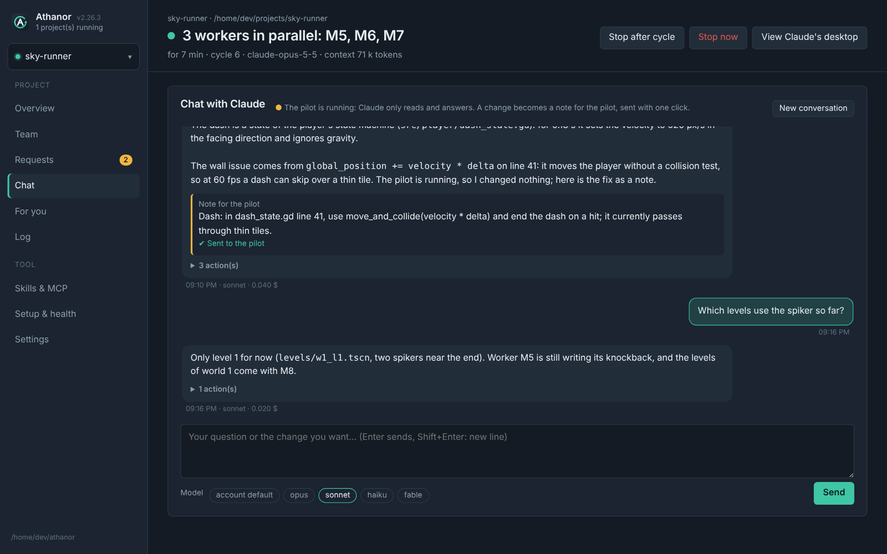
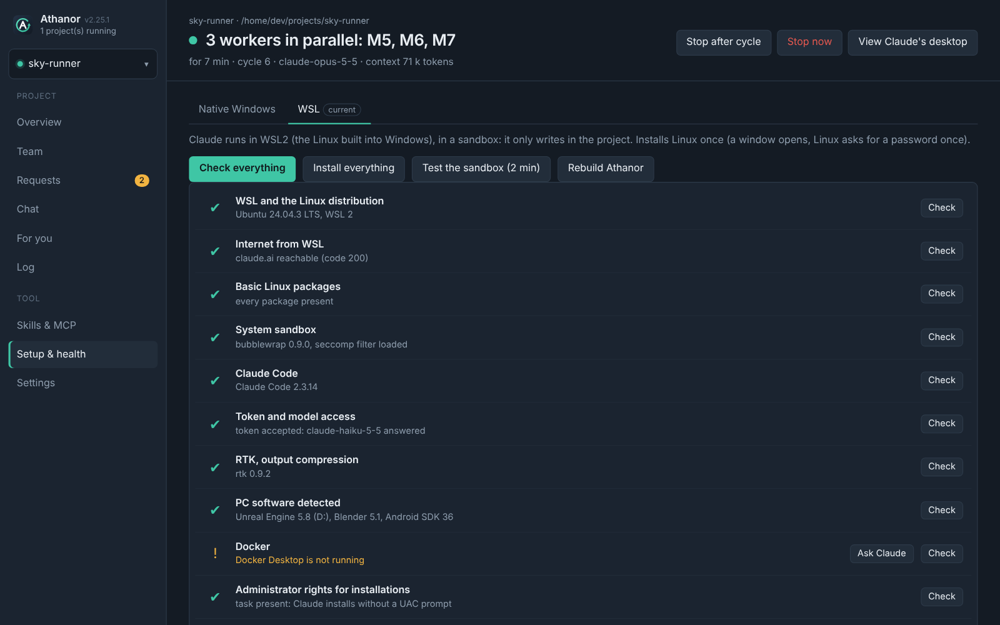
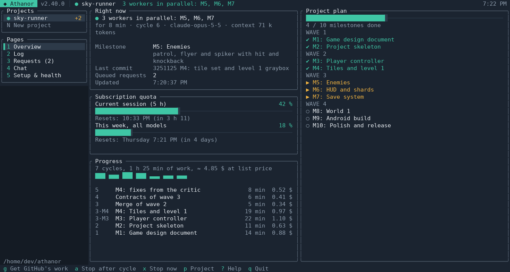

<p align="center">
  
</p>

<h1 align="center">Athanor</h1>

<h3 align="center">Let Claude Code build whole projects while you do something else.</h3>

<p align="center">
  <i>The athanor was the alchemist's furnace, built to burn for days without going out and without anyone tending it.</i>
</p>

<p align="center">
  <a href="LICENSE"></a>
  
  <a href="https://claude.com/claude-code"></a>
  
  
</p>

<p align="center">
  <a href="#quick-start"><b>Quick start</b></a> ·
  <a href="#how-it-works"><b>How it works</b></a> ·
  <a href="#parallel-mode"><b>Parallel mode</b></a> ·
  <a href="#eco-mode"><b>Eco mode</b></a> ·
  <a href="#several-computers"><b>Several computers</b></a> ·
  <a href="#the-app"><b>The app</b></a> ·
  <a href="#security"><b>Security</b></a> ·
  <a href="#faq"><b>FAQ</b></a> ·
  <a href="#troubleshooting"><b>Troubleshooting</b></a> ·
  <a href="README.fr.md"><b>Français</b></a>
</p>

<p align="center">
  <a href="https://github.com/Aprilox/Athanor/releases/latest"></a>
</p>

<p align="center">
  
</p>

You describe what you want: a game, a website, an app, a tool. Athanor runs [Claude Code](https://claude.com/claude-code) **cycle after cycle** on your own PC, with your own Claude subscription. Every cycle finishes **one milestone of the plan**: Claude does the work, runs the project's checks, ticks the milestone and commits it. Then a fresh session takes the next one, until the project is delivered. You can close the app, lock it or go to bed. The furnace keeps burning.

> [!NOTE]
> Athanor is an independent open-source project. It is not affiliated with or endorsed by Anthropic. It drives the official Claude Code CLI with your own subscription.

---

## Highlights

| | |
|---|---|
| **An autonomous loop** | One milestone per cycle, a fresh context each time, so turns stay cheap and the project never drifts. Usage limit reached → pause until it reopens, or switch to a fallback model. Error → retry with a growing delay. Silent or over-long cycle → cut and resumed. PC restarted → resumes where it stopped. All state lives in files. |
| **Parallel mode** | One switch per project. A fine-grained plan with dependencies; up to 10 workers build independent milestones at once, each in its own git worktree; the pilot merges each one as soon as it finishes and starts the next, and the lead verifies once at the end. |
| **Eco mode** | One switch per project, for when the quota matters more than speed: the lead does the work itself instead of handing it to sub-agents, one review at delivery, at most 4 images per cycle, shorter command outputs. The model and the effort stay as you set them. |
| **Several computers** | Two, three or ten computers build one project together through its GitHub repository, each with an account that can push to it (the owner's, or a collaborator's: no organization needed): each one takes a milestone no other one builds, the ones it is best at first (a big graphics card for the 3D, a fast network for the big downloads), and they merge each other's work after every milestone. The Overview shows which computers are there and what each one builds. |
| **A real team** | A project lead plus sub-agents: `scout`, `architect`, `creator`, `developer`, `tester`, `critic`, and a cheap `executor` (Haiku by default) for mechanical work. Scouts read for the framing, independent tests and the final critique are always delegated. |
| **Skills & MCP** | Give Claude expertise and tools: a verified catalog (Anthropic skills, superpowers, Context7, Serena, Playwright, GitHub…), a search over thousands of community skills (SkillsMP) and over the official MCP Registry, any skill from a GitHub link, skills you write yourself, any MCP server pasted from its README, and Claude Code plugins from the official marketplace (and any other you add), like Shopify's or Stripe's. Switched on per project, for the lead and the parallel workers. Local MCP servers run in a cage, away from your files and the Claude token. |
| **Tasks for you** | What Claude cannot do itself (create an account, pay, receive a code by SMS, generate a key) becomes a task on the *For you* page, with the exact steps; meanwhile Claude carries on with the rest, and the pilot pauses if nothing else can be done. You answer *done* (with a text, files, keys in a protected field) or *skip: find another way*; Claude checks it at once and tells you whether it works or what is still missing. |
| **A sandbox** | Claude's commands run under bubblewrap + seccomp. They can write only in the project, never read the rest of your machine, and Internet stays open. |
| **Your PC's software** | Unreal Engine, Blender, the Android SDK, Docker and winget are reached through a controlled bridge, command by command. |
| **No UAC prompts** | Opt-in. One consent, and from then on Claude installs and runs what the project needs with administrator rights, silently. |
| **A desktop app** | One file, that updates itself in one click. It shows the live team, the plan, the progress and the subscription quota (with automatic stops), the readable log and the request queue, lets you chat with Claude about the project, and runs health checks with one-click repair. It also runs several projects at once and keeps the programs Claude starts on a desktop of their own, out of your way. Themes, 6 languages. |
| **In a terminal too** | On Linux and macOS, `./athanor tui` shows the whole app in the terminal, like btop: the projects, the overview, the live log, the requests, the chat and the checks, with the keyboard and the mouse. Through SSH, or on a Linux without a screen, it opens by itself; `./athanor gui` forces the window. |
| **From your phone** | Turn on *Remote*, scan a QR code, and Athanor is on your phone (or another computer), from anywhere: the same live pages, start and stop, chat, requests. Through a Cloudflare tunnel, nothing to set up; only the devices you pair get in, and one tap removes one. From a terminal too (page *0*), so a server without a screen pairs a phone. |
| **GitHub, connected once** | Connect each computer to your GitHub account once (*Settings → Options → GitHub*). Then a project is linked to a new private repository, or to any one your account can push to, with no window, and its commits go there after each milestone. The key stays out of Claude's reach; every push is checked for secrets and never forced. Two people can take turns on one repository, or several computers build it at once. |
| **Clean projects** | A project is any folder on your PC, and Athanor keeps its own files in a folder of its own. Athanor only adds a `.athanor/` workshop, with its working documents (requirements, design, architecture), kept out of git on your computer alone, never through your `.gitignore` (unless you choose to share it on GitHub with the people you work with); delete it at the end and nothing is left behind. |
| **Frugal by design** | Targeted reading rules, a quick check during the milestone and the full check once, screenshots assembled into contact sheets, a project map regenerated before each cycle, automatic archives, command output compression. The Overview page shows live how much of each session is re-read from the prompt cache. |

---

## Quick start

**You need:** Windows 10/11, Linux or macOS, and a Claude subscription (Pro, Max or Team).

### 1. Get Athanor

One file (a zip on the Mac). From the [**latest release**](https://github.com/Aprilox/Athanor/releases/latest):

| Your system | Download |
|---|---|
| **Windows 10 / 11** | [**Athanor-Windows-x64.exe**](https://github.com/Aprilox/Athanor/releases/latest/download/Athanor-Windows-x64.exe) (an ARM PC, Snapdragon…: [Athanor-Windows-ARM64.exe](https://github.com/Aprilox/Athanor/releases/latest/download/Athanor-Windows-ARM64.exe)) |
| **macOS** 11 or later | [**Athanor-macOS.zip**](https://github.com/Aprilox/Athanor/releases/latest/download/Athanor-macOS.zip): **Athanor.app**, for Apple Silicon and Intel Macs alike; see [macOS, step by step](#macos-step-by-step) |
| **Linux** | [**Athanor-Linux-x64**](https://github.com/Aprilox/Athanor/releases/latest/download/Athanor-Linux-x64) (an ARM PC: [Athanor-Linux-ARM64](https://github.com/Aprilox/Athanor/releases/latest/download/Athanor-Linux-ARM64)) |

Keep the file wherever you like (the Desktop, for example; on the Mac, Athanor.app in *Applications*): it is how you open Athanor, and it never writes anything next to itself.

> [!TIP]
> Windows SmartScreen may show *"Windows protected your PC"* the first time, because the app is not code-signed. Click *More info → Run anyway*.

### 2. First launch

The first time, Athanor says where it will keep its files and asks before writing anything (*No*: it closes, nothing was written):

| System | Athanor's folder |
|---|---|
| Windows | `%LOCALAPPDATA%\Athanor` |
| Linux | `~/.local/share/athanor` |
| macOS | `~/Library/Application Support/Athanor` |

Everything of its own goes there: its copy of the executable, its settings and your token, its logs, the tools it installs. In your projects it only adds a `.athanor/` folder.

**Windows**

1. Double-click **`Athanor-Windows-x64.exe`**, then *Yes*. Pick a language, a theme and an accent: the first-launch guide takes you through the rest.
2. **Install**: a fresh install starts in **native Windows** (nothing else to install: *Install everything* puts Git for Windows, Python, Node.js, a few small tools and Claude Code for Windows). For Claude in a sandbox, open the **WSL** tab of *Setup & health*: *Install everything* there installs WSL2, Claude Code and the sandbox (Linux asks for a password once; the very first time may need a restart, then open "Ubuntu" once to create your user and run the installation again). A short tour then shows the mode, *Setup & health*, a new project and *Start*.
3. **Connect**: *Setup & health* → *Check everything*. On the *Token and model access* line, click *Repair*: a window signs you in to your Claude account. Paste the token in *Settings*.
4. **Optional, recommended**: *Setup & health* → *Administrator rights for installations* → *Repair*. Windows asks for your consent **once**; Claude never needs a UAC click again.
5. **Add a project**: a name, its folder (existing or new, on any drive) and what you want. Technologies are free unless you impose some. ✨ *Improve with Claude* turns a few words into a complete request; you can go back to yours.
6. **Start.** Add more projects the same way and run them side by side.
7. **GitHub** (optional): *Settings → Options → GitHub → Connect to GitHub*, once; then *Manage → GitHub* links each project to a repository (see [GitHub](#the-app) below, and the in-app *Guide*).

**Linux** (everything runs natively, without WSL)

```bash
chmod +x Athanor-Linux-x64    # once: a downloaded file is not executable yet
./Athanor-Linux-x64           # the app, in an application window of Chrome/Edge/Chromium, else your browser
./Athanor-Linux-x64 tui       # the same app in the terminal (through SSH or without a screen: by itself)
```

Then *Setup & health* → *Install everything* (Claude Code, the sandbox and the tools; Linux asks for your password once), the token in *Settings*, a project and *Start*, as on Windows (steps 3, 5 and 6).

#### macOS, step by step

1. Download [**Athanor-macOS.zip**](https://github.com/Aprilox/Athanor/releases/latest/download/Athanor-macOS.zip). Safari opens it by itself: **Athanor.app** is in *Downloads* (with another browser, double-click the zip once). An application is a folder, which is why it travels zipped. Athanor.app works from *Downloads*; in *Applications* it is at home (macOS then reopens it from there after an update and at login).
2. Open Athanor.app (a double-click). The first time, macOS says it cannot check the app, because it is not signed by Apple: click *Done*, open *System Settings → Privacy & Security*, scroll down to *"Athanor" was blocked* and click **Open Anyway**, then your password. Once only.
3. *Create*: Athanor's folder is made, then its window opens.
4. *Setup & health* → *Install everything*, *Check everything*, then the *Token* line → *Repair*, and paste the token in *Settings*.
5. Add a project and *Start*.

**What *Install everything* puts on the Mac**, through the official installers only: [Homebrew](https://brew.sh) if it is missing (its own installer asks for your password and Enter); seven command-line tools through Homebrew: `git`, `jq`, `ripgrep`, `node`, `imagemagick`, `ffmpeg`, `gh`; Claude Code (Anthropic's installer, into `~/.local/bin`, with one line in `~/.zshrc`); RTK, which shortens command output to save tokens, into Athanor's folder. Nothing with a window, nothing that starts by itself. The sandbox is macOS's own (Seatbelt): only checked. Everything is written to `logs/install-mac.log` in Athanor's folder.

**Its window is its own**, the Mac's web engine (WebKit) inside Athanor: no browser opens. **While it runs**, Athanor has its icon in the Dock and a flame near the clock (the menu bar); both show the pilots at work and open the window again. The red button hides the window: Athanor goes on. **Quit** (⌘Q, or the Dock icon's menu) with pilots running offers to keep Athanor in the menu bar (the Dock icon goes, the pilots go on, the flame stays) or to stop them and quit; *Quit* from the flame quits, the pilots going on or not, as you choose. The Mac stays awake while a pilot runs (`caffeinate`; a closed MacBook still sleeps, unless it is plugged in with an external screen).

Claude works in Seatbelt, the sandbox built into macOS (the same one Claude Code uses): it only writes in the project. The MCP servers have a Seatbelt cage of their own. Unreal, Blender, Roblox Studio, Xcode and the Android SDK are found in their usual places and Claude runs them directly; Windows programs and Docker through `tool` are Windows and Linux only. On the Mac, the programs Claude opens show on your screen (there is no separate desktop as on Windows).

### 3. Updating

**From the app**: when a new version is out, an *Update to X.Y.Z* button shows at the top of the window (Athanor looks when it opens; *Settings → Options → Version* looks now, and can stop looking at opening). *Update now* downloads the file of your system, checks it against the release's checksums, then Athanor closes, puts the new version in place and opens again. Running pilots go on.

**By hand**: close Athanor, download the new file and open it: it updates Athanor's folder the same way. On the Mac, Athanor.app is downloaded once: its updates then come from the app (an older Athanor.app opens the newer Athanor kept in Athanor's folder).

Your token, settings, projects, `logs/` and `tools/` are never touched by an update. An installation made before 2.26 (a folder with `Athanor.exe`, `template/` and `athanor-config.json` side by side) stays where it is: put the new executable in it, or use the button. An update also cleans such a folder up: the files of the older versions that no version uses any more (`commands/`, the bash and Python scripts of `system/`, `docs/`, the README…) go when they are exactly as shipped; one you changed is moved into `logs/ancien-kit/<date>/`, and `logs/nettoyage-<date>.txt` lists what went. Nothing else of the folder is touched.

<details>
<summary><b>Build it yourself</b> (from the source code)</summary>

With [Go](https://go.dev/dl/) 1.24 or later (no Go? `winget install GoLang.Go`, `sudo apt install golang-go` or `brew install go`):

```bash
git clone https://github.com/Aprilox/Athanor.git
cd Athanor/app
go run . construire
```

The same on Windows (PowerShell), Linux and macOS: it builds `Athanor.exe` and `athanor` into the `Athanor` folder, each carrying everything a release carries. Run there, a copy of the source code is its own tool folder (its `template/` is used as it is); update it with `git pull` and `go run . construire` again. `go run . construire --all` builds every system into `dist/`, the files a release publishes, and `dist/Athanor.app` (both Mac executables in one). The app only uses Go's standard library plus four vendored packages (the WebView2 window on Windows, the Dock icon on the Mac), so building needs no network access once the source is on your disk.
</details>

---

## How it works

<p align="center">
  
</p>

**A cycle.** The pilot (`athanor demarrer`) syncs the request, archives old milestones, rebuilds the project map (`.athanor/MAP.md`), opens the Unreal editor if the project has one, then starts a Claude Code session with [`template/CLAUDE.md`](template/CLAUDE.md) as instructions, in your language. Claude takes the first unchecked milestone of `.athanor/PLAN.md`, does it, runs `check.sh`, ticks it, logs it in `LOG.md` and commits. The pilot closes the cycle shortly after the commit and starts the next one.

**What every agent knows from the start.** `.athanor/PC_TOOLS.md` lists the toolchain already installed and its versions (Node, Python, PHP, Composer, Git…), checked by the pilot, so nobody spends turns probing it. Two short files collect the problems already solved, one line each: `.athanor/SOLUTIONS.md` for the project and `tools/SOLUTIONS.md` for the PC, shared by every project. Every agent reads them first and adds a line when it solves something; the pilot removes duplicates and keeps the latest 60 lines, and merges what parallel workers learned.

**No thread lost when a context gets full.** Every session keeps `.athanor/HANDOFF.md` (where it is, 10 lines). Past `RELAY_CONTEXT_K` thousand tokens of context (110 by default), the pilot stops it between two steps and starts a fresh session on the same milestone, with that file, its last actions and its last messages: cheaper turns, and no automatic compaction that would blur the thread. Workers are relayed the same way, on their own branch.

**Work done inside a program is saved.** An editor or an engine driven through an MCP server keeps its work in memory: before ticking a milestone, the agent saves it into the project. If a milestone used an MCP server and its commit changed no file, the pilot has that checked first on the next cycle. The catalogue's Roblox Studio and Unreal servers come with how to save in them.

**A project's life.**

| Phase | What happens |
|---|---|
| Framing | one time-boxed cycle (`FRAMING_MAX_MIN`, 25 min by default) that only writes the plan: up to 3 `scout`s read the attachments and the existing code at once, the lead writes `.athanor/docs/REQUIREMENTS.md`, `DESIGN.md`, `ARCHITECTURE.md` and a plan of 8 to 25 milestones, each line a self-contained sheet (files, dependencies, acceptance criteria, what to read), and the `critic` checks the plan once. No code, no installation, no demo content; past the time box, the plan as it stands goes ahead |
| Skeleton | an executable skeleton and the project's own `check.sh` (build, tests, screenshots) |
| Complete slice | one feature working end to end, checked by the `tester` |
| Production | the remaining milestones, one per cycle, or several at once in parallel mode |
| Polish | the `critic` uses the result like a demanding user and files bugs in `BUGS.md` |
| Delivery | `deliverable/`, `TEST_GUIDE.md`, then `FINAL_REPORT.md` with `STATUS: DONE`. The pilot takes the next queued request, or stops |

---

## Parallel mode

*Manage → Working mode → Parallel mode*, per project, with 2 to 10 workers at most. Workers run on `WORKER_MODEL` (Sonnet by default): a well-written milestone sheet is execution work, the lead keeps its own model for the plan and the merges.

1. The lead writes a **fine-grained plan with explicit dependencies**: many small, self-contained milestones, each with the files it touches, `Depends on:` the milestones it needs, and acceptance criteria. M1 is always the foundation (skeleton, `check.sh`, shared contracts).
2. The pilot runs a **scheduler**: every milestone whose dependencies are merged gets a **worker** (its own Claude session, its own git worktree `.athanor/work/M5` and branch `auto/M5`), starting with 2 and adding one each time a worker delivers, up to the chosen number. As soon as a worker meets the quota, no other one starts; if they all met it, the lead's verification is skipped and the pilot waits, then runs one milestone with the lead alone before starting workers again. The pilot also lets the lead work alone, for that cycle, when workers would not pay off: fewer than 3 milestones ready at once, only documentation milestones (they link to each other and conflict), or the 5-hour quota at 75% or the weekly one at 85%. Two milestones whose sheets name the same files never run at the same time. The workers share a board, `.athanor/BOARD.md`, written by the pilot every few seconds: what each one is doing and the files it holds. A worker that needs a file outside its sheet reserves it first (`.athanor/RESERVE`); the pilot grants it unless another worker holds it, and no new worker starts on a reserved file.
3. As soon as a worker finishes, the pilot **merges its branch immediately** when it applies cleanly, ticks the milestone, and starts the next ready milestones. Nobody waits for the slowest worker.
4. At the end of the cycle, **one** session of the lead verifies everything: it merges the branches that conflicted, runs the full check, fixes what the merges broke, and files the rest in `BUGS.md`.
5. **Queued requests don't wait.** At the start of each cycle they join the current request: the lead adds their milestones to the plan, with their dependencies.

Each worker only carries its own milestone in context, so the work is split into small, cheap sessions instead of one huge one. A worker may hand its long test runs and searches to `executor` (cheap model) and read only the failures; it calls no other sub-agent. The Team page shows one card per worker with the sub-agents it called, and the Log tags their lines `[M5]`. Parallel mode uses more quota per hour (one session per worker) but far less wall-clock time.

---

## Eco mode

*Manage → Working mode → Eco mode*, per project (in a terminal: **M**, then *Working mode*). For when the quota matters more than speed. It never runs with the parallel mode: switching one on switches the other off.

Measured on a real game project, **sub-agents use most of the quota** (80 to 87 % of the tokens of its cycles): each one starts from zero and pays again for its whole context at every turn. So the eco mode cuts there first:

- **The lead does the work itself.** No sub-agent for an ordinary milestone or a large chunk (it splits the milestone instead); the project's own sub-agents only when the request asks for them on that milestone; no new sub-agent proposed.
- **One review, at the end.** `critic` and `tester` run once each, for the delivery: not after the complete slice, not in the polish, never a counter-review. The framing skips the scouts (one at most for large attachments) and the plan review.
- **Few images.** At most 4 image reads per cycle (MCP captures included), on reduced contact sheets; a new screenshot only after a visible change.
- **Less reading, shorter outputs.** The end of the log, the current milestone, the needed sections only; command outputs cut at 8,000 characters (`BASH_MAX_OUTPUT_LENGTH`, 20,000 otherwise).

The **model and the thinking effort are not touched**: they stay as you set them. To save even more, choose a smaller model for the lead (Sonnet) and a lower effort (`medium` or `low`) in *Settings → Models*. The Overview shows *eco mode* while a cycle runs; the switch applies from the next cycle.

---

## Several computers

One project, several computers working on it at the same time: your desktop with its big graphics card, a laptop on fibre, an old tower. They meet through the project's GitHub repository, nothing else to set up, on Windows, macOS and Linux alike.

**What it needs.** One GitHub repository, and for each person an account that can push to it: the owner's own, or a collaborator's (the owner adds each person in the repository's *Settings → Collaborators* on GitHub, with write access). **No GitHub organization is needed.** Every computer is connected to GitHub once, with that account: *Settings → Options → GitHub → Connect to GitHub*.

**Starting.** On the first computer, link the project to the repository (*Manage → GitHub*), then switch on *Overview → Other computers → Work with other computers* (it shares the workshop, `.athanor/`, and pushes it at once, so that the others get the request and the plan; the switch asks first when it is off). On each other computer: *New project → Join a project*, with the same repository and branch and a new empty folder: the project arrives at once (its request, its plan, its log), already working with the others; it starts from their work, never from a history of its own. While it has no request yet, *Start* runs it anyway: its pilot brings in the others' work every minute, and the request with it. The *Other computers* block of the Overview lists these steps, and the Guide's *Several computers* goes through them with a button for each. Each computer has its own key on its account (“Athanor (computer)”), so each one can be disconnected alone.

**Who builds what.** Before each cycle, a computer's pilot brings the others' work into the project, then takes a milestone: one whose dependencies are done and that no other computer builds. The framing is written by one computer, the others wait for the plan; the final report too, at the end, by one computer. Two computers that choose the same milestone at the same moment are told apart by who took it first; the other one takes another. With nothing to take (everything left waits for a milestone in progress), a computer waits and looks again every minute, and its Overview says why.

**What each computer is good at.** *Remote → This computer, for the other computers*: its name, what it has (`RTX 4090, 24 GB`) and a few words (`gpu`, `network`). Claude knows the team when it writes the plan: a milestone that needs what only some computers have gets `Needs: gpu.` in its line, and only a computer with that word builds it, while the others take the rest. Two computers with the same word build such milestones at the same time, so Claude splits big work of one kind (the armors of several types, several levels) into separate milestones. The words are optional: when no running computer has the word a milestone needs (nobody declared anything), Athanor shares it out like the others, in the plan's order.

**What you see.** *Overview → Computers on this project*: every computer of the team, online or when it was last seen, what it builds right now and since when, its last push. A computer is online while its Athanor runs (it says it is there every minute), even with its pilot stopped; the computers' clocks must be on time (set automatically, as systems do by default).

**A level for each word.** `gpu:3` against `gpu:1`: a word may carry a level from 1 to 9. A milestone that needs a lot of it (`Needs: gpu:3.`) goes to a computer at that level or more, while the less capable ones take the lighter milestones at the same time; when no computer has that level, the most capable one takes it.

**Notes between the computers.** The computers' Claude leave each other notes in `.athanor/TEAM_NOTES.md` (an interface that changed, a shared file to be careful with, a trap): every Claude reads the last ones before it starts, and the Overview shows them.

**Work never lost.** Every 10 minutes, and when its pilot stops or hands a milestone over, a computer sends its unfinished work to GitHub, on a ref of its own (`refs/athanor/encours/<computer>`, a patch per milestone). It is not a branch: GitHub does not list it among the branches and runs none of the repository's workflows when it changes or goes; it goes once its milestones are finished. The computer that takes that milestone next goes on from there; if it cannot merge that work, it passes it on inside its own, so a third computer still gets both. A computer that comes back after another took its milestone over keeps its own copy aside in its `.git` (`refs/athanor/sauve/…`) and starts from the team's; its files ignored by git that the team's version replaces are copied first into Athanor's data for the project (kept 30 days, the 5 most recent always).

**Merging.** After each milestone, the pilot merges the others' new commits first, then pushes (never forced). The workshop's notes (`LOG.md`, `BUGS.md`, `SOLUTIONS.md`…) are joined line by line, and two milestones ticked on lines next to each other in the plan are merged by themselves. When two computers really changed the same lines, the pilot undoes the merge (nothing is lost) and Claude makes it at the start of its next cycle, keeping both sides' work (`.athanor/MERGE_NEEDED.md`).

**When a program does not work on a computer** (Blender crashes, an SDK is broken): Claude first looks for the cause and repairs what it can on that computer, even if it takes 5 or 10 minutes; only when the cause is out of its reach (the hardware, a driver, a licence) or its repair did not work does it say so, without running the same failing test again and again. Every computer of the team gets a notification, and the others try the milestone in its place, those that have the program's word first. The one that succeeds keeps the word, so such milestones go to it from then on; the Overview shows who builds a milestone in place of whom, and what does not work where. If none can (or none is running), the computer that was meant to build it takes it back and Claude asks you on *For you*, saying which computers tried. A computer tries a program again 12 hours later, in case it was repaired. Working alone, Claude asks you at that point.

**Good to know.** The repository needs *Share the workshop (.athanor/) on GitHub*: switching the computers on turns it on, with the push after each milestone. Each computer runs one milestone at a time, so parallel mode is off while several computers work on a project. Every computer leaves a small ref `refs/athanor/pc/<id>` on the repository, not a branch (never in the list of branches, no workflow runs for it): its presence (its name, what it is good at, what it builds); it goes away when the computer stops working with the others, and after 30 days without news. The `athanor/pc/…` and `athanor/encours/…` branches of 2.36 are removed once, each by its own computer. A project whose history has nothing in common with the repository's is refused: two projects that only share a name are never mixed. Files of the folder that the repository also has are never overwritten when a computer joins: it says which ones to move.

Why GitHub and not a tunnel between the computers: every computer already pushes there, it is reachable from anywhere without opening anything, it keeps working when one computer is off, and its history is the merge. A tunnel would need every computer online at once, and one of them would have to serve the others.

---

## The team

| Agent | Role | Model |
|---|---|---|
| **Project lead** | reads the plan, codes ordinary milestones, delegates, reviews every report, commits | `MODEL` |
| `scout` | reads what it is pointed at (code, attachments, documentation) and answers one question in a short summary, or writes one document; for the framing | `SUBAGENT_MODEL`, Sonnet when empty |
| `architect` | requirements, architecture and the milestone plan for a large re-planning | `SUBAGENT_MODEL` |
| `creator` | content: story, world, dialogue, interface texts, programmatic 2D/3D/sound assets | `SUBAGENT_MODEL` |
| `developer` | one precise development task with its tests | `SUBAGENT_MODEL` |
| `tester` | automated tests, screenshots, bug reports (never fixes the code itself) | `SUBAGENT_MODEL` |
| `critic` | uses the result like a demanding end user, without complacency (read only) | `SUBAGENT_MODEL` |
| `executor` | mechanical work with no design decision: long command outputs, searches, bulk edits, file copies; the only sub-agent parallel workers may call | `CHEAP_MODEL` (Haiku) |

With `SUBAGENT_MODEL=auto` (*Settings*, "chosen by the lead"), the lead picks the model of each call itself: Haiku for mechanical work, Sonnet for most of the work, Opus only for judgement (architecture, a bug not understood, the final critique). A call that sets none keeps the model of the table.

The agents live in [`template/.claude/agents/`](template/.claude/agents): edit them to change how your team works.

**Your own sub-agents.** On the Team page, **+ New sub-agent** adds a specialist of your own (a translator, a researcher for a domain, a level designer…): a name, when the lead should call it, its instructions (**✨ Improve with Claude** turns a few lines into a structured brief), a model (like the others, cheap or most capable), read only or not, this project or all your projects. Or describe it to Claude in **Chat** ("a Blender specialist for the props"): it asks what it needs, then shows the sub-agent as a card you can still edit (✨ *Improve with Claude* there too), and **Add to the team** creates it (the same for changing one of yours). The lead can also propose one when a need keeps coming back: it writes `.athanor/agents/<name>.md`, the pilot checks it and adds it to the team at the next cycle, labelled *proposed by the lead*; you keep it, edit it or remove it (a removed proposal is never made again). These sub-agents work like the others: same sandbox, skills, MCP tools and attached files, callable by the lead and by parallel workers; the lead finds them in `.athanor/TEAM.md`, and a request can name one ("have `translator` do the texts"). They are stored in `extensions/agents.json` (12 per project at most).

---

## The app

| | |
|:---:|:---:|
| <br>**Team**: who called whom, what each one does, live | <br>**Log**: readable or raw, filtered, workers tagged |
| <br>**Requests**: a queue you can reorder, files, notes along the way | <br>**Chat**: ask about the project at any time |
| <br>**Skills**: installed once, switched on per project | <br>**MCP**: remote or local in a cage, tested in one click |
| <br>**Setup & health**: one tab per mode, repair line by line | <br>**Settings → Options**: 6 languages, 5 palettes × 5 accents |

The screenshots show the dark "Slate" and the "Light" palettes.

| Page | What you do there |
|---|---|
| **Overview** | the state in one sentence, current milestone, the last commit of this computer and the last one on GitHub (and why a push did not go), ticked plan, the computers working on the project (what each one builds), the subscription quota (5 hours, the week) with an automatic stop at the threshold you choose, the progress and its projection (when the last milestone should land, time and cost), usage per cycle (time, list-price cost, cache); *Start*, *Stop after cycle*, *Stop now*, *Working mode* |
| **Team** | a tree: the lead and each worker with the sub-agents it called; click a sub-agent for the brief it was given and the report it handed back; the model each one runs on; who can be called, and your own sub-agents (create, edit, remove) |
| **For you** | what Claude needs from you: each task with its steps and links, a protected field for each key it asks for, files; *It's done* or *Skip: find another way*; Claude's verdict (verified, or what is still missing) and the history. A badge in the menu, a banner on Overview and a system notification announce a new task |
| **Requests** | the current request and its plan, the queued requests (time-stamped, reorderable), notes along the way; ✨ *Improve with Claude* rewrites a request clearer and more complete, and you can go back to yours; 📎 attach files to a request (specification, mock-ups, photos, PDF, data): they stay in the workshop and Claude reads them with the request |
| **Chat** | talk with Claude about the project: questions at any time (it reads the code, the plan, the log); while the pilot is stopped it can also change files (no commands) and Athanor commits them; while the pilot runs, a change becomes a note for the pilot, sent with one click; model to choose |
| **Log** | the readable log (Claude speaks, tools, results, sub-agents, pilot) or the raw JSON, filterable |
| **Remote** | remote access on or off, the link and QR code that pair a phone or another computer, the trusted devices (connected now or last seen, from where), rename or ✕ remove one; this computer's name and what it is good at, for the other computers of a project |
| **Guide** | step-by-step tutorials, always in the menu, with a button that opens the right page for each step: starting a project, GitHub (connecting the computer, linking, working in turns), your phone (and your own domain, and how to stop using it), several computers (what it needs, connecting each computer, joining, what each one is good at); the first steps and the pages link to them |
| **New project / Join a project** (in the project picker) | a name, the folder (*Browse…* opens the system's folder dialog) and what you want; or join a project other computers already build, from its repository |
| **Manage** (in the project picker) | rename the project; move or rename its folder; point it to another folder (the plan and requests come along, the milestones are checked against what it contains); check the milestones; archive it; delete it (from the list, its workshop or the whole folder, to the recycle bin); link it to GitHub |
| **Skills & MCP** | the library (verified catalog, search in SkillsMP and the MCP Registry, GitHub link, your own skills, pasted MCP configurations), a switch per project, the API keys of the servers (stored apart, never shown) and their settings (an address, a port, a path: detected in the configuration, shown in clear with their default), *View / edit* a server's configuration, settings and program to open as JSON (pasted ones included), *Test* starts a server in its cage and lists its tools; *Sign in* once to a remote server that asks for it (OAuth), for every project; **Plugins**: the whole catalog of Claude Code plugins (official marketplace plus yours), searchable, installed in one click and switched on per project |
| **Setup & health** | One tab per mode (native Windows and WSL on Windows; Linux; macOS), the current one marked: *Install everything* for it, or switch to it. *Check everything*, *Test the sandbox* for real, *Repair* line by line, *Ask Claude* to repair or install something |
| **Settings → Claude** | the pilot's settings, the kit's `.env` (token masked, models, effort, watchdog…, rarely used ones under *Advanced*), *Save and restart after cycle* |
| **Settings → Options** | language, palette and accent, this computer's connection to GitHub, project list (removing a project never touches its folder), restart the pilots on opening, start with the computer, "Claude" desktop, password, tool folder, version and updates |

**Skills & MCP, safely**: skills are loaded as a session plugin (`--plugin-dir`), so Claude only reads one when it needs it; it can read them but never change them. MCP servers are added to the session's own MCP configuration; a local one starts in a bubblewrap cage (`athanor mcp-cage`): system read-only, only the project and the tool caches writable, no home folder, no Windows drives, no Athanor folder, no Claude token. A *Windows program* (Roblox Studio's server, a `.exe` or a `.bat`, recognized when pasting and confirmed with the *Windows program* option) cannot be caged from WSL: it starts on Windows through WSL interop (`athanor mcp-windows`), with your rights, and only receives its own variables; Claude only sees its tools, and its whole process tree is stopped with the session. Requires Claude Code with `--plugin-dir` for skills.

**Plugins, taken apart**: a plugin is downloaded once into the tool folder (from GitHub, pinned to the commit its marketplace gives) and switched on per project. Its skills, commands and sub-agents are loaded with `--plugin-dir`, read-only for Claude; its MCP servers join the MCP library (local ones in the cage, keys stored apart, a remote one signed in to once for every project); its hooks, LSP servers and monitors are left out, because they would run outside the sandbox. Plugins built by a command or published only on npm are listed but not installed.

**Projects that follow their folder**: when a project points to another folder, Athanor compares the ticked milestones with what is there. In an empty folder nothing is done any more; a milestone whose listed files are missing is unticked; when the files come back, it is ticked again by itself. At the next start, Claude checks every milestone more thoroughly (`.athanor/REVERIFY`) and unticks what is really missing. Archived projects leave the list and are never restarted: *Archived projects*, at the bottom of the project list, brings them back.

**GitHub, connected once per computer**: *Settings → Options → GitHub → Connect to GitHub* signs in one time and puts a key “Athanor (this computer)” on your GitHub account, kept in Athanor's data (out of Claude's reach in a sandbox). Every project of the computer pushes with it; linking a project needs it. That key opens every repository your account can push to; *Disconnect* removes it from this computer (GitHub then lists an entry you can remove under *Settings › SSH and GPG keys*). A project linked by a version before 2.39 with a key of its own (a deploy key) keeps pushing with it, and *Use my GitHub connection* moves it to the connection.

**GitHub, for each project**: when you create a project, or later under *Manage → GitHub*, choose *Use one of my repositories* (OWNER/NAME: linked at once, with no window) or *Create a private repository* (one sign-in, only to create it; nothing of it is kept). Athanor checks right away that your account can read and push to the repository, and says why when it cannot (not found, read access only, network); a repository with GitHub Actions workflows asks you first. From then on, the pilot pushes as soon as a milestone is committed, again at the end of every cycle if something is not on GitHub yet (a cycle cut by the context, the time limit or the quota included), and at the delivery (switch it off to push only with *Push now*; the log then says so). Pushes are never forced: if GitHub has commits the project does not, Athanor stops and says so. Before each push, the new commits are checked for secrets (keys, tokens, `.env` files, private keys); if one is found nothing is pushed, and Claude removes it from the unpushed commits on its next cycle. A change to the repository's GitHub Actions workflows (code GitHub runs, with the repository's secrets) waits for you: check it, then *Push anyway*. The same block sets the **author of the commits** (your name, and your GitHub email or your private GitHub *noreply* address, proposed from your account) and whether Claude appears as co-author (by default it does not: no “Co-Authored-By: Claude” line); Claude writes each commit subject as `M3: what the milestone delivers`. *Share the workshop (.athanor/) on GitHub* puts the plan, the requests, the log and the documents into the commits (never the secrets, the raw logs or the pilot's state): ticking it commits them at once, alone (never the code being written), and pushes them; *Push now* also takes what changed in them since, so that someone who pulls the repository and adds it to their own Athanor goes on with the project; one pilot at a time on a project, unless the computers work together ([Several computers](#several-computers)).

**Two people, in turns, on one repository** (no organization, no *Work with other computers*): the owner adds the other as a collaborator (the repository's *Settings › Collaborators*). Each one connects their computer to GitHub (above) and links the project to the repository. Tick *Share the workshop* on both sides. Before working, *Manage → GitHub → Get GitHub's work* brings in what the other pushed (as `git pull` would: a fast-forward, or a merge; never over changes not committed, and a real conflict is left to Claude at its next cycle, nothing changed). *Start* checks it too: when GitHub has commits the folder does not, Athanor asks whether to bring them in first or start from where you are.

**A plan you can shape**: click a milestone to see its files, dependencies and acceptance criteria; move it up or down, or remove it (the other milestones stop depending on it), or edit `PLAN.md` as a whole.

**Start with the computer**: *Open Athanor when the computer starts* opens it with its window, on Windows, in a Linux desktop session and on macOS (at login). With *Restart the pilots that were running*, the projects you started and neither stopped nor saw delivered start again. Launching Athanor while it already runs only brings its window back: there is never a second copy.

**Remote access**: *Remote* → switch it on. Athanor downloads Cloudflare's tunnel program once (`cloudflared`, checked against its release's checksum) and opens a "quick tunnel": an `https://….trycloudflare.com` address, no account. Scan the QR code with your phone's camera (or open the link on another computer), then type the 6-digit code the *Remote* page shows when you move the mouse over it (renewed every 20 seconds): the device becomes trusted and finds the same Athanor, laid out for its screen, live; on a phone, *Add to Home Screen* makes it an app. Everything works from there except what only the computer should do: the secrets, the remote access itself, the password, opening folders on the computer. The *Remote* page lists the devices, connected now or not, and ✕ removes one at once: its next click is refused. While remote access is on, the computer does not go to sleep (the screen can still turn off). The tunnel survives Athanor's restarts (an update), but its address changes when the computer restarts: scan the code again then. Cloudflare gives no uptime guarantee for quick tunnels.

**Notifications on the phone**: on a paired phone, *Remote → This device → Notifications on this device*. The phone then gets a notification even with Athanor closed on it, when Claude needs you, when a milestone is done, when a project is delivered and when a computer of a team is stuck; a tap opens the right page. On an iPhone or iPad, add Athanor to the Home Screen first (iOS 16.4 or later) and switch them on from there.

**Your own domain, a fixed address**: with a free Cloudflare account and a domain whose DNS is at Cloudflare, *Remote → Address → Use my domain* gives an address that never changes (`athanor.example.com`). Athanor opens Cloudflare's sign-in once, in the browser, then creates a tunnel of this computer and points the name to it (an existing DNS record is never replaced); the account's certificate and the tunnel's credentials stay in Athanor's folder. The devices then keep their access across restarts of the computer. The page's guide sets up **Cloudflare Access** in a few clicks of Cloudflare's dashboard: Cloudflare then asks for your e-mail and a code before anything reaches the computer, so a stranger who finds the address does not even see Athanor. *Back to a temporary address* deletes the tunnel at Cloudflare.

**Lock**: with a password (*Settings → Options*), the 🔒 button locks the app. Claude keeps working, but nothing can be seen or changed (token included) without the password, and the app starts locked.

**"Claude" desktop**: the programs Claude starts never open on your screen, so they never interrupt your work or a full-screen game.
- **Windows**: Unreal, Blender, a game under test and everything they start open on a Windows desktop of their own, the way the UAC prompt has its own (the gateways start them with `Athanor.exe isole`). They cannot take the focus, nor your mouse: while a pilot runs, a guard lifts the mouse lock of a game played on Claude's desktop (a Roblox play test, Unreal's play in editor) and puts back a cursor it moved (each correction in `logs/souris.log`). They are not heard either: while a pilot runs, their sound is muted, except while you look at Claude's desktop or with *Settings → Options → “Claude” desktop → Hear Claude's desktop* (Windows remembers a program's mute for its next start, so Athanor gives the sound back as soon as the program ends, when the pilot stops, and at its next start after a crash). *View Claude's desktop* switches the screen to it; the bar at the top, or Ctrl + Alt + B, brings you back.
- **Linux**, and the Linux programs under WSL that WSLg would show on Windows: each pilot runs a private X server (Xvfb). Claude, its tools and its MCP servers only see that screen (`athanor ecran`), and the user's display, X11 or Wayland, is out of their reach. *View Claude's screen* shows it live in the app.
- With the option off, new programs open on your screen again. Those already running stay where they are until they close: the app still lets you go and close them.

The interface is translated into English, French, Spanish, German, Italian and Portuguese. The language you choose is also the one Claude writes the plan, log and documents in.

---

## In a terminal



On Linux and macOS, Athanor also runs in the terminal, like btop or htop: the same Athanor as its window, on the same server, so both always show the same thing. Made for a server reached through SSH, a Linux without a desktop, or simply your own terminal.

- **Open it**: `./athanor tui` in Athanor's folder (or the downloaded file: `./Athanor-Linux-x64 tui`). Through SSH (`SSH_CONNECTION` set), or on a Linux without a screen (no `DISPLAY` nor `WAYLAND_DISPLAY`), `./athanor` alone opens it. `./athanor gui` opens the window whatever the guess.
- **On a server**: run Athanor as a normal user, not as root: Claude Code refuses to work as root (Setup & health says so, and *Start* refuses). On a fresh VPS: `adduser NAME`, `usermod -aG sudo NAME`, log in as `NAME`, then `./Athanor-Linux-x64`.
- **With Athanor already open** (its window, or another terminal): `./athanor tui` shows that same Athanor. When the terminal is the one that started Athanor, Athanor stops with it (the pilots keep running); *w* opens the window as well, on a computer with a screen.
- **Pages**: *1* Overview (the state, the last commit here and on GitHub, the quota, the cycles and the plan), *2* Log (live; *o*, *r*, *u* filter tools, results and sub-agents, */* searches, *f* follows), *3* Requests (*n* a new one, *e* a note along the way, *d* deletes, *Alt+↑/↓* reorders), *4* Chat (its field is ready as soon as the page opens: *Enter* sends, *Alt+Enter* a new line; *Esc* leaves it for *c* a new conversation and *m* the model, *i* comes back to it), *5* Setup & health (*v* checks everything, *r* repairs and *I* installs everything right in the terminal, each command shown and sudo answered there, then Athanor comes back; *T* the token). *6* For you (*Enter* answers, with the values asked for in hidden fields; *k* skips), *7* Team, *8* GitHub (*c* connects this computer in the terminal, *l* links one of your repositories, *r* creates a private one, *p* pushes, *a* automatic push, *u* unlinks), *9* Settings (*Enter* edits a setting, secrets hidden; *l*, *p*, *a* the language, the palette, the accent), *0* Remote (*o* switches remote access on or off, the pairing QR code drawn in the terminal with its link, *v* shows the 6 digits for 10 seconds, *r* renames and *d* removes a trusted device: a server reached through SSH pairs a phone this way, with no window). On pages 8, 9 and 0 their own letters come first, small or capital. The forms have *Save* and *Cancel* buttons (Tab, or a click; *F2* saves too); a form the server refuses stays open with the reason, and closing one with text in it asks first.
- **Everywhere**: *s* Start (with the same questions as the window: no request yet, tools not installed, GitHub ahead), *a* Stop after cycle (again: let it go on), *x* Stop now, *p* or *[ ]* the project, *N* a new project, *M* manages it (rename, archive, remove from the list; the archived ones come back from *p*), *g* Get GitHub's work, *?* every key, *q* quits. The mouse clicks projects, pages and lines; the wheel scrolls.
- **Its look**: the app's palette and accent, its language, in 24-bit colours when the terminal says it has them (else 256). Over SSH the terminal does not always say so: `ATHANOR_COULEURS=24 ./athanor tui` forces them. While the terminal serves Athanor, what Athanor prints goes to `logs/terminal.log`.

## What Claude can and cannot do

| | |
|---|---|
| Write | only in the project folder (and in the tool's `tools/` for what it installs) |
| Read | only the project, `tools/` and the Linux system files; not your documents, not the Windows drives, not `.env` |
| Internet | yes, freely |
| Install tools | yes: in `tools/` (Linux tools, portable Windows software in `tools/windows/`), or in a disposable Docker container; every installation is recorded in `tools/INSTALLS.md` |
| Install Windows software | yes, with winget or an installer: for your user, or with administrator rights if you allowed it (one Windows consent) |
| Windows firewall | set automatically with the same permission: the project's programs can accept connections **from the local network only** |
| Your Windows software | yes, through the gateways below. **This is an intended exit from the sandbox**: those programs run with your Windows rights |
| `cmd.exe`, `powershell.exe` | no, blocked from the sandbox (the gateways remain available) |
| Change the pilot, the sandbox or its settings | no (`system/` is outside its folders) |

This table is the WSL mode, the default. In the native Windows mode below, there is no sandbox.

### Native Windows mode (experimental)

*Settings → Options → Execution mode → Native Windows*. The pilot is `Athanor.exe` itself and Claude Code is the Windows program (its commands run in Git Bash, the shell Claude Code uses on Windows): no WSL, the project's Windows folder and Windows programs are reached directly, and file access is faster.

**There is no sandbox in this mode** (Claude Code has none on native Windows): Claude can read and change any file of your PC and run any program, without asking. The file guard still limits its file tools to the project and `tools/`, and its instructions tell it to stay there, but nothing enforces it for its commands. Use it for projects you trust. That includes Athanor's own files: in this mode Claude's commands could read the tool's `.env` (your token), the keys of the MCP servers and the GitHub key, and change the pilot itself.

- Requirements: Git for Windows, jq, Python, Node.js, GitHub CLI, uv and Claude Code for Windows; *Setup & health → Install everything* installs them (winget, then Claude Code's installer).
- The project must be in a folder of a Windows drive (`C:\...`, `D:\...`), not in the WSL file system. Its history (cycles, statistics) carries over between the two modes.
- The mode applies to the pilots started afterwards; stop the running ones first. When you close Athanor while native pilots run, it asks whether they go on in the background or stop.
- Claude's Linux screen does not exist in this mode; Claude's Windows desktop still keeps the programs it opens away from yours.

---

## Your PC's tools

Claude works in Linux (WSL2 on Windows) and reaches your Windows software through gateways. The bridge runs each command **outside** the sandbox, with your rights:

| Gateway | What it does |
|---|---|
| `unreal-editor`, `unreal-cmd`, `unreal-uat` | opens the Unreal editor (optionally driven through Unreal MCP), runs commandlets and tests, packages Windows and Android builds |
| `roblox-studio` | opens Roblox Studio on a place of the project (nothing if a Studio is already open) |
| `blender` | the PC's Blender, typically in the background with a Python script (`blender -b -P scene.py`); `blender --open FILE.blend` opens its window (nothing if a Blender is already open) |
| `adb` | the PC's Android tool: install and test on a phone plugged in over USB |
| `tool IMAGE CMD…` | runs a command in a disposable Docker container, with only the project mounted |
| `install-windows ID` / `--file setup.exe` | installs Windows software (winget or an installer), elevated when allowed |
| `pc-exec [--admin] program.exe` | runs a Windows program the project built or downloaded |
| `windows-var NAME PATH` | sets a Windows environment variable for the development tools (`ANDROID_HOME`, `JAVA_HOME`…) |

Installed software is detected on **every drive** (`C:`, `D:`…), and the newest version wins. The detected list is written before each cycle to `.athanor/PC_TOOLS.md`. Paths can be forced in *Settings* when detection misses them (`UE_DIR`, `BLENDER_EXE`, `ANDROID_SDK_DIR`).

**Unreal Engine (MCP)**: install **Unreal Engine** from the verified catalog of *Skills & MCP*, switch it on for the project (its address is a setting of the server) and, in WSL mode, run `Athanor.exe reseau-unreal` once. Claude enables the MCP plugins in the Unreal project itself, and the pilot opens the editor before each cycle. Claude drives it (actors, lights, materials, tests), runs tests and screenshots with `unreal-cmd`, and packages the Windows game with `unreal-uat` into `deliverable/`. The Unreal MCP is experimental: when it does not answer, Claude carries on without it.

**Roblox Studio (MCP)**: install **Roblox Studio** from the verified catalog of *Skills & MCP* and switch it on for the project. In Studio, *Assistant > … > Manage MCP Servers*, turn on *Enable Studio as MCP server*. Before each cycle, the pilot opens the project's first `.rbxl`/`.rbxlx` place in Studio (on Claude's desktop when that option is on), unless a Studio is already open: then Claude works in yours. Claude edits scripts and instances, runs play tests and inserts assets through Studio's built-in MCP server. It is a Windows program: it runs on Windows, outside the cage (see *Skills & MCP, safely* above). Experimental.

**Blender (MCP)**: install **Blender** from the verified catalog of *Skills & MCP* (Blender Lab's official server; needs Blender 5.1+, uv and Git for Windows) and switch it on for the project. In Blender, install the MCP add-on from [blender.org/lab/mcp-server](https://www.blender.org/lab/mcp-server/), turn on its *Auto Start*, and allow *Online Access* (*Preferences > System*). Before each cycle, the pilot opens the project's first `.blend` (or an empty Blender), unless a Blender is already open: then Claude works in yours. Claude runs Python in Blender, inspects the scene, takes screenshots and searches Blender's documentation; it saves the scene into the project as a `.blend`. The server runs the code Claude writes inside Blender with your rights, outside the cage. Experimental.

**Any MCP server that drives a program**: the program to open before each cycle is part of the server's description, in the catalog or in your library (*View / edit*, key `ouvrir`): the program (a gateway such as `blender`, or a Windows program `C:\…\name.exe`), its arguments (`{FICHIER}`: the project's file found), the project files to look for (`*.blend`), the process name or the port that says it is already open, and how long to wait for that port. Settings (`${PORT}`…) are filled in from the fields below the server. A new server of this kind needs no change to Athanor. Blender's opening is described this way; Roblox Studio and Unreal keep their own (Rojo build, editor's MCP plugin).

**Missing software**: Claude sorts it out on its own (a portable version in `tools/windows/`, else winget, else the administrator task if allowed). If an installation fails, it writes it to `.athanor/TODO_FOR_YOU.md` and finds another way.

**Mobile games (Unreal)**: Android first (portable SDK and Java, `.apk` installed on a phone plugged in over USB), iOS kept portable (`docs/IOS_PORT.md`).

**Docker (optional)**: needs Docker Desktop with *Settings > Resources > WSL integration*.

---

## Configuration

Everything is editable in the app (*Settings*), or in `.env` ([`.env.example`](.env.example) documents every key).

| Key | Role |
|---|---|
| `CLAUDE_CODE_OAUTH_TOKEN` | token of your subscription (`claude setup-token`), never shared |
| `MODEL` / `FALLBACK_MODEL` / `SUBAGENT_MODEL` | lead model, model used while the lead's quota is exhausted, sub-agents model (`auto`: chosen by the lead for each call) |
| `CHEAP_MODEL` | model of the `executor` sub-agent (default `haiku`) |
| `FRAMING_MODEL` / `WORKER_MODEL` | model of the framing cycle (empty = `MODEL`), model of the parallel workers (default `sonnet`, empty = `MODEL`) |
| `FRAMING_MAX_MIN` | time box of the framing, in minutes (default 25) |
| `RELAY_CONTEXT_K` | context, in thousands of tokens, past which a fresh session takes over the milestone (default 110, 0 = never) |
| `EFFORT` | reasoning effort, `low` to `max` |
| `LANGUAGE` | language Claude works and documents in (set by the app) |
| `MAX_HOURS` | safety stop (default 168, one week) |
| `QUOTA_WAIT_MIN` | wait when the quota reset time cannot be read |
| `IDLE_MAX_MIN`, `CYCLE_MAX_MIN`, `CLOSE_AFTER_MILESTONE` | cycle watchdog, one milestone per cycle |
| `KEEP_AWAKE` | the PC stays awake while a pilot runs: `1` (default; the screen too for Roblox Studio and Unreal), `screen` (the screen always), `0` (off) |
| `RTK`, `TZ` | command output compression, time zone of the logs (empty = the system's) |
| `UE_DIR`, `BLENDER_EXE`, `ANDROID_SDK_DIR`, `ANDROID_JDK_DIR` | tool paths when auto-detection misses them (optional, absent by default) |

When the quota is exhausted for every model, the pilot waits for it to reopen and resumes on its own.

---

## Security

What the sandbox guarantees, and what it deliberately does not:

- **Claude's commands** run in the Claude Code sandbox (bubblewrap + seccomp). They can write only in the project folder and `tools/`. They cannot read the rest of your Linux home or the Windows drives, and cannot launch `cmd.exe` or `powershell.exe` directly. *Setup & health → Test the sandbox* proves it with a real session. Claude's file tools (Read, Edit, Write…) are limited the same way by a hook (`athanor hook fichiers`, [`app/outil_gardes.go`](app/outil_gardes.go)). On macOS the sandbox is Seatbelt, with the same rules.
- **Windows software is an intended exit.** The gateways run outside the sandbox, with your user rights, and `pc-exec` runs any Windows program Claude places in the project or in `tools/windows`. Treat a project like code you run yourself.
- **Administrator rights are opt-in.** *Administrator rights → Repair* asks for your consent once and registers an elevated scheduled task (`Athanor - installations`). It runs a copy of `Athanor.exe` kept in `C:\ProgramData\Athanor`, which only administrators can modify. The task only runs winget packages and programs located inside your project folders or `tools\windows`. It also lets the project's programs accept local-network connections without the firewall dialog. Remove it any time with `Athanor.exe autoriser-admin --retirer`.
- **The pilot never trusts the project folder.** It keeps its own state (pid, lock, sandbox settings, instructions, counters) in `logs/`, out of Claude's reach, and never writes through a symbolic link placed in `.athanor/`. It validates every value it reads back, and runs git with hooks, filters, merge drivers, fsmonitor, external diff and signature programs disabled. It starts Claude Code with only its own settings and MCP servers (`--setting-sources user`, `--strict-mcp-config` when the CLI supports them), and `tools/` is never in its `PATH`.
- **The app** listens on `127.0.0.1` only and rejects any other `Host` header (DNS rebinding). Only the windows it opens itself can use it: each one is opened on a single-use address that gives it a cookie, so a program of the computer that finds the port (a command Claude runs, for instance) gets neither the page nor the API. It also requires a per-session secret header on every API call and stores the password salted and hashed. It never sends `.env` secrets unless asked, and while locked it shows only "running / phase / cycle".
- **Remote access** (off by default): a second server listens on `127.0.0.1` only, for `cloudflared`, and answers only the tunnel's host name. Without a trusted device's key nothing goes through, neither the page nor the API. A device gets its key by opening the pairing link: a random code, single-use, valid 2 minutes and renewed by itself, that only exists while the *Remote* page is open on the computer. It only opens a request: the device must then type 6 digits the computer shows under the mouse only, renewed every 20 seconds, so a photo of the QR code is not enough; three wrong digits end the request, and after 20 wrong codes in 10 minutes, pairing pauses. Each new device raises a notification on the computer. The key is a long random secret in an `HttpOnly`, `Secure` cookie; the configuration only keeps its SHA-256. With a password set, each device unlocks on its own, and one that types 5 wrong passwords is removed from the trusted devices (the computer says so). A device never reaches the secrets, the remote-access settings, the password or the folders of the computer. On its *Remote* page it sees its notifications, the state of the access, the trusted devices (to rename or remove them) and *This computer, for the other computers*; never the switch, the address settings nor the pairing link, its QR code or its digits, which the server does not even send to a device: a device can never let another one in. Past 60 requests a minute without a key, an address is refused for 10 minutes. With your own domain, Cloudflare Access can stop strangers before the computer. Notifications are encrypted for each device alone (Web Push, RFC 8291) and signed with a key Athanor makes once (VAPID): the browser's push service only relays bytes it cannot read, and Athanor only posts to the push services browsers use (Google's, Apple's, Mozilla's, Microsoft's), never to an address a device would choose. The traffic is HTTPS up to Cloudflare, which relays it to your computer.
- **"Ask Claude" repair sessions** run outside the sandbox, in the tool folder, without `sudo`: on purpose, to repair the tooling itself. Anything that needs `sudo` or Windows is written to `logs/TODO_FOR_YOU.md` for you instead.
- **GitHub**: each computer pushes with one key of its own on your GitHub account (“Athanor (computer)”), made at *Connect to GitHub* and kept in Athanor's GitHub data (`~/.local/share/athanor/github/connexion`; in the Linux home of WSL on Windows), which the sandbox cannot read. It opens every repository your account can push to: *Disconnect* removes it from the computer, and GitHub's *Settings › SSH and GPG keys* revokes it. The sign-ins themselves (to connect, or to create a repository) live in a temporary folder deleted right after: no GitHub sign-in is ever kept. The pilot pushes from a private git folder: nothing in the project's `.git` (which Claude can write) is used, GitHub's server identity is checked against the keys GitHub publishes, and `GH_TOKEN`/`GITHUB_TOKEN` are removed from Claude's environment.
- **Several computers** talk only through the project's repository, with each computer's own key: no port is opened and no computer reaches another. What a computer publishes about itself is its name, what you wrote it is good at, its Athanor version and what it builds; nothing about the computer itself. The others' commits come in through the same private git folder, are merged by git with hooks and filters off, and the pilot's state, logs and secrets never leave a computer.
- **Nothing personal is ever committed**: `.env`, `logs/`, `tools/` and the app's settings are git-ignored, and projects live outside the tool folder.

Found a vulnerability? Please open a [private security advisory](https://github.com/Aprilox/Athanor/security/advisories/new) rather than a public issue.

---

## Running for days

- The pilots run in the background, without a window (in WSL on Windows, unless you chose the native mode): you can close the app.
- The PC stays awake while a pilot runs (`KEEP_AWAKE`), even with the app closed; for Roblox Studio and Unreal the screen stays on too, because a locked Windows session draws nothing (no captures, no play tests). Do not lock the session yourself (Win + L) before a night of Roblox or Unreal, and check that the screen saver does not ask for a sign-in on resume.
- *Settings → Options*: "Open Athanor when the computer starts" and "Restart the pilots that were running, when the app opens".
- Safety stop after `MAX_HOURS` (counted from the project's first start); raise it in *Settings* to go on.

## Finished project, follow-ups, new project

- **Follow-up requests**: *Requests* page. As soon as the current request is done, the pilot takes the first queued one, appends it to `REQUEST.md` and reopens the project with a resume milestone.
- **Note along the way**: *Requests* page, read at the start of the next cycle, without a restart.
- **Reopen by hand**: replace `STATUS: DONE` with `STATUS: REOPENED` in `.athanor/FINAL_REPORT.md`, then *Start*.
- **New project**: selector → *+ New project*. **Clean a finished project**: delete its `.athanor/` folder.

---

## Commands without the app

Everything the app does is a command of the executable (`Athanor.exe` on Windows, the downloaded `./Athanor-Linux-x64`, `Athanor.app/Contents/MacOS/athanor` on the Mac, or `athanor` in Athanor's folder; `Athanor.exe wsl COMMAND …` runs it in WSL):

| Command | |
|---|---|
| `installer` | install everything (Linux, macOS, the WSL side); Windows: `installer-windows` (WSL) or `installer-natif` |
| `configurer` | token, models, options (the language is set in the app) |
| `demarrer [--background] DIR` | start the pilot on a project |
| `suivre DIR` | follow it live |
| `arreter --apres-cycle DIR` | stop cleanly after the current milestone |
| `arreter DIR` | stop now |
| `tester-cage` | prove the sandbox with a real session |
| `autoriser-admin [--retirer]` | allow or remove administrator installations (Windows) |
| `reseau-unreal` | WSL network for the Unreal MCP (Windows, once) |
| `tui` / `gui` | the app in the terminal / in its window (Linux, macOS; see [In a terminal](#in-a-terminal)) |
| `aide` | every command |

Without a folder, the commands use `projet` in Athanor's folder. The request is read and written in `DIR/.athanor/REQUEST.md`, the next ones in `DIR/.athanor/queue/` (one file per request, taken in order).

## Where to look

- `.athanor/STATE.json`: phase, cycle, model, current milestone, planned resume; `stats.tsv`: one line per cycle.
- `.athanor/PLAN.md`, `LOG.md`; `pilot.log` (cycles, quotas, fallbacks); `logs/` (raw log of each cycle).
- At the end: `.athanor/FINAL_REPORT.md`, `TEST_GUIDE.md`, and the deliverable in `deliverable/`.
- In Athanor's folder: `logs/` (repairs, sandbox test, `TODO_FOR_YOU.md`).

---

## Athanor's folder

```
Athanor.exe, athanor   the app (Windows; athanor alone on Linux and macOS, and on Windows the Linux one of the WSL mode);
                       everything else is a command of it: the pilot, its gateways (system/bin links), installer…
template/              the texts for Claude, put back by every update
.env, .env.example     your settings and token, and the model of every setting
athanor-config*.json   the app's settings (projects, options)
logs/, tools/          the pilots' logs and private folders; the tools Claude installs (tools/INSTALLS.md)
extensions/, system/   the Skills & MCP library; what the PC has and Claude's commands
local/                 repairs made on this PC (a file here replaces the same one of template/ or app/catalogue.json,
                       never overwritten by an update)
app/                   the Go sources, written only when a repair needs them (Rebuild Athanor, a repair by Claude)
```

## Repository layout

```
app/                   the app's Go sources, static UI (HTML, CSS, JS without dependencies), Windows resources;
                       go run . construire builds Athanor.exe and athanor, each carrying template/, .env.example,
                       LICENSE and these sources (app/embarque.go)
template/              CLAUDE.md (Claude's instructions), guides/ (the parts only some cycles need), PC_TOOLS_GUIDE.md, .claude/agents/ (the team)
docs/images/           README images
docs/releases/         what is new in each version (shown on the release page)
.env.example           every setting, documented
```

Inside each project, `.athanor/` holds REQUEST.md, PLAN.md, LOG.md, queue/, done/, check.sh, STATE.json, stats.tsv and logs/. It is the only thing Athanor adds.

---

## FAQ

<details>
<summary><b>What does it cost?</b></summary>

Only your Claude subscription: Athanor chains Claude Code sessions, nothing else. The most capable models use quota fastest; Sonnet lasts longer. `FALLBACK_MODEL` keeps working while the main model's quota is exhausted, and `CHEAP_MODEL` handles the mechanical work. The Overview page shows the cost of every cycle at list price, which is what your subscription quota pays.
</details>

<details>
<summary><b>What can it build?</b></summary>

Anything Claude Code can build and check by itself in a folder: websites and web apps, desktop and command-line tools, games (Unreal Engine, Godot, web), Android apps, libraries. Projects that need your Windows software use the gateways. The checks are written by Claude for each project (`check.sh`), with screenshots for anything visual.
</details>

<details>
<summary><b>Can I steer it while it works?</b></summary>

Yes. *Requests → Note along the way* is read at the start of the next cycle. New requests are queued and can be reordered. *Stop after cycle* finishes the current milestone, saves it, then stops, so nothing is lost.
</details>

<details>
<summary><b>Will it get in my way while I use the PC?</b></summary>

The pilots run in the background, without a window. The programs they open (an editor, a game under test) go to the "Claude" desktop, never on your screen. The PC stays awake on its own while a pilot runs.
</details>

<details>
<summary><b>Does the project stay clean?</b></summary>

Yes: Athanor only adds `.athanor/`, kept out of git through `.git/info/exclude` (never through your `.gitignore`). Delete it when you are done and the project is as you left it. To share the workshop with the people you work with, tick *Share the workshop (.athanor/) on GitHub* in the project's GitHub settings: whoever clones the repository and adds it to Athanor picks the work up where it stopped.
</details>

<details>
<summary><b>Can I use it on several PCs?</b></summary>

Yes. Nothing is tied to a user name or a drive letter: paths come from your profile and software is detected on every drive. Download Athanor on each PC and run *Install everything* there. To go on with the same project from another PC: link it to GitHub with *Share the workshop (.athanor/) on GitHub*; on the other PC, connect to GitHub, create a project in an empty folder linked to the same repository (*Use one of my repositories*) and *Get GitHub's work* (*Start* offers it too): the plan comes along and the pilot takes it up where it stopped. Both at the same time: [Several computers](#several-computers).
</details>

---

## Troubleshooting

| Symptom | Fix |
|---|---|
| *WSL and the Linux distribution* failing in Setup & health | *Install everything* in the WSL tab has not set up the Linux distribution yet (open "Ubuntu" once after the first restart, then run it again) |
| The pilot stops at once, with a message about the sandbox | *Repair* on the *System sandbox* line: bubblewrap, socat or the seccomp filter is missing |
| Sandbox test: "CMD.EXE LAUNCHED FROM THE SANDBOX" | the seccomp filter is missing: *Repair* on the *System sandbox* line |
| Unreal: "MCP unavailable for this cycle" | editor 5.8 with the Unreal MCP plugins, *Auto Start Server* checked, WSL network "mirrored" (`Athanor.exe reseau-unreal`) |
| `tool`: "Docker not found" | start Docker Desktop, enable *WSL integration* |
| "Usage limit reached, Claude is waiting" | expected; with `FALLBACK_MODEL`, Claude goes on with the fallback model, unless the limit hit is the account's own (5 hours, the week), which the fallback model shares |
| "Connection problem" | missing or wrong token: *Settings*, or *Repair* on the *Token and model access* line |
| An installation needs administrator rights | *Setup & health* → *Administrator rights for installations* → *Repair* (once) |

---

## Releasing

Push a version tag: GitHub first runs every CI check on the tagged commit (tests on Windows, Linux and macOS, the single executable, every build target), then builds the apps and publishes the release ([`.github/workflows/release.yml`](.github/workflows/release.yml)). If a single check fails (or anything after it), nothing is published: the tag is removed, and the release too if it was already created, so Athanor's updates never offer it. Fix, commit, then push the same tag again (`git tag -f v2.42.0 && git push origin v2.42.0`):

```bash
git tag v2.42.0 && git push origin v2.42.0
```

Keep the version in [`app/winres/athanor.rc`](app/winres/athanor.rc) and `versionAthanor` in [`app/commandes.go`](app/commandes.go) in step with the tag (a test checks they match), and write what is new in `docs/releases/VERSION.md` (e.g. [`docs/releases/2.31.0.md`](docs/releases/2.31.0.md)): it opens the release page.

Every push is checked on Windows, Linux and macOS ([`.github/workflows/ci.yml`](.github/workflows/ci.yml)), the single executable included (nothing written before the consent, Athanor's folder installed, nothing next to the file); `cd app && go run . construire --all` builds every target into `dist/`. A release publishes `Athanor-Windows-x64.exe`, `Athanor-Windows-ARM64.exe`, `Athanor-macOS.zip` (Athanor.app, signed ad hoc on a Mac runner), `Athanor-Linux-x64`, `Athanor-Linux-ARM64` and `SHA256SUMS.txt`, under the same names at every version; Athanor's own updates download the same files.

After a change of `app/` on a PC (a repair by Claude, or yours: `athanor reparer --diff` first writes the sources into Athanor's folder when they are not there), `./athanor reparer --recompiler` (`.\Athanor.exe reparer --recompiler` on Windows) rebuilds the kit's executables there: it shows the change against the running executable's own sources, installs a portable Go outside the kit when none is found, runs `go vet`, builds, runs the new executable's autotest and only then puts it in place, keeping the previous one (`reparer --annuler` puts it back).

## Contributing

Issues and pull requests are welcome. Before opening one:

- `cd app && go vet . && GOOS=windows go vet .` must pass, as well as `go test ./...`.
- Comments and user-facing strings are in English. Some internal identifiers are in French, because the project started in French; keep the existing names when you touch them. New interface strings go through `t()` and get their translations in [`app/static/i18n.js`](app/static/i18n.js).

## Acknowledgements

- [Claude Code](https://claude.com/claude-code), which does the actual work.
- [VirtualDesktop](https://github.com/MScholtes/VirtualDesktop) by Markus Scholtes (MIT), compiled on first use: fallback when the "Claude" desktop cannot be created (windows moved to a virtual desktop).
- [go-webview2](https://github.com/jchv/go-webview2) (MIT) for the Windows window, [purego](https://github.com/ebitengine/purego) (Apache 2.0) for the Mac's Dock icon, and [bubblewrap](https://github.com/containers/bubblewrap) for the sandbox.
- [cloudflared](https://github.com/cloudflare/cloudflared) (Apache 2.0), downloaded on first use, for the remote-access tunnel, and [rsc.io/qr](https://github.com/rsc/qr) (BSD-3-Clause) for its QR codes.

## License

[MIT](LICENSE) © Aprilox
