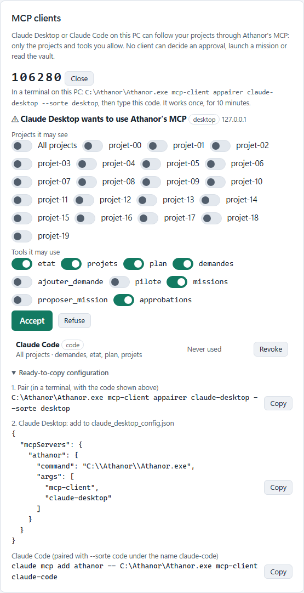
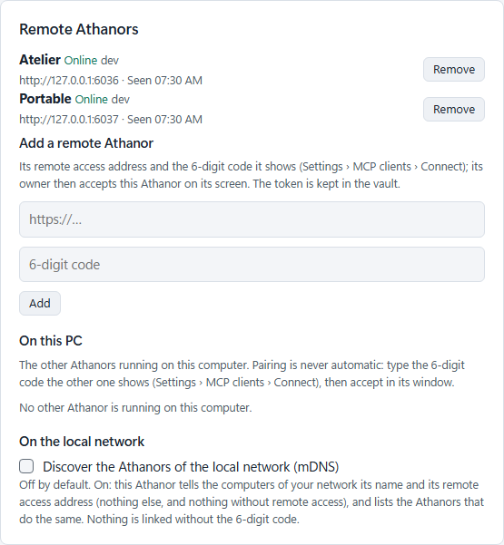
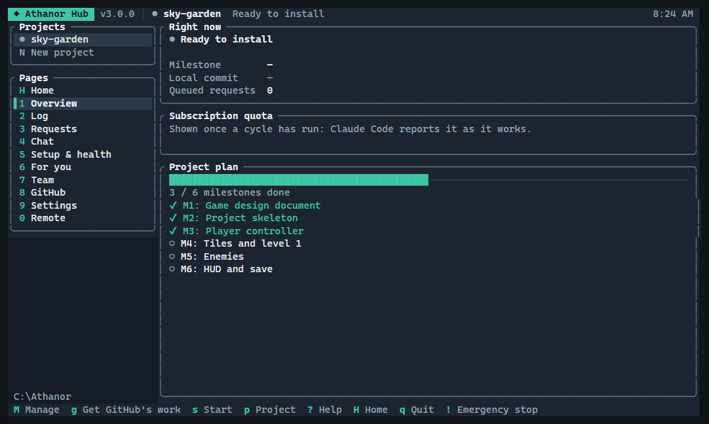

# Le hub : accueil, missions, accès à distance

Fait partie du [README d'Athanor Hub](../README.fr.md) · [English](HUB.md)

## Le hub

**L'Accueil** est la page sur laquelle Athanor s'ouvre : une conversation avec l'[assistant d'accueil](#lassistant-daccueil), une tuile par module avec son état et ses chiffres en direct (Studio : projets en cours, jalons terminés aujourd'hui, projets qui ont besoin de vous, quota ; Serveurs…), chaque chiffre ouvrant sa page, une tuile *Cet ordinateur* avec sa charge relue toutes les 2 secondes (processeurs, mémoire, chaque carte graphique et sa VRAM, place et activité de chaque disque, entrée et sortie de chaque lien réseau : Wi-Fi, Ethernet… ; sous Windows, Linux et macOS, aussi depuis un téléphone appairé), et deux listes, *Ce qui attend votre réponse* puis *En cours*, chacune avec *Tout voir*.

**Projets** liste tout ce qui est en cours dans chaque module : son état, son avancement, ce qu'il fait maintenant (« Jalon 5/14 : … »), ce qui vous attend et pourquoi, un lien direct ; des filtres *Tous*, *Besoin de moi*, *En cours* ; *Nouveau projet*, *Rejoindre un projet*, les projets archivés. Les projets d'un [Athanor distant](#mcp-et-athanor-distants) arrivent sous la forme `nom@instance`.

**Se repérer** : le menu à gauche a un seul niveau : *Accueil*, *Projets*, une entrée par module (**Missions**, **Studio**, les projets que Claude construit, le **Coffre**, **Serveurs**), le *Journal d'audit* et les *Réglages* en bas ; l'entrée d'un module rouvre la dernière page que vous y avez vue. Les pages d'un module sont des onglets en haut : ceux de Studio (le sélecteur de projet, puis Suivi, Équipe, Demandes, Discuter, Pour vous, Accès, Déploiement, Journal, Gérer) sont les pages décrites plus haut ; les Réglages regroupent Réglages, Skills & MCP, Installation & santé et À distance. Sur un téléphone, ☰ ouvre le menu et les onglets défilent sur le côté. La **cloche**, en haut de chaque page, réunit ce qui a besoin de vous dans chaque module, une ligne chacun avec sa raison : *Voir* ouvre la bonne page, *Ignorer* masque la ligne sans rien supprimer (*Alertes ignorées* la garde, *Rouvrir* la ramène, et elle revient d'elle-même quand sa raison change). **Guide**, à côté, ouvre le Guide. **Tutoriels** : l'Accueil, Studio et le Coffre montrent chacun une courte visite à votre première venue ; les *Tutoriels* du Guide les rejouent et *Réglages → Options* les réaffiche tous. La mise à jour vers le hub ne déplace rien : projets, réglages, clés et anciens liens restent où ils étaient. *Guide › Se repérer* en fait le tour, et le terminal s'ouvre sur la même page d'accueil (*H*).

**Seulement Studio ?** Rien ne change : Studio marche seul, pour un projet ou plusieurs, comme Athanor avant ; Serveurs ne demande rien tant que vous ne l'ouvrez pas, et un projet sans serveur dans son onglet *Déploiement* n'est jamais déployé. **Une mission depuis l'accueil** : *Nouvelle mission* sur l'accueil ouvre le formulaire unique d'une [mission](#missions) ; une phrase à l'assistant (« Fais une boutique et mets-la en ligne sur @vps avec @stripe ») ouvre le même formulaire déjà rempli, et rien ne démarre avant que vous appuyiez sur *Lancer*. Un projet Studio ne se déploie jamais lui-même et ne demande jamais d'accès à un serveur : il finit prêt à déployer, et Athanor le met en ligne avec les clés du coffre.

**Démarrer avec l'ordinateur** : *Ouvrir Athanor au démarrage de l'ordinateur* l'ouvre avec sa fenêtre, sous Windows, dans une session de bureau Linux et sur macOS (à l'ouverture de session). Avec *Relancer les pilotes qui tournaient*, les projets que vous avez démarrés et que vous n'avez ni arrêtés ni vus livrés repartent. Lancer Athanor alors qu'il tourne déjà ne fait que ramener sa fenêtre : il n'y a jamais deux copies.

**Scène d'ouverture** : au lancement d'Athanor Hub, une courte scène (la marque Athanor Hub, environ deux secondes) joue une fois, puis l'accueil s'affiche ; l'application se charge pendant ce temps, elle ne ralentit donc jamais le démarrage. Un clic, une touche ou Échap la passent. Avec un mot de passe Athanor, la scène se prolonge en écran de verrouillage : la marque reste à l'écran avec une lueur douce et un cadenas se dessine en trait pendant que le champ du mot de passe a déjà le focus (vous pouvez taper tout de suite, même pendant la première partie) ; un mot de passe faux donne une courte secousse et un message, le bon ouvre le cadenas et la lueur s'étend vers l'accueil. La scène n'est qu'un décor : avant le mot de passe, la page ne charge ni projet, ni clé, ni liste, et les routes de données restent refusées côté Go. Elle ne se rejoue ni au rechargement de la page ni quand vous rouvrez la fenêtre, se met en pause quand la fenêtre est cachée, devient un simple fondu si *réduire les animations* est activé dans votre système, et se fait plus légère sur téléphone. *Réglages → Options → Démarrage → Afficher l'animation de lancement au démarrage d'Athanor Hub* la coupe (l'écran de verrouillage s'affiche alors sans la scène). L'interface du terminal (`tui`) n'a pas d'animation.

### Accès à distance, depuis votre téléphone ou un autre ordinateur

**Accès à distance** : *À distance* → activez-le. Athanor télécharge une fois le programme de tunnel de Cloudflare (`cloudflared`, vérifié avec l'empreinte de sa version) et ouvre un « tunnel rapide » : une adresse `https://….trycloudflare.com`, sans compte. Scannez le QR code avec l'appareil photo de votre téléphone (ou ouvrez le lien sur un autre ordinateur), puis saisissez le code à 6 chiffres que la page *À distance* affiche quand vous passez la souris dessus (renouvelé toutes les 20 secondes) : l'appareil devient de confiance et retrouve le même Athanor, mis en page pour son écran, en direct ; sur un téléphone, *Sur l'écran d'accueil* en fait une application. Tout fonctionne de là, sauf ce que seul l'ordinateur doit faire : les secrets, l'accès à distance lui-même, le mot de passe, l'ouverture de dossiers sur l'ordinateur. La page *À distance* liste les appareils, connectés ou non, et ✕ en retire un tout de suite : son prochain clic est refusé. Tant que l'accès à distance est activé, l'ordinateur ne se met pas en veille (l'écran peut quand même s'éteindre). Le tunnel survit aux redémarrages d'Athanor (une mise à jour), mais son adresse change quand l'ordinateur redémarre : scannez alors le code à nouveau. Cloudflare ne garantit aucune disponibilité pour les tunnels rapides.

**Notifications sur le téléphone** : sur un téléphone appairé, *À distance → Cet appareil → Notifications sur cet appareil*. Le téléphone reçoit alors une notification, même avec Athanor fermé dessus, quand Claude a besoin de vous, quand un jalon est terminé, quand un projet est livré et quand un ordinateur d'une équipe est bloqué ; un appui ouvre la bonne page. Sur un iPhone ou un iPad, ajoutez d'abord Athanor à l'écran d'accueil (iOS 16.4 ou plus) et activez-les depuis là.

**Votre propre domaine, une adresse fixe** : avec un compte Cloudflare gratuit et un domaine dont le DNS est chez Cloudflare, *À distance → Adresse → Utiliser mon domaine* donne une adresse qui ne change jamais (`athanor.example.com`). Athanor ouvre une fois la connexion Cloudflare, dans le navigateur, puis crée un tunnel de cet ordinateur et y fait pointer le nom (un enregistrement DNS existant n'est jamais remplacé) ; le certificat du compte et les identifiants du tunnel restent dans le dossier d'Athanor. Les appareils gardent alors leur accès d'un redémarrage de l'ordinateur à l'autre. Le guide de la page configure **Cloudflare Access** en quelques clics du tableau de bord de Cloudflare : Cloudflare demande alors votre e-mail et un code avant que quoi que ce soit n'atteigne l'ordinateur, si bien qu'un inconnu qui trouve l'adresse ne voit même pas Athanor. *Revenir à une adresse temporaire* supprime le tunnel chez Cloudflare.

**Verrou** : avec un mot de passe (*Réglages → Options*), le bouton 🔒 verrouille l'application. Claude continue de travailler, mais rien ne peut être vu ni modifié (jeton compris) sans le mot de passe, et l'application démarre verrouillée. La fenêtre se verrouille aussi seule après un temps sans activité (1 heure par défaut, *Réglages → Options*) : seule l'interface se verrouille, donc IA, déploiements, tâches et sessions SSH continuent et gardent les clés du coffre sans redemander le mot de passe ; le bouton 🔒 et l'arrêt d'urgence ferment aussi les clés du coffre.

L'interface est traduite en anglais, français, espagnol, allemand, italien et portugais. La langue que vous choisissez est aussi celle dans laquelle Claude écrit le plan, le journal et les documents.

### Missions

Une mission relie ce qu'Athanor gère : un **projet Studio**, ses **serveurs** et les **clés API** du coffre dont il a besoin, ou **seulement des serveurs**. *Nouvelle mission* (sur l'accueil ou dans *Missions*) ouvre un seul formulaire, tout en vue : le **but de la mission** en haut, puis deux blocs à cocher, côte à côte sur ordinateur (l'un sous l'autre sur téléphone), et les clés du coffre en dessous. Tout genre de projet y entre : un site, une API, un jeu, un outil, un programme pour vos serveurs.

- **But de la mission.** Le résultat final que vous voulez, avec vos mots, avec *Améliorer avec Claude*.
- **Projet Studio** (coché par défaut) : Claude le développe. Son **projet** : un nom nouveau le crée dans Studio (avec son dossier, ses modes de travail, GitHub et ses propres réglages juste là, chacun avec une valeur par défaut sensée), le nom d'un des vôtres lui ajoute la mission comme prochaine demande. Un **plan** (facultatif), avec *Améliorer avec Claude*.
- **Gestion des serveurs** : Claude installe, configure et relie vos serveurs. Cochez-en autant qu'il faut. Avec un projet, chacun reçoit son rôle : **le projet est déployé ici** (plusieurs : des copies), ou **autre rôle**, et vous dites alors en quelques mots ce qu'il fait (une base PostgreSQL, un worker… ; obligatoire, même si le plan des serveurs le dit aussi) ; le projet n'y est jamais déployé. Avec la *Gestion des serveurs* seule, la mission est une tâche sur les serveurs (par exemple : installer un programme de GitHub sur plusieurs serveurs et les relier entre eux), sans développement, et chaque serveur peut dire son rôle (facultatif). Claude lit chaque rôle à côté du nom de son serveur.
- **Coffre : clés API**, toujours là : cochez les clés que la mission peut utiliser, groupées par vos catégories ; leurs valeurs n'arrivent jamais à Claude.
- **Sur les serveurs**, un seul choix : **A besoin de moi** (Claude lit les serveurs librement et vous demande votre accord avant chaque changement), **Autonome avec l'IA** (Claude travaille sans vous attendre et demande quand même avant une commande dangereuse) ou **Autonomie totale** (aucune action humaine nécessaire : Claude ne vous demande jamais rien sur les serveurs, commandes dangereuses et mise en ligne comprises ; vous la confirmez une fois, avec le mot de passe d'Athanor). Les quatre modes de l'assistant SSH restent sur la page du serveur.
- **Plan pour les serveurs**, séparé du plan du projet, avec *Améliorer avec Claude* ; tapez-y **@** (ou dans le but) pour nommer un serveur ou une clé API du coffre, comme sur l'accueil : son nom s'écrit et il est coché s'il ne l'était pas : ce que fait chaque serveur et comment ils sont reliés (nginx sur web-1, PostgreSQL sur db-1 joignable seulement depuis web-1, web-2 une copie de web-1…). Le serveur web qu'il nomme est celui utilisé : avec nginx, Athanor ne fait que basculer les versions du site et l'agent configure nginx pour les servir (Caddy n'est jamais installé contre votre plan). Puis, si le projet répond sur le web, son **adresse publique** (facultative), et **quand déployer** (à la livraison ou après chaque jalon).

*Lancer* crée le projet, son déploiement et sa permission, puis démarre son pilote (ou, sans projet, le pilote serveurs : votre but découpé en jalons, chacun une tâche avec ses critères d'acceptation, l'un après l'autre, voir [MISSIONS.fr.md](MISSIONS.fr.md)) : un clic, aucune autre étape. L'assistant de l'accueil répond avec le résumé de la mission sous son message (projet, serveurs et leurs rôles, clés, permission, plans) : *Vérifier et lancer* ouvre le même formulaire, rempli d'après votre phrase ; rien ne s'ouvre tout seul. Il sépare les deux plans : ce qu'il faut construire va au plan du projet, ce qui tourne sur quel serveur au plan des serveurs.

*Missions* montre un cadre par mission : le projet et son état (en cours, en pause, arrêté, terminé) avec une barre de ses jalons, chaque serveur avec son rôle et son *Terminal*, l'état du déploiement (non utilisé, en préparation, mise en ligne, en ligne, échec et pourquoi), les clés, le choix de permission. Une mission sans projet montre l'état de sa tâche et ce qu'elle a répondu. Les serveurs se gèrent depuis le cadre : *Arrêter le travail sur le serveur*, *Relancer le travail sur le serveur* (sa première mise en ligne, ou le dernier commit redéployé). *Pause*, *Arrêter*, *Reprendre* (*Relancer* sans projet), *Modifier* (un texte modifié devient une nouvelle demande du projet) et *Supprimer* marchent dans tout état ; supprimer une mission qui travaille arrête d'abord son pilote et ses tâches serveur, et son projet et son dossier ne partent que si vous le cochez. *Détails* replie l'historique de la mission et un lien vers le journal complet du projet.

### L'assistant d'accueil

La page d'accueil est une conversation avec un assistant qui connaît Athanor : posez une question, ou dites ce que vous voulez faire, avec vos mots. *Entrée* envoie, *Maj+Entrée* ajoute une ligne, *Nouvelle conversation* repart de zéro (il oublie celle-ci et ses pouvoirs sont désactivés). *@* ouvre la liste de vos projets, serveurs et clés du coffre, groupés par type avec une icône ; chaque groupe montre 5 entrées puis « N autres : tapez pour filtrer ». La puce insérée garde son type : un projet et un serveur de même nom pointent chacun vers le leur.

- **Ce qu'il lit.** Seulement ce que vous lui donnez : vos messages, les fichiers que vous joignez (images, PDF et fichiers texte, 20 Mo au plus chacun) et les dossiers que vous indiquez sous *Ce que l'assistant peut faire* › *Dossiers*, chacun en lecture seule ou en lecture et écriture. Son dossier de travail est vide : il ne voit aucun projet, serveur ni clé de lui-même, seulement leurs noms et leurs états.
- **Ses pouvoirs.** *Internet* (chercher et lire le web) et *Écriture* (modifier des fichiers, uniquement dans les dossiers réglés en lecture et écriture) sont désactivés par défaut et le redeviennent à chaque nouvelle conversation ; leur résumé reste visible sous le champ. Il n'exécute jamais de commande, n'utilise jamais de serveur MCP et n'atteint jamais un serveur.
- **Ce qu'il ne voit jamais.** Les valeurs du coffre (une valeur collée dans un message ou un fichier texte est masquée avant qu'il la lise, et dans chaque réponse de l'API), les fichiers de secrets (`.env`), les dossiers propres d'Athanor et les dossiers système. Un fichier ou une page web qui lui donne des ordres est une donnée : il vous dit ce que le texte demande et ne le suit pas.
- **Missions et cartes.** Un projet à construire (avec ses serveurs et ses clés quand votre phrase les nomme), ou un travail sur des serveurs seulement, est une mission : son résumé s'affiche sous la réponse, et *Vérifier et lancer* ouvre le formulaire *Nouvelle mission* rempli de ce qu'il a compris ; vous vérifiez, corrigez ce que vous voulez et lancez. Pour le reste, il propose une carte : démarrer un pilote, ajouter une demande, laisser une remarque, lancer une tâche sur vos serveurs ou avec vos clés d'API, créer un sous-agent ou un serveur MCP, en activer un dans des projets. La carte n'affiche que ce que votre demande utilise et dit quoi, sur quoi et avec quels accès ; *Lancer*, *Changer* ou *Refuser*. Rien ne s'exécute avant *Lancer*, et chaque décision entre dans le journal d'audit.
- **Depuis un téléphone.** Sur un appareil appairé, la conversation est en lecture seule. Le *?* en haut de la conversation rejoue son court tutoriel ; *Guide › Parler à l'assistant d'accueil* donne les détails.

---

## MCP et Athanor distants

| | |
|:---:|:---:|
|  **Clients MCP** : un code, votre accord, une portée |  **Athanor distants** : un autre Athanor rejoint le vôtre |

Le MCP d'Athanor s'ouvre à deux sortes de clients, toujours par un code à 6 chiffres **et** votre oui à l'écran, jamais par une adresse ouverte sur votre réseau ou sur Internet (rien n'écoute hors de 127.0.0.1).

- **Claude Desktop et Claude Code.** *Réglages › Clients MCP › Brancher un client* affiche un code ; `Athanor mcp-client appairer claude-desktop --sorte desktop` dans un terminal l'appaire, et vous choisissez les projets qu'il peut voir et les outils qu'il peut utiliser. *Configuration prête à copier* donne l'entrée de `claude_desktop_config.json` et la ligne `claude mcp add`. Il lit l'état des modules, les plans, les demandes et les accords en attente ; avec les outils que vous cochez, il ajoute une demande, ou démarre ou met en pause un pilote. Il ne décide jamais d'un accord, ne lit pas le coffre et ne touche aucun serveur ; *Révoquer* arrête son jeton aussitôt. Pas à pas : [docs/MCP.md](MCP.fr.md).
- **Athanor distants.** *Réglages › Athanor distants › Ajouter un Athanor distant* relie un autre Athanor (sur ce PC, votre réseau ou un VPS) par l'adresse de son accès à distance et le code qu'il affiche ; son propriétaire accepte et choisit ce qu'il prête, et le jeton est gardé dans votre coffre. Ses projets arrivent dans *Projets* sous la forme `nom@instance` (grisés hors ligne), vous démarrez ou arrêtez son pilote d'ici, et un module Serveurs distant apporte ses serveurs et ses tâches — une action en prod attend toujours l'accord de son propre propriétaire. La découverte du réseau local (mDNS) est désactivée par défaut et ne fait que proposer. `athanor module servers` fait tourner Serveurs seul sur un VPS, sans fenêtre (une unité systemd est dans la doc). Pas à pas : [docs/REMOTE.md](REMOTE.fr.md).
- **Testé.** `TestI7Listeners` vérifie que chaque écoute du vrai exécutable est sur 127.0.0.1 ; `TestOuvertureNonAppaire` et une red team scriptée essaient chaque route sans jeton valide ; le job CI `two-instances` appaire deux vrais Athanor et pilote l'un depuis l'autre.

---

## Dans un terminal

Sous Linux et macOS, Athanor tourne aussi dans le terminal, comme btop ou htop : le même Athanor que sa fenêtre, sur le même serveur, donc les deux montrent toujours la même chose. Fait pour un serveur joint en SSH, un Linux sans bureau, ou simplement votre propre terminal. Le terminal réunit l'accueil et les pages du Studio ci-dessous ; le Coffre, les Serveurs, les Accès et le chat d'accueil restent dans la fenêtre (ouvrez-la sur cet ordinateur avec *w*, ou depuis un téléphone appairé par l'accès à distance).

- **L'ouvrir** : `./athanor tui` dans le dossier d'Athanor (ou le fichier téléchargé : `./Athanor-Linux-x64 tui`). En SSH (`SSH_CONNECTION` défini), ou sur un Linux sans écran (ni `DISPLAY` ni `WAYLAND_DISPLAY`), `./athanor` seul l'ouvre. `./athanor gui` ouvre la fenêtre quoi qu'en dise la détection.
- **Sur un serveur** : lancez Athanor avec un utilisateur normal, pas en root : Claude Code refuse de travailler en root (Installation & santé le dit, et *Démarrer* refuse). Sur un VPS neuf : `adduser NOM`, `usermod -aG sudo NOM`, connectez-vous en `NOM`, puis `./Athanor-Linux-x64`.
- **Avec Athanor déjà ouvert** (sa fenêtre, ou un autre terminal) : `./athanor tui` montre ce même Athanor. Quand c'est le terminal qui a lancé Athanor, Athanor s'arrête avec lui (les pilotes continuent) ; *w* ouvre aussi la fenêtre, sur un ordinateur avec écran.
- **Les pages** : *H* Accueil, sur lequel le terminal s'ouvre (un bloc par module avec son état et ses chiffres, ce qui vous attend ; *Entrée* ouvre la première page du module, *Échap* y revient), *1* Suivi (l'état, le dernier commit ici et sur GitHub, le quota ou, avec une clé API, la dépense (*$* la recompte à partir de maintenant), les cycles et le plan), *2* Journal (en direct ; *o*, *r*, *u* filtrent outils, résultats et sous-agents, */* cherche, *f* suit), *3* Demandes (*n* une nouvelle, *e* une remarque en cours de route, *d* supprime, *Alt+↑/↓* réordonne), *4* Discuter (son champ est prêt dès l'ouverture de la page : *Entrée* envoie, *Alt+Entrée* une nouvelle ligne ; *Échap* le quitte pour *c* une nouvelle conversation, *m* le modèle et *w* Internet, *i* y revient), *5* Installation & santé (*v* vérifie tout ; *r* répare et *I* installe tout directement dans le terminal, chaque commande affichée et sudo répondu sur place, puis Athanor revient ; *T* le jeton, ou la clé API en mode API). *6* Pour vous (d'abord les approbations en attente des agents, tous projets confondus, chacune avec ce qu'elle demande : le site, accès cochés, SHA court, plan Serveurs étape par étape ; *y* accepte, *r* refuse, *t* ne plus demander là où la fenêtre le permet, avec le mot de passe d'Athanor quand il est demandé ; puis les tâches : *Entrée* répond, avec les valeurs demandées dans des champs masqués ; *k* passe), *7* Équipe, *8* GitHub (*c* connecte cet ordinateur dans le terminal, *l* lie un de vos dépôts, *r* en crée un privé, *p* envoie, *a* envoi automatique, *u* délie), *9* Réglages (*Entrée* modifie un réglage, secrets masqués ; *l*, *p*, *a* la langue, la palette, l'accent), *0* À distance (*o* active ou coupe l'accès, le QR code d'appairage dessiné dans le terminal avec son lien, *v* montre les 6 chiffres pendant 10 secondes, *r* renomme et *d* retire un appareil de confiance : un serveur joint en SSH appaire ainsi un téléphone sans fenêtre). Sur les pages E, 8, 9 et 0, leurs propres lettres passent en premier, en minuscule comme en majuscule. *!* sur toute page est l'arrêt d'urgence, après confirmation. Les formulaires ont des boutons *Enregistrer* et *Annuler* (Tab, ou un clic ; *F2* enregistre aussi) ; un formulaire refusé par le serveur reste ouvert avec la raison, et en fermer un qui contient du texte demande d'abord.
- **Partout** : *s* Démarrer (avec les mêmes questions que la fenêtre : pas encore de demande, outils non installés, GitHub en avance), *a* Arrêter après le cycle (à nouveau : le laisser continuer), *x* Arrêter maintenant, *p* ou *[ ]* le projet, *N* un nouveau projet, *M* le gère (renommer, archiver, retirer de la liste ; les archivés reviennent depuis *p*), *g* Récupérer le travail de GitHub, *?* toutes les touches, *q* quitte. La souris clique projets, pages et lignes ; la molette fait défiler.
- **Son allure** : la palette et l'accent de l'application, sa langue, en couleurs 24 bits quand le terminal dit les avoir (sinon 256). En SSH, le terminal ne le dit pas toujours : `ATHANOR_COULEURS=24 ./athanor tui` les force. Tant que le terminal fait tourner Athanor, ce qu'Athanor affiche va dans `logs/terminal.log`.
