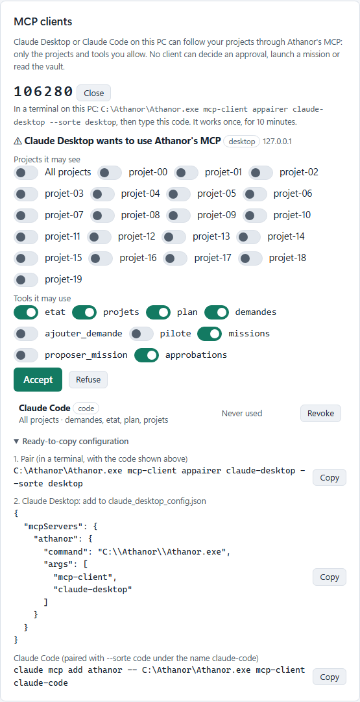
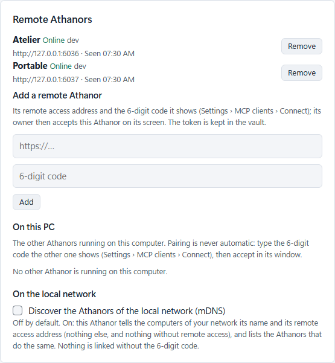
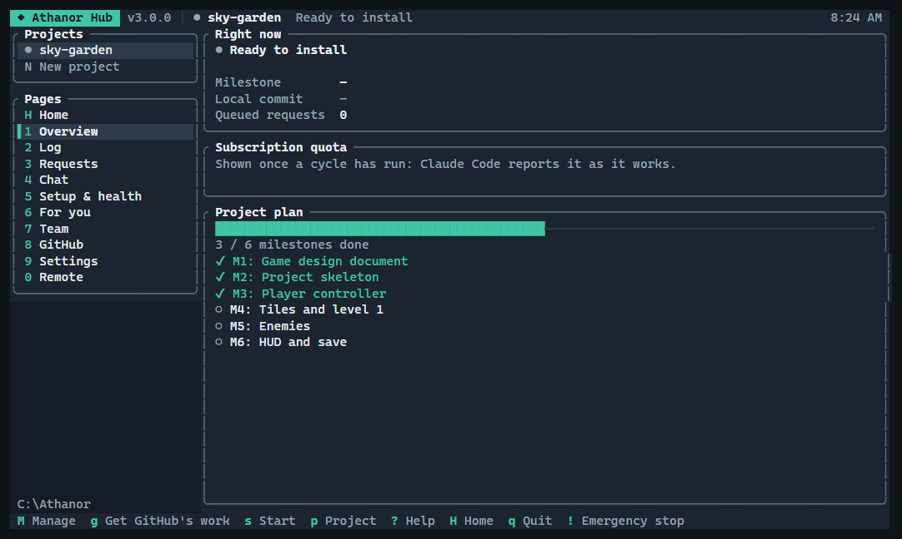

# The hub: home, missions, remote access

Part of the [Athanor Hub README](../README.md) · [Français](HUB.fr.md)

## The hub

**Home** is the page Athanor opens on. On the left, the conversation with the [home assistant](#the-home-assistant) fills the screen: Athanor's mark and a few ways to start while it is empty, then the messages; under its field, always in sight, *Files*, *Internet*, *Writing* and *Folders* (their count; a click opens their list), and one sentence saying what the assistant can do right now. On the right: two lists, *Waiting for your answer* then *In progress*, each with *See all*; one tile per module with its state and live figures (Studio: projects running, milestones done today, projects that need you, and its quota, one bar per window: the 5-hour session on the plans that have it, then the week, each with when it starts again; Servers…), each figure opening its page; a *This computer* tile with its load read live every 2 seconds (processors, memory, each graphics card (NVIDIA, AMD or Intel) and its VRAM, or the unified memory and the GPU cores of Apple silicon, each disk's space and activity, each network link in and out: Wi-Fi, Ethernet…; on Windows, Linux and macOS, also from a paired phone).

**Projects** lists everything under way in every module: its state, its progress, what it is doing now (“Milestone 5/14: …”), what waits for you and why, a direct link; filters *All*, *Needs me*, *In progress*; *New project*, *Join a project*, the archived projects. The projects of a [remote Athanor](#mcp-and-remote-athanors) come in as `name@instance`.

**Finding your way**: the menu on the left has one level: *Home*, *Projects*, one entry per module (**Missions**, **Studio**, the projects Claude builds, the **Vault**, **Servers**), the *Audit log* and *Settings* at the bottom; a module's entry reopens the page you last saw in it. A module's pages are tabs at the top: Studio's (the project picker, then Overview, Team, Requests, Chat, For you, Access, Deployment, Log, Manage) are the pages described above; Settings holds Settings, Skills & MCP, Setup & health and Remote. On a phone, ☰ opens the menu and the tabs scroll sideways. The **bell**, at the top of every page, gathers what needs you in every module, one line each with its reason: *View* opens the right page, *Ignore* hides the line without deleting anything (*Ignored alerts* keeps it, *Reopen* brings it back, and it returns by itself when its reason changes). **Guide**, beside it, opens the Guide. **Tutorials**: Home, Studio and the Vault each show a short tour on your first visit; the Guide's *Tutorials* replays them and *Settings → Options* shows them all again. The update to the hub moves nothing: projects, settings, keys and old links stay where they were. *Guide › Finding your way* walks through it, and the terminal opens on the same home page (*H*).

**Only Studio?** Nothing changes: Studio works on its own, for one project or many, as Athanor did before; Servers asks for nothing until you open it, and a project with no server in its *Deployment* tab is never deployed. **A mission from home**: *New mission* on the home page opens the one form of a [mission](#missions); a sentence to the assistant (“Make a shop and put it online on @vps with @stripe”) opens the same form already filled, and nothing starts before you press *Launch*. A Studio project never deploys itself and never asks for a server's access: it ends ready to deploy, and Athanor puts it online with the keys of the vault.

**Start with the computer**: *Open Athanor when the computer starts* opens it with its window, on Windows, in a Linux desktop session and on macOS (at login). With *Restart the pilots that were running*, the projects you started and neither stopped nor saw delivered start again. Launching Athanor while it already runs only brings its window back: there is never a second copy.

**Opening scene**: when Athanor Hub starts, a short scene (the Athanor Hub mark, about two seconds) plays once, then the home page appears; the app loads underneath meanwhile, so it never slows the start. A click, any key or Esc skips it. With a password for Athanor, the scene goes on as the lock screen: the mark stays on screen with a soft glow and a padlock is drawn in line while the password field already has the focus (you can type at once, even during the first part); a wrong password gives a short shake and a message, the right one opens the padlock and the glow spreads into the home page. The scene is decoration only: before the password the page loads no project, key or list, and the data routes stay refused on the Go side. It does not play again when you reload the page or reopen the window, pauses while the window is hidden, becomes a simple fade with *reduce motion* turned on in your system, and is lighter on a phone. *Settings → Options → Startup → Show the launch animation when Athanor Hub starts* turns it off (the lock screen then appears without the scene). The terminal interface (`tui`) has no animation.

### Remote access, from your phone or another computer

**Remote access**: *Remote* → switch it on. Athanor downloads Cloudflare's tunnel program once (`cloudflared`, checked against its release's checksum) and opens a "quick tunnel": an `https://….trycloudflare.com` address, no account. Scan the QR code with your phone's camera (or open the link on another computer), then type the 6-digit code the *Remote* page shows when you move the mouse over it (renewed every 20 seconds): the device becomes trusted and finds the same Athanor, laid out for its screen, live; on a phone, *Add to Home Screen* makes it an app. Everything works from there except what only the computer should do: the secrets, the remote access itself, the password, opening folders on the computer. The *Remote* page lists the devices, connected now or not, and ✕ removes one at once: its next click is refused. While remote access is on, the computer does not go to sleep (the screen can still turn off). The tunnel survives Athanor's restarts (an update), but its address changes when the computer restarts: scan the code again then. Cloudflare gives no uptime guarantee for quick tunnels.

**Notifications on the phone**: on a paired phone, *Remote → This device → Notifications on this device*. The phone then gets a notification even with Athanor closed on it, when Claude needs you, when a milestone is done, when a project is delivered and when a computer of a team is stuck; a tap opens the right page. On an iPhone or iPad, add Athanor to the Home Screen first (iOS 16.4 or later) and switch them on from there.

**Your own domain, a fixed address**: with a free Cloudflare account and a domain whose DNS is at Cloudflare, *Remote → Address → Use my domain* gives an address that never changes (`athanor.example.com`). Athanor opens Cloudflare's sign-in once, in the browser, then creates a tunnel of this computer and points the name to it (an existing DNS record is never replaced); the account's certificate and the tunnel's credentials stay in Athanor's folder. The devices then keep their access across restarts of the computer. The page's guide sets up **Cloudflare Access** in a few clicks of Cloudflare's dashboard: Cloudflare then asks for your e-mail and a code before anything reaches the computer, so a stranger who finds the address does not even see Athanor. *Back to a temporary address* deletes the tunnel at Cloudflare.

**Lock**: with a password (*Settings → Options*), the 🔒 button locks the app. Claude keeps working, but nothing can be seen or changed (token included) without the password, and the app starts locked. The window also locks itself after a time without activity (1 hour by default, *Settings → Options*): only the interface locks, so AIs, deployments, tasks and SSH sessions keep running and keep the vault keys without asking for the password again; the 🔒 button and the emergency stop close the vault keys as well.

The interface is translated into English, French, Spanish, German, Italian and Portuguese. The language you choose is also the one Claude writes the plan, log and documents in.

### Missions

A mission links what Athanor manages: a **Studio project**, its **servers** and the **API keys** of the vault it needs, or **servers only**. *New mission* (on the home page or in *Missions*) opens one form, everything in view: the **goal of the mission** on top, then two blocks to tick, side by side on a computer (stacked on a phone), and the vault's keys below. A project of any kind fits: a site, an API, a game, a tool, a program for your servers.

- **Goal of the mission.** The end result you want, in your words, with *Improve with Claude*.
- **Studio project** (ticked by default): Claude develops it. Its **project**: a new name creates it in Studio (with its folder, working modes, GitHub and own settings right there, each with a sensible default), the name of one of yours adds the mission to it as its next request. A **plan** (optional), with *Improve with Claude*.
- **Server management**: Claude installs, configures and links your servers. Tick as many as needed. With a project, each one gets its role: **the project is deployed here** (several: copies of it), or **another role**, and then you say in a few words what it does (a PostgreSQL database, a worker…; required, even when the servers' plan says it too); it is never deployed to. With *Server management* alone, the mission is one task on the servers (for example: install a program from GitHub on several servers and link them together), no development, and each server can say its role (optional). Claude reads each role next to its server's name.
- **API keys for this mission**, always there: the chosen keys as chips (× removes one), and *Find an API* to add one, by its name, its type or its category (with the filter by category when you made some), however many keys the vault holds; their values never reach Claude.
- **On the servers**, one choice: **Needs me** (Claude reads the servers freely and asks your accord before each change), **Autonomous with the AI** (Claude works without waiting for you and still asks before a dangerous command) or **Full autonomy** (no human action needed: Claude never asks you anything on the servers, dangerous commands and putting it online included; you confirm it once, with Athanor's password). The four modes of the SSH assistant stay on the server's page.
- **Plan for the servers**, separate from the project's plan, with *Improve with Claude*; type **@** there (or in the goal) to name a server or an API key of the vault, as on the home page: its name is written and it is ticked if it was not: what each server does and how they are linked (nginx on web-1, PostgreSQL on db-1 reachable from web-1 only, web-2 a copy of web-1…). The web server it names is the one used: with nginx, Athanor only switches the site's versions and the agent sets nginx up to serve them (Caddy is never installed against your plan). Then, if the project answers on the web, its **public address** (optional), and **when to deploy** (at delivery or after each milestone).

*Launch* creates the project, its deployment and its permission, then starts its pilot (or, servers only, the servers pilot: your goal cut into milestones, each one a task with its acceptance criteria, run in turn, see [MISSIONS.md](MISSIONS.md)): one click, no other step. The assistant of the home page answers with the mission's summary under its message (project, servers and their roles, keys, permission, plans): *Review and launch* opens the same form, filled from your sentence; nothing opens by itself. It keeps the two plans apart: what to build goes to the project's plan, what runs on which server to the servers' plan.

*Missions* shows one frame per mission: the project and its state (in progress, paused, stopped, finished) with a bar of its milestones, each server with its role and its *Terminal*, the deployment's state (not used, being prepared, going online, online, failed and why), the keys, the permission choice. A servers-only mission shows its task's state and what it answered. The servers are managed from the frame: *Stop the server's work*, *Launch the server's work again* (its first deployment, or the last commit deployed again). *Pause*, *Stop*, *Resume* (*Launch again* for servers only), *Edit* (a changed text becomes a new request of the project) and *Delete* work in any state; deleting a mission that works stops its pilot and its server tasks first, and its project and folder go only when you tick it. *Details* folds the mission's history and a link to the project's full log.

### The home assistant

The home page is a conversation with an assistant that knows Athanor: ask a question, or say what you want done, in your words. *Enter* sends, *Shift+Enter* adds a line, *New conversation* starts again (it forgets this one and its powers are switched off). *@* opens a list of your projects, servers and vault keys, grouped by type with an icon; each group shows 5 entries and then "N more: type to filter". The chip you insert keeps its type, so a project and a server with the same name each point to their own.

- **What it reads.** Only what you give it: your messages, the files you attach (images, PDF and text files, 20 MB at most each) and the folders you add with *Folders* under the field, each read only or read and write; without one, it sees no file of your computer and still answers and proposes cards. Its working folder is empty: it sees no project, server or key by itself, only their names and states.
- **Its powers.** *Internet* (search and read the web) and *Writing* (change files, only in the folders set to read and write) are off by default and off again in each new conversation; their chips stay in sight under the field, lit while on, with one sentence saying what the assistant can do right now. It never runs a command, never uses an MCP server and never reaches a server.
- **What it never sees.** The vault's values (a value pasted in a message or a text file is masked before it reads it, and in every answer of the API), secrets files (`.env`), Athanor's own folders and system folders. A file or a web page that gives it orders is data: it tells you what the text asks and does not follow it.
- **Missions and cards.** A project to build (with its servers and keys when your sentence names them), or work on servers only, is a mission: its summary shows under the answer, and *Review and launch* opens the *New mission* form filled with what it understood; you check it, change what you want and launch it. For the rest it proposes a card: start a pilot, add a request, leave a remark, run a task on your servers or with your API keys, create a sub-agent or an MCP server, switch one on in projects. The card shows only what your request uses and says what, on what and with which accesses; *Launch*, *Change* or *Refuse*. Nothing runs before *Launch*, and each decision goes into the audit log.
- **From a phone.** On a paired device the conversation is read only. The *?* at the top of the conversation replays its short tutorial; *Guide › Talk to the home assistant* has the details.

---

## MCP and remote Athanors

| | |
|:---:|:---:|
|  **MCP clients**: a code, your yes, a scope |  **Remote Athanors**: another Athanor joins yours |

Athanor's MCP opens to two kinds of clients, always by a 6-digit code **and** your yes on screen, never by an address open on your network or the Internet (nothing listens outside 127.0.0.1).

- **Claude Desktop and Claude Code.** *Settings › MCP clients › Connect a client* shows a code; `Athanor mcp-client appairer claude-desktop --sorte desktop` in a terminal pairs it, and you choose the projects it may see and the tools it may use. *Ready-to-copy configuration* gives the entry for `claude_desktop_config.json` and the `claude mcp add` line. It reads the state of the modules, the plans, the requests and the approvals waiting; with the tools you tick, it adds a request, or starts or pauses a pilot. It never decides an approval, reads the vault or touches a server; *Revoke* stops its token at once. Step by step: [docs/MCP.md](MCP.md).
- **Remote Athanors.** *Settings › Remote Athanors › Add a remote Athanor* links another Athanor (on this PC, your network or a VPS) by its remote access address and the code it shows; its owner accepts and chooses what it lends, and the token is kept in your vault. Its projects come into *Projects* as `name@instance` (greyed while offline), you start or stop its pilot from here, and a remote Servers module brings its servers and tasks — a production action still waits for its own owner's approval. Local network discovery (mDNS) is off by default and only ever proposes. `athanor module servers` runs Servers alone on a VPS, with no window (a systemd unit is in the doc). Step by step: [docs/REMOTE.md](REMOTE.md).
- **Tested.** `TestI7Listeners` checks that every listener of the real executable is on 127.0.0.1; `TestOuvertureNonAppaire` and a scripted red team try every route without a valid token; the CI job `two-instances` pairs two real Athanors and drives one from the other.

---

## In a terminal

On Linux and macOS, Athanor also runs in the terminal, like btop or htop: the same Athanor as its window, on the same server, so both always show the same thing. Made for a server reached through SSH, a Linux without a desktop, or simply your own terminal. The terminal holds the home page and the Studio pages below; the Vault, Servers, Access and the home chat stay in the window (open it on this computer with *w*, or from a paired phone through remote access).

- **Open it**: `./athanor tui` in Athanor's folder (or the downloaded file: `./Athanor-Linux-x64 tui`). Through SSH (`SSH_CONNECTION` set), or on a Linux without a screen (no `DISPLAY` nor `WAYLAND_DISPLAY`), `./athanor` alone opens it. `./athanor gui` opens the window whatever the guess.
- **On a server**: run Athanor as a normal user, not as root: Claude Code refuses to work as root (Setup & health says so, and *Start* refuses). On a fresh VPS: `adduser NAME`, `usermod -aG sudo NAME`, log in as `NAME`, then `./Athanor-Linux-x64`.
- **With Athanor already open** (its window, or another terminal): `./athanor tui` shows that same Athanor. When the terminal is the one that started Athanor, Athanor stops with it (the pilots keep running); *w* opens the window as well, on a computer with a screen.
- **Pages**: *H* Home, where the terminal opens (one block per module with its state and figures, what needs you; *Enter* opens the module's first page, *Esc* comes back to it), *1* Overview (the state, the last commit here and on GitHub, the quota or, with an API key, the spend (*$* counts it again from now), the cycles and the plan), *2* Log (live; *o*, *r*, *u* filter tools, results and sub-agents, */* searches, *f* follows), *3* Requests (*n* a new one, *e* a note along the way, *d* deletes, *Alt+↑/↓* reorders), *4* Chat (its field is ready as soon as the page opens: *Enter* sends, *Alt+Enter* a new line; *Esc* leaves it for *c* a new conversation, *m* the model and *w* Internet, *i* comes back to it), *5* Setup & health (*v* checks everything, *r* repairs and *I* installs everything right in the terminal, each command shown and sudo answered there, then Athanor comes back; *T* the token, or the API key in API mode). *6* For you (the agents' pending approvals first, every project, each with what it asks: the site, ticked accesses, short SHA, a Servers plan step by step; *y* accepts, *r* refuses, *t* never asks again where the window offers it, with Athanor's password when it is asked for; then the tasks: *Enter* answers, with the values asked for in hidden fields; *k* skips), *7* Team, *8* GitHub (*c* connects this computer in the terminal, *l* links one of your repositories, *r* creates a private one, *p* pushes, *a* automatic push, *u* unlinks), *9* Settings (*Enter* edits a setting, secrets hidden; *l*, *p*, *a* the language, the palette, the accent), *0* Remote (*o* switches remote access on or off, the pairing QR code drawn in the terminal with its link, *v* shows the 6 digits for 10 seconds, *r* renames and *d* removes a trusted device: a server reached through SSH pairs a phone this way, with no window). On pages E, 8, 9 and 0 their own letters come first, small or capital. *!* on any page is the emergency stop, after a confirmation. The forms have *Save* and *Cancel* buttons (Tab, or a click; *F2* saves too); a form the server refuses stays open with the reason, and closing one with text in it asks first.
- **Everywhere**: *s* Start (with the same questions as the window: no request yet, tools not installed, GitHub ahead), *a* Stop after cycle (again: let it go on), *x* Stop now, *p* or *[ ]* the project, *N* a new project, *M* manages it (rename, archive, remove from the list; the archived ones come back from *p*), *g* Get GitHub's work, *?* every key, *q* quits. The mouse clicks projects, pages and lines; the wheel scrolls.
- **Its look**: the app's palette and accent, its language, in 24-bit colours when the terminal says it has them (else 256). Over SSH the terminal does not always say so: `ATHANOR_COULEURS=24 ./athanor tui` forces them. While the terminal serves Athanor, what Athanor prints goes to `logs/terminal.log`.
