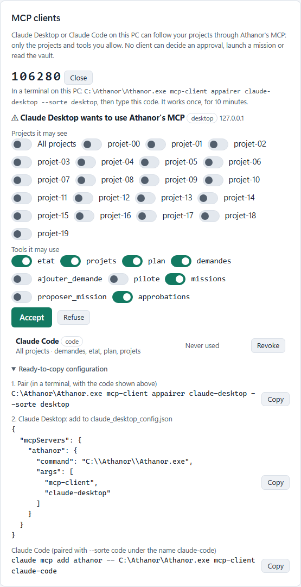

# Brancher Claude Desktop (ou Claude Code) sur Athanor

*English: [MCP.md](MCP.md)*

Athanor a un seul serveur MCP. Claude Desktop ou Claude Code, **sur ce PC**, peut s'en servir pour suivre vos projets : lire leur plan et leurs demandes, ajouter une demande, démarrer ou mettre en pause un pilote. Seulement les projets et les outils que vous autorisez, jamais plus. Dans l'application, *Guide › Brancher Claude Desktop* reprend les mêmes étapes ; un autre Athanor relié à celui-ci est dans [REMOTE.fr.md](REMOTE.fr.md).

<p align="center">
  
</p>

## Pas à pas

1. **Ouvrir un code.** *Réglages › Clients MCP › Brancher un client* affiche un code à 6 chiffres. Il ne sert qu'une fois, pendant 10 minutes (5 essais faux le ferment) ; *Fermer* le retire.
2. **Appairer dans un terminal.** Dans un terminal sur ce PC, lancez la commande affichée sous le code, puis tapez le code :
   ```sh
   Athanor mcp-client appairer claude-desktop --sorte desktop
   ```
   (sous Windows, le chemin complet d'`Athanor.exe` est dans *Configuration prête à copier*). Le terminal répond `Code accepted` et attend votre accord.
3. **Accepter avec un périmètre.** « claude-desktop veut utiliser le MCP d'Athanor » arrive dans *Clients MCP*. Cochez les projets qu'il peut voir (ou *Tous les projets*) et les outils qu'il peut utiliser, puis *Accepter*. Les outils de lecture sont cochés ; `ajouter_demande`, `pilote` et `proposer_mission` ne le sont pas. Le terminal reçoit le jeton **une seule fois** et le garde dans votre dossier utilisateur (`athanor-clients/claude-desktop.jeton` dans votre dossier de configuration, lisible par vous seul). Athanor n'en garde que l'empreinte.
4. **L'ajouter à Claude Desktop.** *Configuration prête à copier* donne l'entrée pour `claude_desktop_config.json` (dans Claude Desktop : *Settings › Developer › Edit Config*) :
   ```json
   {
     "mcpServers": {
       "athanor": { "command": "C:\\Chemin\\Vers\\Athanor.exe", "args": ["mcp-client", "claude-desktop"] }
     }
   }
   ```
   Redémarrez Claude Desktop : *athanor* apparaît dans ses outils.
5. **Claude Code.** Appairez sous le nom `claude-code` avec `--sorte code`, puis :
   ```sh
   claude mcp add athanor -- "C:\Chemin\Vers\Athanor.exe" mcp-client claude-code
   ```

## Ce qu'un client peut faire

| Outil | Ce qu'il fait | Coché par défaut |
|---|---|---|
| `etat` | les modules, leurs alertes, le nom de cette instance | oui |
| `projets` | les projets de son périmètre, leur avancement et leur jalon en cours | oui |
| `plan`, `demandes` | le plan d'un projet, ses demandes | oui |
| `missions`, `approbations` | les anciennes missions (en lecture seule) et les accords en attente (avec un lien vers la page, jamais une décision) | oui |
| `ajouter_demande` | ajoute une demande à un projet de son périmètre | non |
| `pilote` | `demarrer`, `pause_fin_cycle` (s'arrête à la fin du cycle) ou `arreter` | non |
| `proposer_mission` | retiré : répond que les missions ne se créent plus, et renvoie vers `ajouter_demande` | non |

Demandez à Claude « Que font mes projets ? » : il appelle `etat` et `projets`, puis lit ce dont il a besoin. Chaque appel va dans le journal d'audit sous `client:claude-desktop`, avec l'outil et le projet.

## Ce qu'un client ne peut jamais faire

- **Décider d'un accord.** Un accord demande une preuve de présence venant de la fenêtre d'Athanor ou d'un appareil appairé ; un jeton lu sur le disque n'en donne jamais.
- **Déployer**, lire une valeur du coffre, toucher un serveur : ces outils n'existent pas pour un client MCP, quoi que vous cochiez.
- **Voir un projet hors de son périmètre** : pour lui, ce projet n'existe pas (même réponse qu'un nom inconnu).
- **Servir son jeton ailleurs** : un jeton de client ne vaut que sur la route MCP, jamais sur les autres routes `/api/*` ni par le tunnel de l'accès à distance.

Athanor revérifie le jeton, l'outil et le projet à chaque appel, dans son propre code : un client qui obéit à une mauvaise consigne ne peut toujours pas dépasser son périmètre.

## Révoquer

*Révoquer* sur sa ligne dans *Clients MCP* : son jeton cesse de marcher aussitôt, et Claude reçoit le message « Athanor refused this client's token (revoked, or Athanor is in emergency stop) ». Il doit s'appairer de nouveau pour revenir. L'**arrêt d'urgence** suspend tous les clients et ferme l'appairage jusqu'à *Reprendre*.

## Dépannage

| Claude dit | Que faire |
|---|---|
| « Athanor is not open on this computer » | Ouvrez Athanor : le relais le retrouve seul sur 127.0.0.1, quel que soit son port. |
| « This MCP client is not paired with Athanor » | Le fichier du jeton manque : appairez de nouveau (étape 2) avec le même nom que dans la configuration. |
| « Athanor refused this client's token » | Il a été révoqué, ou Athanor est en arrêt d'urgence : *Reprendre*, ou appairer de nouveau. |
| Le code est refusé dans le terminal | Il a déjà servi, a expiré (10 minutes) ou a été fermé après 5 essais faux : ouvrez-en un nouveau. |
| Un projet manque | Il est hors du périmètre du client : révoquez-le et appairez-le de nouveau avec ce projet coché. |
| *athanor* n'est pas dans les outils de Claude Desktop | Vérifiez le JSON (une virgule, les `\\` doublés des chemins Windows), puis quittez complètement Claude Desktop et rouvrez-le. |

Tout reste sur ce PC : le relais parle à Athanor sur 127.0.0.1 seulement, et Athanor n'ouvre pour lui aucune adresse sur votre réseau ni sur Internet. Il n'y a pas de connecteur HTTP distant : il exigerait une adresse publique.
