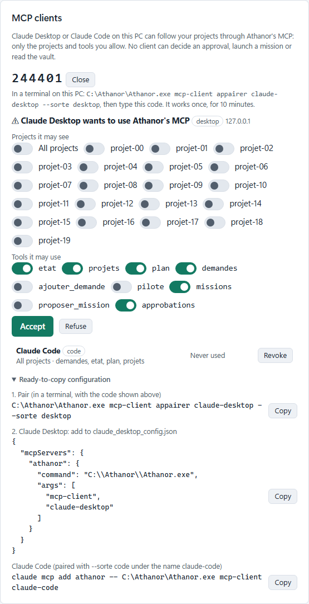

# Connect Claude Desktop (or Claude Code) to Athanor

*Français : [MCP.fr.md](MCP.fr.md)*

Athanor has one MCP server. Claude Desktop or Claude Code, **on this PC**, can use it to follow your projects: read their plan and their requests, add a request, start or pause a pilot, prepare a mission card. Only the projects and the tools you allow, never more. In the app, *Guide › Connect Claude Desktop* walks through the same steps; another Athanor linked to this one is in [REMOTE.md](REMOTE.md).

<p align="center">
  
</p>

## Step by step

1. **Open a code.** *Settings › MCP clients › Connect a client* shows a 6-digit code. It works once, for 10 minutes (5 wrong tries close it); *Close* withdraws it.
2. **Pair in a terminal.** In a terminal on this PC, run the command shown under the code, then type the code:
   ```sh
   Athanor mcp-client appairer claude-desktop --sorte desktop
   ```
   (on Windows, the full path of `Athanor.exe` is in *Ready-to-copy configuration*). The terminal answers `Code accepted` and waits for your yes.
3. **Accept with a scope.** “claude-desktop wants to use Athanor's MCP” comes into *MCP clients*. Tick the projects it may see (or *All projects*) and the tools it may use, then *Accept*. The reading tools are ticked; `ajouter_demande`, `pilote` and `proposer_mission` are not. The terminal receives the token **once** and keeps it in your user folder (`athanor-clients/claude-desktop.jeton` under your configuration folder, readable by you only). Athanor keeps only its hash.
4. **Add it to Claude Desktop.** *Ready-to-copy configuration* gives the entry for `claude_desktop_config.json` (in Claude Desktop: *Settings › Developer › Edit Config*):
   ```json
   {
     "mcpServers": {
       "athanor": { "command": "C:\\Path\\To\\Athanor.exe", "args": ["mcp-client", "claude-desktop"] }
     }
   }
   ```
   Restart Claude Desktop: *athanor* is listed among its tools.
5. **Claude Code.** Pair under the name `claude-code` with `--sorte code`, then:
   ```sh
   claude mcp add athanor -- "C:\Path\To\Athanor.exe" mcp-client claude-code
   ```

## What a client can do

| Tool | What it does | Ticked by default |
|---|---|---|
| `etat` | the modules, their alerts, this instance's name | yes |
| `projets` | the projects of its scope, their progress and current milestone | yes |
| `plan`, `demandes` | a project's plan, its requests | yes |
| `missions`, `approbations` | the missions and the approvals waiting (with a link to the page, never a decision) | yes |
| `ajouter_demande` | adds a request to a project of its scope | no |
| `pilote` | `demarrer`, `pause_fin_cycle` (stops at the end of the cycle) or `arreter` | no |
| `proposer_mission` | prepares a mission card from a sentence; *Launch* stays yours | no |

Ask Claude “What are my projects doing?”: it calls `etat` and `projets`, then reads what it needs. Every call goes to the audit log as `client:claude-desktop`, with the tool and the project.

## What a client can never do

- **Decide an approval.** An approval needs a proof of presence from Athanor's window or a paired device; a token read on the disk never gives one.
- **Launch a mission**, read a value of the vault, touch a server: those tools do not exist for an MCP client, whatever you tick.
- **See a project outside its scope**: for it, the project does not exist (same answer as an unknown name).
- **Use its token anywhere else**: a client token works on the MCP route only, never on the other `/api/*` routes nor through the remote access tunnel.

Athanor checks the token, the tool and the project again at each call, in its own code: a client that obeys a bad instruction still cannot do more than its scope.

## Revoke

*Revoke* on its line in *MCP clients*: its token stops working at once, and Claude gets the message “Athanor refused this client's token (revoked, or Athanor is in emergency stop)”. It must pair again to come back. The **emergency stop** suspends every client and closes pairing until *Resume*.

## Troubleshooting

| Claude says | What to do |
|---|---|
| “Athanor is not open on this computer” | Open Athanor: the relay finds it on 127.0.0.1 by itself, whatever its port. |
| “This MCP client is not paired with Athanor” | The token file is missing: pair again (step 2) with the same name as in the configuration. |
| “Athanor refused this client's token” | It was revoked, or Athanor is in emergency stop: *Resume*, or pair again. |
| The code is refused in the terminal | It is used, expired (10 minutes) or closed after 5 wrong tries: open a new one. |
| A project is missing | It is outside the client's scope: revoke it and pair again with that project ticked. |
| *athanor* is not in Claude Desktop's tools | Check the JSON (a comma, the doubled `\\` of Windows paths), then quit Claude Desktop completely and reopen it. |

Everything stays on this PC: the relay talks to Athanor on 127.0.0.1 only, and Athanor opens no address on your network or on the Internet for it. There is no remote HTTP connector: it would need a public address.
