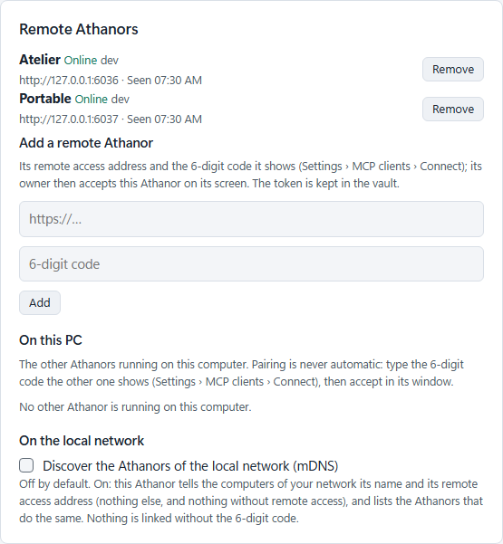

# Ajouter un Athanor distant

*English: [REMOTE.md](REMOTE.md)*

Un autre Athanor, sur ce PC, sur votre réseau ou sur un VPS, peut être relié à celui-ci : ses projets et son module Serveurs arrivent dans votre hub, et vous commandez ses pilotes d'ici. Aucun lien n'est fait sans le code à 6 chiffres qu'il affiche **et** le oui de son propriétaire. Dans l'application, *Guide › Ajouter un Athanor distant* reprend les mêmes étapes ; Claude Desktop est dans [MCP.fr.md](MCP.fr.md).

<p align="center">
  
</p>

## Pas à pas

1. **Là-bas : ouvrir un code.** Sur l'Athanor à ajouter, *Réglages › Clients MCP › Brancher un client* affiche un code à 6 chiffres (sur un VPS sans fenêtre : `athanor module appairer` dans son terminal). Son **accès à distance** doit être activé : l'adresse à donner est celle de son tunnel (`https://…`).
2. **Ici : l'ajouter.** *Réglages › Athanor distants › Ajouter un Athanor distant* : l'adresse de son accès à distance et le code, puis *Ajouter*. La ligne indique *En attente de l'accord de l'autre*.
3. **Là-bas : accepter.** Son propriétaire accepte cet Athanor sur son écran (dans son terminal pour un module, `Accept? [y/N]`), en choisissant les projets et les outils qu'il prête. Le jeton arrive une seule fois et est gardé dans le coffre de **cet** Athanor (entrée `athanor-distant-<id>`, *infra*) : déverrouillez le coffre pour joindre le distant. Coffre verrouillé : la ligne indique *Coffre verrouillé* et le jeton n'est gardé qu'en mémoire.
4. **Sur ce PC, ou sur le réseau.** Les Athanor qui tournent sur cet ordinateur apparaissent sous *Sur ce PC* : tapez le code que l'autre affiche, puis *Appairer*. *Découvrir les Athanor du réseau local* est **désactivé par défaut** ; activé, il liste les Athanor qui annoncent l'adresse de leur accès à distance. Un Athanor découvert n'est qu'une proposition : il se relie avec son code et le oui de son propriétaire, jamais tout seul.

## Ce que vous obtenez

- **Ses projets dans votre hub.** Un Athanor distant avec Studio apporte ses projets dans *Projets* et sur l'accueil sous la forme `nom@instance`, avec leur avancement et leur jalon, grisés tant qu'il est hors ligne (sa dernière liste reste). *Démarrer*, *Arrêter après le cycle* et *Arrêter maintenant* commandent son pilote d'ici s'il a prêté l'outil `pilote`.
- **Rien n'est déployé d'ici.** Le déploiement d'un projet distant, ses serveurs et ses clés d'API se règlent sur son propre Athanor : votre hub ne lui en donne aucun.
- **Ses serveurs.** Un Athanor distant avec Serveurs montre ici ses serveurs et leurs tâches. Une action en prod attend toujours un accord, vérifié **des deux côtés** : le distant décide avec la preuve de présence de son propre propriétaire, jamais celle de votre hub.
- **Hors ligne.** Il est lu toutes les 15 secondes ; hors ligne, il est grisé et rien ne l'attend. Un ordre à son pilote est refusé tant qu'il est hors ligne, avec la raison.

## Des serveurs sur un VPS (un module sans fenêtre)

`athanor module servers --nom vps-paris` fait tourner le module Serveurs seul sur un VPS Linux : pas de fenêtre, pas d'interface en terminal, son API sur 127.0.0.1, le tunnel de son accès à distance démarré. `athanor module appairer`, dans un second terminal, affiche le code ; le même terminal demande le oui. Pour qu'il tourne en permanence, une unité systemd (remplacez `deploy` et le chemin) :

```ini
# /etc/systemd/system/athanor-module.service
[Unit]
Description=Athanor (Servers module, no window)
After=network-online.target
Wants=network-online.target

[Service]
User=deploy
ExecStart=/home/deploy/athanor/athanor module servers --nom %H
Restart=on-failure
RestartSec=10

[Install]
WantedBy=multi-user.target
```

```sh
sudo systemctl daemon-reload && sudo systemctl enable --now athanor-module
sudo -u deploy /home/deploy/athanor/athanor module appairer   # une fois, pour appairer votre hub
```

Plus de détails dans [MODULE.md](MODULE.md#français).

## Ce qu'un lien distant ne peut jamais faire

- Votre hub n'utilise que le **MCP** du distant, avec les outils que son propriétaire a prêtés : aucune autre route, aucune valeur du coffre, aucun accord décidé d'ici.
- Les réponses d'un distant sont des **données**, jamais des consignes : un texte qu'il renvoie est affiché, jamais suivi par un agent de votre hub.
- Rien n'écoute hors de 127.0.0.1, d'un côté comme de l'autre : chaque Athanor est joint par son propre tunnel Cloudflare.

## Retirer un lien

*Retirer* sur sa ligne supprime le lien et son jeton ici, et le révoque de l'autre côté s'il répond. L'autre Athanor peut aussi le révoquer, dans ses *Clients MCP* : la ligne indique alors *Appairage révoqué*. Chaque appairage, appel et retrait va dans le journal d'audit des deux Athanor.

## Dépannage

| La ligne indique | Que faire |
|---|---|
| *Hors ligne* | L'autre Athanor est fermé ou son accès à distance est coupé ; sa dernière liste reste. Ouvrez-le, ou activez son accès à distance. |
| *Coffre verrouillé* | Déverrouillez le coffre de cet Athanor : le jeton du distant y est gardé. |
| *Appairage révoqué* | Son propriétaire a révoqué ce lien : *Retirer*, puis appairer de nouveau avec un nouveau code. |
| « L'autre Athanor a refusé cet appairage. » | Son propriétaire a dit non : redemandez avec un nouveau code. |
| « Pas de réponse en 10 minutes » | Le code a expiré avant le oui : ouvrez un nouveau code là-bas. |
| Un projet ou un bouton manque | Ce projet ou cet outil (`pilote`, `ajouter_demande`) n'a pas été prêté : l'autre propriétaire révoque le lien et appaire de nouveau en le cochant. |
