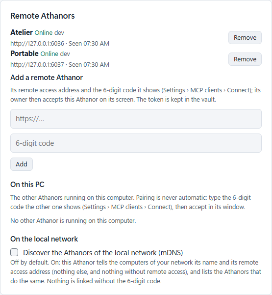

# Add a remote Athanor

*Français : [REMOTE.fr.md](REMOTE.fr.md)*

Another Athanor, on this PC, on your network or on a VPS, can be linked to this one: its projects and its Servers module come into your hub, and you drive its pilots from here. No link is made without the 6-digit code it shows **and** its owner's yes. In the app, *Guide › Add a remote Athanor* walks through the same steps; Claude Desktop is in [MCP.md](MCP.md).

<p align="center">
  
</p>

## Step by step

1. **There: open a code.** On the Athanor to add, *Settings › MCP clients › Connect a client* shows a 6-digit code (on a VPS with no window: `athanor module appairer` in its terminal). Its **remote access** must be on: the address you give is the one of its tunnel (`https://…`).
2. **Here: add it.** *Settings › Remote Athanors › Add a remote Athanor*: its remote access address and the code, then *Add*. The line says *Waiting for the other one's yes*.
3. **There: accept.** Its owner accepts this Athanor on its screen (in its terminal for a module, `Accept? [y/N]`), choosing the projects and the tools it lends. The token comes once and is kept in **this** Athanor's vault (entry `athanor-distant-<id>`, *infra*): unlock the vault to reach the remote one. Vault locked: the line says *Vault locked* and the token waits in memory only.
4. **On this PC, or on the network.** The Athanors running on this computer show under *On this PC*: type the code the other one shows, then *Pair*. *Discover the Athanors of the local network* is **off by default**; on, it lists the Athanors that announce their remote access address. A discovered Athanor is a proposal only: it is linked with its code and its owner's yes, never by itself.

## What you get

- **Its projects in your hub.** A remote Athanor with Studio brings its projects into *Projects* and the home page as `name@instance`, with their progress and their milestone, greyed while it is offline (its last list stays). *Start*, *Stop after cycle* and *Stop now* drive its pilot from here if it lent the `pilote` tool.
- **Nothing deployed from here.** A remote project's deployment, its servers and its API keys are set on its own Athanor: your hub gives it none.
- **Its servers.** A remote Athanor with Servers shows its servers and their tasks here. A production action still waits for an approval, checked **on both sides**: the remote Athanor decides with its own owner's proof of presence, never your hub's.
- **Offline.** It is read every 15 seconds; offline, it is greyed and nothing waits on it. An order to its pilot is refused while it is offline, with the reason.

## Servers on a VPS (a module with no window)

`athanor module servers --nom vps-paris` runs the Servers module alone on a Linux VPS: no window, no terminal interface, its API on 127.0.0.1, its remote access tunnel started. `athanor module appairer`, in a second terminal, shows the code; the same terminal asks for the yes. To keep it running, a systemd unit (replace `deploy` and the path):

```ini
# /etc/systemd/system/athanor-module.service
[Unit]
Description=Athanor (Servers module, no window)
After=network-online.target
Wants=network-online.target

[Service]
User=deploy
ExecStart=/home/deploy/athanor/athanor module servers --nom %H
Restart=on-failure
RestartSec=10

[Install]
WantedBy=multi-user.target
```

```sh
sudo systemctl daemon-reload && sudo systemctl enable --now athanor-module
sudo -u deploy /home/deploy/athanor/athanor module appairer   # once, to pair your hub
```

More in [MODULE.md](MODULE.md).

## What a remote link can never do

- Your hub uses the remote Athanor's **MCP only**, with the tools its owner lent: no other route, no vault value, no approval decided from here.
- A remote Athanor's answers are **data**, never instructions: a text it sends back is shown, never followed by an agent of your hub.
- Nothing listens outside 127.0.0.1 on either side: each Athanor is reached through its own Cloudflare tunnel.

## Remove a link

*Remove* on its line deletes the link and its token here, and revokes it on the other side when it answers. The other Athanor can revoke it too, in its *MCP clients*: the line then says *Pairing revoked*. Each pairing, call and removal goes to the audit log of both Athanors.

## Troubleshooting

| The line says | What to do |
|---|---|
| *Offline* | The other Athanor is closed or its remote access is off; its last list stays. Open it, or turn its remote access on. |
| *Vault locked* | Unlock this Athanor's vault: the remote one's token is kept there. |
| *Pairing revoked* | Its owner revoked this link: *Remove*, then pair again with a new code. |
| “The other Athanor refused this pairing.” | Its owner said no: ask again with a new code. |
| “No answer in 10 minutes” | The code expired before the yes: open a new code over there. |
| A project or a button is missing | That project or that tool (`pilote`, `ajouter_demande`) was not lent: the other owner revokes the link and pairs again with it ticked. |
