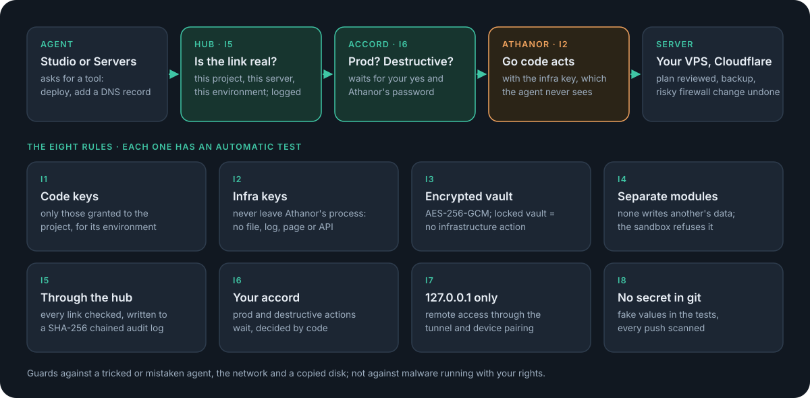

# Modèle de sécurité

Fait partie du [README d'Athanor Hub](../README.fr.md) · [English](SECURITY.md)

## Modèle de sécurité

**Ce contre quoi Athanor se garde** : un agent trompé (une injection de prompt dans une page web, un README, un e-mail ou la sortie d'une commande), un agent qui se trompe (`rm -rf`, le mauvais serveur), quelqu'un sur votre réseau local ou sur Internet, et un disque ou une sauvegarde copiés. Chaque garde-fou est dans le code Go d'Athanor, jamais dans une consigne donnée à Claude : il tient même si un agent obéit à un attaquant.

**Ce contre quoi il ne se garde pas** : un logiciel malveillant qui tourne avec tous vos droits d'utilisateur. Un tel programme lit ce que vous pouvez lire, voit ce que vous tapez et attend que vous déverrouilliez. Et dans le [mode Windows natif](STUDIO.fr.md#mode-windows-natif-expérimental), il n'y a pas de barrière : un agent peut lire n'importe quel fichier de votre PC (voir plus bas ce qui y est refusé par défaut).

### Les huit règles

Chaque règle a un test automatique dans la CI et, là où on peut le montrer pour de vrai, un bouton dans l'application.

| | Règle | Comment elle tient, comment elle est prouvée |
|---|---|---|
| **I1** | Un agent de Studio ne reçoit que les clés *code* accordées à son projet. | Athanor écrit lui-même le `.athanor/secrets.env` du pilote à partir du coffre avant chaque démarrage ; *Installation & santé → Tester le coffre* lance une vraie session Claude qui doit voir la clé accordée et jamais celle du voisin ni une clé *infra*. |
| **I2** | Les secrets *infra* (clés SSH, jetons Cloudflare…) ne quittent jamais le processus d'Athanor. | Aucun environnement d'agent, fichier en clair, journal, page ni réponse d'API ne les contient ; les agents appellent des outils et c'est le code Go d'Athanor qui agit avec la clé. Des tests passent au crible chaque sortie à la recherche des valeurs témoins. |
| **I3** | Le coffre est chiffré sur le disque. | AES-256-GCM, une clé par portée, enveloppée par votre mot de passe et le coffre du système (*code*) ou par votre mot de passe seul (*infra*). Coffre verrouillé (cadenas, ou jamais ouvert depuis le démarrage) = aucune action sur l'infrastructure : les déploiements et les tâches Serveurs attendent et le disent. Le verrouillage automatique ne verrouille que la fenêtre et laisse le coffre ouvert. |
| **I4** | Les modules ne peuvent pas modifier les données les uns des autres. | Un agent de Studio ne peut pas écrire dans les dossiers de Serveurs ni du hub (la barrière le refuse ; *Tester la barrière* l'essaie) ; un agent de Serveurs n'écrit jamais dans le dépôt d'un projet : il récupère le code avec une clé de déploiement en lecture seule. |
| **I5** | Toute action entre modules passe par le hub. | Le hub vérifie que le lien existe (ce projet, ce serveur, ce déploiement), puis l'écrit dans le journal d'audit, dont la chaîne SHA-256 signale toute ligne modifiée, retirée ou insérée. |
| **I6** | La production et les actions destructrices attendent votre accord. | Décidé par le code du hub, pas par l'agent : les étapes destructrices et les déploiements du site de production d'un ancien projet attendent toujours, sauf pour un projet que vous avez vous-même mis en *Ignorer les permissions* (dans la fenêtre d'Athanor, avec son mot de passe ; tracé au journal d'audit) ; chaque approbation redemande le mot de passe d'Athanor. |
| **I7** | Rien n'est ouvert au réseau sans appairage. | L'application, son API et son MCP n'écoutent que sur `127.0.0.1` ; l'accès à distance passe par le tunnel et l'appairage des appareils. `TestI7Listeners` vérifie chaque écoute du vrai exécutable. |
| **I8** | Aucun secret dans le dépôt, les tests ni la CI. | Les tests fabriquent de fausses valeurs ; aucun vrai compte n'est utilisé dans la CI, et chaque envoi est passé au crible à la recherche de secrets. |

  

**Mode Windows natif.** Il n'a pas de barrière, donc un agent pourrait ouvrir la clé *code* par DPAPI, comme vous. Lier une entrée *infra* à un projet, les tâches Serveurs et donner des clés d'infrastructure par *Pour vous* y sont refusés par défaut, avec la proposition de passer par WSL ; *Forcer en connaissance de cause* l'autorise projet par projet, après une confirmation, et chaque usage forcé est journalisé.

**Sur les serveurs.** Chaque commande est classée *lecture*, *changement* ou *destructrice* par Athanor lui-même ; un plan est montré et relu avant que quoi que ce soit change ; une modification du pare-feu ou de SSH s'annule d'elle-même au bout de 5 minutes sans confirmation ; une sauvegarde est faite avant une étape risquée ; SSH par clé seulement, pas de root direct par défaut ; la sortie d'un serveur est une donnée, jamais un ordre. Détails dans [Serveurs](SERVERS.fr.md#serveurs).

### La barrière, l'application et le reste

- **Les commandes de Claude** tournent dans le bac à sable de Claude Code (bubblewrap + seccomp). Elles ne peuvent écrire que dans le dossier du projet et `tools/`. Elles ne peuvent lire ni le reste de votre dossier Linux, ni les disques Windows, ni lancer `cmd.exe` ou `powershell.exe` directement. *Installation & santé → Tester la barrière* le prouve avec une vraie session. Les outils de fichiers de Claude (Read, Edit, Write…) sont limités de la même façon par un garde-fou (`athanor hook fichiers`, [`app/outil_gardes.go`](../app/outil_gardes.go)). Sur macOS, la barrière est Seatbelt, avec les mêmes règles.
- **Les logiciels Windows sont une sortie voulue.** Les passerelles tournent hors de la barrière, avec vos droits, et `pc-exec` lance n'importe quel programme Windows que Claude dépose dans le projet ou dans `tools/windows`. Traitez un projet comme du code que vous lanceriez vous-même.
- **Les droits administrateur sont sur autorisation.** *Droits administrateur → Réparer* vous demande votre accord une fois et crée une tâche planifiée élevée (`Athanor - installations`). Elle lance une copie d'`Athanor.exe` gardée dans `C:\ProgramData\Athanor`, que seuls les administrateurs peuvent modifier. La tâche ne lance que des paquets winget et des programmes situés dans vos dossiers de projets ou dans `tools\windows`. Elle laisse aussi les programmes du projet accepter des connexions du réseau local sans la fenêtre du pare-feu. Retirez-la quand vous voulez avec `Athanor.exe autoriser-admin --retirer`.
- **Le pilote ne fait jamais confiance au dossier du projet.** Il garde son propre état (pid, verrou, réglages de la barrière, consignes, compteurs) dans `logs/`, hors de portée de Claude, et n'écrit jamais à travers un lien symbolique posé dans `.athanor/`. Il vérifie chaque valeur relue, et appelle git sans hooks, filtres, pilotes de fusion, fsmonitor, diff externe ni programmes de signature. Il lance Claude Code avec ses seuls réglages et serveurs MCP (`--setting-sources user`, `--strict-mcp-config` quand la commande les connaît), et `tools/` n'est jamais dans son `PATH`.
- **L'application** n'écoute que sur `127.0.0.1` et refuse tout autre en-tête `Host` (DNS rebinding). Seules les fenêtres qu'elle ouvre elle-même peuvent s'en servir : chacune s'ouvre sur une adresse à usage unique qui lui donne un cookie, si bien qu'un programme de l'ordinateur qui trouve le port (une commande lancée par Claude, par exemple) n'obtient ni la page ni l'API. Elle exige aussi un en-tête secret propre à la session sur chaque appel et stocke le mot de passe salé et haché. Elle n'envoie jamais les secrets du `.env` sans demande, et, verrouillée, n'affiche que « en marche / phase / cycle ».
- **La route MCP du hub** (`/api/mcp`) ne répond qu'au jeton d'une session de pilote (`Authorization: Bearer`), jamais par le tunnel de l'accès à distance, et ce jeton n'ouvre aucune autre route de l'application. Les réglages d'Athanor et ses dossiers `hub/` et `modules/` ne sont ni lisibles ni modifiables depuis la barrière (bubblewrap ou Seatbelt) : *Tester la barrière* tente d'y écrire et doit échouer. En mode Windows natif, ou pour un programme Windows que lance `pc-exec`, rien ne l'impose : la chaîne du journal d'audit et le mot de passe d'Athanor (redemandé pour les approbations, les clés données et l'infra forcée) sont alors les garde-fous.
- **L'accès à distance** (coupé par défaut) : un second serveur n'écoute que sur `127.0.0.1`, pour `cloudflared`, et ne répond qu'au nom d'hôte du tunnel. Sans la clé d'un appareil de confiance, rien ne passe, ni la page ni l'API. Un appareil reçoit sa clé en ouvrant le lien d'appairage : un code aléatoire, à usage unique, valable 2 minutes et renouvelé tout seul, qui n'existe que tant que la page *À distance* est ouverte sur l'ordinateur. Il n'ouvre qu'une demande : l'appareil doit ensuite taper 6 chiffres que l'ordinateur n'affiche que sous la souris, renouvelés toutes les 20 secondes, si bien qu'une photo du QR code ne suffit pas ; trois chiffres faux mettent fin à la demande, et après 20 mauvais codes en 10 minutes, l'appairage se met en pause. Chaque nouvel appareil déclenche une notification sur l'ordinateur. La clé est un long secret aléatoire dans un cookie `HttpOnly` et `Secure` ; la configuration n'en garde que le SHA-256. Avec un mot de passe, chaque appareil se déverrouille de son côté, et celui qui tape 5 mots de passe faux est retiré des appareils de confiance (l'ordinateur le signale). Un appareil n'atteint jamais les secrets, les réglages de l'accès à distance, le mot de passe ni les dossiers de l'ordinateur. Sur sa page *À distance*, il voit ses notifications, l'état de l'accès, les appareils de confiance (pour les renommer ou les retirer) et *Cet ordinateur, pour les autres ordinateurs* ; jamais l'interrupteur, les réglages d'adresse ni le lien d'appairage, son QR code ou ses chiffres, que le serveur n'envoie même pas à un appareil : un appareil ne peut jamais en faire entrer un autre. Au-delà de 60 requêtes par minute sans clé, une adresse est refusée pendant 10 minutes. Avec votre propre domaine, Cloudflare Access peut arrêter les inconnus avant l'ordinateur. Les notifications sont chiffrées pour chaque appareil seul (Web Push, RFC 8291) et signées d'une clé qu'Athanor crée une fois (VAPID) : le service de notifications du navigateur ne fait que relayer des octets qu'il ne peut pas lire, et Athanor n'envoie qu'aux services de notifications des navigateurs (ceux de Google, d'Apple, de Mozilla, de Microsoft), jamais à une adresse qu'un appareil choisirait. Le trafic est en HTTPS jusqu'à Cloudflare, qui le relaie vers votre ordinateur.
- **Les sessions « Demander à Claude »** (réparation de l'outillage) tournent hors de la barrière, dans le dossier de l'outil, sans `sudo` : c'est voulu, pour réparer l'outillage lui-même. Ce qui demande `sudo` ou Windows est écrit pour vous dans `logs/TODO_FOR_YOU.md`.
- **GitHub** : chaque ordinateur envoie avec une clé à lui sur votre compte GitHub (« Athanor (ordinateur) »), créée par *Se connecter à GitHub* et gardée dans les données GitHub d'Athanor (`~/.local/share/athanor/github/connexion` ; dans le dossier personnel Linux de WSL sous Windows), que la barrière ne peut pas lire. Elle ouvre tous les dépôts que votre compte peut modifier : *Se déconnecter* la retire de l'ordinateur, et *Settings › SSH and GPG keys* de GitHub la révoque. Les connexions elles-mêmes (pour connecter l'ordinateur, ou créer un dépôt) vivent dans un dossier temporaire supprimé juste après : aucune connexion GitHub n'est jamais gardée. Le pilote envoie depuis un dossier git privé : rien du `.git` du projet (que Claude peut écrire) n'est utilisé, l'identité du serveur de GitHub est vérifiée avec les clés que GitHub publie, et `GH_TOKEN`/`GITHUB_TOKEN` sont retirés de l'environnement de Claude.
- **Plusieurs ordinateurs** ne communiquent que par le dépôt du projet, chacun avec sa propre clé : aucun port n'est ouvert et aucun ordinateur n'en atteint un autre. Ce qu'un ordinateur publie sur lui-même : son nom, ce que vous avez écrit qu'il sait bien faire, sa version d'Athanor et ce qu'il construit ; rien sur l'ordinateur lui-même. Les commits des autres arrivent par le même dossier git privé, sont fusionnés par git avec les hooks et les filtres coupés, et l'état du pilote, ses journaux et les secrets ne quittent jamais un ordinateur.
- **Rien de personnel n'est jamais commité** : `.env`, `logs/`, `tools/` et les réglages de l'application sont ignorés par git, et les projets vivent hors du dossier de l'outil.

Vous avez trouvé une faille ? Ouvrez plutôt un [avis de sécurité privé](https://github.com/Aprilox/Athanor/security/advisories/new) qu'une issue publique.
