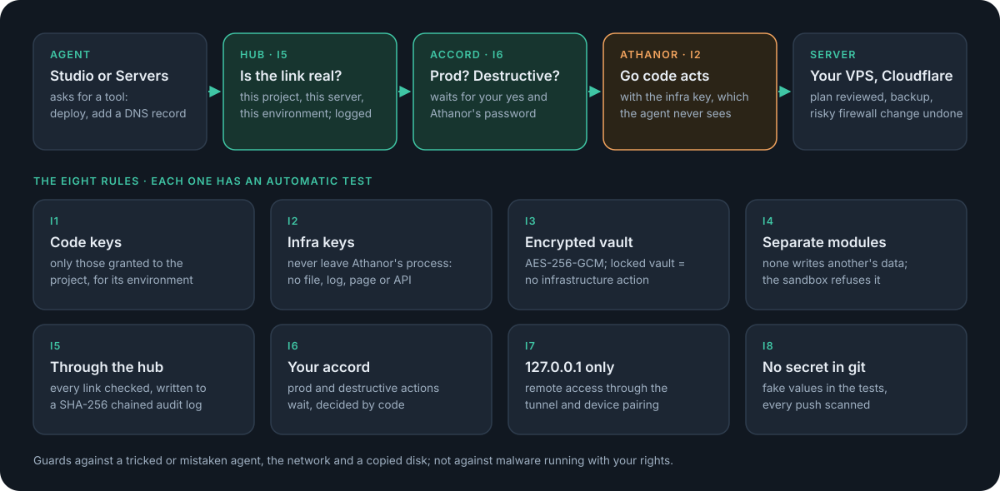

# Security model
<!-- Absolute links on purpose: GitHub also shows this file on the Security tab, where relative links resolve from the root and break. -->

Part of the [Athanor Hub README](https://github.com/Aprilox/Athanor/blob/main/README.md) · [Français](https://github.com/Aprilox/Athanor/blob/main/docs/SECURITY.fr.md)

## Security model

**What Athanor guards against**: an agent that is tricked (a prompt injection in a web page, a README, an e-mail or a command's output), an agent that makes a mistake (`rm -rf`, the wrong server), someone on your local network or on the Internet, and a copied disk or backup. Each guard is in Athanor's Go code, never in an instruction to Claude, so it holds even if an agent obeys an attacker.

**What it does not guard against**: malicious software running with all your user rights. Such a program can read what you can read, watch what you type and wait for you to unlock. And in [native Windows mode](https://github.com/Aprilox/Athanor/blob/main/docs/STUDIO.md#native-windows-mode-experimental) there is no sandbox: an agent can read any file of your PC (see below what is refused there by default).

### The eight rules

Each rule has an automatic test in the CI and, where it can be shown for real, a button in the app.

| | Rule | How it holds, how it is proved |
|---|---|---|
| **I1** | A Studio agent receives only the *code* keys granted to its project. | Athanor itself writes the pilot's `.athanor/secrets.env` from the vault before each start; *Setup & health → Test the vault* runs a real Claude session that must see the granted key and never the neighbour's nor an *infra* one. |
| **I2** | *Infra* secrets (SSH keys, Cloudflare tokens…) never leave Athanor's process. | No agent environment, plain file, log, page or API answer holds them; agents call tools and Athanor's Go code acts with the key. Tests scan every output for the sample values. |
| **I3** | The vault is encrypted on disk. | AES-256-GCM, one key per scope, wrapped by your password and the system's keystore (*code*) or by your password only (*infra*). Vault locked (never opened since the start, or closed by the emergency stop) = no infrastructure action: deployments and server tasks wait and say so. Locking, with the padlock or by itself, only locks the window and leaves the vault open, so the work in the background goes on. |
| **I4** | Modules cannot change each other's data. | A Studio agent cannot write into the Servers or hub folders (the sandbox refuses it; *Test the sandbox* tries); a Servers agent never writes into a project's repository: it fetches the code with a read-only deployment key. |
| **I5** | Every action between modules goes through the hub. | The hub checks the link exists (this project, this server, this deployment), then writes it to the audit log, whose SHA-256 chain names any line changed, removed or inserted. |
| **I6** | Production and destructive actions wait for your accord. | Decided by the hub's code, not by the agent: destructive steps and the deployments of an older project's production site always wait, except for a project you put in *Ignore permissions* yourself (in Athanor's window, with its password, audited); each approval asks for Athanor's password again. |
| **I7** | Nothing is open to the network without pairing. | The app, its API and its MCP listen on `127.0.0.1` only; remote access goes through the tunnel and device pairing. `TestI7Listeners` checks every listener of the real executable. |
| **I8** | No secret in the repository, the tests or the CI. | Tests generate fake values; no real account is used in the CI, and every push is scanned for secrets. |

  

**Native Windows mode.** It has no sandbox, so an agent could open the *code* key through DPAPI as you can. Linking an *infra* entry to a project, Servers tasks and giving infrastructure keys through *For you* are refused there by default, with an offer to use WSL; *Force, knowing the risk* allows it project by project, after a confirmation, and each forced use is logged.

**On the servers.** Every command is ranked *read*, *change* or *destructive* by Athanor itself; a plan is shown and reviewed before anything changes; a firewall or SSH change undoes itself after 5 minutes unless confirmed; a backup is made before a risky step; key-only SSH, no direct root by default; a server's output is data, never an order. Details in [Servers](https://github.com/Aprilox/Athanor/blob/main/docs/SERVERS.md#servers).

### The sandbox, the app and the rest

- **Claude's commands** run in the Claude Code sandbox (bubblewrap + seccomp). They can write only in the project folder and `tools/`. They cannot read the rest of your Linux home or the Windows drives, and cannot launch `cmd.exe` or `powershell.exe` directly. *Setup & health → Test the sandbox* proves it with a real session. Claude's file tools (Read, Edit, Write…) are limited the same way by a hook (`athanor hook fichiers`, [`app/outil_gardes.go`](https://github.com/Aprilox/Athanor/blob/main/app/outil_gardes.go)). On macOS the sandbox is Seatbelt, with the same rules.
- **Windows software is an intended exit.** The gateways run outside the sandbox, with your user rights, and `pc-exec` runs any Windows program Claude places in the project or in `tools/windows`. Treat a project like code you run yourself.
- **Administrator rights are opt-in.** *Administrator rights → Repair* asks for your consent once and registers an elevated scheduled task (`Athanor - installations`). It runs a copy of `Athanor.exe` kept in `C:\ProgramData\Athanor`, which only administrators can modify. The task only runs winget packages and programs located inside your project folders or `tools\windows`. It also lets the project's programs accept local-network connections without the firewall dialog. Remove it any time with `Athanor.exe autoriser-admin --retirer`.
- **The pilot never trusts the project folder.** It keeps its own state (pid, lock, sandbox settings, instructions, counters) in `logs/`, out of Claude's reach, and never writes through a symbolic link placed in `.athanor/`. It validates every value it reads back, and runs git with hooks, filters, merge drivers, fsmonitor, external diff and signature programs disabled. It starts Claude Code with only its own settings and MCP servers (`--setting-sources user`, `--strict-mcp-config` when the CLI supports them), and `tools/` is never in its `PATH`.
- **The app** listens on `127.0.0.1` only and rejects any other `Host` header (DNS rebinding). Only the windows it opens itself can use it: each one is opened on a single-use address that gives it a cookie, so a program of the computer that finds the port (a command Claude runs, for instance) gets neither the page nor the API. It also requires a per-session secret header on every API call and stores the password salted and hashed. It never sends `.env` secrets unless asked, and while locked it shows only "running / phase / cycle".
- **The hub's MCP route** (`/api/mcp`) answers only to a pilot session's token (`Authorization: Bearer`), never through the remote-access tunnel, and that token opens no other route of the app. Athanor's settings and its `hub/` and `modules/` folders are neither readable nor writable from the sandbox (bubblewrap or Seatbelt): *Test the sandbox* tries to write there and must fail. In native Windows mode, or for a Windows program `pc-exec` runs, nothing enforces this: the audit log's chain and Athanor's password (asked again for approvals, keys given and forced infra) are then the safeguards.
- **Remote access** (off by default): a second server listens on `127.0.0.1` only, for `cloudflared`, and answers only the tunnel's host name. Without a trusted device's key nothing goes through, neither the page nor the API. A device gets its key by opening the pairing link: a random code, single-use, valid 2 minutes and renewed by itself, that only exists while the *Remote* page is open on the computer. It only opens a request: the device must then type 6 digits the computer shows under the mouse only, renewed every 20 seconds, so a photo of the QR code is not enough; three wrong digits end the request, and after 20 wrong codes in 10 minutes, pairing pauses. Each new device raises a notification on the computer. The key is a long random secret in an `HttpOnly`, `Secure` cookie; the configuration only keeps its SHA-256. With a password set, each device unlocks on its own, and one that types 5 wrong passwords is removed from the trusted devices (the computer says so). A device never reaches the secrets, the remote-access settings, the password or the folders of the computer. On its *Remote* page it sees its notifications, the state of the access, the trusted devices (to rename or remove them) and *This computer, for the other computers*; never the switch, the address settings nor the pairing link, its QR code or its digits, which the server does not even send to a device: a device can never let another one in. Past 60 requests a minute without a key, an address is refused for 10 minutes. With your own domain, Cloudflare Access can stop strangers before the computer. Notifications are encrypted for each device alone (Web Push, RFC 8291) and signed with a key Athanor makes once (VAPID): the browser's push service only relays bytes it cannot read, and Athanor only posts to the push services browsers use (Google's, Apple's, Mozilla's, Microsoft's), never to an address a device would choose. The traffic is HTTPS up to Cloudflare, which relays it to your computer.
- **"Ask Claude" repair sessions** run outside the sandbox, in the tool folder, without `sudo`: on purpose, to repair the tooling itself. Anything that needs `sudo` or Windows is written to `logs/TODO_FOR_YOU.md` for you instead.
- **GitHub**: each computer pushes with one key of its own on your GitHub account (“Athanor (computer)”), made at *Connect to GitHub* and kept in Athanor's GitHub data (`~/.local/share/athanor/github/connexion`; in the Linux home of WSL on Windows), which the sandbox cannot read. It opens every repository your account can push to: *Disconnect* removes it from the computer, and GitHub's *Settings › SSH and GPG keys* revokes it. The sign-ins themselves (to connect, or to create a repository) live in a temporary folder deleted right after: no GitHub sign-in is ever kept. The pilot pushes from a private git folder: nothing in the project's `.git` (which Claude can write) is used, GitHub's server identity is checked against the keys GitHub publishes, and `GH_TOKEN`/`GITHUB_TOKEN` are removed from Claude's environment.
- **Several computers** talk only through the project's repository, with each computer's own key: no port is opened and no computer reaches another. What a computer publishes about itself is its name, what you wrote it is good at, its Athanor version and what it builds; nothing about the computer itself. The others' commits come in through the same private git folder, are merged by git with hooks and filters off, and the pilot's state, logs and secrets never leave a computer.
- **Nothing personal is ever committed**: `.env`, `logs/`, `tools/` and the app's settings are git-ignored, and projects live outside the tool folder.

Found a vulnerability? Please open a [private security advisory](https://github.com/Aprilox/Athanor/security/advisories/new) rather than a public issue.
