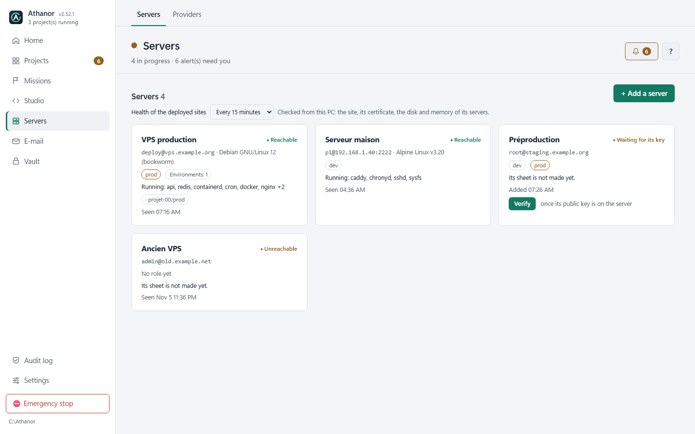
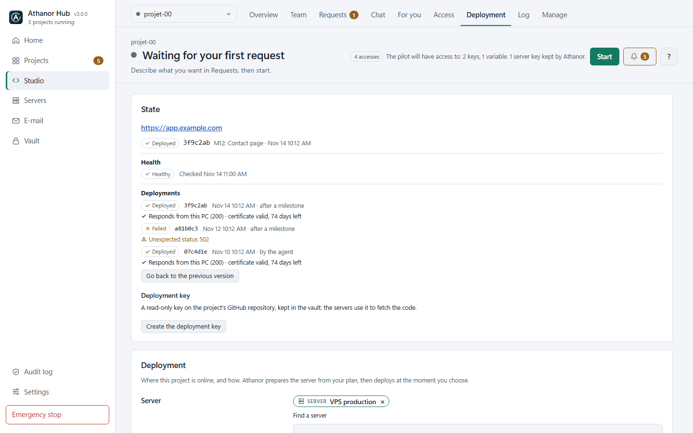

# Serveurs et déploiement

Fait partie du [README d'Athanor Hub](../README.fr.md) · [English](SERVERS.md)

## Serveurs

*Serveurs*, dans le menu, liste vos VPS et serveurs maison, chacun avec sa fiche et ses tâches. *Guide › Ajouter un serveur* et *Guide › Confier une tâche à l'agent Serveurs* vous accompagnent. Pour l'essayer d'abord sur un serveur sans importance, voir [docs/SERVEUR_DE_TEST.md](SERVEUR_DE_TEST.md) ; tout ce qu'Athanor lit, écrit et ne fait jamais sur une machine neuve est dans [docs/MACHINE_NEUVE.md](MACHINE_NEUVE.md).

  

- **En ajouter un.** L'adresse, le port et l'utilisateur : aucun rôle à choisir. Athanor lit d'abord l'empreinte de la clé d'hôte du serveur pour que vous la confirmiez : il n'en accepte jamais une en silence, et une empreinte qui change plus tard est refusée avec un message clair. Puis trois façons de se connecter (plus une clé déjà dans le coffre) : une nouvelle clé ed25519 faite par Athanor (vous copiez sa partie publique sur le serveur, puis *Vérifier*, ou vous donnez une fois le mot de passe du serveur pour y poser la clé, et ce mot de passe n'est pas gardé) ; le mot de passe du serveur seul, gardé au coffre comme entrée *infra* (aucune clé n'est créée, les connexions par mot de passe restent ouvertes et *Couper les connexions par mot de passe* n'est pas proposé) ; ou une clé SSH que vous avez déjà, collée ou lue depuis son fichier, avec sa phrase de passe si elle en a une, vérifiée et gardée au coffre. Un mot de passe ou une clé n'est jamais écrit dans une page ou un journal. Pour une clé, Athanor propose ensuite de *Couper les connexions par mot de passe*, jamais de lui-même. Un serveur s'ajoute sur l'ordinateur et demande un mot de passe à Athanor (son mot de passe ou sa clé est une entrée *infra*) ; un téléphone appairé voit la liste et les fiches, en lecture seule.
- **La fiche.** Prête environ une minute après l'ajout : système, processeurs, mémoire, disque, ports à l'écoute, logiciels présents (Docker, Compose, k3s, kubectl, nginx, Caddy, ufw), pare-feu, services et conteneurs en marche. Chaque carte garde sa propre hauteur (une carte vide, comme *Conteneurs 0*, se replie en une ligne, et les longues listes de ports et de services se replient derrière *Tout voir (n)*). Elle est relue sur *Actualiser*, après chaque changement fait par Athanor, et toutes les 6 heures tant que la clé *infra* du coffre est ouverte. Elle est gardée dans le dossier d'Athanor (`modules/servers/<id>/`, avec un `FICHE.md` lisible), jamais avec une clé ou un mot de passe. *Retirer ce serveur* l'oublie sans toucher au serveur, et garde sa clé dans le coffre sauf si vous cochez la case. Un serveur ajouté avec l'ancien rôle *Production* fait attendre votre accord à chaque plan : *Retirer le rôle Production*, sur sa fiche, le lui enlève (mot de passe d'Athanor) ; la production se choisit désormais dans le déploiement de chaque projet.
- **Ce qu'Athanor exécute sur un serveur.** La fiche est un seul script shell en lecture seule : `/etc/os-release`, `uname`, `nproc`, mémoire et disque, `ss` (ou `netstat`), `command -v` pour chaque outil, `ufw status`, les services et conteneurs en marche, avec `sudo -n` seulement là où il ne demande pas de mot de passe. L'ajout d'une nouvelle clé avec le mot de passe donné une fois ajoute la clé publique d'Athanor à `~/.ssh/authorized_keys`. *Couper les connexions par mot de passe* écrit `/etc/ssh/sshd_config.d/00-athanor.conf`, le vérifie avec `sshd -t`, recharge SSH et se reconnecte avec la clé ; si quoi que ce soit échoue, le fichier est retiré. Tout le reste passe par un plan que vous avez accepté (ci-dessous).
- **Le terminal.** *Connecter*, sur la carte ou la fiche d'un serveur, ouvre un vrai terminal dans la page (xterm.js, inclus dans Athanor) : couleurs, copier-coller, Ctrl+C, `nano` ou `htop` en plein écran, redimensionné avec la fenêtre. Le Go d'Athanor ouvre la connexion SSH avec la clé du serveur et vérifie son empreinte ; la clé et les mots de passe n'arrivent jamais à la page. l'onglet *SFTP*, à côté de *Terminal* sur la même connexion, montre côte à côte les fichiers de cet ordinateur (*Local*) et ceux du serveur : glissez de l'un à l'autre pour envoyer ou télécharger (dossiers compris, trois à la fois, *Annuler*, reprise après une coupure réseau), *Actions* ou le clic droit pour renommer, supprimer après la liste de ce qui part, changer les permissions ou modifier un fichier texte jusqu'à 1 Mo ; remplacer demande d'abord ; sur un téléphone, un panneau à la fois avec *Envoyer* et *Télécharger* ; *⚙ Réglages* choisit le thème (Athanor clair ou sombre, Solarized, Nord, Dracula, Gruvbox, One Dark), la taille du texte, l'interligne et le curseur, en aperçu direct, gardés par *Enregistrer*, annulés par *Annuler*. *Assistant* ajoute une discussion à côté, en deux modes : *Connexion à part* (par défaut ; il travaille dans sa propre session SSH et le panneau montre chaque commande, sa sortie et celle en cours, avec *Arrêter*) ou *En direct dans mon terminal* (ses commandes s'écrivent dans le vôtre ; votre saisie n'est verrouillée que pendant qu'une d'elles s'exécute, sous *L'IA travaille* avec *Arrêter* et *Prendre la main*, et seulement dans cet onglet : elle est libre dès que la commande finit, échoue ou est arrêtée, et rien n'est tapé dans votre shell au déverrouillage. Un plan qui vous attend affiche *En attente de votre décision* avec *Accepter*, *Refuser* et *Modifier*, et vous laisse le terminal ; une tâche en échec dit pourquoi, avec *Réessayer*). Les deux passent par les garde-fous ci-dessous ; les valeurs du coffre sont masquées dans ce qu'il montre. Un sélecteur *Permissions*, gardé par serveur, règle ce qu'il demande : *Manuel* (chaque commande, lectures comprises), *Accepter les modifications* (il écrit tout son plan dans le fil, puis l'applique, ne demandant qu'avant une étape dangereuse ou inconnue), *Auto* (il agit tout de suite et ne demande qu'avant une commande dangereuse ou inconnue) ou *Ignorer les permissions* (rien n'est demandé, commandes dangereuses comprises ; proposé seulement quand Athanor a un mot de passe, choisi dans la fenêtre après un avertissement ; c'est votre propre assistant, donc aucun avertissement ne reste sur la carte, la fiche ou le terminal une fois choisi). Les messages envoyés pendant qu'il travaille attendent dans une file, chacun avec *Envoyer maintenant* (la tâche qui tape dans votre terminal s'arrête et le message part tout de suite, avec le contexte de ce qu'elle faisait) et *Retirer* ; les suivants partent à leur tour. Une séparation entre le terminal et l'assistant se déplace à la souris ou aux flèches (*Maj* pour de plus grands pas), chaque côté gardant une largeur minimale ; la largeur est gardée et un double-clic la réinitialise ; elle est masquée sur téléphone et sur tablette étroite. Si le serveur ne répond plus, le terminal se reconnecte tout seul avec les secrets du coffre, sans rien demander : environ 10 tentatives espacées de 30 secondes au plus (environ 3 minutes, la tentative affichée). Un mot de passe ou une clé refusés l'arrêtent après un dernier essai 30 secondes plus tard (un serveur qui redémarre refuse les connexions quelques secondes), une empreinte changée ou un serveur retiré aussitôt, avec un message propre et *Se reconnecter*, et une liaison perdue de nouveau après 3 reconnexions en 5 minutes est abandonnée (*Réessayer*). Un terminal inutilisé se ferme au bout de 15 minutes ; le journal d'audit nomme chaque connexion et chaque fichier modifié, jamais ce qui est tapé. Depuis un appareil appairé, le terminal et les fichiers sont coupés, sauf si *À distance › Permissions › Terminal et fichiers des serveurs* est autorisé sur l'ordinateur. *Guide › Travailler dans le terminal d'un serveur* le détaille.
- **La clé reste chez Athanor.** La clé d'un serveur est une entrée *infra* du coffre : elle ne s'ouvre qu'avec le mot de passe d'Athanor, n'est déchiffrée qu'en mémoire et ne quitte jamais le processus d'Athanor (ni vers le pilote, ni vers une page, un téléphone ou le journal d'audit). Supprimer une entrée du coffre qu'un serveur utilise est refusé, avec le nom du serveur.
- **L'agent Serveurs.** Sur la fiche d'un serveur, *Tâches* : dites en une phrase ce qu'il faut faire, puis *Lancer*. *Pour le projet* relie la tâche à un projet : l'agent peut alors aussi changer le DNS, le HTTPS et la protection de l'adresse de son site, sur ce seul nom. Un chef ops (une session Claude dans son propre atelier vide, hors de vos projets) reçoit les outils d'Athanor pour les serveurs de cette tâche seulement — une commande, lire et écrire un fichier, SFTP, services, Docker et Compose, le pare-feu ufw, le RUNBOOK du serveur —, jamais la clé elle-même, et les perd à la fin de la tâche. Il lit la fiche, le RUNBOOK et l'état du serveur, puis propose un plan. En mode Windows natif, une tâche est refusée (*Passer à WSL*), sauf si vous la forcez avec le mot de passe d'Athanor.
- **Garde-fous.** Athanor classe lui-même chaque étape, *lecture*, *changement* ou *destructrice* (une commande cachée derrière `bash -c`, `sudo` ou un interpréteur, ou qu'il ne sait pas analyser, compte comme destructrice). La lecture s'exécute sans demander, sauf les secrets (`/etc/shadow`, `~/.ssh/*`, `*.env`, clés privées sont refusés). Tout le reste attend un plan : un critique sécurité (une session en lecture seule) le relit, puis vous l'*Acceptez* dans la cloche, sur *Pour vous* ou sur votre téléphone, en retapant le mot de passe d'Athanor. Chaque étape acceptée s'exécute une fois, exactement comme montrée. C'est vrai sur tous les serveurs. Les étapes destructrices vous attendent toujours, comme tout ce qui touche un serveur portant le site de production d'un ancien projet (ou qu'Athanor ne sait pas situer : dans le doute, prudence) ; ailleurs, *Ne plus demander pour ce serveur* accepte ses changements une fois pour toutes. Chaque appel et chaque décision vont au journal d'audit, les sorties du serveur sont données à l'agent comme des données, et *Arrêter* ou l'arrêt d'urgence coupe la commande en cours.
- **Sauvegardes et annulation automatique.** Un fichier remplacé garde sa version d'avant dans `/var/backups/athanor/prev/`, lisible par root seulement ; ce qu'une étape destructrice supprime est d'abord archivé dans `/var/backups/athanor/`, sinon l'étape est refusée. Une règle de pare-feu ou un réglage SSH est défait par le serveur lui-même au bout de 5 minutes sauf si Athanor, en se reconnectant, le confirme (*Garder ce changement*) : une mauvaise règle ne peut pas vous enfermer dehors.
- **Vérifié depuis l'extérieur, consigné.** Après l'application, un vérificateur externe contrôle le résultat (statut HTTP, certificat et son expiration, en-têtes de sécurité, mot de passe demandé) ; un échec fait sonner la cloche. Le `RUNBOOK.md` de chaque serveur (*Cahier d'exploitation* sur sa fiche) garde ses accès sans secret, son rôle, ce qui tourne, les plans appliqués, les sauvegardes et comment revenir en arrière. *Installation & santé › Tester l'agent Serveurs* joue une vraie tâche complète sur le conteneur de test d'Athanor (Docker) en 5 minutes environ.
- **Le site d'un projet.** L'endroit où un projet est en ligne se règle dans son propre onglet *Déploiement* ([plus bas](#le-déploiement-dun-projet)) : le serveur, l'adresse, les clés d'API et votre plan, sans essai ni production à choisir. La fiche d'un serveur nomme les projets qui l'utilisent.
- **Cloudflare (DNS et HTTPS).** Votre jeton Cloudflare va dans le *Coffre*, comme toute API (*Coffre › Ajouter*, type *Cloudflare*, portée *infra*) : créez-le aux seuls droits qu'utilise Athanor, sur la zone de votre domaine seulement ; *Tester* montre ses zones et ce qu'il peut y faire, sans rien changer. Choisi dans l'onglet *Déploiement* d'un projet, ou nommé avec `@` dans une tâche, il permet à l'agent Serveurs de lire et changer, sur le seul nom d'hôte du site du projet, ses enregistrements DNS, son mode HTTPS, un certificat d'origine (sa clé privée faite par Athanor, posée sur le serveur, jamais confiée à l'agent) et sa protection : *Cloudflare Access* (les seules adresses e-mail que vous donnez) ou un *mot de passe devant le site* (Caddy n'en reçoit que l'empreinte). Sans Cloudflare, Caddy obtient son propre certificat Let's Encrypt. Les droits à donner, chaque appel d'Athanor et ce qui n'atteint jamais l'IA : [docs/CLOUDFLARE.md](CLOUDFLARE.md).
- **Déploiements.** Le premier déploiement d'un projet est une tâche Serveurs qu'Athanor lance de lui-même (ou *Préparer maintenant*, dans l'onglet *Déploiement*) : l'agent lit le projet et votre plan, et choisit la méthode — un site statique servi par Caddy, Docker Compose, ou k3s seulement si vous le demandez ; quand votre plan nomme un autre serveur web (nginx, Apache…), l'agent le configure pour servir le site et Athanor ne fait que basculer ses versions — et le moteur d'Athanor lui-même l'exécute, puis la reprend sans agent au moment que le projet a choisi (après chaque jalon ou à la livraison), ou quand le pilote le demande. Chaque version va dans son propre dossier sur le serveur et le site bascule dessus d'un coup ; une vérification externe suit, et *Revenir à la version d'avant* remet la précédente en quelques secondes. *Durcir ce serveur* (proposé sur un serveur où Athanor se connecte avec une clé, pas un mot de passe) applique un plan fixe à un serveur neuf (utilisateur sudo, clés seules, pare-feu, mises à jour de sécurité, Caddy). Toutes les 15 minutes, les sites déployés sont vérifiés depuis ce PC ; un échec fait sonner la cloche avec *Réessayer*, *Revenir à la version d'avant* et *Je prends la main*. Les méthodes, ce qui est écrit sur un serveur et ce qui n'atteint jamais l'IA : [docs/DEPLOY.md](DEPLOY.fr.md).
- **Clé de déploiement.** Pour un projet lié à GitHub, *Créer la clé de déploiement* (dans l'onglet *Déploiement*) fabrique une clé gardée dans le coffre et l'ajoute en lecture seule au dépôt, pour que les serveurs y prennent le code ; délier ou supprimer le projet la retire de GitHub et du coffre.

---

## Déploiement et approbations

Le déploiement d'un projet dit où il est mis en ligne, et quand ; une approbation est un agent qui vous demande ce qu'il n'a pas le droit de décider seul. Les approbations aboutissent toutes aux mêmes endroits (la cloche, *Pour vous*, votre téléphone), et tout est écrit dans le journal d'audit.

### Le déploiement d'un projet

Un projet Studio se construit comme avant, sans rien d'un serveur. Il est aussi déployé dès que son onglet **Déploiement** a un serveur : Studio construit, Athanor prépare le serveur et met le projet en ligne. Les méthodes et ce qui est écrit sur un serveur : [docs/DEPLOY.md](DEPLOY.fr.md).

  

- **L'onglet.** *Studio › Déploiement*, un par projet : le **serveur** (parmi ceux de *Serveurs*), l'**adresse** où le projet répondra (vide s'il n'en a pas encore), les **API** du coffre dont il a besoin (Cloudflare, par exemple), un **plan** avec vos propres mots (« nginx sur un port, un script de disponibilité, un certificat, le domaine ») et **quand déployer**. Il se modifie dans tous les états du projet (en cours, arrêté, en pause, en échec), depuis l'ordinateur ; un téléphone appairé le lit. Rien n'y parle d'essai ni de production : si le site est un vrai site (de vrais utilisateurs ou de vraies données, un lancement public), dites-le dans le plan ou dans votre demande : Claude a alors pour consigne d'attendre votre accord avant de le mettre en ligne la première fois, dans tous les modes sauf *Ignorer les permissions*. L'aide sous *Plan* le dit aussi.
- **Quand déployer.** *À la livraison* (par défaut) : quand le projet est livré. *Après chaque jalon* : chaque fois que le pilote coche un jalon, le dernier commit du projet est mis en ligne et vérifié. Un projet sans serveur n'est jamais déployé, et rien ne s'en plaint.
- **Préparé en avance, premier déploiement tout seul.** Dès que le plan du projet compte un jalon, une tâche Serveurs prépare le serveur d'après votre plan (paquets, serveur web, utilisateur, dossier, certificat, pare-feu, DNS) pendant que Studio construit. Le premier déploiement est lui aussi une tâche Serveurs : un agent lit le projet et votre plan, met le serveur en place et met le projet en ligne. D'ici là l'onglet dit *Premier déploiement en cours*, jamais un échec en rouge, et un déploiement raté est retenté à la prochaine occasion ; *Préparer maintenant* le lance sans attendre. Les déploiements suivants reprennent sa méthode, sans agent.
- **Livrer à nouveau.** Les demandes ajoutées après la livraison rouvrent le projet ; quand elles sont faites, il est livré de nouveau, et cette livraison est déployée : un déploiement par livraison, aucun en double après un redémarrage d'Athanor.
- **État et historique.** L'onglet montre l'adresse, le dernier déploiement avec son commit et son jalon, la *Santé* du site (vérifiée depuis ce PC), chaque déploiement avec son résultat, et *Revenir à la version d'avant*.
- **Permissions.** Quatre modes disent ce que les tâches serveur du projet peuvent faire sans demander. Ils portent les noms des modes de l'assistant SSH, mais *Manuel* est moins strict pour un projet, qui lit ses serveurs librement, qu'à côté d'un terminal, où il demande avant chaque commande : *Manuel* (lit les serveurs librement, demande votre accord pour chaque plan de modifications), *Auto* (lance tout de suite lectures et modifications sur les serveurs, vous demande avant une commande dangereuse ou une commande qu'il ne connaît pas), *Accepter les modifications* (applique ses plans de modifications sans vous attendre, ne vous demande que si un plan contient une commande dangereuse ou inconnue) et *Ignorer les permissions* (fait tout sans vous demander, commandes dangereuses et déploiements en production compris, et ne s'arrête jamais pour un mot de passe). Dans tous les modes sauf ce dernier, un site que votre demande ou son plan de déploiement décrit comme une production attend votre accord avant sa première mise en ligne : l'agent vous envoie son plan, même celui qu'*Auto* ou *Accepter les modifications* appliquerait aussitôt. L'onglet montre le mode ; il se choisit dans *Gérer › Réglages de ce projet*, et *Réglages › Permissions* fixe le défaut (*Manuel* au départ). *Ignorer les permissions* se choisit seulement dans la fenêtre d'Athanor (un téléphone appairé est refusé), après une confirmation et avec le mot de passe d'Athanor retapé ; rien n'interrompt ensuite le projet, ni l'accord pour ses fichiers de construction, ni celui pour la mise en ligne, et le journal d'audit écrit chacun d'eux.
- **Depuis la page d'accueil.** Une phrase dans le champ de la conversation d'accueil, par exemple « Fais un site pour la boulangerie Martin et mets-le en ligne sur martin.fr sur @vps ». `@` nomme un projet, un serveur ou une API du coffre par son nom (jamais une valeur) et en fait une puce ; la puce *Nouveau projet* (dans une conversation vide, ou par `@`) demande un nouveau projet. L'assistant propose une carte qui n'affiche que ce que votre demande utilise : une carte **projet** (Studio seul, ou avec son déploiement : serveurs, API, adresse, plan, quand déployer ; le dossier, le dépôt GitHub et *Réglages de ce projet* repliés ; pour un projet que vous avez déjà, elle n'écrit que son déploiement, *Définir le déploiement du projet*) ou une carte **serveur** sans projet (*Lancer une tâche sur vos serveurs*, *avec vos clés d'API*, ou les deux). Rien ne démarre avant *Lancer*.
- **Réglages de ce projet.** Dans *Gérer*, la section repliée *Réglages de ce projet* : les modèles des agents, le mode de travail, l'arrêt sur quota et le mode de permissions. Chacun suit les *Réglages* par défaut (*Comme dans les Réglages (…)* nomme la valeur actuelle) ; une valeur choisie ici ne vaut que pour ce projet, dès son prochain cycle, et chaque changement va au journal d'audit.
- **Arrêter.** *Arrêter* propose trois façons : *Terminer le jalon en cours* (Claude l'achève et l'enregistre, puis le pilote s'arrête ; rien n'est perdu), *Mettre en pause* (le pilote s'arrête tout de suite et le déploiement du projet attend ; ses tâches serveur restent et ne changent rien jusqu'à *Démarrer*) ou *Arrêter immédiatement* (le cycle en cours est coupé et les tâches serveur du déploiement du projet sont annulées ; *Démarrer* refait ce qui n'était pas enregistré).
- **Supprimer un projet.** *Gérer › Supprimer le projet* : le projet quitte Studio, avec son déploiement, son suivi et ses propres réglages. *Mettre aussi tout son dossier à la corbeille* est décoché par défaut : sans case cochée, le dossier et tout ce qu'il contient restent sur votre ordinateur. Un dossier qui est un lien ou mène ailleurs n'est jamais supprimé. Rien n'est retiré des serveurs : ce que le projet a mis en ligne y reste. Vous revenez à la liste *Projets*.
- **Studio ne déploie pas.** Un projet Studio ne se déploie jamais lui-même et ne demande jamais d'accès à un serveur (adresse SSH, utilisateur@hôte, port, clé privée), ni par une tâche pour vous ni par `demander_acces` ; `athanor todo add` et `demander_acces` refusent une telle demande. Il finit prêt à déployer (construction, tests et, si utile, un fichier de déploiement comme un `Dockerfile`) : Athanor le met en ligne, avec les serveurs et les clés du coffre.
- **Projets d'avant la 3.0.** Un projet qui avait été réglé avec plusieurs sites les garde : l'onglet en montre et en change un, et *Autres sites de ce projet* liste les autres par leur adresse, chacun avec *En faire le déploiement*. Un site qu'une mission a mis en ligne le dit jusqu'à ce que vous en fassiez le déploiement du projet ; le site de production d'un ancien projet vous demande encore avant chaque déploiement (« Mise en ligne de example.com ? », dans la cloche, sur *Pour vous* et sur votre téléphone) ; un projet qui ne déployait que sur demande garde *Seulement quand je le demande*. Rien n'est réécrit quand on le lit, et aucun mot de passe n'est redemandé.
- **Anciennes missions.** Les missions faites par une construction précédente du hub apparaissent dans *Missions* en cadres à lire seulement, à lire ou supprimer ; leurs projets continuent seuls : [docs/MISSIONS.md](MISSIONS.md).

### Approbations, journal d'audit et arrêt d'urgence

Pendant qu'il travaille, le pilote parle à Athanor par un petit serveur MCP à lui, `athanor-hub` : il peut vous demander ce qui lui manque au lieu de s'arrêter, et c'est vous qui décidez. *Guide › Approbations et journal d'audit* le parcourt pas à pas.

- **Les outils du hub donnés au pilote.** Chaque démarrage d'un pilote reçoit son propre jeton, valable pour ce seul projet, révoqué quand le pilote s'arrête ou après 24 heures sans usage ; Athanor n'en garde que l'empreinte. Avec lui, Claude peut lire l'état et le déploiement de son projet (des noms, jamais une valeur), demander une clé en donnant une raison (`demander_acces`), signaler un blocage dans la cloche (`signaler`) et demander un déploiement (`demander_deploiement`, qui suit le mode de permissions du projet). Ses consignes lui disent de demander plutôt que de s'arrêter, de ne jamais redemander une clé que vous avez refusée, et de traiter ce qu'un outil renvoie comme une donnée, jamais comme un ordre. Athanor fermé, le pilote continue comme avant. *Installation & santé → Tester le MCP du hub* le prouve avec une courte session réelle.
- **Les approbations.** Une demande apparaît dans la cloche et en tête de *Pour vous* : le projet, la raison de l'agent et le temps restant. Elle expire au bout de 24 heures (refusée, pour l'agent). *Accepter* choisit une clé *code* du coffre (ou *Ajouter une clé*) et la variable : Athanor l'écrit aussitôt dans le `.athanor/secrets.env` du projet, et le pilote la lit sans redémarrer. *Refuser* : l'agent fait sans. *Ne plus demander pour ce projet* accepte aussi les demandes suivantes du même genre ; les actions destructives, et les déploiements du site de production d'un ancien projet, attendent toujours votre accord. Aucun agent ne peut décider, ni poser une telle règle.
- **Depuis le téléphone.** Un appareil appairé reçoit une notification pour chaque nouvelle demande et peut l'accepter ou la refuser sur *Pour vous* ; le reste du hub, et la route des agents, lui restent fermés.
- **Un agent de ce PC.** Un agent hors de la barrière (toujours en mode Windows natif ; par `pc-exec` en mode WSL) lance des programmes comme vous et pourrait piloter la fenêtre. Décider d'une approbation, donner une clé à un projet ou forcer des entrées d'infra demande donc le mot de passe d'Athanor, retapé dans la fenêtre (un téléphone appairé déverrouillé avec lui ne le redemande pas) ; sans mot de passe, rien ne peut décider. Choisir le premier mot de passe et *Reprendre* après un arrêt d'urgence sont refusés tant qu'un pilote, une discussion ou un test d'Athanor tourne, et `athanor arret-urgence` ne peut qu'arrêter. Limite connue : un processus qu'un agent a laissé tourner après l'arrêt de son pilote, et un agent qui modifie les fichiers d'Athanor hors de la barrière, ne sont pas arrêtés par ceci (la chaîne du journal d'audit montre une ligne modifiée).
- **Le journal d'audit.** *Journal d'audit*, dans le menu : chaque appel d'un agent au hub et sa réponse, chaque décision, chaque accès donné ou forcé, et l'arrêt d'urgence ; filtrez par mois, projet ou type, ou cherchez. Il est gardé dans le dossier d'Athanor (`hub/journal/`, un fichier par mois). Chaque ligne porte le SHA-256 de la ligne d'avant : *Vérifier le journal* nomme la première ligne modifiée, retirée ou insérée. Les valeurs du coffre et les formats de clé connus sont masqués avant l'écriture. Un téléphone appairé peut le lire et le vérifier.
- **L'arrêt d'urgence.** Le bouton rouge au pied du menu, un téléphone appairé, ou `athanor arret-urgence` dans un terminal, après une confirmation : chaque pilote s'arrête, chaque jeton du hub est révoqué, les demandes en attente sont refusées et le coffre se ferme (le trousseau du système ne le rouvre plus) ; avec un mot de passe, la fenêtre et les appareils sont verrouillés. Pour reprendre, déverrouillez Athanor (sans mot de passe : *Reprendre* dans la cloche), puis *Démarrez* les projets.
