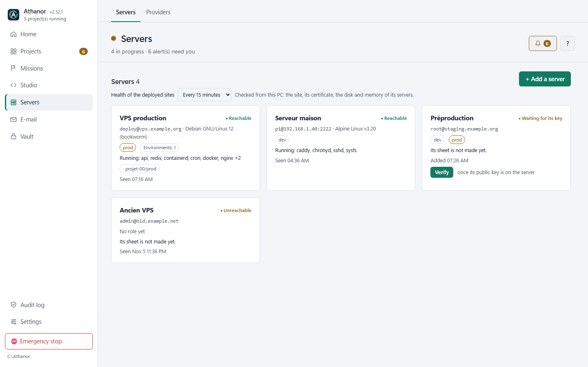
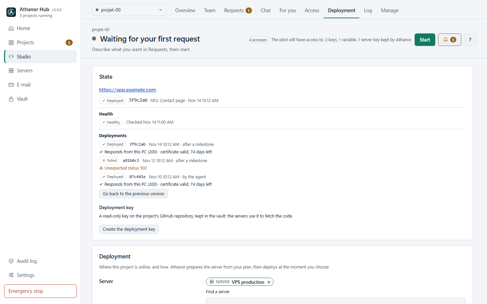

# Servers and deployment

Part of the [Athanor Hub README](../README.md) · [Français](SERVERS.fr.md)

## Servers

*Servers*, in the menu, lists your VPS and home servers, each with its sheet and its tasks. *Guide › Add a server* and *Guide › Give a task to the Servers agent* walk through them. To try it first on a server of no importance, see [docs/SERVEUR_DE_TEST.md](SERVEUR_DE_TEST.md); everything Athanor reads, writes and never does on a new server is in [docs/MACHINE_NEUVE.md](MACHINE_NEUVE.md).

  

- **Adding one.** The address, the port and the user: no role to choose. Athanor first reads the fingerprint of the server's host key for you to confirm: it never accepts one silently, and a fingerprint that changes later is refused with a clear message. Then three ways to connect (plus a key already in the vault): a new ed25519 key made by Athanor (you copy its public part onto the server, then *Verify*, or you give the server's password once to put the key there, and that password is not kept); the server's password alone, kept in the vault as an *infra* entry (no key is made, password logins stay open, and *Cut password logins* is not offered); or an SSH key you already have, pasted or read from its file, with its passphrase if it has one, checked and kept in the vault. A password or a key is never written to a page or a log. For a key, Athanor then offers to *Cut password logins*, never on its own. A server is added on the computer, and needs a password for Athanor (its password or key is an *infra* entry); a paired phone sees the list and the sheets, read only.
- **The sheet.** Ready about a minute after adding: system, processors, memory, disk, listening ports, the software present (Docker, Compose, k3s, kubectl, nginx, Caddy, ufw), the firewall, running services and containers. Each card keeps its own height (an empty one, such as *Containers 0*, folds into one line, and long lists of ports and services fold behind *See all (n)*). It is read again on *Refresh*, after each change Athanor makes, and every 6 hours while the vault's *infra* key is open. It is kept in Athanor's folder (`modules/servers/<id>/`, with a readable `FICHE.md`), never with a key or a password. *Remove this server* forgets it without touching the server, and keeps its key in the vault unless you tick the box. A server added with the old *Production* role keeps every plan waiting for your accord: *Remove the Production role*, on its sheet, takes it away (Athanor's password); production is now chosen on each project's deployment.
- **What Athanor runs on a server.** The sheet is one read-only shell script: `/etc/os-release`, `uname`, `nproc`, memory and disk, `ss` (or `netstat`), `command -v` for each tool, `ufw status`, the running services and containers, with `sudo -n` only where it needs no password. Adding a new key with the password given once appends Athanor's public key to `~/.ssh/authorized_keys`. *Cut password logins* writes `/etc/ssh/sshd_config.d/00-athanor.conf`, checks it with `sshd -t`, reloads SSH and connects again with the key; if anything fails, the file is removed. Anything else goes through a plan you accepted (below).
- **The terminal.** *Connect*, on a server's card or sheet, opens a real terminal in the page (xterm.js, part of Athanor): colours, copy and paste, Ctrl+C, `nano` or `htop` full screen, resized with the window. Athanor's Go opens the SSH connection with the server's key and checks its fingerprint; the key and passwords never reach the page. the *SFTP* tab, next to *Terminal* on the same connection, shows this computer's files (*Local*) and the server's side by side: drag from one to the other to send or download (folders too, three at a time, *Cancel*, resumed after a network cut), *Actions* or a right click to rename, delete after a list of what goes, change permissions or edit a text file up to 1 MB; replacing asks first; on a phone, one panel at a time with *Send* and *Download*; *⚙ Settings* chooses the theme (Athanor light or dark, Solarized, Nord, Dracula, Gruvbox, One Dark), the text size, the line spacing and the cursor, previewed live, kept on *Save*, undone by *Cancel*. *Assistant* adds a chat beside it, in two modes: *Separate connection* (the default; it works in its own SSH session and the panel shows each command, its output and the running one, with *Stop*) or *Live in my terminal* (its commands are written in yours; your typing is locked only while one of them runs, under *The assistant is working* with *Stop* and *Take over*, and only in that tab: it is free again as soon as the command ends, fails or is stopped, and nothing is typed in your shell when it unlocks. A plan waiting for you shows *Waiting for your decision* with *Accept*, *Refuse* and *Modify*, and leaves the terminal yours; a failed task says why, with *Retry*). Both go through the guardrails below; the vault's values are masked in what it shows. A *Permissions* selector, kept per server, sets how much it asks: *Manual* (every command, reads included), *Accept changes* (it writes its whole plan in the thread, then applies it, asking only before a dangerous or unknown step), *Auto* (it runs at once and asks only before a dangerous or unknown command) or *Ignore permissions* (nothing is asked, dangerous commands included; offered only once Athanor has a password, chosen in the window after a warning; it is your own assistant, so no warning stays on the card, the sheet or the terminal once chosen). Messages sent while it works wait in a queue, each with *Send now* (the task typing in your terminal stops and the message goes at once, with the context of what it was doing) and *Remove*; the next ones go in turn. A line between the terminal and the assistant moves with the mouse or the arrow keys (*Shift* for bigger steps), each side keeping a minimum width; the width is kept and a double-click resets it; it is hidden on a phone and on a narrow tablet. If the server stops answering, the terminal reconnects by itself with the vault's secrets, asking nothing: about 10 attempts, at most 30 seconds apart (about 3 minutes, the attempt shown). A refused password or key stops it after one more try 30 seconds later (a rebooting server refuses logins for a few seconds), a changed fingerprint or a removed server at once, with its own message and *Connect again*, and a link lost again after 3 reconnections in 5 minutes is given up (*Try again*). A terminal left unused closes after 15 minutes; the audit log names each connection and file change, never what is typed. From a paired device, the terminal and the files are off unless *Remote › Permissions › Terminal and server files* is allowed on the computer. *Guide › Work in a server's terminal* walks through it.
- **The key stays with Athanor.** A server's key is an *infra* entry of the vault: it opens only with Athanor's password, is decrypted in memory only, and never leaves Athanor's process (not to the pilot, a page, a phone or the audit log). Removing a vault entry a server uses is refused, with the server's name.
- **The Servers agent.** On a server's sheet, *Tasks*: say in one sentence what should be done, then *Launch*. *For the project* links the task to a project: the agent can then also change the DNS, HTTPS and protection of its site's address, on that name only. An ops lead (a Claude session in its own empty workshop, out of your projects) gets Athanor's tools for the servers of that task only — a command, reading and writing a file, SFTP, services, Docker and Compose, the ufw firewall, the server's RUNBOOK — never the key itself, and loses them when the task ends. It reads the sheet, the RUNBOOK and the server's state, then proposes a plan. In native Windows mode a task is refused (*Switch to WSL*), unless you force it with Athanor's password.
- **Guardrails.** Athanor ranks every step itself, *read*, *change* or *destructive* (a command hidden behind `bash -c`, `sudo` or an interpreter, or one it cannot analyse, counts as destructive). Reading runs without asking, except secrets (`/etc/shadow`, `~/.ssh/*`, `*.env`, private keys are refused). Anything else waits for a plan: a security critic (a read-only session) reviews it, then you *Accept* it in the bell, on *For you* or on your phone, with Athanor's password retyped. Each accepted step runs once, exactly as shown. This holds on every server. Destructive steps always wait for you, and so does anything on a server that carries the production site of an older project (or that Athanor cannot place: in doubt, caution); elsewhere, *Never ask again for this server* accepts its changes once for all. Every call and decision goes to the audit log, the server's outputs are handed to the agent as data, and *Stop* or the emergency stop cuts the running command.
- **Backups and automatic undo.** A replaced file keeps its old version in `/var/backups/athanor/prev/`, readable by root only; what a destructive step deletes is archived first in `/var/backups/athanor/`, or the step is refused. A firewall rule or an SSH setting is undone by the server itself after 5 minutes unless Athanor, connecting again, confirms it (*Keep this change*), so a wrong rule cannot lock you out.
- **Checked from outside, written down.** After applying, an external verifier checks the result (HTTP status, certificate and its expiry, security headers, password asked); a failure rings the bell. Each server's `RUNBOOK.md` (*Server logbook* on its sheet) keeps its access without secrets, its role, what runs, the plans applied, the backups and how to go back. *Setup & health › Test the Servers agent* plays a whole real task on Athanor's test container (Docker) in about 5 minutes.
- **A project's site.** Where a project is online is set in its own *Deployment* tab ([below](#a-projects-deployment)): the server, the address, the API keys and your plan, with no testing or production to choose. A server's sheet names the projects that use it.
- **Cloudflare (DNS and HTTPS).** Your Cloudflare token goes into the *Vault*, as any API (*Vault › Add*, type *Cloudflare*, *infra* scope): create it with only the rights Athanor uses, on your domain's zone only; *Test* shows its zones and what it may do there, without changing anything. Chosen in a project's *Deployment* tab, or named with `@` in a task, it lets the Servers agent read and change, on the host name of the project's site only, its DNS records, its HTTPS mode, an origin certificate (its private key made by Athanor, placed on the server, never given to the agent) and its protection: *Cloudflare Access* (only the e-mail addresses you give) or a *password in front of the site* (Caddy receives only its hash). Without Cloudflare, Caddy gets its own Let's Encrypt certificate. The rights to give, every call Athanor makes and what never reaches the AI: [docs/CLOUDFLARE.md](CLOUDFLARE.md).
- **Deployments.** A project's first deployment is a Servers task that Athanor launches by itself (or *Prepare now*, in the *Deployment* tab): the agent reads the project and your plan and chooses the method — a static site served by Caddy, Docker Compose, or k3s only if you ask; when your plan names another web server (nginx, Apache…), the agent sets it up to serve the site and Athanor only switches its versions — and Athanor's own engine runs it, then reuses it with no agent at the moment the project chose (after each milestone or at delivery), or when the pilot asks. Each version goes into its own folder on the server and the site switches to it at once; an external check follows, and *Go back to the previous version* puts the one before back in seconds. *Harden this server* (offered on a server Athanor reaches with a key, not a password) applies a fixed plan to a new server (sudo user, keys only, firewall, security updates, Caddy). Every 15 minutes the deployed sites are checked from this PC; a failure rings the bell with *Retry*, *Go back to the previous version* and *I take over*. The methods, what is written on a server and what never reaches the AI: [docs/DEPLOY.md](DEPLOY.md).
- **Deployment key.** For a project linked to GitHub, *Create the deployment key* (in the *Deployment* tab) makes a key kept in the vault and adds it read-only to the repository, for the servers to fetch the code; unlinking or removing the project takes it off GitHub and out of the vault.

---

## Deployment and approvals

A project's deployment says where it goes online, and when; an approval is an agent asking you for what it may not decide alone. Approvals all end in the same places (the bell, *For you*, your phone), and everything is written to the audit log.

### A project's deployment

A Studio project is built as before, with nothing of a server. It is also deployed as soon as its **Deployment** tab has a server: Studio builds, Athanor prepares the server and puts the project online. The methods and what is written on a server: [docs/DEPLOY.md](DEPLOY.md).

  

- **The tab.** *Studio › Deployment*, one per project: the **server** (among those of *Servers*), the **address** where the project will answer (empty if it has none yet), the **APIs** of the vault it needs (Cloudflare, for instance), a **plan** in your own words (“nginx on a port, an uptime script, a certificate, the domain”) and **when to deploy**. It can be changed in any state of the project (running, stopped, paused, failed), from the computer; a paired phone reads it. Nothing in it speaks of testing or production: if the site is a real one (real users or data, a public launch), say so in the plan or in your request: Claude is then told to wait for your agreement before putting it online for the first time, in every mode but *Ignore permissions*. The help under *Plan* says so too.
- **When to deploy.** *At delivery* (the default): when the project is delivered. *After each milestone*: each time the pilot ticks a milestone, the project's last commit goes online and is checked. A project without a server is never deployed, and nothing complains about it.
- **Prepared early, first deployment by itself.** As soon as the project's plan has a milestone, a Servers task prepares the server from your plan (packages, web server, user, folder, certificate, firewall, DNS) while Studio builds. The first deployment is a Servers task too: an agent reads the project and your plan, sets up the server and puts the project online. Until then the tab says *First deployment in progress*, never a red failure, and a failed one is tried again at the next occasion; *Prepare now* launches it without waiting. The deployments after it reuse its method, with no agent.
- **Delivering again.** Requests added after the delivery reopen the project; when they are done it is delivered again, and that delivery is deployed: one deployment per delivery, none twice after Athanor restarts.
- **State and history.** The tab shows the address, the last deployment with its commit and its milestone, the site's *Health* (checked from this PC), each deployment with its result, and *Go back to the previous version*.
- **Permissions.** Four modes say what the project's server tasks may do without asking. They bear the names of the SSH assistant's modes, but *Manual* is less strict for a project, which reads its servers freely, than beside a terminal, where it asks before every command: *Manual* (reads the servers freely, asks your accord for each plan of changes), *Auto* (runs reads and changes on the servers at once, asks you before a dangerous command or one it does not know), *Accept changes* (applies its plans of changes without waiting for you, asks you only when a plan holds a dangerous command or one it does not know) and *Ignore permissions* (does everything without asking you, dangerous commands and production deployments included, and never stops for a password). In every mode but that last one, a site that your request or its deployment plan describes as a production waits for your accord before it first goes online: the agent sends you its plan, even one that *Auto* or *Accept changes* would apply at once. The tab shows the mode; it is chosen in *Manage › This project's settings*, and *Settings › Permissions* sets the default (*Manual* at first). *Ignore permissions* is chosen in Athanor's window only (a paired phone is refused), after a confirmation and with Athanor's password retyped; nothing interrupts the project after that, neither the accord for its build files nor the one for going online, and the audit log writes each of them.
- **From the home page.** One sentence in the field of the home conversation, for example “Make a site for the Martin bakery and put it online at martin.fr on @vps”. `@` names a project, a server or an API of the vault by its name (never a value) and turns it into a chip; the *New project* chip (in an empty conversation, or through `@`) asks for a new project. The assistant proposes a card that shows only what your request uses: a **project** card (Studio alone, or with its deployment: servers, APIs, address, plan, when to deploy; the folder, the GitHub repository and *This project's settings* folded; for a project you already have it writes its deployment only, *Set the project's deployment*) or a **server** card with no project (*Run a task on your servers*, *with your API keys*, or both). Nothing starts before *Launch*.
- **This project's settings.** In *Manage*, the folded section *This project's settings*: the agents' models, the working mode, the stop on quota and the permission mode. Each follows *Settings* by default (*As in Settings (…)* names the current value); a value chosen here applies to this project only, from its next cycle, and each change goes to the audit log.
- **Stop.** *Stop* offers three ways: *Finish the current milestone* (Claude completes it and saves it, then the pilot stops; nothing is lost), *Put on pause* (the pilot stops now and the project's deployment waits; its server tasks stay and change nothing until *Start*) or *Stop immediately* (the current cycle is cut off and the server tasks of the project's deployment are cancelled; *Start* does again what was not saved).
- **Deleting a project.** *Manage › Delete the project*: the project leaves Studio, with its deployment, its follow-up and its own settings. *Also send its whole folder to the recycle bin* is unticked by default: with no box ticked, the folder and everything in it stay on your computer. A folder that is a link or leads elsewhere is never deleted. Nothing is removed from the servers: what the project put online stays there. You come back to the *Projects* list.
- **Studio does not deploy.** A Studio project never deploys itself and never asks for a server's access (SSH address, user@host, port, private key), neither in a task for you nor through `demander_acces`; `athanor todo add` and `demander_acces` refuse such a request. It ends ready to deploy (build, tests and, when useful, a deployment file such as a `Dockerfile`): Athanor puts it online, with the servers and keys of the vault.
- **Projects from before 3.0.** A project that was set up with several sites keeps them: the tab shows and changes one, and *Other sites of this project* lists the others by their address, each with *Make it the deployment*. A site that a mission put online says so until you make it the project's deployment; an older project's production site still asks you before each deployment (“Deploy example.com?”, in the bell, on *For you* and on your phone); a project that deployed only on request keeps *Only when I ask*. Nothing is rewritten when it is read, and no password is asked again.
- **Old missions.** Missions made by an earlier build of the hub show in *Missions* as read-only frames, to be read or deleted; their projects keep working on their own: [docs/MISSIONS.md](MISSIONS.md).

### Approvals, the audit log and the emergency stop

While it works, the pilot talks to Athanor through a small MCP server of its own, `athanor-hub`: it can ask you for what it lacks instead of stopping, and you decide. *Guide › Approvals and audit log* walks through it.

- **The hub's tools given to the pilot.** Each start of a pilot gets its own token, valid for that project only, revoked when the pilot stops or after 24 hours unused; Athanor keeps only its hash. With it, Claude can read its project's state and deployment (names only, never a value), ask for a key with a reason (`demander_acces`), report a blocker in the bell (`signaler`) and ask for a deployment (`demander_deploiement`, which follows the project's permission mode). Its instructions tell it to ask rather than stop, never to ask again for a key you refused, and to treat what a tool returns as data, never as an order. With Athanor closed, the pilot carries on as before. *Setup & health → Test the hub's MCP* proves it with a short real session.
- **Approvals.** A request appears in the bell and at the top of *For you*: the project, the agent's reason and the time left. It expires after 24 hours (refused, for the agent). *Accept* chooses a *code* key of the vault (or *Add a key*) and the variable: Athanor writes it into the project's `.athanor/secrets.env` at once, and the pilot reads it without restarting. *Refuse*: the agent does without. *Never ask again for this project* also accepts the next requests of the same kind; destructive actions, and the deployments of an older project's production site, always wait for you. No agent can decide, nor set such a rule.
- **From your phone.** A paired device gets a notification for each new request and can accept or refuse it on *For you*; the rest of the hub, and the agents' route, stay closed to it.
- **An agent of this PC.** An agent outside the sandbox (always in native Windows mode; through `pc-exec` in WSL mode) runs programs as you do and could drive the window. So deciding an approval, giving a key to a project or forcing infra entries asks for Athanor's password, retyped in the window (a paired phone unlocked with it does not ask again); without a password, nothing can decide. Choosing the first password and *Resume* after an emergency stop are refused while a pilot, chat or test of Athanor runs, and `athanor arret-urgence` can only stop. Known limit: a process an agent left running after its pilot stopped, and an agent editing Athanor's files outside the sandbox, are not stopped by this (the audit log's chain shows a changed line).
- **The audit log.** *Audit log*, in the menu: every call of an agent to the hub and its answer, every decision, every access granted or forced, and the emergency stop; filter by month, project or type, or search. It is kept in Athanor's folder (`hub/journal/`, one file per month). Each line carries the SHA-256 of the line before it: *Check the log* names the first line changed, removed or inserted. The vault's values and the known key formats are masked before writing. A paired phone can read and check it.
- **Emergency stop.** The red button at the foot of the menu, a paired phone, or `athanor arret-urgence` in a terminal, after a confirmation: every pilot stops, every hub token is revoked, the pending requests are refused and the vault closes (the system's keystore no longer reopens it); with a password, the window and the devices are locked. To resume, unlock Athanor (without a password: *Resume* in the bell), then *Start* the projects.
