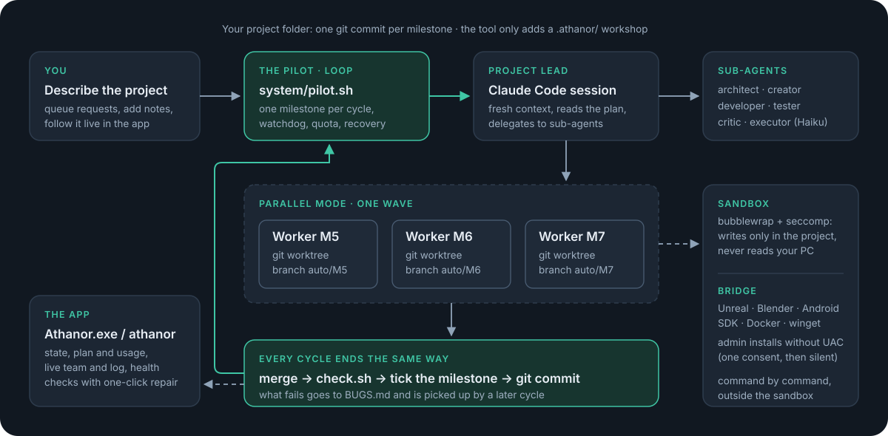
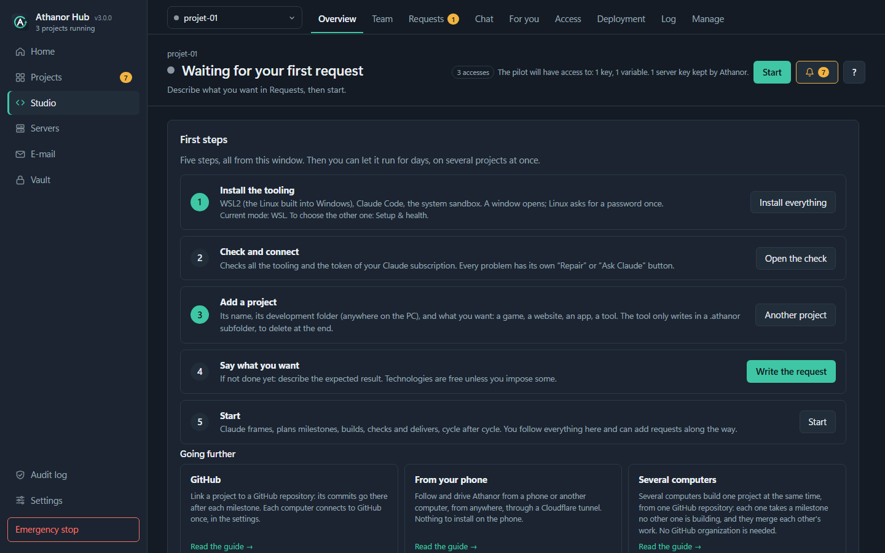
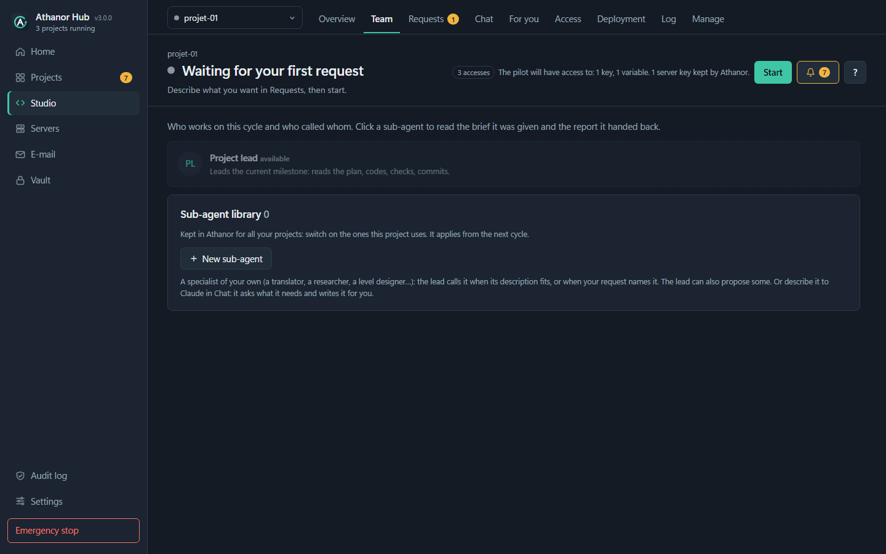
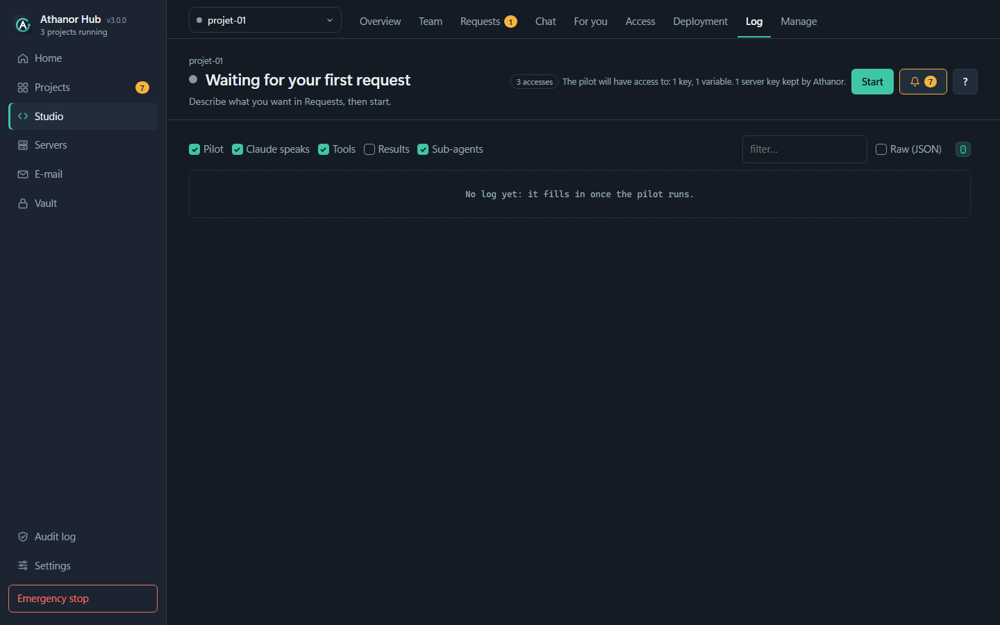
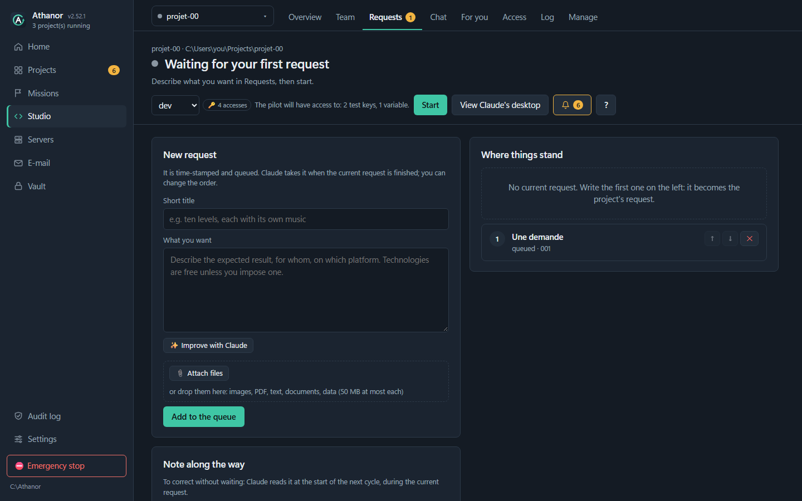
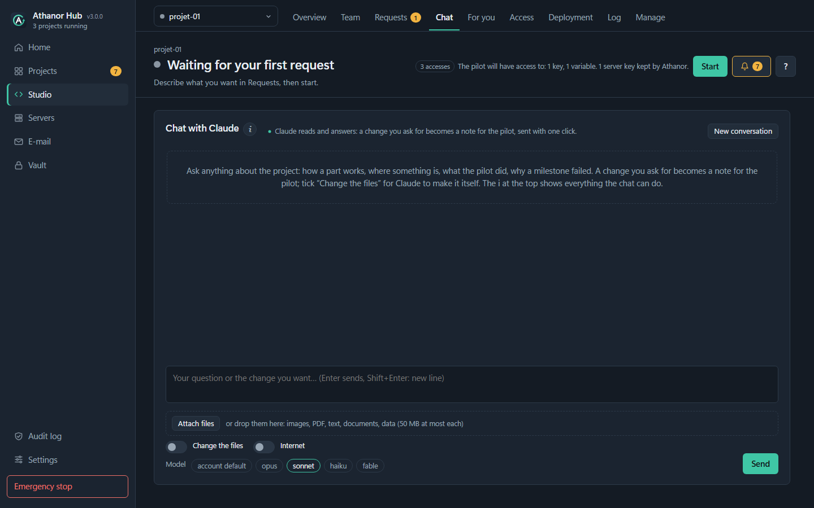
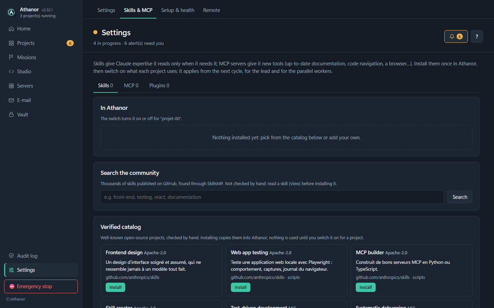
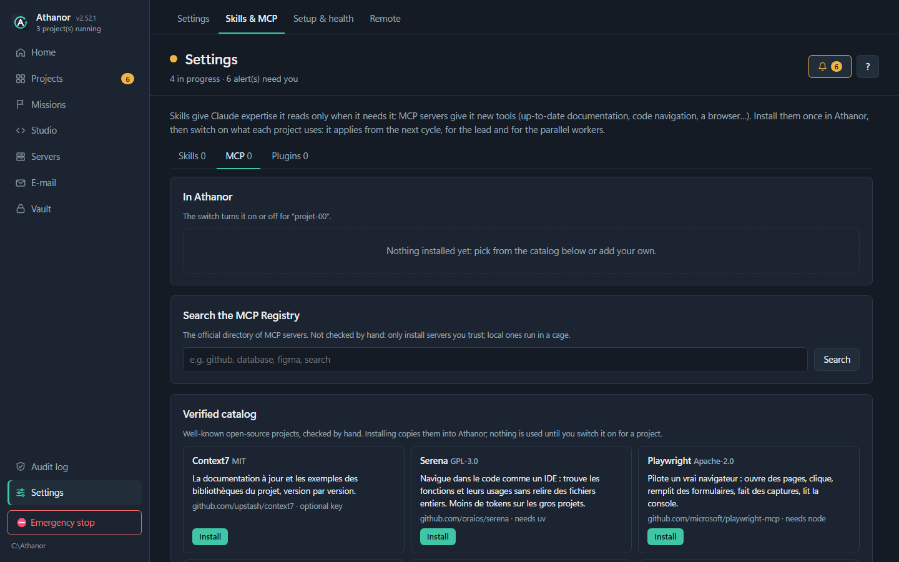
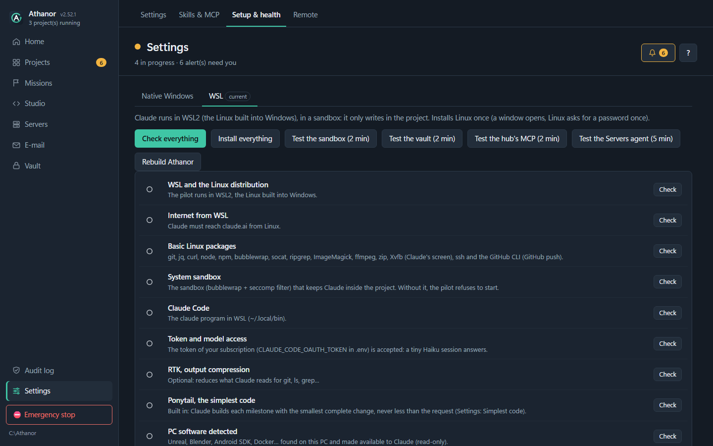
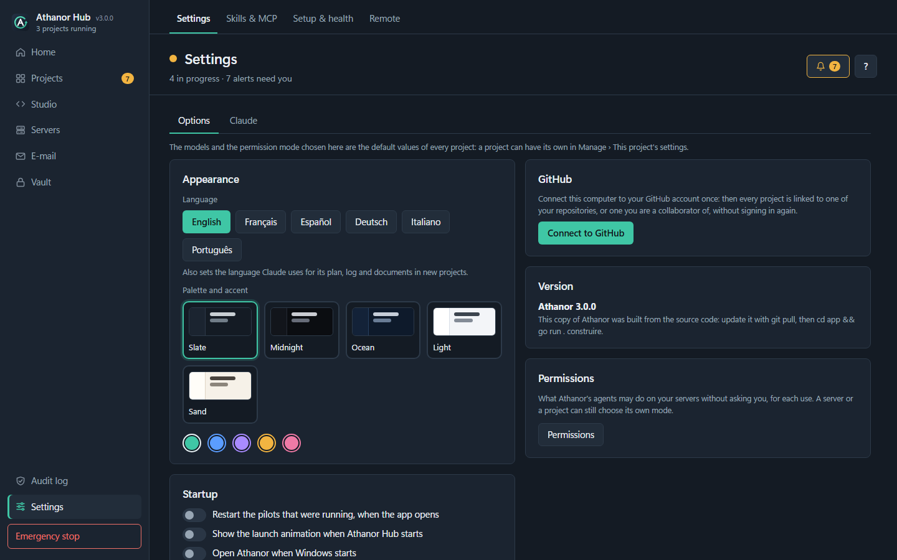

# Studio : les projets que Claude construit

Fait partie du [README d'Athanor Hub](../README.fr.md) · [English](STUDIO.md)

## Studio : les projets que Claude construit

Vous décrivez ce que vous voulez : un jeu, un site, une application, un outil. Studio lance Claude Code **cycle après cycle** : chaque cycle termine **un jalon du plan**. Claude fait le travail, lance les vérifications du projet, coche le jalon et le commite ; puis une session neuve prend le suivant, jusqu'à la livraison du projet.

| | |
|---|---|
| **Une boucle autonome** | Un jalon par cycle et un contexte neuf à chaque fois : les tours restent économes et le projet ne dérive pas. Quota atteint → pause jusqu'à sa réouverture, ou bascule sur un modèle de secours. Erreur → nouvel essai avec un délai croissant. Cycle muet ou trop long → coupé et repris. PC redémarré → reprise là où il s'était arrêté. Tout l'état est dans des fichiers. |
| **Mode parallèle** | Un interrupteur par projet. Un plan fin avec dépendances ; jusqu'à 10 ouvriers réalisent des jalons indépendants en même temps, chacun dans sa copie de travail git ; le pilote fusionne chacun dès qu'il termine et lance le suivant, et le chef vérifie une fois à la fin. |
| **Mode éco** | Un interrupteur par projet, quand le quota compte plus que la vitesse : le chef fait le travail lui-même au lieu de le confier à des sous-agents, une seule revue à la livraison, 4 images au plus par cycle, des sorties de commandes plus courtes. Le modèle et l'effort restent tels que vous les avez réglés. |
| **Mode fast** | Un interrupteur par projet, quand c'est le temps de construction qui compte le plus : des vérifications rapides seulement à chaque jalon et aucune revue en cours de route ; la vérification complète, le testeur, le critique et toutes les corrections viennent une seule fois, dans une vérification finale que le pilote impose avant la livraison. Les trois modes se cumulent. |
| **Ponytail, intégré** | Activé par défaut : Claude réalise chaque jalon avec la plus petite modification complète (les règles de [Ponytail](https://github.com/dietrichgebert/ponytail)), jamais moins que la demande. Le Suivi montre ce qui est mesuré : le cache, ce que RTK a épargné, et les cycles avec et sans, côte à côte. |
| **Plusieurs ordinateurs** | Deux, trois ou dix ordinateurs construisent un même projet ensemble par son dépôt GitHub, chacun avec un compte qui peut y envoyer (celui du propriétaire, ou celui d'un contributeur : pas besoin d'organisation) : chacun prend un jalon qu'aucun autre ne construit, d'abord ceux pour lesquels il est le meilleur (une grosse carte graphique pour la 3D, un réseau rapide pour les gros téléchargements), et ils fusionnent le travail les uns des autres après chaque jalon. Le Suivi montre quels ordinateurs sont là et ce que chacun construit. |
| **Une vraie équipe** | Un chef de projet et des sous-agents : `scout`, `architect`, `creator`, `developer`, `tester`, `critic`, et un `executor` bon marché (Haiku par défaut) pour le travail mécanique. Les éclaireurs lisent pour le cadrage, les tests indépendants et la critique finale sont toujours délégués. |
| **Skills & MCP** | Donnez à Claude de l'expertise et des outils : un catalogue vérifié (skills d'Anthropic, superpowers, Context7, Serena, Playwright, GitHub…), une recherche dans des milliers de skills communautaires (SkillsMP) et dans le registre officiel MCP, n'importe quel skill depuis un lien GitHub, vos propres skills, n'importe quel serveur MCP collé depuis son README, et les plugins Claude Code du catalogue officiel (et de tout autre que vous ajoutez), comme ceux de Shopify ou de Stripe. Activés projet par projet, pour le chef comme pour les ouvriers en parallèle. Les serveurs MCP locaux tournent dans une cage, loin de vos fichiers et du jeton Claude. |
| **Des tâches pour vous** | Ce que Claude ne peut pas faire lui-même (créer un compte, payer, recevoir un code par SMS, générer une clé) devient une tâche sur la page *Pour vous*, avec les étapes exactes ; en attendant, Claude continue le reste, et le pilote se met en pause s'il n'y a plus rien d'autre à faire. Vous répondez *c'est fait* (avec un texte, des fichiers, des clés dans un champ protégé) ou *passer : trouve une autre solution* ; Claude vérifie aussitôt et vous dit si ça marche ou ce qui manque encore. |
| **Une barrière** | Les commandes de Claude tournent sous bubblewrap + seccomp. Elles ne peuvent écrire que dans le projet et ne lisent jamais le reste de votre machine ; Internet reste ouvert. |
| **Vos logiciels** | Unreal Engine, Blender, le SDK Android, Docker et winget sont joignables par un pont contrôlé, commande par commande. |
| **Aucune fenêtre UAC** | Sur autorisation. Un seul consentement, puis Claude installe et lance ce dont le projet a besoin avec les droits administrateur, sans rien vous demander. |
| **Une application de bureau** | Un seul fichier, qui se met à jour en un clic. Elle montre l'équipe en direct, le plan, l'avancement et le quota de l'abonnement (avec arrêts automatiques), le journal lisible et la file des demandes, permet de discuter avec Claude du projet, et lance des vérifications qui se réparent en un clic. Elle fait aussi tourner plusieurs projets à la fois et garde les programmes que Claude lance sur leur propre bureau, loin de vous. Thèmes, 6 langues. |
| **GitHub, connecté une fois** | Connectez chaque ordinateur à votre compte GitHub une fois (*Réglages → Options → GitHub*). Un projet se lie ensuite à un nouveau dépôt privé, ou à tout dépôt que votre compte peut modifier, sans fenêtre, et ses commits y partent après chaque jalon. La clé reste hors de portée de Claude ; chaque envoi est vérifié à la recherche de secrets et n'est jamais forcé. Deux personnes peuvent se relayer sur un même dépôt, ou plusieurs ordinateurs le construire en même temps. |
| **Des projets propres** | Un projet est n'importe quel dossier de votre PC, et Athanor garde ses propres fichiers dans un dossier à lui. Athanor n'y ajoute qu'un atelier `.athanor/`, avec ses documents de travail (exigences, design, architecture), tenu hors de git sur votre ordinateur seulement, jamais via votre `.gitignore` (sauf si vous choisissez de le partager sur GitHub avec ceux qui travaillent avec vous) : supprimez-le à la fin et il ne reste aucune trace. |
| **Économe par conception** | Règles de lecture ciblées, vérification rapide pendant le jalon et complète une seule fois, captures assemblées en planches, carte du projet refaite avant chaque cycle, archives automatiques, compression des sorties de commandes. La page *Suivi* montre en direct quelle part de chaque session est relue depuis le cache. |

### Comment ça marche

  

**Un cycle.** Le pilote (`athanor demarrer`) synchronise la demande, archive les vieux jalons, refait la carte du projet (`.athanor/MAP.md`), ouvre l'éditeur Unreal si le projet en a un, puis lance une session Claude Code avec [`template/CLAUDE.md`](../template/CLAUDE.md) comme consignes, dans votre langue. Claude prend le premier jalon non coché de `.athanor/PLAN.md`, le réalise, lance `check.sh`, le coche, le note dans `LOG.md` et commite. Le pilote ferme le cycle peu après le commit et lance le suivant.

**Ce que chaque agent sait dès le départ.** `.athanor/PC_TOOLS.md` liste les outils déjà installés et leurs versions (Node, Python, PHP, Composer, Git…), vérifiés par le pilote : personne ne dépense de tours à les sonder. Deux fichiers courts rassemblent les problèmes déjà résolus, une ligne chacun : `.athanor/SOLUTIONS.md` pour le projet et `tools/SOLUTIONS.md` pour le PC, partagé par tous les projets. Chaque agent les lit en premier et ajoute une ligne quand il résout quelque chose ; le pilote retire les doublons, garde les 60 dernières lignes et récupère ce que les ouvriers en parallèle ont appris.

**Pas de fil perdu quand un contexte est plein.** Chaque session tient `.athanor/HANDOFF.md` à jour (où elle en est, 10 lignes). Au-delà de `RELAY_CONTEXT_K` milliers de tokens de contexte (110 par défaut), le pilote l'arrête entre deux étapes et lance une nouvelle session sur le même jalon, avec ce fichier, ses dernières actions et ses derniers messages : des tours moins chers, et pas de compaction automatique qui brouillerait le fil. Les ouvriers sont relayés de la même façon, sur leur propre branche.

**Le travail fait dans un programme est enregistré.** Un éditeur ou un moteur piloté par un serveur MCP garde son travail en mémoire : avant de cocher un jalon, l'agent l'enregistre dans le projet. Si un jalon a utilisé un serveur MCP et que son commit n'a changé aucun fichier, le pilote le fait vérifier en premier au cycle suivant. Les serveurs Roblox Studio et Unreal du catalogue disent comment enregistrer chez eux.

**La vie d'un projet.**

| Phase | Ce qui se passe |
|---|---|
| Cadrage | un cycle limité dans le temps (`FRAMING_MAX_MIN`, 25 min par défaut) qui n'écrit que le plan : jusqu'à 3 `scout` lisent en même temps les pièces jointes et le code existant, le chef écrit `.athanor/docs/REQUIREMENTS.md`, `DESIGN.md`, `ARCHITECTURE.md` et un plan de 8 à 25 jalons, chaque ligne étant une fiche autonome (fichiers, dépendances, critères d'acceptation, ce qu'il faut lire), et le `critic` relit le plan une fois. Ni code, ni installation, ni contenu de démo ; une fois le temps écoulé, le plan tel qu'il est part en développement |
| Squelette | un squelette exécutable et le `check.sh` propre au projet (compilation, tests, captures) |
| Tranche complète | une fonctionnalité qui marche de bout en bout, vérifiée par le `tester` |
| Production | les jalons restants, un par cycle, ou plusieurs à la fois en mode parallèle |
| Finition | le `critic` utilise le résultat comme un utilisateur exigeant et note les bugs dans `BUGS.md` |
| Livraison | `deliverable/`, `TEST_GUIDE.md`, puis `FINAL_REPORT.md` avec `STATUS: DONE`. Le pilote prend la demande suivante de la file, ou s'arrête |

**Les gros projets, par étapes.** Une demande trop grande pour 25 jalons n'est ni tassée en jalons géants ni réduite : le cadrage la découpe en étapes, autant qu'il en faut, chacune complète et testée à sa fin. Il ne détaille que la première ; chaque étape suivante tient sur une ligne du plan (`- [ ] S2: Stage 2/5 — …`). Quand le pilote y arrive, le `tester` puis le `critic` passent sur ce qui est fait, et le chef détaille l'étape en vrais jalons, avec le code des étapes précédentes sous les yeux. La finition et la livraison viennent à la dernière étape. Le Suivi et *Tous les projets* montrent l'étape en cours (« Étape 2/5 »). En mode parallèle, une ligne d'étape n'est jamais confiée à un ouvrier : le chef la détaille lui-même ; en mode éco, la revue n'a lieu qu'à la livraison.

### Mode parallèle

*Gérer → Mode de travail → Mode parallèle*, par projet, avec 2 à 10 ouvriers au maximum. Les ouvriers tournent sur `WORKER_MODEL` (Sonnet par défaut) : une fiche de jalon bien écrite est du travail d'exécution, le chef garde son modèle pour le plan et les fusions.

1. Le chef écrit un **plan fin avec des dépendances explicites** : beaucoup de petits jalons autonomes, chacun avec les fichiers qu'il touche, `Depends on:` les jalons dont il a besoin, et ses critères d'acceptation. M1 est toujours la fondation (squelette, `check.sh`, contrats partagés).
2. Le pilote fait tourner un **ordonnanceur** : chaque jalon dont les dépendances sont fusionnées reçoit un **ouvrier** (sa propre session Claude, sa propre copie de travail git `.athanor/work/M5` et sa branche `auto/M5`), en commençant par 2 et en en ajoutant un chaque fois qu'un ouvrier livre, jusqu'au nombre choisi. Dès qu'un ouvrier atteint le quota, plus aucun ne démarre ; s'ils l'ont tous atteint, la vérification du chef est sautée et le pilote attend, puis fait un jalon avec le chef seul avant de relancer des ouvriers. Le pilote laisse aussi le chef travailler seul, le temps d'un cycle, quand des ouvriers ne seraient pas rentables : moins de 3 jalons prêts en même temps, uniquement des jalons de documentation (ils se citent entre eux et entrent en conflit), ou le quota des 5 heures à 75 % ou celui de la semaine à 85 %. Deux jalons dont les fiches citent les mêmes fichiers ne tournent jamais en même temps. Les ouvriers partagent un tableau, `.athanor/BOARD.md`, écrit par le pilote toutes les quelques secondes : ce que fait chacun et les fichiers qu'il tient. Un ouvrier qui a besoin d'un fichier hors de sa fiche le réserve d'abord (`.athanor/RESERVE`) ; le pilote l'accorde sauf si un autre ouvrier le tient, et aucun nouvel ouvrier ne démarre sur un fichier réservé.
3. Dès qu'un ouvrier termine, le pilote **fusionne sa branche immédiatement** quand elle s'applique sans conflit, coche le jalon et lance les jalons suivants devenus prêts. Personne n'attend l'ouvrier le plus lent.
4. En fin de cycle, **une seule** session du chef vérifie tout : elle fusionne les branches en conflit, lance la vérification complète (les vérifications rapides des jalons fusionnés en mode fast), corrige ce que les fusions ont cassé et note le reste dans `BUGS.md`.
5. **Les demandes en attente n'attendent pas.** Au début de chaque cycle, elles rejoignent la demande en cours : le chef ajoute leurs jalons au plan, avec leurs dépendances.

Chaque ouvrier ne porte que son jalon en contexte : le travail est découpé en petites sessions économes au lieu d'une seule énorme. Un ouvrier peut confier ses longues séries de tests et ses recherches à `executor` (modèle bon marché) et ne lire que les échecs ; il n'appelle aucun autre sous-agent. La page *Équipe* montre une carte par ouvrier avec les sous-agents qu'il a appelés, et le *Journal* étiquette leurs lignes `[M5]`. Le mode parallèle consomme plus de quota par heure (une session par ouvrier) mais beaucoup moins de temps.

Il se cumule avec les deux autres modes. Avec le **mode éco**, chaque ouvrier et la vérification du chef suivent ses règles : peu d'images, moins de lecture, des sorties de commandes coupées à 8 000 caractères. Avec le **mode fast**, des vérifications rapides suivent les fusions et la vérification d'ensemble attend la fin.

### Mode éco

*Gérer → Mode de travail → Mode éco*, par projet (dans un terminal : **M**, puis *Mode de travail*). Pour quand le quota compte plus que la vitesse. Il se cumule avec le mode parallèle (les ouvriers suivent aussi ses règles) et avec le mode fast.

Mesuré sur un vrai projet de jeu, **ce sont les sous-agents qui consomment le plus** (80 à 87 % des jetons de ses cycles) : chacun repart de zéro et repaie tout son contexte à chaque tour. Le mode éco coupe donc d'abord là :

- **Le chef fait le travail lui-même.** Pas de sous-agent pour un jalon ordinaire ni pour un gros morceau (il découpe le jalon à la place) ; les sous-agents du projet seulement quand la demande les exige pour ce jalon ; aucun nouveau sous-agent proposé.
- **Une seule revue, à la fin.** `critic` et `tester` passent une fois chacun, pour la livraison : ni après la tranche complète, ni au polish, jamais de contre-revue. Le cadrage se passe des éclaireurs (un au plus pour de grosses pièces jointes) et de la relecture du plan.
- **Peu d'images.** 4 lectures d'image au plus par cycle (captures MCP comprises), en planches réduites ; une nouvelle capture seulement après un changement visible.
- **Moins de lecture, des sorties courtes.** La fin du journal, le jalon en cours, les seules sections utiles ; les sorties de commandes coupées à 8 000 caractères (`BASH_MAX_OUTPUT_LENGTH`, 20 000 sinon).

Le **modèle et l'effort de réflexion ne sont pas touchés** : ils restent tels que vous les avez réglés. Pour économiser encore plus, choisissez un modèle plus petit pour le chef (Sonnet) et un effort plus bas (`medium` ou `low`) dans *Réglages → Modèles*. Le Suivi affiche *mode éco* pendant un cycle ; l'interrupteur s'applique dès le prochain cycle.

### Mode fast

*Gérer → Mode de travail → Mode fast*, par projet (dans un terminal : **M**, puis *Mode de travail*), ou dès la création du projet. Pour quand c'est le temps de construction qui compte le plus. Mesuré sur trois vrais projets, **un tiers à la moitié du temps d'un cycle part dans la vérification complète qui termine chaque jalon**, et davantage à mesure que le projet grossit. Le mode fast reporte cette attente, et les revues, à la fin.

- **Des vérifications rapides seulement.** À la fin d'un jalon, Claude lance `check.sh quick` sur ce qu'il vient de construire, puis commite. Aucune vérification complète en cours de route : ni pour une ligne d'étape, ni après un cycle parallèle.
- **Aucune revue en cours de route.** `tester` et `critic` ne passent ni après la tranche complète, ni en fin d'étape, ni au polish.
- **Les défauts sont notés, pas poursuivis.** Une ligne dans `BUGS.md`, corrigée tout de suite seulement si elle bloque la suite. **Jusqu'à la fin, le projet peut être bugué, mal fini ou avec des problèmes de finition.**
- **Tout est vérifié et corrigé à la fin.** Avant la livraison vient la vérification finale : la vérification complète jusqu'à ce qu'elle passe, `tester` puis `critic` sur tout le projet, **chaque** remarque corrigée (les petites aussi), la vérification complète à nouveau et un second passage du testeur, jusqu'à ce qu'il ne reste rien. La livraison est aussi finie que sans ce mode. Le dernier jalon est plus long, puisqu'il porte la vérification de tout le projet.
- **Le pilote l'impose.** Un cycle en mode fast laisse `.athanor/FAST_DEBT` ; Claude ne le supprime qu'une fois la vérification finale terminée. Une livraison faite tant que ce fichier existe est rouverte (trois fois au plus par lancement ; ensuite le pilote s'arrête et le dit).
- **Désactivé en cours de route** : ce qui a été construit en mode fast est d'abord vérifié en entier (à la livraison en mode éco, comme son unique revue), puis le travail reprend comme d'habitude.

Le cadrage ne change pas. Le Suivi affiche *mode fast* pendant un cycle ; l'interrupteur s'applique dès le prochain cycle, et le Suivi dit *Nouveau mode de travail : pris en compte à la fin de ce cycle* tant que le pilote ne l'a pas réellement lu. Les trois modes se cumulent : parallèle et fast ensemble, c'est la façon la plus rapide de construire ; avec le mode éco, la vérification finale est son unique revue (`tester` et `critic` une fois chacun, chaque remarque quand même corrigée).

### Économiser le quota

Trois mécanismes agissent sur chaque projet, et la section *Consommation* du Suivi (repliée : cliquez dessus) montre ce que chacun apporte de façon mesurée.

- **Ponytail** (`PONYTAIL=1`, activé par défaut ; *Réglages → Code le plus simple*). Athanor embarque les règles de [Ponytail](https://github.com/dietrichgebert/ponytail) 5.3.2 (MIT) et les donne à **toutes** les sessions Claude du projet : le chef, les ouvriers en parallèle, chaque sous-agent (ceux d'Athanor et les vôtres) et la discussion de l'appli. Ceux qui écrivent du code reçoivent ses règles : avant d'écrire, réutiliser ce que le projet, la bibliothèque standard ou une dépendance installée offre déjà ; puis la plus petite modification qui fonctionne entièrement, avec un petit test pour toute logique non triviale. Ceux qui planifient, explorent ou jugent (le cadrage, `architect`, `scout`, `critic`, les agents en lecture seule, une question dans la discussion) reçoivent sa façon de travailler sobre : ne lire que ce que la question demande, répondre court et, pour `critic`, signaler le code qui devrait être plus petit. Une phrase d'Athanor fixe sa portée : Ponytail décide *comment* un jalon est construit, jamais *combien* de la demande est livré. Les hooks de son plugin ne sont pas utilisés (ils écrivent dans `~/.claude` et installent une ligne de statut). *Installation & santé* indique s'il est activé.
- **RTK** compresse les sorties de `git`, `ls`, `grep`, des tests… avant que Claude les lise. Ses mesures sont maintenant gardées par projet (`.athanor/rtk/`, hors de git), et le pilote les relève après chaque cycle.
- **Le cache** : ce que Claude relit pendant une session coûte un dixième au tarif public.

Dans *Consommation* : la part de lecture économisée par le cache, les jetons épargnés par RTK et, dès 3 cycles réussis de chaque sorte, le coût moyen d'un cycle **avec et sans** Ponytail (et le mode éco) sur ce projet. Cette dernière ligne est une tendance, pas un test : les jalons diffèrent d'un cycle à l'autre, et personne ne peut mesurer le code que Ponytail a évité d'écrire. Dans un terminal, le cadre *Avancement* dit la même chose en une ligne.

### Plusieurs ordinateurs

Un projet, plusieurs ordinateurs qui y travaillent en même temps : votre PC fixe et sa grosse carte graphique, un portable sur la fibre, une vieille tour. Ils se retrouvent par le dépôt GitHub du projet, rien d'autre à installer, sous Windows, macOS comme Linux.

**Ce qu'il faut.** Un dépôt GitHub, et pour chaque personne un compte qui peut y envoyer : celui du propriétaire, ou celui d'un contributeur (le propriétaire ajoute chaque personne dans *Settings → Collaborators* du dépôt sur GitHub, avec l'accès en écriture). **Pas besoin d'organisation GitHub.** Chaque ordinateur est connecté une fois à GitHub, avec ce compte : *Réglages → Options → GitHub → Se connecter à GitHub*.

**Pour commencer.** Sur le premier ordinateur, liez le projet au dépôt (*Gérer → GitHub*), puis activez *Suivi → Autres ordinateurs → Travailler avec d'autres ordinateurs* (cela partage l'atelier, `.athanor/`, et l'envoie aussitôt, pour que les autres reçoivent la demande et le plan ; l'interrupteur demande d'abord s'il est désactivé). Sur chaque autre ordinateur : *Nouveau projet → Rejoindre un projet*, avec le même dépôt, la même branche et un nouveau dossier vide : le projet arrive aussitôt (sa demande, son plan, son journal de bord), déjà en travail avec les autres ; il part de leur travail, jamais d'un historique à lui. S'il n'a pas encore de demande, *Démarrer* le lance quand même : son pilote ramène le travail des autres chaque minute, et la demande avec. L'encadré *Autres ordinateurs* du Suivi rappelle ces étapes, et *Plusieurs ordinateurs* dans le Guide les déroule avec un bouton pour chacune. Chaque ordinateur a sa propre clé sur son compte (« Athanor (ordinateur) »), donc chacun peut être déconnecté seul.

**Qui construit quoi.** Avant chaque cycle, le pilote d'un ordinateur ramène le travail des autres dans le projet, puis prend un jalon : un jalon dont les dépendances sont faites et qu'aucun autre ordinateur ne construit. Le cadrage est écrit par un seul ordinateur, les autres attendent le plan ; le rapport final aussi, à la fin, par un seul. Deux ordinateurs qui choisissent le même jalon au même moment sont départagés par celui qui l'a pris le premier ; l'autre en prend un autre. S'il n'y a rien à prendre (tout ce qui reste attend un jalon en cours), un ordinateur attend et regarde de nouveau chaque minute, et son Suivi dit pourquoi.

**Ce que chaque ordinateur sait bien faire.** *À distance → Cet ordinateur, pour les autres ordinateurs* : son nom, ce qu'il a (`RTX 4090, 24 Go`) et quelques mots (`gpu`, `network`). Claude connaît l'équipe quand il écrit le plan : un jalon qui a besoin de ce que seuls certains ordinateurs ont reçoit `Needs: gpu.` dans sa ligne, et seul un ordinateur qui a ce mot le construit, pendant que les autres prennent le reste. Deux ordinateurs avec le même mot construisent ces jalons en même temps : Claude découpe donc un gros travail d'un même genre (les armures de plusieurs types, plusieurs niveaux) en jalons séparés. Les mots sont facultatifs : si aucun ordinateur en marche n'a le mot dont un jalon a besoin (personne n'a rien déclaré), Athanor le répartit comme les autres, dans l'ordre du plan.

**Ce que vous voyez.** *Suivi → Ordinateurs sur ce projet* : chaque ordinateur de l'équipe, en ligne ou vu à telle heure, ce qu'il construit en ce moment et depuis quand, son dernier envoi. Un ordinateur est en ligne tant que son Athanor tourne (il signale sa présence chaque minute), même pilote arrêté ; les horloges des ordinateurs doivent être à l'heure (réglées automatiquement, comme par défaut).

**Un niveau pour chaque mot.** `gpu:3` contre `gpu:1` : un mot peut porter un niveau de 1 à 9. Un jalon qui en demande beaucoup (`Needs: gpu:3.`) va à un ordinateur de ce niveau ou plus, pendant que les moins puissants prennent les jalons plus légers en même temps ; si aucun ordinateur n'a ce niveau, le plus puissant le prend.

**Des notes entre les ordinateurs.** Les Claude des ordinateurs se laissent des notes dans `.athanor/TEAM_NOTES.md` (une interface qui a changé, un fichier partagé à manier avec soin, un piège) : chaque Claude lit les dernières avant de commencer, et le Suivi les montre.

**Un travail jamais perdu.** Toutes les 10 minutes, et quand son pilote s'arrête ou passe la main sur un jalon, un ordinateur envoie son travail inachevé sur GitHub, sur une ref à lui (`refs/athanor/encours/<ordinateur>`, un patch par jalon). Ce n'est pas une branche : GitHub ne la montre pas dans la liste des branches et ne lance aucun workflow du dépôt quand elle change ou disparaît ; elle part une fois ses jalons finis. L'ordinateur qui prend ensuite ce jalon repart de là ; s'il ne peut pas fusionner ce travail, il le transmet dans le sien, et un troisième ordinateur reçoit quand même les deux. Un ordinateur qui revient après qu'un autre a repris son jalon garde sa propre copie de côté dans son `.git` (`refs/athanor/sauve/…`) et repart du travail de l'équipe ; ses fichiers ignorés par git que la version de l'équipe remplace sont d'abord copiés dans les données d'Athanor pour le projet (gardés 30 jours, les 5 plus récents toujours).

**Les fusions.** Après chaque jalon, le pilote fusionne d'abord les nouveaux commits des autres, puis envoie (jamais en force). Les notes de l'atelier (`LOG.md`, `BUGS.md`, `SOLUTIONS.md`…) sont jointes ligne à ligne, et deux jalons cochés sur des lignes voisines du plan sont fusionnés tout seuls. Quand deux ordinateurs ont vraiment changé les mêmes lignes, le pilote annule la fusion (rien n'est perdu) et Claude la fait au début de son cycle suivant, en gardant le travail des deux côtés (`.athanor/MERGE_NEEDED.md`).

**Quand un programme ne marche pas sur un ordinateur** (Blender plante, un SDK est cassé) : Claude cherche d'abord la cause et répare ce qu'il peut sur cet ordinateur, même si cela prend 5 ou 10 minutes ; c'est seulement quand la cause est hors de sa portée (le matériel, un pilote, une licence) ou que sa réparation n'a pas marché qu'il le signale, sans relancer en boucle le même test qui échoue. Chaque ordinateur de l'équipe reçoit une notification, et les autres essaient le jalon à sa place, d'abord ceux qui ont le mot de ce programme. Celui qui réussit garde le mot : ces jalons lui reviennent désormais ; le Suivi montre qui construit un jalon à la place de qui, et ce qui ne marche pas où. Si aucun n'y arrive (ou si aucun ne tourne), l'ordinateur qui devait le construire le reprend et Claude vous le demande dans *Pour vous*, en disant quels ordinateurs ont essayé. Un ordinateur réessaie un programme 12 heures plus tard, au cas où il aurait été réparé. En travaillant seul, Claude vous le demande à ce moment-là.

**Bon à savoir.** Le dépôt a besoin de *Partager l'atelier (.athanor/) sur GitHub* (sauf si l'atelier passe par le lien direct, plus bas) : activer les ordinateurs l'active, avec l'envoi après chaque jalon. Chaque ordinateur fait un jalon à la fois : le mode parallèle est donc coupé pendant que plusieurs ordinateurs travaillent sur un projet. Chaque ordinateur laisse une petite ref `refs/athanor/pc/<id>` sur le dépôt, pas une branche (jamais dans la liste des branches, aucun workflow ne tourne pour elle) : sa présence (son nom, ce qu'il sait bien faire, ce qu'il construit) ; elle disparaît quand il cesse de travailler avec les autres, et après 30 jours sans nouvelles. Les branches `athanor/pc/…` et `athanor/encours/…` de la 2.36 sont retirées une fois, chacune par son ordinateur. Un projet dont l'historique n'a rien de commun avec celui du dépôt est refusé : deux projets qui partagent seulement un nom ne sont jamais mélangés. Les fichiers du dossier que le dépôt a aussi ne sont jamais écrasés quand un ordinateur rejoint l'équipe : il dit lesquels déplacer.

**Équipe, en direct (un lien direct).** *Suivi → Équipe, en direct* : un ordinateur devient le **maître** de l'équipe (n'importe lequel, projet par projet). Il ouvre un lien à lui, un tunnel Cloudflare séparé de l'accès à distance : ce lien ne répond qu'aux appels de l'équipe, si bien qu'un membre de l'équipe ne peut jamais atteindre le panneau du maître, ses réglages ni sa discussion. *Inviter un ordinateur* donne une invitation (`https://….trycloudflare.com#123456`, un seul usage, 10 minutes) ; sur l'autre ordinateur, *Rejoindre avec une invitation* ; le maître voit alors « PC-B veut rejoindre l'équipe » et l'*Accepte* ou le *Refuse* : un bon code seul ne fait entrer personne. Ensuite, toutes les 10 secondes, chaque ordinateur dit ce qu'il construit et ce qu'il consomme (le quota du compte sur 5 heures et sur la semaine, les cycles, le coût, les jetons, Ponytail, le mode éco), et chacun voit toute l'équipe en direct. L'adresse du tunnel change quand il redémarre : le maître publie la nouvelle, chiffrée avec la clé de l'équipe, dans sa présence sur GitHub, et les autres la retrouvent là. Dans un terminal : **M**, puis *Équipe, en direct*.

**L'atelier par le lien direct** (pour un dépôt public). Sur le maître, *Atelier par le lien direct* : le plan, la demande, le journal et les notes (ce que `.athanor/` partage) passent alors d'ordinateur en ordinateur par le lien du maître, jamais par GitHub ; `.athanor/` quitte les commits sur chaque ordinateur (le prochain push le retire du dépôt, les fichiers restent dans chaque dossier). Entre deux cycles, chaque pilote fusionne son atelier avec celui de l'équipe, fichier par fichier : les notes que chaque ordinateur complète sont réunies, les jalons cochés sont réunis, le reste du texte est fusionné ; quand deux ordinateurs ont changé les mêmes lignes, la version de l'équipe reste et celle de cet ordinateur va dans `.athanor/merge/`, que Claude intègre en premier (`.athanor/WORKSHOP_MERGE.md`). Un ordinateur qui rejoint depuis un dossier vide reçoit le code par GitHub et attend la demande de l'atelier du maître. Les fichiers de plus de 8 Mo restent sur leur ordinateur : mettez-les dans le projet lui-même, ils passent par GitHub.

**Lancer toute l'équipe depuis le maître.** *Lancer l'équipe* lance le pilote du maître, puis celui de chaque nœud en quelques secondes ; *Arrêter l'équipe après le cycle* les arrête tous à la fin de leur cycle. Un nœud ne suit que ces deux ordres (rien d'autre d'un ordinateur n'est jamais piloté depuis un autre), et son utilisateur peut les refuser : *Le maître peut lancer et arrêter le pilote de cet ordinateur*.

**Une équipe privée sur GitHub, et son secours.** Avec l'atelier par le lien direct, les présences des ordinateurs sur GitHub sont aussi chiffrées avec la clé de l'équipe (GitHub voit un identifiant et une heure, jamais un nom, un jalon ou l'adresse du maître), et le maître garde une copie chiffrée de l'atelier de l'équipe sur le dépôt (une ref, `refs/athanor/atelier`, pas une branche : GitHub ne voit ni les chemins ni les contenus). Quand le maître est injoignable, les nœuds continuent par cette copie ; le maître fusionne ce qu'ils y ont écrit dès qu'il le peut. Chaque ordinateur d'une telle équipe doit l'avoir rejointe (la clé vient avec l'invitation).

**Passer le rôle de maître.** Sur le maître, *En faire le maître* à côté d'un nœud en direct : cet ordinateur reprend l'équipe (ses ordinateurs, son atelier, ses ordres) et ouvre son propre lien ; l'ancien maître devient l'un de ses nœuds, et les autres suivent d'eux-mêmes (l'ancien maître le leur dit pendant deux minutes, ensuite la nouvelle adresse est dans la présence chiffrée du nouveau maître). L'atelier de l'ancien maître est figé pendant ce temps : rien de ce qui est écrit n'est perdu. Une passation qui n'aboutit pas en 5 minutes est annulée.

GitHub reste là où passe le code et ce sur quoi l'équipe se replie : quand le maître ne répond pas, les ordinateurs continuent comme avant et sont vus par GitHub.

### L'équipe

| Agent | Rôle | Modèle |
|---|---|---|
| **Chef de projet** | lit le plan, code les jalons ordinaires, délègue, relit chaque rapport, commite | `MODEL` |
| `scout` | lit ce qu'on lui désigne (code, pièces jointes, documentation) et répond à une question en un court résumé, ou écrit un document ; pour le cadrage | `SUBAGENT_MODEL`, Sonnet s'il est vide |
| `architect` | exigences, architecture et plan des jalons pour une grosse révision du plan | `SUBAGENT_MODEL` |
| `creator` | contenus : histoire, monde, dialogues, textes d'interface, ressources 2D/3D/son générées par programme | `SUBAGENT_MODEL` |
| `developer` | une tâche de développement précise, avec ses tests | `SUBAGENT_MODEL` |
| `tester` | tests automatiques, captures, rapports de bugs (ne corrige jamais le code lui-même) | `SUBAGENT_MODEL` |
| `critic` | utilise le résultat comme un utilisateur final exigeant, sans complaisance (lecture seule) | `SUBAGENT_MODEL` |
| `executor` | travail mécanique sans décision de conception : sorties de commandes longues, recherches, modifications en série, copies de fichiers ; le seul sous-agent que les ouvriers en parallèle peuvent appeler | `CHEAP_MODEL` (Haiku) |

Avec `SUBAGENT_MODEL=auto` (*Réglages*, « choisi par le chef »), le chef choisit lui-même le modèle de chaque appel : Haiku pour le travail mécanique, Sonnet pour l'essentiel du travail, Opus seulement pour le jugement (architecture, bug incompris, critique finale). Un appel qui n'en précise pas garde le modèle du tableau.

Les agents sont dans [`template/.claude/agents/`](../template/.claude/agents) : modifiez-les pour changer la façon de travailler de votre équipe.

**Vos propres sous-agents.** Sur la page *Équipe*, **+ Nouveau sous-agent** ajoute un spécialiste à vous (un traducteur, un chercheur dans un domaine, un level designer…) : un nom, quand le chef doit l'appeler, ses consignes (**✨ Améliorer avec Claude** transforme quelques lignes en consignes structurées), un modèle (comme les autres, économique ou le plus puissant), lecture seule ou non. Il rejoint votre **bibliothèque de sous-agents**, gardée dans Athanor pour tous vos projets et activée dans celui-ci : la page *Équipe* liste la bibliothèque avec un interrupteur par sous-agent pour le projet courant, **Modifier** (la modification vaut pour chaque projet qui l'utilise) et **Supprimer** (il quitte tous les projets). Ou décrivez-le à Claude dans **Discuter** (« un spécialiste Blender pour les objets ») : il pose ses questions, puis montre le sous-agent sous forme de fiche encore modifiable (✨ *Améliorer avec Claude* là aussi), et **Ajouter à l'équipe** le crée (de même pour modifier l'un des vôtres). Le chef peut aussi en proposer un quand un besoin revient : il écrit `.athanor/agents/<nom>.md`, le pilote le vérifie et l'ajoute à l'équipe au cycle suivant, marqué *proposé par le chef* ; vous le gardez, le modifiez, le désactivez ou le supprimez (une proposition désactivée ou supprimée n'est jamais refaite dans ce projet) ; un autre projet peut aussi l'activer. Ces sous-agents fonctionnent comme les autres : même barrière, skills, outils MCP et fichiers joints, appelables par le chef et par les ouvriers en parallèle ; le chef les trouve dans `.athanor/TEAM.md`, et une demande peut en nommer un (« fais faire les textes par `traducteur` »). Ils sont rangés dans `extensions/agents.json` (sans limite, dans la bibliothèque comme dans un projet). Les sous-agents des versions précédentes rejoignent la bibliothèque au premier démarrage : celui fait pour tous vos projets est activé dans chacun, celui d'un projet dans ce projet (deux différents du même nom : le second devient `nom-2`).

### Les pages

| | |
|:---:|:---:|
|  **Équipe** : qui a appelé qui, ce que fait chacun, en direct |  **Journal** : lisible ou brut, filtrable, ouvriers étiquetés |
|  **Demandes** : une file réordonnable, des fichiers, des remarques en cours de route |  **Discuter** : des questions sur le projet à tout moment |
|  **Skills** : installés une fois, activés par projet |  **MCP** : distants ou locaux dans une cage, testés en un clic |
|  **Installation & santé** : un onglet par mode, réparation ligne par ligne |  **Réglages → Options** : 6 langues, 5 palettes × 5 accents |

Les captures montrent les palettes sombre « Ardoise » et « Clair ».

| Page | Ce qu'on y fait |
|---|---|
| **Suivi** | l'état en une phrase, le jalon en cours, le dernier commit de cet ordinateur et le dernier sur GitHub (et pourquoi un envoi n'est pas parti), le plan coché, les ordinateurs qui travaillent sur le projet (ce que chacun construit ; replié tant que le projet ne se fait pas à plusieurs ordinateurs), le quota de l'abonnement (5 heures, la semaine) avec un arrêt automatique au seuil choisi (avec une clé API : la dépense API face à votre budget), l'avancement et sa projection (quand le dernier jalon devrait tomber, en temps et en coût), la consommation par cycle (durée, coût catalogue, cache) ; *Démarrer*, *Arrêter* (terminer le jalon en cours, ou arrêter maintenant), *Mode de travail* |
| **Équipe** | un arbre : le chef et chaque ouvrier avec les sous-agents qu'il a appelés ; un clic sur un sous-agent montre la consigne reçue et le rapport rendu ; le modèle de chacun ; qui peut être appelé, et la bibliothèque de vos sous-agents (créer, modifier, supprimer, un interrupteur par projet) |
| **Pour vous** | ce dont Claude a besoin de vous : chaque tâche avec ses étapes et ses liens, un champ protégé pour chaque clé demandée, des fichiers ; *C'est fait* ou *Passer : trouve une autre solution* ; le verdict de Claude (vérifiée, ou ce qui manque encore) et l'historique. Une pastille dans le menu, un bandeau sur le *Suivi* et une notification système annoncent une nouvelle tâche |
| **Demandes** | la demande en cours et son plan, les demandes à la suite (horodatées, réordonnables), les remarques en cours de route ; ✨ *Améliorer avec Claude* reformule une demande plus claire et plus complète, et vous pouvez revenir à la vôtre ; 📎 joignez des fichiers à une demande (cahier des charges, maquettes, photos, PDF, données) : ils restent dans l'atelier et Claude les lit avec la demande |
| **Discuter** | la conversation sur ce projet, présentée comme celle de l'accueil mais à part : son titre nomme le projet et le dossier que Claude lit, *Assistant général* ouvre l'assistant de l'accueil pour Athanor dans son ensemble ; une conversation vide propose quelques façons de commencer ; sous le champ, toujours visibles, *Fichiers*, *Internet*, *Modifier les fichiers* et le modèle, avec une phrase qui dit ce que Claude fera. Parler avec Claude du projet : des questions à tout moment (il lit le code, le plan, le journal) ; pilote arrêté, il peut aussi modifier des fichiers (sans commandes) et Athanor les commite ; pilote en marche, une modification devient une remarque pour le pilote, envoyée d'un clic ; sur un projet avec des serveurs, Claude demande d'abord si une remarque est pour le code ou pour les serveurs, et une remarque pour les serveurs s'ajoute d'un clic au plan pour les serveurs (l'agent Serveurs la met en place) ; 🌐 *Internet* (désactivé par défaut, mémorisé sur l'appareil) laisse Claude chercher et lire sur le web, seulement quand un message le demande (regarder en ligne, comparer avec ce qui existe ailleurs, un fait actuel), jamais pour une question sur le projet |
| **Journal** | le journal lisible (Claude parle, outils, résultats, sous-agents, pilote) ou brut (JSON), filtrable |
| **À distance** | l'accès à distance activé ou coupé, le lien et le QR code qui appairent un téléphone ou un autre ordinateur, les appareils de confiance (connecté maintenant ou vu à telle heure, d'où), les renommer ou les retirer d'un ✕ ; le nom de cet ordinateur et ce qu'il sait bien faire, pour les autres ordinateurs d'un projet |
| **Guide** | le bouton *Guide* à côté de la cloche : le tutoriel de chaque partie à rejouer, et des sujets pas à pas avec pour chaque étape un bouton qui ouvre la bonne page : se repérer, démarrer un projet, le coffre et les accès, GitHub (connecter l'ordinateur, lier, travailler chacun son tour), votre téléphone (et votre propre domaine, et comment ne plus l'utiliser), plusieurs ordinateurs (ce qu'il faut, connecter chaque ordinateur, rejoindre, ce que chacun sait bien faire), le terminal ; les premiers pas et les pages y renvoient |
| **Nouveau projet / Rejoindre un projet** (sur la page *Projets*, ou dans le sélecteur de projet) | un nom, le dossier (proposé à côté de vos autres projets ; *Parcourir…* ouvre la fenêtre de choix de dossier du système) et ce que vous voulez ; GitHub est dans le formulaire, et les réglages du projet (les modes parallèle, éco et fast, le cadrage le plus long, la limite de temps de travail) sont dans leur propre colonne à côté, dessous sur une fenêtre étroite ; ou rejoindre un projet que d'autres ordinateurs construisent déjà, depuis son dépôt |
| **Gérer** (dans le sélecteur de projet) | renommer le projet ; déplacer ou renommer son dossier ; le faire pointer vers un autre dossier (le plan et les demandes suivent, les jalons sont vérifiés d'après son contenu) ; vérifier les jalons ; l'archiver ; le supprimer (de la liste, son atelier ou tout le dossier, à la corbeille) ; le lier à GitHub |
| **Skills & MCP** | la bibliothèque (catalogue vérifié, recherche dans SkillsMP et le registre MCP, lien GitHub, vos propres skills, configurations MCP collées), un interrupteur par projet, les clés d'API des serveurs (rangées à part, jamais réaffichées) et leurs réglages (une adresse, un port, un chemin : détectés dans la configuration, affichés en clair avec leur valeur par défaut), *Voir / modifier* la configuration d'un serveur, ses réglages et le programme à ouvrir en JSON (y compris un serveur collé), *Tester* démarre un serveur dans sa cage et liste ses outils, et vérifie un skill (son en-tête, et si ses scripts ont leur programme ici et se lisent) ; quand un test échoue, **Corriger avec Claude** trouve une configuration (ou réécrit une copie du skill, montrée en diff avant *Appliquer*) qui marche sur ce système, la teste avant de la garder, et *Annuler la correction* remet ce qu'elle a remplacé ; chaque correction est aussi notée pour tout le monde dans `logs/corrections/`, et celles du catalogue vérifié peuvent être écrites dans une copie du code d'Athanor (`athanor extensions appliquer-corrections KIT CODE`) ; *Se connecter* une fois à un serveur distant qui le demande (OAuth), pour tous les projets ; **Plugins** : tout le catalogue des plugins Claude Code (catalogue officiel plus les vôtres), avec recherche, installés en un clic et activés projet par projet |
| **Installation & santé** | Un onglet par mode (Windows natif et WSL sous Windows ; Linux ; macOS), l'actuel marqué : *Tout installer* pour lui, ou y basculer. *Tout vérifier*, *Tester la barrière* pour de vrai, *Réparer* ligne par ligne, *Demander à Claude* de réparer ou d'installer quelque chose |
| **Réglages → Claude** | les réglages du pilote, le `.env` de l'outil (jeton masqué, modèles, effort, surveillance…, les plus rares sous *Avancé*). Enregistrés pendant qu'un pilote tourne, ils sont pris en compte tout seuls : le pilote redémarre avec eux à la fin de son cycle, et son bouton le dit (un clic annule) |
| **Réglages → Options** | langue, palette et accent, un raccourci vers l'Athanor installé (le Bureau, le menu des applications, les Applications du Mac), la connexion de cet ordinateur à GitHub, liste des projets (retirer de la liste ne touche jamais au dossier), relance des pilotes à l'ouverture, démarrage avec l'ordinateur, bureau « Claude », mot de passe, dossier de l'outil, version et mises à jour |

**Skills & MCP, en sécurité** : les skills sont chargés comme un plugin de session (`--plugin-dir`) : Claude ne lit un skill que quand il en a besoin, et peut les lire mais jamais les modifier. Les serveurs MCP s'ajoutent à la configuration MCP de la session ; un serveur local démarre dans une cage bubblewrap (`athanor mcp-cage`) : système en lecture seule, seuls le projet et les caches de l'outil en écriture, ni dossier personnel, ni disques Windows, ni dossier d'Athanor, ni jeton Claude. Un *programme Windows* (le serveur de Roblox Studio, un `.exe` ou un `.bat`, reconnu au collage et confirmé par l'option *Programme Windows*) ne peut pas être mis en cage depuis WSL : il démarre sous Windows via l'interopérabilité de WSL (`athanor mcp-windows`), avec vos droits, et ne reçoit que ses propres variables ; Claude ne voit que ses outils, et tout son arbre de processus s'arrête avec la session. Les skills demandent une version de Claude Code qui a `--plugin-dir`.

**Les plugins, démontés** : un plugin est téléchargé une fois dans le dossier de l'outil (depuis GitHub, figé sur le commit que donne son catalogue) et activé projet par projet. Ses skills, ses commandes et ses sous-agents sont chargés avec `--plugin-dir`, en lecture seule pour Claude ; ses serveurs MCP rejoignent la bibliothèque MCP (les locaux dans la cage, les clés rangées à part, un serveur distant connecté une fois pour tous les projets) ; ses hooks, ses serveurs LSP et ses moniteurs sont écartés, car ils tourneraient hors de la barrière. Les plugins construits par une commande ou publiés seulement sur npm sont listés mais pas installés.

**Des projets qui suivent leur dossier** : quand un projet pointe vers un autre dossier, Athanor compare les jalons cochés avec ce qui s'y trouve. Dans un dossier vide, plus rien n'est fait ; un jalon dont les fichiers listés manquent est décoché ; quand les fichiers reviennent, il se recoche tout seul. Au démarrage suivant, Claude vérifie chaque jalon plus en profondeur (`.athanor/REVERIFY`) et décoche ce qui manque vraiment. Les projets archivés quittent la liste et ne sont jamais relancés : *Projets archivés*, en bas de la liste des projets, les ramène.

**Le plan se façonne** : un clic sur un jalon montre ses fichiers, ses dépendances et ses critères d'acceptation ; on peut le monter, le descendre ou le retirer (les autres jalons n'en dépendent plus), ou éditer `PLAN.md` en entier.

**Bureau « Claude »** : les programmes que Claude lance ne s'ouvrent jamais sur votre écran. Ils n'interrompent ni votre travail ni un jeu en plein écran.
- **Windows** : Unreal, Blender, un jeu en test et tout ce qu'ils lancent s'ouvrent sur un bureau Windows à part, comme celui de l'invite UAC (les passerelles les lancent avec `Athanor.exe isole`). Ils ne peuvent prendre ni la main, ni votre souris : tant qu'un pilote tourne, un garde lève le verrouillage de la souris d'un jeu lancé sur le bureau de Claude (un test en jeu Roblox, le « play » d'Unreal) et remet en place un curseur qu'il a déplacé (chaque correction dans `logs/souris.log`). On ne les entend pas non plus : tant qu'un pilote tourne, leur son est coupé, sauf quand vous regardez le bureau de Claude ou avec *Réglages → Options → Bureau « Claude » → Entendre le bureau de Claude* (Windows retient la sourdine d'un programme pour son prochain lancement : Athanor rend donc le son dès que le programme se ferme, à l'arrêt du pilote, et à son prochain démarrage après un plantage). *Voir les fenêtres ouvertes par Claude* bascule l'écran dessus ; la barre en haut, ou Ctrl + Alt + B, vous ramène.
- **Windows, programmes console** : un pilote natif se donne une console cachée que partagent tous les programmes qu'il lance (bash, git, go, les vérifications) : aucune fenêtre de console ni de Windows Terminal ne s'ouvre, aucune ne prend la main. Pour suivre le pilote en direct, *Réglages → Options → Mode d'exécution → Afficher le terminal du pilote* montre cette console en une seule fenêtre réduite dans la barre des tâches, jamais mise au premier plan (pour les pilotes lancés ensuite).
- **Linux**, et les programmes Linux sous WSL que WSLg afficherait sur Windows : chaque pilote fait tourner un serveur X privé (Xvfb). Claude, ses outils et ses serveurs MCP ne voient que cet écran (`athanor ecran`), et votre affichage, X11 ou Wayland, leur est inaccessible. *Voir l'écran de Claude* l'affiche en direct dans l'application.
- Option désactivée, les nouveaux programmes s'ouvrent à nouveau sur votre écran. Ceux qui tournent déjà restent où ils sont jusqu'à leur fermeture : l'application vous laisse aller les fermer.

### GitHub

**GitHub, connecté une fois par ordinateur** : *Réglages → Options → GitHub → Se connecter à GitHub* se connecte une seule fois et met une clé « Athanor (cet ordinateur) » sur votre compte GitHub, gardée dans les données d'Athanor (hors de portée de Claude dans un bac à sable). Chaque projet de l'ordinateur envoie avec elle ; lier un projet la demande. Cette clé ouvre tous les dépôts que votre compte peut modifier ; *Se déconnecter* la retire de cet ordinateur (GitHub garde alors une entrée à retirer dans *Settings › SSH and GPG keys*) ; les projets restent liés, et envoient de nouveau avec la nouvelle clé une fois l'ordinateur reconnecté. Un projet lié par une version d'avant la 2.39 avec sa propre clé (une deploy key) continue d'envoyer avec elle, et *Utiliser ma connexion GitHub* le fait passer à la connexion.

**GitHub, pour chaque projet** : à la création d'un projet, ou plus tard dans *Gérer → GitHub*, choisissez *Utiliser un de mes dépôts* (PROPRIÉTAIRE/NOM : lié aussitôt, sans fenêtre) ou *Créer un dépôt privé* (une connexion, seulement pour le créer ; rien n'en est gardé, sauf si *Réglages → Options → GitHub → Créer des dépôts sans fenêtre* en garde une : les dépôts sont alors créés aussitôt, sans fenêtre, et *Oublier cet accès* la retire). Athanor vérifie tout de suite que votre compte peut lire le dépôt et y envoyer, et dit pourquoi sinon (introuvable, lecture seule, réseau) ; un dépôt avec des workflows GitHub Actions vous demande d'abord. Ensuite, le pilote envoie dès qu'un jalon est commité, de nouveau à la fin de chaque cycle si quelque chose n'est pas encore sur GitHub (y compris un cycle coupé par le contexte, la limite de temps ou le quota), et à la livraison (désactivez-le pour n'envoyer qu'avec *Envoyer maintenant* ; le journal le dit alors). Les envois ne sont jamais forcés : si GitHub a des commits que le projet n'a pas, Athanor s'arrête et le dit. Avant chaque envoi, les nouveaux commits sont vérifiés à la recherche de secrets (clés, jetons, fichiers `.env`, clés privées) ; si un secret est trouvé, rien n'est envoyé, et Claude le retire des commits non envoyés à son cycle suivant. Une modification des workflows GitHub Actions du dépôt (du code que GitHub exécute, avec les secrets du dépôt) vous attend : vérifiez-la, puis *Envoyer quand même*. Le même encadré règle l'**auteur des commits** (votre nom, et votre email GitHub ou votre adresse GitHub privée *noreply*, proposés depuis votre compte) et si Claude apparaît en co-auteur (par défaut non : aucune ligne « Co-Authored-By: Claude ») ; Claude écrit chaque titre de commit sous la forme `M3: ce que le jalon apporte`. *Partager l'atelier (.athanor/) sur GitHub* met le plan, les demandes, le journal de bord et les documents dans les commits (jamais les secrets, les journaux bruts ni l'état du pilote) : la cocher les commite aussitôt, seuls (jamais le code en cours d'écriture), et les envoie ; *Envoyer maintenant* prend aussi ce qui y a changé depuis ; quelqu'un qui récupère le dépôt et l'ajoute à son propre Athanor reprend le projet ; un seul pilote à la fois sur un projet, sauf si les ordinateurs travaillent ensemble ([Plusieurs ordinateurs](#plusieurs-ordinateurs)).

**À deux, chacun son tour, sur un même dépôt** (sans organisation, sans *Travailler avec d'autres ordinateurs*) : le propriétaire ajoute l'autre comme contributeur (*Settings › Collaborators* du dépôt). Chacun connecte son ordinateur à GitHub (ci-dessus) et lie le projet au dépôt. Cochez *Partager l'atelier* des deux côtés. Avant de travailler, *Gérer → GitHub → Récupérer le travail de GitHub* ramène ce que l'autre a poussé (comme `git pull` : une avance rapide ou une fusion ; jamais par-dessus des modifications non commitées, et un vrai conflit est laissé à Claude à son cycle suivant, sans rien changer). *Démarrer* le vérifie aussi : si GitHub a des commits que le dossier n'a pas, Athanor demande s'il faut les ramener d'abord ou démarrer d'où vous en êtes.

**Un dépôt créé sur GitHub avec un README** (ou une licence, un `.gitignore`) : sa branche a son propre historique, sans rien de commun avec celui du projet, donc le premier push est refusé. *Gérer → GitHub → Régler la question avec la branche de GitHub…* (proposé aussi par *Récupérer le travail de GitHub* et par le push refusé) : *Intégrer les fichiers de GitHub* fusionne les deux historiques (un fichier présent des deux côtés avec des contenus différents : Claude le fusionne à son cycle suivant, rien n'est perdu), ou *Remplacer la branche de GitHub par ce projet* pousse par-dessus, après avoir montré quels commits quitteraient la branche, et seulement telle que vous l'avez vue (si GitHub a changé entre-temps, rien n'est remplacé). Jamais quand plusieurs ordinateurs travaillent ensemble.

### Ce que Claude peut et ne peut pas faire

| | |
|---|---|
| Écrire | seulement dans le dossier du projet (et dans `tools/` de l'outil pour ce qu'il installe) |
| Lire | seulement le projet, `tools/` et les fichiers du système Linux ; ni vos documents, ni les disques Windows, ni `.env` |
| Internet | oui, librement |
| Installer des outils | oui : dans `tools/` (outils Linux, logiciels Windows portables dans `tools/windows/`), ou dans un conteneur Docker jetable ; chaque installation est notée dans `tools/INSTALLS.md` |
| Installer des logiciels Windows | oui, avec winget ou un installateur : pour votre utilisateur, ou avec les droits administrateur si vous l'avez autorisé (une seule demande Windows) |
| Pare-feu Windows | réglé tout seul avec la même autorisation : les programmes du projet peuvent recevoir des connexions **du réseau local seulement** |
| Vos logiciels Windows | oui, par les passerelles prévues (voir ci-dessous). **C'est une sortie voulue de la barrière** : ces programmes tournent avec vos droits Windows |
| `cmd.exe`, `powershell.exe` | non, bloqués depuis la barrière (les passerelles restent possibles) |
| Modifier le pilote, la barrière, ses réglages | non (`system/` est hors de ses dossiers) |

Ce tableau décrit le mode WSL, celui par défaut. Dans le mode Windows natif ci-dessous, il n'y a pas de barrière.

#### Mode Windows natif (expérimental)

*Réglages → Options → Mode d'exécution → Windows natif*. Le pilote est `Athanor.exe` lui-même et Claude Code est le programme Windows (ses commandes tournent dans Git Bash, le shell que Claude Code utilise sous Windows) : pas de WSL, le dossier Windows du projet et les programmes Windows sont atteints directement, et l'accès aux fichiers est plus rapide.

**Il n'y a pas de barrière dans ce mode** (Claude Code n'a pas de bac à sable sous Windows natif) : Claude peut lire et modifier n'importe quel fichier de votre PC et lancer n'importe quel programme, sans demander. Le garde-fichiers limite toujours ses outils de fichiers au projet et à `tools/`, et ses consignes lui disent d'y rester, mais rien ne l'impose à ses commandes. À réserver aux projets de confiance. Cela vaut aussi pour les fichiers d'Athanor : dans ce mode, les commandes de Claude pourraient lire le `.env` de l'outil (votre jeton), les clés des serveurs MCP et la clé GitHub, et modifier le pilote lui-même.

- Prérequis : Git pour Windows, jq, Python, Node.js, GitHub CLI, uv et Claude Code pour Windows ; *Installation & santé → Tout installer* les installe (winget, puis l'installeur de Claude Code).
- Le projet doit être dans un dossier d'un lecteur Windows (`C:\...`, `D:\...`), pas dans le système de fichiers WSL. Son historique (cycles, statistiques) passe d'un mode à l'autre.
- Le mode s'applique aux pilotes lancés ensuite ; arrêtez d'abord ceux qui tournent. Si vous fermez Athanor pendant que des pilotes natifs tournent, il demande s'ils continuent en arrière-plan ou s'arrêtent.
- L'écran Linux de Claude n'existe pas dans ce mode ; le bureau Windows de Claude garde toujours à l'écart les programmes qu'il ouvre.
- **Le coffre dans ce mode.** N'importe quel agent pourrait ouvrir la clé *code* par DPAPI, comme vous : les clés des projets sont alors protégées d'une copie du disque, pas de Claude (elles sont faites pour le code du projet de toute façon). Lier une entrée *infra* (les clés de vos serveurs) à un projet est refusé, avec la proposition de passer par WSL ; *Forcer en connaissance de cause*, dans le panneau *Accès* du projet, l'autorise pour ce projet après une confirmation, et chaque lien forcé est journalisé (sans la valeur). *Tester le coffre* marche aussi ici et dit ce qu'il a pu lire.
- **Les avertissements.** Une étiquette *Mode natif : sans barrière* reste en haut de chaque page jusqu'à *Compris*, à côté, qui la masque sur cet appareil (*Réglages → Options* montre toujours le mode). Une tâche Serveurs est refusée avec *Passer à WSL* ou *Forcer cette tâche* (mot de passe d'Athanor). *Ne plus me le rappeler* dans cette fenêtre, ou *Réglages → Options → Ne plus afficher les avertissements du mode Windows natif* (désactivé par défaut, mot de passe d'Athanor pour l'activer), force les tâches suivantes sans question : chaque forçage reste dans le journal d'audit, et les entrées *infra*, la production et les étapes destructives gardent leur propre décision.

### Les outils de votre PC

Claude travaille sous Linux (WSL2 sous Windows) et atteint vos logiciels Windows par des passerelles. Le pont exécute chaque commande **hors** de la barrière, avec vos droits :

| Passerelle | Ce qu'elle fait |
|---|---|
| `unreal-editor`, `unreal-cmd`, `unreal-uat` | ouvre l'éditeur Unreal (piloté par Unreal MCP si activé), lance commandlets et tests, fabrique les versions Windows et Android |
| `roblox-studio` | ouvre Roblox Studio sur une place du projet (rien si un Studio est déjà ouvert) |
| `blender` | le Blender du PC, généralement en arrière-plan avec un script Python (`blender -b -P scene.py`) ; `blender --open FICHIER.blend` ouvre sa fenêtre (rien si un Blender est déjà ouvert) |
| `adb` | l'outil Android du PC : installer et tester sur un téléphone branché en USB |
| `tool IMAGE CMD…` | lance une commande dans un conteneur Docker jetable qui ne voit que le projet |
| `install-windows ID` / `--file setup.exe` | installe un logiciel Windows (winget ou installateur), avec élévation si autorisée |
| `pc-exec [--admin] programme.exe` | lance un programme Windows construit ou téléchargé par le projet |
| `windows-var NOM CHEMIN` | définit une variable d'environnement Windows pour les outils de développement (`ANDROID_HOME`, `JAVA_HOME`…) |

Les logiciels installés sont détectés sur **tous les disques** (`C:`, `D:`…), et la version la plus récente l'emporte. La liste détectée est écrite avant chaque cycle dans `.athanor/PC_TOOLS.md`. Si la détection manque un logiciel, indiquez son chemin dans *Réglages* (`UE_DIR`, `BLENDER_EXE`, `ANDROID_SDK_DIR`).

**Unreal Engine (MCP)** : installez **Unreal Engine** depuis le catalogue vérifié de *Skills & MCP*, activez-le pour le projet (son adresse est un réglage du serveur) et, en mode WSL, lancez une fois `Athanor.exe reseau-unreal`. Claude active lui-même les plugins du MCP dans le projet Unreal, et le pilote ouvre l'éditeur avant chaque cycle. Claude le pilote (acteurs, lumières, matériaux, tests), lance tests et captures avec `unreal-cmd`, et fabrique le jeu Windows avec `unreal-uat` dans `deliverable/`. Le MCP d'Unreal est expérimental : s'il ne répond pas, Claude continue sans.

**Roblox Studio (MCP)** : installez **Roblox Studio** depuis le catalogue vérifié de *Skills & MCP* et activez-le pour le projet. Dans Studio, *Assistant > … > Manage MCP Servers*, activez *Enable Studio as MCP server*. Avant chaque cycle, le pilote ouvre dans Studio la première place `.rbxl`/`.rbxlx` du projet (sur le bureau de Claude si cette option est activée), sauf si un Studio est déjà ouvert : Claude travaille alors dans le vôtre. Claude modifie scripts et instances, lance des tests en jeu et insère des ressources via le serveur MCP intégré à Studio. Le serveur MCP de Studio tourne hors de la cage, comme le programme de l'utilisateur qu'il est (voir *Skills & MCP, en sécurité* plus haut), et Athanor le trouve sur l'ordinateur : sous Windows, `mcp.bat` dans votre dossier Roblox ; sous macOS, `StudioMCP` dans `RobloxStudio.app` (`/Applications` ou `~/Applications`) ; sous Linux, Studio tourne avec [Vinegar](https://vinegarhq.org) (Flatpak ou natif) et son `mcp.bat` est lancé dans le Wine de Vinegar. Le réglage `ROBLOX_STUDIO_MCP` du serveur donne un autre chemin si besoin. Expérimental, et davantage sous Linux.

**Blender (MCP)** : installez **Blender** depuis le catalogue vérifié de *Skills & MCP* (le serveur officiel de Blender Lab ; nécessite Blender 5.1+, uv et Git — Git pour Windows sous Windows ; sous macOS et Linux il tourne avec uv sur l'ordinateur, le Blender de Linux étant celui du PATH, le Snap ou le Flatpak `org.blender.Blender`) et activez-le pour le projet. Dans Blender, installez le module MCP depuis [blender.org/lab/mcp-server](https://www.blender.org/lab/mcp-server/), activez son *Auto Start* et autorisez l'*accès en ligne* (*Préférences > Système*). Sur sa ligne, choisissez comment Claude travaille avec : **Arrière-plan + fenêtre d'aperçu** (par défaut sous Windows et Linux) : Claude lance ses scripts avec `blender -b -P script.py`, sans les outils MCP (le moins cher), et chaque exécution s'affiche dans une fenêtre Blender qui se recharge toute seule, une par dossier où Claude travaille (les ouvriers en parallèle ont chacun la leur), sur le bureau Claude quand cette option est active ; **Arrière-plan seul** : aucune fenêtre ; **Dans la fenêtre de Blender (MCP)** (le seul mode avec fenêtre sur Mac) : comme suit. Avant chaque cycle, le pilote ouvre le premier `.blend` du projet (ou un Blender vide), sauf si un Blender est déjà ouvert : Claude travaille alors dans le vôtre. Claude exécute du Python dans Blender, inspecte la scène, prend des captures et cherche dans la documentation de Blender ; il enregistre la scène dans le projet en `.blend`. Le serveur exécute dans Blender le code écrit par Claude, avec vos droits, hors de la cage. Expérimental.

**Tout serveur MCP qui pilote un programme** : le programme à ouvrir avant chaque cycle fait partie de la description du serveur, dans le catalogue ou dans votre bibliothèque (*Voir / modifier*, clé `ouvrir`) : le programme (une passerelle comme `blender`, ou un programme Windows `C:\…\nom.exe`), ses arguments (`{FICHIER}` : le fichier du projet trouvé), les fichiers du projet à chercher (`*.blend`), le nom du processus ou le port qui disent qu'il est déjà ouvert, et combien de temps attendre ce port. Les réglages (`${PORT}`…) viennent des champs sous le serveur. Un nouveau serveur de ce genre ne demande aucune modification d'Athanor. L'ouverture de Blender est décrite ainsi ; Roblox Studio et Unreal gardent la leur (build Rojo, plugin MCP de l'éditeur).

**Logiciels manquants** : Claude se débrouille seul (version portable dans `tools/windows/`, sinon winget, sinon la tâche administrateur si elle est autorisée). Si une installation échoue, il l'écrit dans `.athanor/TODO_FOR_YOU.md` et continue autrement.

**Jeu mobile (Unreal)** : Android d'abord (SDK et Java portables, `.apk` installé sur le téléphone branché en USB), iOS gardé portable (`docs/IOS_PORT.md`).

**Docker (facultatif)** : il faut Docker Desktop avec *Settings > Resources > WSL integration*.

### Laisser tourner plusieurs jours

- Les pilotes tournent en arrière-plan, sans fenêtre (dans WSL sous Windows, sauf en mode natif) : vous pouvez fermer l'application.
- Le PC reste éveillé tant qu'un pilote tourne (`KEEP_AWAKE`), même application fermée ; pour Roblox Studio et Unreal, l'écran reste allumé aussi, car une session Windows verrouillée n'affiche rien (ni captures, ni tests en jeu). Ne verrouillez pas vous-même la session (Win + L) avant une nuit de Roblox ou d'Unreal, et vérifiez que l'écran de veille ne demande pas de reconnexion à la reprise.
- *Réglages → Options* : « Ouvrir Athanor au démarrage de l'ordinateur » et « Relancer les pilotes qui tournaient, à l'ouverture de l'application ».
- Pas de limite de temps par défaut : le pilote travaille jusqu'à la livraison, qui l'arrête de lui-même. Pour en fixer une : *Limite de temps de travail* (`MAX_HOURS`) dans *Réglages*, ou pour ce projet seul dans *Gérer → Mode de travail*. Seul compte le temps où le pilote travaille : ses attentes (quota, erreurs, « Pour vous »), une pause ou Athanor fermé ne comptent pas.

### Projet terminé, suite, nouveau projet

- **Demandes à la suite** : page *Demandes*. Dès que la demande en cours est terminée, le pilote prend la première de la file, l'ajoute à `REQUEST.md` et rouvre le projet avec un jalon de reprise.
- **Remarque en cours de route** : page *Demandes*, choix *Tout de suite*, lue au début du cycle suivant, sans redémarrage.
- **Rouvrir à la main** : remplacez `STATUS: DONE` par `STATUS: REOPENED` dans `.athanor/FINAL_REPORT.md`, puis *Démarrer*.
- **Nouveau projet** : sélecteur → *+ Nouveau projet*. **Nettoyer un projet fini** : supprimez son dossier `.athanor/`.
