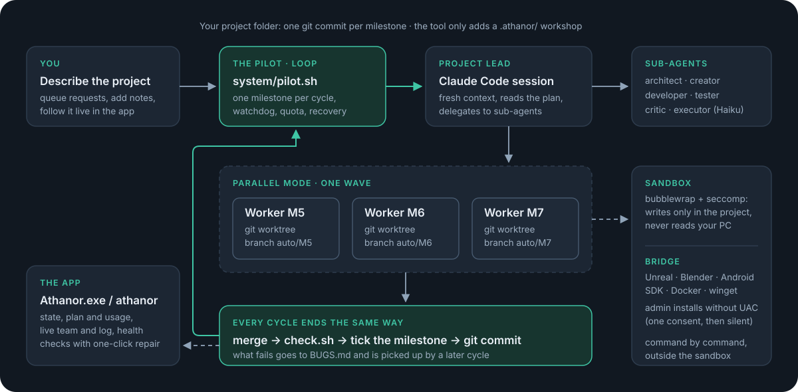
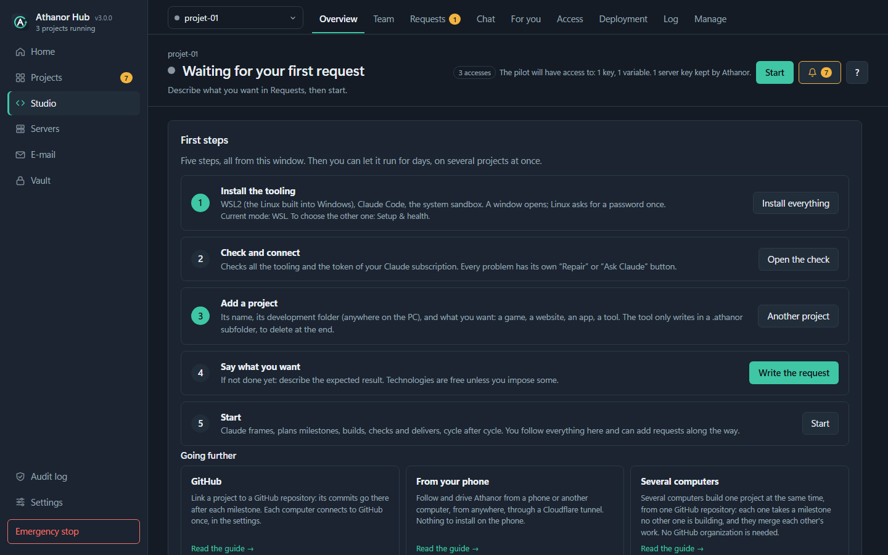
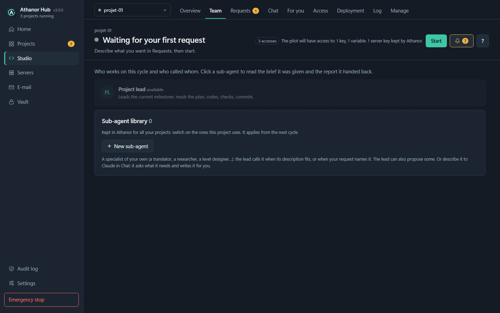
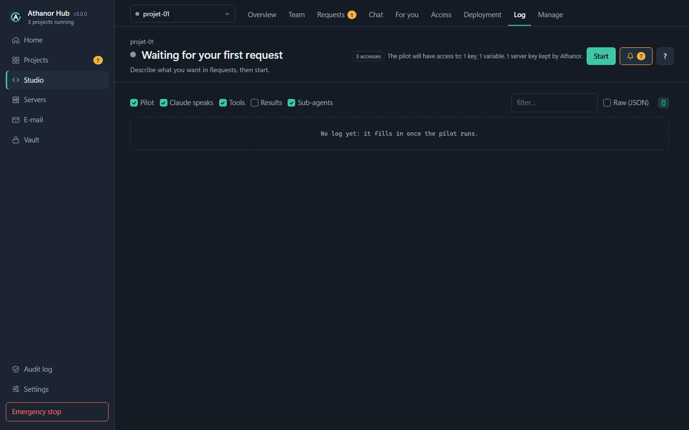
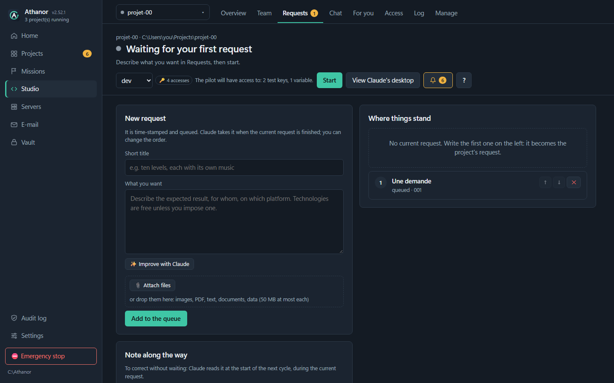
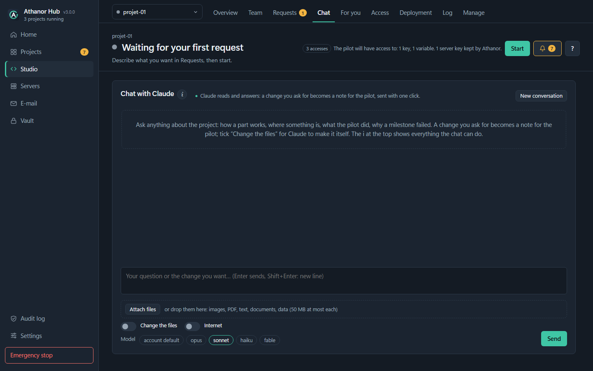
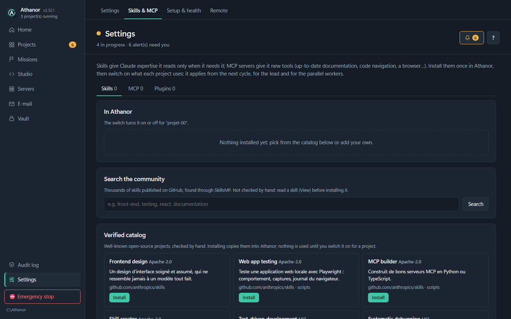
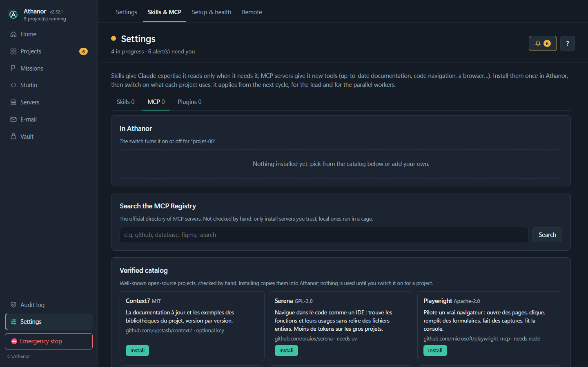
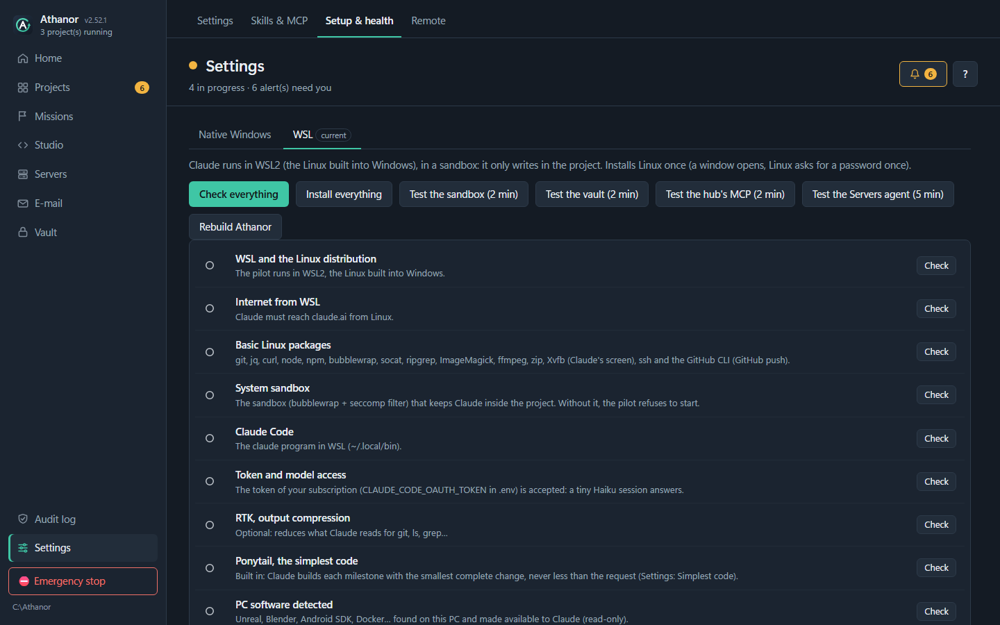
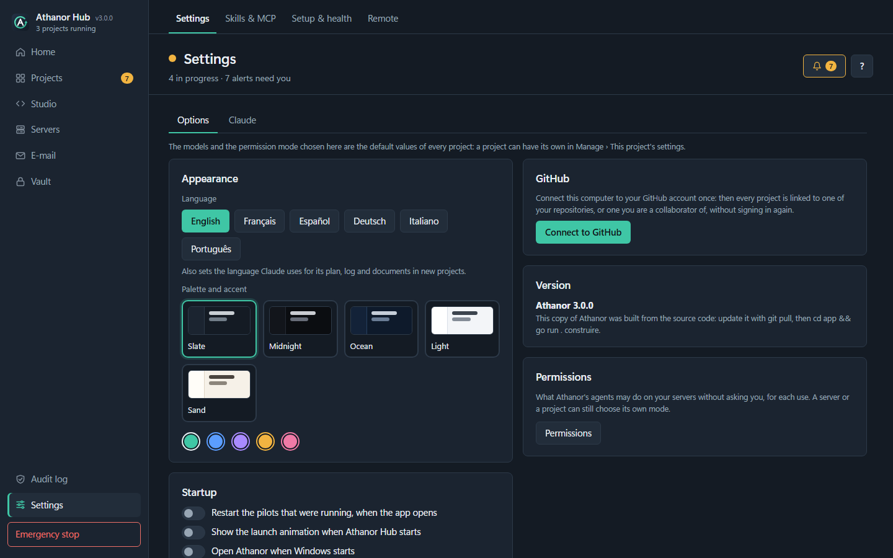

# Studio: projects Claude builds

Part of the [Athanor Hub README](../README.md) · [Français](STUDIO.fr.md)

## Studio: projects Claude builds

You describe what you want: a game, a website, an app, a tool. Studio runs Claude Code **cycle after cycle**: every cycle finishes **one milestone of the plan**. Claude does the work, runs the project's checks, ticks the milestone and commits it; then a fresh session takes the next one, until the project is delivered.

| | |
|---|---|
| **An autonomous loop** | One milestone per cycle, a fresh context each time, so turns stay cheap and the project never drifts. Usage limit reached → pause until it reopens, or switch to a fallback model. Error → retry with a growing delay. Silent or over-long cycle → cut and resumed. PC restarted → resumes where it stopped. All state lives in files. |
| **Parallel mode** | One switch per project. A fine-grained plan with dependencies; up to 10 workers build independent milestones at once, each in its own git worktree; the pilot merges each one as soon as it finishes and starts the next, and the lead verifies once at the end. |
| **Eco mode** | One switch per project, for when the quota matters more than speed: the lead does the work itself instead of handing it to sub-agents, one review at delivery, at most 4 images per cycle, shorter command outputs. The model and the effort stay as you set them. |
| **Fast mode** | One switch per project, for when the build time matters most: quick checks only at each milestone and no review on the way; the full check, the tester, the critic and every fix come once, in a final verification the pilot enforces before the delivery. The three modes add up. |
| **Ponytail, built in** | On by default: Claude builds each milestone with the smallest complete change ([Ponytail](https://github.com/dietrichgebert/ponytail)'s rules), never less than the request. The Overview shows what is measured: the cache, what RTK spared, and the cycles with and without side by side. |
| **Several computers** | Two, three or ten computers build one project together through its GitHub repository, each with an account that can push to it (the owner's, or a collaborator's: no organization needed): each one takes a milestone no other one builds, the ones it is best at first (a big graphics card for the 3D, a fast network for the big downloads), and they merge each other's work after every milestone. The Overview shows which computers are there and what each one builds. |
| **A real team** | A project lead plus sub-agents: `scout`, `architect`, `creator`, `developer`, `tester`, `critic`, and a cheap `executor` (Haiku by default) for mechanical work. Scouts read for the framing, independent tests and the final critique are always delegated. |
| **Skills & MCP** | Give Claude expertise and tools: a verified catalog (Anthropic skills, superpowers, Context7, Serena, Playwright, GitHub…), a search over thousands of community skills (SkillsMP) and over the official MCP Registry, any skill from a GitHub link, skills you write yourself, any MCP server pasted from its README, and Claude Code plugins from the official marketplace (and any other you add), like Shopify's or Stripe's. Switched on per project, for the lead and the parallel workers. Local MCP servers run in a cage, away from your files and the Claude token. |
| **Tasks for you** | What Claude cannot do itself (create an account, pay, receive a code by SMS, generate a key) becomes a task on the *For you* page, with the exact steps; meanwhile Claude carries on with the rest, and the pilot pauses if nothing else can be done. You answer *done* (with a text, files, keys in a protected field) or *skip: find another way*; Claude checks it at once and tells you whether it works or what is still missing. |
| **A sandbox** | Claude's commands run under bubblewrap + seccomp. They can write only in the project, never read the rest of your machine, and Internet stays open. |
| **Your PC's software** | Unreal Engine, Blender, the Android SDK, Docker and winget are reached through a controlled bridge, command by command. |
| **No UAC prompts** | Opt-in. One consent, and from then on Claude installs and runs what the project needs with administrator rights, silently. |
| **A desktop app** | One file, that updates itself in one click. It shows the live team, the plan, the progress and the subscription quota (with automatic stops), the readable log and the request queue, lets you chat with Claude about the project, and runs health checks with one-click repair. It also runs several projects at once and keeps the programs Claude starts on a desktop of their own, out of your way. Themes, 6 languages. |
| **GitHub, connected once** | Connect each computer to your GitHub account once (*Settings → Options → GitHub*). Then a project is linked to a new private repository, or to any one your account can push to, with no window, and its commits go there after each milestone. The key stays out of Claude's reach; every push is checked for secrets and never forced. Two people can take turns on one repository, or several computers build it at once. |
| **Clean projects** | A project is any folder on your PC, and Athanor keeps its own files in a folder of its own. Athanor only adds a `.athanor/` workshop, with its working documents (requirements, design, architecture), kept out of git on your computer alone, never through your `.gitignore` (unless you choose to share it on GitHub with the people you work with); delete it at the end and nothing is left behind. |
| **Frugal by design** | Targeted reading rules, a quick check during the milestone and the full check once, screenshots assembled into contact sheets, a project map regenerated before each cycle, automatic archives, command output compression. The Overview page shows live how much of each session is re-read from the prompt cache. |

### How it works

  

**A cycle.** The pilot (`athanor demarrer`) syncs the request, archives old milestones, rebuilds the project map (`.athanor/MAP.md`), opens the Unreal editor if the project has one, then starts a Claude Code session with [`template/CLAUDE.md`](../template/CLAUDE.md) as instructions, in your language. Claude takes the first unchecked milestone of `.athanor/PLAN.md`, does it, runs `check.sh`, ticks it, logs it in `LOG.md` and commits. The pilot closes the cycle shortly after the commit and starts the next one.

**What every agent knows from the start.** `.athanor/PC_TOOLS.md` lists the toolchain already installed and its versions (Node, Python, PHP, Composer, Git…), checked by the pilot, so nobody spends turns probing it. Two short files collect the problems already solved, one line each: `.athanor/SOLUTIONS.md` for the project and `tools/SOLUTIONS.md` for the PC, shared by every project. Every agent reads them first and adds a line when it solves something; the pilot removes duplicates and keeps the latest 60 lines, and merges what parallel workers learned.

**No thread lost when a context gets full.** Every session keeps `.athanor/HANDOFF.md` (where it is, 10 lines). Past `RELAY_CONTEXT_K` thousand tokens of context (200 by default, or `auto`: chosen for each project from its own milestones), the pilot stops it between two steps and starts a fresh session on the same milestone, with that file, its last actions and its last messages: cheaper turns, and no automatic compaction that would blur the thread. That session first splits what is left of a milestone too big for one session, and the framing sizes the milestones for that context. Workers are relayed the same way, on their own branch.

**Work done inside a program is saved.** An editor or an engine driven through an MCP server keeps its work in memory: before ticking a milestone, the agent saves it into the project. If a milestone used an MCP server and its commit changed no file, the pilot has that checked first on the next cycle. The catalogue's Roblox Studio and Unreal servers come with how to save in them.

**A project's life.**

| Phase | What happens |
|---|---|
| Framing | one time-boxed cycle (`FRAMING_MAX_MIN`, 25 min by default) that only writes the plan: up to 3 `scout`s read the attachments and the existing code at once, the lead writes `.athanor/docs/REQUIREMENTS.md`, `DESIGN.md`, `ARCHITECTURE.md` and a plan of 8 to 25 milestones, each line a self-contained sheet (files, dependencies, acceptance criteria, what to read), and the `critic` checks the plan once. No code, no installation, no demo content; past the time box, the plan as it stands goes ahead |
| Skeleton | an executable skeleton and the project's own `check.sh` (build, tests, screenshots) |
| Complete slice | one feature working end to end, checked by the `tester` |
| Production | the remaining milestones, one per cycle, or several at once in parallel mode |
| Polish | the `critic` uses the result like a demanding user and files bugs in `BUGS.md` |
| Delivery | `deliverable/`, `TEST_GUIDE.md`, then `FINAL_REPORT.md` with `STATUS: DONE`. The pilot takes the next queued request, or stops |

**Large projects, in stages.** A request too large for 25 milestones is neither squeezed into oversized milestones nor reduced: the framing cuts it into stages, as many as it takes, each one complete and tested at its end. It details the first one only; every later stage is one line of the plan (`- [ ] S2: Stage 2/5 — …`). When the pilot reaches it, the `tester` then the `critic` review what is done, and the lead details the stage into real milestones, with the code of the earlier stages in hand. The polish and the delivery come with the last stage. The Overview and *All projects* show the stage under way ("Stage 2/5"). In parallel mode a stage line is never handed to a worker: the lead details it itself; in eco mode the review only happens at the delivery.

### Parallel mode

*Manage → Working mode → Parallel mode*, per project, with 2 to 10 workers at most. Workers run on `WORKER_MODEL` (Sonnet by default): a well-written milestone sheet is execution work, the lead keeps its own model for the plan and the merges.

1. The lead writes a **fine-grained plan with explicit dependencies**: many small, self-contained milestones, each with the files it touches, `Depends on:` the milestones it needs, and acceptance criteria. M1 is always the foundation (skeleton, `check.sh`, shared contracts).
2. The pilot runs a **scheduler**: every milestone whose dependencies are merged gets a **worker** (its own Claude session, its own git worktree `.athanor/work/M5` and branch `auto/M5`), starting with 2 and adding one each time a worker delivers, up to the chosen number. As soon as a worker meets the quota, no other one starts; if they all met it, the lead's verification is skipped and the pilot waits, then runs one milestone with the lead alone before starting workers again. The pilot also lets the lead work alone, for that cycle, when workers would not pay off: fewer than 3 milestones ready at once, only documentation milestones (they link to each other and conflict), or the 5-hour quota at 75% or the weekly one at 85%. Two milestones whose sheets name the same files never run at the same time. The workers share a board, `.athanor/BOARD.md`, written by the pilot every few seconds: what each one is doing and the files it holds. A worker that needs a file outside its sheet reserves it first (`.athanor/RESERVE`); the pilot grants it unless another worker holds it, and no new worker starts on a reserved file.
3. As soon as a worker finishes, the pilot **merges its branch immediately** when it applies cleanly, ticks the milestone, and starts the next ready milestones. Nobody waits for the slowest worker.
4. At the end of the cycle, **one** session of the lead verifies everything: it merges the branches that conflicted, runs the full check (the quick checks of the merged milestones in the fast mode), fixes what the merges broke, and files the rest in `BUGS.md`.
5. **Queued requests don't wait.** At the start of each cycle they join the current request: the lead adds their milestones to the plan, with their dependencies.

Each worker only carries its own milestone in context, so the work is split into small, cheap sessions instead of one huge one. A worker may hand its long test runs and searches to `executor` (cheap model) and read only the failures; it calls no other sub-agent. The Team page shows one card per worker with the sub-agents it called, and the Log tags their lines `[M5]`. Parallel mode uses more quota per hour (one session per worker) but far less wall-clock time.

It adds up with the two other modes. With the **eco mode**, every worker and the lead's verification follow its rules: few images, less reading, command outputs cut at 8,000 characters. With the **fast mode**, quick checks follow the merges and the whole verification waits for the end.

### Eco mode

*Manage → Working mode → Eco mode*, per project (in a terminal: **M**, then *Working mode*). For when the quota matters more than speed. It adds up with the parallel mode (the workers follow its rules too) and with the fast mode.

Measured on a real game project, **sub-agents use most of the quota** (80 to 87 % of the tokens of its cycles): each one starts from zero and pays again for its whole context at every turn. So the eco mode cuts there first:

- **The lead does the work itself.** No sub-agent for an ordinary milestone or a large chunk (it splits the milestone instead); the project's own sub-agents only when the request asks for them on that milestone; no new sub-agent proposed.
- **One review, at the end.** `critic` and `tester` run once each, for the delivery: not after the complete slice, not in the polish, never a counter-review. The framing skips the scouts (one at most for large attachments) and the plan review.
- **Few images.** At most 4 image reads per cycle (MCP captures included), on reduced contact sheets; a new screenshot only after a visible change.
- **Less reading, shorter outputs.** The end of the log, the current milestone, the needed sections only; command outputs cut at 8,000 characters (`BASH_MAX_OUTPUT_LENGTH`, 20,000 otherwise).

The **model and the thinking effort are not touched**: they stay as you set them. To save even more, choose a smaller model for the lead (Sonnet) and a lower effort (`medium` or `low`) in *Settings → Models*. The Overview shows *eco mode* while a cycle runs; the switch applies from the next cycle.

### Fast mode

*Manage → Working mode → Fast mode*, per project (in a terminal: **M**, then *Working mode*), or right when you create the project. For when the build time matters most. Measured on three real projects, **a third to a half of a cycle's time goes into the full check that ends every milestone**, and more as the project grows. The fast mode moves that wait, and the reviews, to the end.

- **Quick checks only.** At the end of a milestone, Claude runs `check.sh quick` on what it just built, then commits. No full check on the way: not for a stage line, not after a parallel cycle.
- **No review on the way.** `tester` and `critic` do not run after the complete slice, at the end of a stage or in the polish.
- **Defects are noted, not chased.** One line in `BUGS.md`, fixed at once only when it blocks what comes next. **Until the end, the project may be buggy, unpolished or badly finished.**
- **Everything is verified and fixed at the end.** Before the delivery comes the final verification: the full check until it passes, `tester` then `critic` on the whole project, **every** finding fixed (the small ones too), the full check again and a second tester pass, until nothing is left. The delivery is as finished as without the mode. The last milestone is longer, since it carries the verification of the whole project.
- **The pilot enforces it.** A fast cycle leaves `.athanor/FAST_DEBT`; Claude deletes it only once the final verification is complete. A delivery made while that file exists is reopened (three times at most per run; then the pilot stops and says so).
- **Switched off on the way**: what was built in the fast mode is verified as a whole first (at the delivery in the eco mode, as its single review), then the work goes on as usual.

The framing is unchanged. The Overview shows *fast mode* while a cycle runs; the switch applies from the next cycle, and the Overview says *New working mode: taken at the end of this cycle* until the pilot has really read it. The three modes add up: parallel and fast together is the fastest way to build; with the eco mode, the final verification is its single review (`tester` and `critic` once each, every finding still fixed).

### Saving the quota

Three things work on every project, and the Overview's *Usage* section (folded: click it) shows what each one measurably brings.

- **Ponytail** (`PONYTAIL=1`, on by default; *Settings → Simplest code*). Athanor carries the rules of [Ponytail](https://github.com/dietrichgebert/ponytail) 5.3.2 (MIT) and gives them to **every** Claude session of the project: the lead, the parallel workers, every sub-agent (Athanor's and your own) and the app's chat. Those that write code get its rules: before writing, reuse what the project, the standard library or an installed dependency already has; then the smallest change that fully works, with a small test for any non-trivial logic. Those that plan, explore or judge (the framing, `architect`, `scout`, `critic`, the read-only agents, a chat question) get its lean way of working: read only what the question needs, answer short, and, for `critic`, report the code that should be smaller. One line of Athanor's sets its reach: Ponytail decides *how* a milestone is built, never *how much* of the request is delivered. Its plugin's own hooks are not used (they write in `~/.claude` and set up a status line). *Setup & health* says whether it is on.
- **RTK** compresses the outputs of `git`, `ls`, `grep`, the tests… before Claude reads them. Its measures are now kept per project (`.athanor/rtk/`, out of git), and the pilot reads them after every cycle.
- **The cache**: what Claude reads again within a session costs a tenth at list price.

In *Usage*: the share of reading the cache saved, the tokens RTK spared, and, once 3 successful cycles of each kind exist, the average cost of a cycle **with and without** Ponytail (and the eco mode) on this project. That last line is a trend, not a test: the milestones differ from one cycle to the next, and no one can measure the code Ponytail kept Claude from writing. In a terminal, the *Progress* box says the same in one line.

### Several computers

One project, several computers working on it at the same time: your desktop with its big graphics card, a laptop on fibre, an old tower. They meet through the project's GitHub repository, nothing else to set up, on Windows, macOS and Linux alike.

**What it needs.** One GitHub repository, and for each person an account that can push to it: the owner's own, or a collaborator's (the owner adds each person in the repository's *Settings → Collaborators* on GitHub, with write access). **No GitHub organization is needed.** Every computer is connected to GitHub once, with that account: *Settings → Options → GitHub → Connect to GitHub*.

**Starting.** On the first computer, link the project to the repository (*Manage → GitHub*), then switch on *Overview → Other computers → Work with other computers* (it shares the workshop, `.athanor/`, and pushes it at once, so that the others get the request and the plan; the switch asks first when it is off). On each other computer: *New project → Join a project*, with the same repository and branch and a new empty folder: the project arrives at once (its request, its plan, its log), already working with the others; it starts from their work, never from a history of its own. While it has no request yet, *Start* runs it anyway: its pilot brings in the others' work every minute, and the request with it. The *Other computers* block of the Overview lists these steps, and the Guide's *Several computers* goes through them with a button for each. Each computer has its own key on its account (“Athanor (computer)”), so each one can be disconnected alone.

**Who builds what.** Before each cycle, a computer's pilot brings the others' work into the project, then takes a milestone: one whose dependencies are done and that no other computer builds. The framing is written by one computer, the others wait for the plan; the final report too, at the end, by one computer. Two computers that choose the same milestone at the same moment are told apart by who took it first; the other one takes another. With nothing to take (everything left waits for a milestone in progress), a computer waits and looks again every minute, and its Overview says why.

**What each computer is good at.** *Remote → This computer, for the other computers*: its name, what it has (`RTX 4090, 24 GB`) and a few words (`gpu`, `network`). Claude knows the team when it writes the plan: a milestone that needs what only some computers have gets `Needs: gpu.` in its line, and only a computer with that word builds it, while the others take the rest. Two computers with the same word build such milestones at the same time, so Claude splits big work of one kind (the armors of several types, several levels) into separate milestones. The words are optional: when no running computer has the word a milestone needs (nobody declared anything), Athanor shares it out like the others, in the plan's order.

**What you see.** *Overview → Computers on this project*: every computer of the team, online or when it was last seen, what it builds right now and since when, its last push. A computer is online while its Athanor runs (it says it is there every minute), even with its pilot stopped; the computers' clocks must be on time (set automatically, as systems do by default).

**A level for each word.** `gpu:3` against `gpu:1`: a word may carry a level from 1 to 9. A milestone that needs a lot of it (`Needs: gpu:3.`) goes to a computer at that level or more, while the less capable ones take the lighter milestones at the same time; when no computer has that level, the most capable one takes it.

**Notes between the computers.** The computers' Claude leave each other notes in `.athanor/TEAM_NOTES.md` (an interface that changed, a shared file to be careful with, a trap): every Claude reads the last ones before it starts, and the Overview shows them.

**Work never lost.** Every 10 minutes, and when its pilot stops or hands a milestone over, a computer sends its unfinished work to GitHub, on a ref of its own (`refs/athanor/encours/<computer>`, a patch per milestone). It is not a branch: GitHub does not list it among the branches and runs none of the repository's workflows when it changes or goes; it goes once its milestones are finished. The computer that takes that milestone next goes on from there; if it cannot merge that work, it passes it on inside its own, so a third computer still gets both. A computer that comes back after another took its milestone over keeps its own copy aside in its `.git` (`refs/athanor/sauve/…`) and starts from the team's; its files ignored by git that the team's version replaces are copied first into Athanor's data for the project (kept 30 days, the 5 most recent always).

**Merging.** After each milestone, the pilot merges the others' new commits first, then pushes (never forced). The workshop's notes (`LOG.md`, `BUGS.md`, `SOLUTIONS.md`…) are joined line by line, and two milestones ticked on lines next to each other in the plan are merged by themselves. When two computers really changed the same lines, the pilot undoes the merge (nothing is lost) and Claude makes it at the start of its next cycle, keeping both sides' work (`.athanor/MERGE_NEEDED.md`).

**When a program does not work on a computer** (Blender crashes, an SDK is broken): Claude first looks for the cause and repairs what it can on that computer, even if it takes 5 or 10 minutes; only when the cause is out of its reach (the hardware, a driver, a licence) or its repair did not work does it say so, without running the same failing test again and again. Every computer of the team gets a notification, and the others try the milestone in its place, those that have the program's word first. The one that succeeds keeps the word, so such milestones go to it from then on; the Overview shows who builds a milestone in place of whom, and what does not work where. If none can (or none is running), the computer that was meant to build it takes it back and Claude asks you on *For you*, saying which computers tried. A computer tries a program again 12 hours later, in case it was repaired. Working alone, Claude asks you at that point.

**Good to know.** The repository needs *Share the workshop (.athanor/) on GitHub* (unless the workshop goes through the direct link, below): switching the computers on turns it on, with the push after each milestone. Each computer runs one milestone at a time, so parallel mode is off while several computers work on a project. Every computer leaves a small ref `refs/athanor/pc/<id>` on the repository, not a branch (never in the list of branches, no workflow runs for it): its presence (its name, what it is good at, what it builds); it goes away when the computer stops working with the others, and after 30 days without news. The `athanor/pc/…` and `athanor/encours/…` branches of 2.36 are removed once, each by its own computer. A project whose history has nothing in common with the repository's is refused: two projects that only share a name are never mixed. Files of the folder that the repository also has are never overwritten when a computer joins: it says which ones to move.

**Team, live (a direct link).** *Overview → Team, live*: one computer becomes the team's **master** (any of them, project by project). It opens a link of its own, a Cloudflare tunnel separate from the remote access: that link only answers the team's calls, so a team member can never reach the master's panel, its settings or its chat. *Invite a computer* gives an invitation (`https://….trycloudflare.com#123456`, one use, 10 minutes); on the other computer, *Join with an invitation*; then the master sees « PC-B wants to join the team » and *Accepts* or *Refuses* it: a right code alone lets no one in. Then every 10 seconds each computer says what it builds and what it uses (the account's quota for 5 hours and for the week, cycles, cost, tokens, Ponytail, eco mode), and every one of them sees the whole team live. The tunnel's address changes when it starts again: the master publishes the new one encrypted with the team's key in its presence on GitHub, and the others find it there. In a terminal: **M**, then *Team, live*.

**The workshop through the direct link** (for a public repository). On the master, *Workshop through the direct link*: the plan, the request, the log and the notes (what `.athanor/` shares) then go from computer to computer through the master's link, never through GitHub; `.athanor/` leaves the commits on every computer (the next push takes it out of the repository, the files stay in each folder). Between two cycles each pilot merges its workshop with the team's, file by file: the notes every computer adds to are joined, the ticked milestones are joined, other text is merged; when two computers changed the same lines, the team's version stays and this computer's goes to `.athanor/merge/`, which Claude folds in first (`.athanor/WORKSHOP_MERGE.md`). A computer joining from an empty folder gets the code from GitHub and waits for the request from the master's workshop. Files bigger than 8 MB stay on their computer: put such files in the project itself, they go through GitHub.

**Start the whole team from the master.** *Start the team* starts the master's pilot, then every node's within seconds; *Stop the team after the cycle* stops them all at the end of their cycle. A node follows these two orders only (nothing else of a computer is ever driven from another), and its user can refuse them: *The master may start and stop this computer's pilot*.

**A private team on GitHub, and its fallback.** With the workshop through the direct link, the computers' presences on GitHub are encrypted with the team's key too (GitHub sees an id and a time, never a name, a milestone or the master's address), and the master keeps an encrypted copy of the team's workshop on the repository (one ref, `refs/athanor/atelier`, not a branch: GitHub sees neither the paths nor the contents). When the master cannot be reached, the nodes go on through that copy; the master merges what they wrote there as soon as it can. Every computer of such a team must have joined it (the key comes with the invitation).

**Handing the master's role over.** On the master, *Make it the master* next to a live node: that computer takes the team (its computers, its workshop, its orders) and opens its own link; the old master becomes one of its nodes, and the others follow by themselves (the old master tells them for two minutes, then the new address is in the new master's encrypted presence). The old master's workshop is frozen meanwhile: nothing written is lost. A handover not finished within 5 minutes is cancelled.

GitHub stays where the code goes and what the team falls back on: when the master does not answer, the computers go on as before and are seen through GitHub.

### The team

| Agent | Role | Model |
|---|---|---|
| **Project lead** | reads the plan, codes ordinary milestones, delegates, reviews every report, commits | `MODEL` |
| `scout` | reads what it is pointed at (code, attachments, documentation) and answers one question in a short summary, or writes one document; for the framing | `SUBAGENT_MODEL`, Sonnet when empty |
| `architect` | requirements, architecture and the milestone plan for a large re-planning | `SUBAGENT_MODEL` |
| `creator` | content: story, world, dialogue, interface texts, programmatic 2D/3D/sound assets | `SUBAGENT_MODEL` |
| `developer` | one precise development task with its tests | `SUBAGENT_MODEL` |
| `tester` | automated tests, screenshots, bug reports (never fixes the code itself) | `SUBAGENT_MODEL` |
| `critic` | uses the result like a demanding end user, without complacency (read only) | `SUBAGENT_MODEL` |
| `executor` | mechanical work with no design decision: long command outputs, searches, bulk edits, file copies; the only sub-agent parallel workers may call | `CHEAP_MODEL` (Haiku) |

With `SUBAGENT_MODEL=auto` (*Settings*, "chosen by the lead"), the lead picks the model of each call itself: Haiku for mechanical work, Sonnet for most of the work, Opus only for judgement (architecture, a bug not understood, the final critique). A call that sets none keeps the model of the table.

The agents live in [`template/.claude/agents/`](../template/.claude/agents): edit them to change how your team works.

**Your own sub-agents.** On the Team page, **+ New sub-agent** adds a specialist of your own (a translator, a researcher for a domain, a level designer…): a name, when the lead should call it, its instructions (**✨ Improve with Claude** turns a few lines into a structured brief), a model (like the others, cheap or most capable), read only or not. It goes into your **sub-agent library**, kept in Athanor for all your projects and switched on in this one: the Team page lists the library with a switch per sub-agent for the current project, **Edit** (the change applies to every project that uses it) and **Delete** (it leaves every project). Or describe it to Claude in **Chat** ("a Blender specialist for the props"): it asks what it needs, then shows the sub-agent as a card you can still edit (✨ *Improve with Claude* there too), and **Add to the team** creates it (the same for changing one of yours). The lead can also propose one when a need keeps coming back: it writes `.athanor/agents/<name>.md`, the pilot checks it and adds it to the team at the next cycle, labelled *proposed by the lead*; you keep it, edit it, switch it off or delete it (a proposal switched off or deleted is never made again in that project); another project can switch it on too. These sub-agents work like the others: same sandbox, skills, MCP tools and attached files, callable by the lead and by parallel workers; the lead finds them in `.athanor/TEAM.md`, and a request can name one ("have `translator` do the texts"). They are stored in `extensions/agents.json` (no limit, in the library or in a project). The sub-agents of earlier versions join the library at the first start: one made for all your projects is switched on in each of them, one of a project in that project (two different ones with the same name: the second becomes `name-2`).

### The pages

| | |
|:---:|:---:|
|  **Team**: who called whom, what each one does, live |  **Log**: readable or raw, filtered, workers tagged |
|  **Requests**: a queue you can reorder, files, notes along the way |  **Chat**: ask about the project at any time |
|  **Skills**: installed once, switched on per project |  **MCP**: remote or local in a cage, tested in one click |
|  **Setup & health**: one tab per mode, repair line by line |  **Settings → Options**: 6 languages, 5 palettes × 5 accents |

The screenshots show the dark "Slate" and the "Light" palettes.

| Page | What you do there |
|---|---|
| **Overview** | the state in one sentence, current milestone, the last commit of this computer and the last one on GitHub (and why a push did not go), ticked plan, the computers working on the project (what each one builds; folded while the project is not worked on with other computers), the subscription quota (5 hours, the week) with an automatic stop at the threshold you choose (with an API key: the API spend against your budget), the progress and its projection (when the last milestone should land, time and cost), usage per cycle (time, list-price cost, cache); *Start*, *Stop* (finish the current milestone, or stop now), *Working mode* |
| **Team** | a tree: the lead and each worker with the sub-agents it called; click a sub-agent for the brief it was given and the report it handed back; the model each one runs on; who can be called, and the library of your own sub-agents (create, edit, delete, a switch per project) |
| **For you** | what Claude needs from you: each task with its steps and links, a protected field for each key it asks for, files; *It's done* or *Skip: find another way*; Claude's verdict (verified, or what is still missing) and the history. A badge in the menu, a banner on Overview and a system notification announce a new task |
| **Requests** | the current request and its plan, the queued requests (time-stamped, reorderable), notes along the way; ✨ *Improve with Claude* rewrites a request clearer and more complete, and you can go back to yours; 📎 attach files to a request (specification, mock-ups, photos, PDF, data): they stay in the workshop and Claude reads them with the request |
| **Chat** | the conversation about this project, laid out as the home's but its own: its title names the project and the folder Claude reads, *General assistant* opens the home's assistant for Athanor as a whole; an empty chat offers a few ways to start; under the field, always in sight, *Files*, *Internet*, *Change the files* and the model, with one sentence saying what Claude does next (folded into the *i* of the bar once a message is sent, as on the home page); on a phone, a button at its top right gives it the whole screen, as the home's assistant. Talk with Claude about the project: questions at any time (it reads the code, the plan, the log); while the pilot is stopped it can also change files (no commands) and Athanor commits them; while the pilot runs, a change becomes a note for the pilot, sent with one click; on a project with servers, Claude first asks whether a remark is for the code or the servers, and a remark for the servers is added with one click to the plan for the servers (the Servers agent sets it up); 🌐 *Internet* (off by default, remembered on the device) lets Claude search and read the web, only when a message needs it (look online, compare with what exists elsewhere, a current fact), never for a question about the project |
| **Log** | the readable log (Claude speaks, tools, results, sub-agents, pilot) or the raw JSON, filterable |
| **Remote** | remote access on or off, the link and QR code that pair a phone or another computer, the trusted devices (connected now or last seen, from where), rename or ✕ remove one; *Permissions*, what a paired device may do beyond following and driving the Studio (write to the home assistant, missions, the terminal and server files), each off until you allow it, after a confirmation; while a device is connected, a badge beside the bell says how many, and a click lists them and opens a device's line here; this computer's name and what it is good at, for the other computers of a project |
| **Guide** | the *Guide* button beside the bell: each part's tutorial to replay, and step-by-step topics with a button that opens the right page for each step: finding your way, starting a project, the vault and project access, GitHub (connecting the computer, linking, working in turns), your phone (and your own domain, and how to stop using it), several computers (what it needs, connecting each computer, joining, what each one is good at), the terminal; the first steps and the pages link to them |
| **New project / Join a project** (on the *Projects* page, or in the project picker) | a name, the folder (proposed next to your other projects; *Browse…* opens the system's folder dialog) and what you want; GitHub is in the form, and the project's settings (the parallel, eco and fast modes, the longest framing, the work time limit) are in their own column beside it, under it on a narrow window; or join a project other computers already build, from its repository |
| **Manage** (in the project picker) | rename the project; move or rename its folder; point it to another folder (the plan and requests come along, the milestones are checked against what it contains); check the milestones; archive it; delete it (from the list, its workshop or the whole folder, to the recycle bin); link it to GitHub |
| **Skills & MCP** | the library (verified catalog, search in SkillsMP and the MCP Registry, GitHub link, your own skills, pasted MCP configurations), a switch per project, the API keys of the servers (stored apart, never shown) and their settings (an address, a port, a path: detected in the configuration, shown in clear with their default), *View / edit* a server's configuration, settings and program to open as JSON (pasted ones included), *Test* starts a server in its cage and lists its tools, and checks a skill (its header, and whether its scripts have their program here and parse); when a test fails, **Fix with Claude** finds a configuration (or rewrites a copy of the skill, shown as a diff before *Apply*) that works on this system, tests it before keeping it, and *Undo the fix* puts back what it replaced; every fix is also written for everyone in `logs/corrections/`, and the verified catalog's fixes can be written into a copy of Athanor's code (`athanor extensions appliquer-corrections KIT CODE`); *Sign in* once to a remote server that asks for it (OAuth), for every project; **Plugins**: the whole catalog of Claude Code plugins (official marketplace plus yours), searchable, installed in one click and switched on per project |
| **Setup & health** | One tab per mode (native Windows and WSL on Windows; Linux; macOS), the current one marked: *Install everything* for it, or switch to it. *Check everything*, *Test the sandbox* for real, *Repair* line by line, *Ask Claude* to repair or install something |
| **Settings → Claude** | the pilot's settings, the kit's `.env` (token masked, models, effort, watchdog…, rarely used ones under *Advanced*). Saved while a pilot runs, they are taken by themselves: the pilot restarts with them at the end of its cycle, and its button says so (a click cancels) |
| **Settings → Options** | language, palette and accent, a shortcut to the installed Athanor (the Desktop, the applications menu, the Mac's Applications), this computer's connection to GitHub, project list (removing a project never touches its folder), restart the pilots on opening, start with the computer, "Claude" desktop, password, tool folder, version and updates |

**Skills & MCP, safely**: skills are loaded as a session plugin (`--plugin-dir`), so Claude only reads one when it needs it; it can read them but never change them. MCP servers are added to the session's own MCP configuration; a local one starts in a bubblewrap cage (`athanor mcp-cage`): system read-only, only the project and the tool caches writable, no home folder, no Windows drives, no Athanor folder, no Claude token. A *Windows program* (Roblox Studio's server, a `.exe` or a `.bat`, recognized when pasting and confirmed with the *Windows program* option) cannot be caged from WSL: it starts on Windows through WSL interop (`athanor mcp-windows`), with your rights, and only receives its own variables; Claude only sees its tools, and its whole process tree is stopped with the session. Requires Claude Code with `--plugin-dir` for skills.

**Plugins, taken apart**: a plugin is downloaded once into the tool folder (from GitHub, pinned to the commit its marketplace gives) and switched on per project. Its skills, commands and sub-agents are loaded with `--plugin-dir`, read-only for Claude; its MCP servers join the MCP library (local ones in the cage, keys stored apart, a remote one signed in to once for every project); its hooks, LSP servers and monitors are left out, because they would run outside the sandbox. Plugins built by a command or published only on npm are listed but not installed.

**Projects that follow their folder**: when a project points to another folder, Athanor compares the ticked milestones with what is there. In an empty folder nothing is done any more; a milestone whose listed files are missing is unticked; when the files come back, it is ticked again by itself. At the next start, Claude checks every milestone more thoroughly (`.athanor/REVERIFY`) and unticks what is really missing. Archived projects leave the list and are never restarted: *Archived projects*, at the bottom of the project list, brings them back.

**A plan you can shape**: click a milestone to see its files, dependencies and acceptance criteria; move it up or down, or remove it (the other milestones stop depending on it), or edit `PLAN.md` as a whole.

**"Claude" desktop**: the programs Claude starts never open on your screen, so they never interrupt your work or a full-screen game.
- **Windows**: Unreal, Blender, a game under test and everything they start open on a Windows desktop of their own, the way the UAC prompt has its own (the gateways start them with `Athanor.exe isole`). They cannot take the focus, nor your mouse: while a pilot runs, a guard lifts the mouse lock of a game played on Claude's desktop (a Roblox play test, Unreal's play in editor) and puts back a cursor it moved (each correction in `logs/souris.log`). They are not heard either: while a pilot runs, their sound is muted, except while you look at Claude's desktop or with *Settings → Options → “Claude” desktop → Hear Claude's desktop* (Windows remembers a program's mute for its next start, so Athanor gives the sound back as soon as the program ends, when the pilot stops, and at its next start after a crash). *See the windows Claude opened* switches the screen to it; the bar at the top, or Ctrl + Alt + B, brings you back.
- **Windows, console programs**: a native pilot gives itself a hidden console that every program it starts shares (bash, git, go, the checks), so no console or Windows Terminal window opens and none takes the focus. To follow the pilot live, *Settings → Options → Execution mode → Show the pilot's terminal* shows that console as one minimised window in the taskbar, never brought to the front (for the pilots started afterwards).
- **Linux**, and the Linux programs under WSL that WSLg would show on Windows: each pilot runs a private X server (Xvfb). Claude, its tools and its MCP servers only see that screen (`athanor ecran`), and the user's display, X11 or Wayland, is out of their reach. *View Claude's screen* shows it live in the app.
- With the option off, new programs open on your screen again. Those already running stay where they are until they close: the app still lets you go and close them.

### GitHub

**GitHub, connected once per computer**: *Settings → Options → GitHub → Connect to GitHub* signs in one time and puts a key “Athanor (this computer)” on your GitHub account, kept in Athanor's data (out of Claude's reach in a sandbox). Every project of the computer pushes with it; linking a project needs it. That key opens every repository your account can push to; *Disconnect* removes it from this computer (GitHub then lists an entry you can remove under *Settings › SSH and GPG keys*); the projects stay linked, and push again with the new key once the computer is connected again. A project linked by a version before 2.39 with a key of its own (a deploy key) keeps pushing with it, and *Use my GitHub connection* moves it to the connection.

**GitHub, for each project**: when you create a project, or later under *Manage → GitHub*, choose *Use one of my repositories* (OWNER/NAME: linked at once, with no window) or *Create a private repository* (one sign-in, only to create it; nothing of it is kept, unless *Settings → Options → GitHub → Create repositories without a window* keeps one: then repositories are created at once, with no window, and *Forget this access* removes it). Athanor checks right away that your account can read and push to the repository, and says why when it cannot (not found, read access only, network); a repository with GitHub Actions workflows asks you first. From then on, the pilot pushes as soon as a milestone is committed, again at the end of every cycle if something is not on GitHub yet (a cycle cut by the context, the time limit or the quota included), and at the delivery (switch it off to push only with *Push now*; the log then says so). Pushes are never forced: if GitHub has commits the project does not, Athanor stops and says so. Before each push, the new commits are checked for secrets (keys, tokens, `.env` files, private keys); if one is found nothing is pushed, and Claude removes it from the unpushed commits on its next cycle. A change to the repository's GitHub Actions workflows (code GitHub runs, with the repository's secrets) waits for you: check it, then *Push anyway*. The same block sets the **author of the commits** (your name, and your GitHub email or your private GitHub *noreply* address, proposed from your account) and whether Claude appears as co-author (by default it does not: no “Co-Authored-By: Claude” line); Claude writes each commit subject as `M3: what the milestone delivers`. *Share the workshop (.athanor/) on GitHub* puts the plan, the requests, the log and the documents into the commits (never the secrets, the raw logs or the pilot's state): ticking it commits them at once, alone (never the code being written), and pushes them; *Push now* also takes what changed in them since, so that someone who pulls the repository and adds it to their own Athanor goes on with the project; one pilot at a time on a project, unless the computers work together ([Several computers](#several-computers)).

**Two people, in turns, on one repository** (no organization, no *Work with other computers*): the owner adds the other as a collaborator (the repository's *Settings › Collaborators*). Each one connects their computer to GitHub (above) and links the project to the repository. Tick *Share the workshop* on both sides. Before working, *Manage → GitHub → Get GitHub's work* brings in what the other pushed (as `git pull` would: a fast-forward, or a merge; never over changes not committed, and a real conflict is left to Claude at its next cycle, nothing changed). *Start* checks it too: when GitHub has commits the folder does not, Athanor asks whether to bring them in first or start from where you are.

**A repository made on GitHub with a README** (or a licence, a `.gitignore`): its branch has a history of its own, nothing in common with the project's, so the first push is refused. *Manage → GitHub → Sort it out with GitHub's branch…* (also offered by *Get GitHub's work* and by the refused push): *Bring GitHub's files in* merges the two histories (a file both have differently: Claude merges it at its next cycle, nothing is lost), or *Replace GitHub's branch with this project* pushes over it, after showing which commits would leave the branch, and only as you saw it (if GitHub changed meanwhile, nothing is replaced). Never for several computers working together.

### What Claude can and cannot do

| | |
|---|---|
| Write | only in the project folder (and in the tool's `tools/` for what it installs) |
| Read | only the project, `tools/` and the Linux system files; not your documents, not the Windows drives, not `.env` |
| Internet | yes, freely |
| Install tools | yes: in `tools/` (Linux tools, portable Windows software in `tools/windows/`); what only one project uses (its test server, a tool built for it) in that project's `.athanor/tools/`, removed with it; or in a disposable Docker container; every installation is recorded in `tools/INSTALLS.md` |
| Install Windows software | yes, with winget or an installer: for your user, or with administrator rights if you allowed it (one Windows consent) |
| Windows firewall | set automatically with the same permission: the project's programs can accept connections **from the local network only** |
| Your Windows software | yes, through the gateways below. **This is an intended exit from the sandbox**: those programs run with your Windows rights |
| `cmd.exe`, `powershell.exe` | no, blocked from the sandbox (the gateways remain available) |
| Change the pilot, the sandbox or its settings | no (`system/` is outside its folders) |

This table is the WSL mode, the default. In the native Windows mode below, there is no sandbox.

#### Native Windows mode (experimental)

*Settings → Options → Execution mode → Native Windows*. The pilot is `Athanor.exe` itself and Claude Code is the Windows program (its commands run in Git Bash, the shell Claude Code uses on Windows): no WSL, the project's Windows folder and Windows programs are reached directly, and file access is faster.

**There is no sandbox in this mode** (Claude Code has none on native Windows): Claude can read and change any file of your PC and run any program, without asking. The file guard still limits its file tools to the project and `tools/`, and its instructions tell it to stay there, but nothing enforces it for its commands. Use it for projects you trust. That includes Athanor's own files: in this mode Claude's commands could read the tool's `.env` (your token), the keys of the MCP servers and the GitHub key, and change the pilot itself.

- Requirements: Git for Windows, jq, Python, Node.js, GitHub CLI, uv and Claude Code for Windows; *Setup & health → Install everything* installs them (winget, then Claude Code's installer).
- The project must be in a folder of a Windows drive (`C:\...`, `D:\...`), not in the WSL file system. Its history (cycles, statistics) carries over between the two modes.
- The mode applies to the pilots started afterwards; stop the running ones first. When you close Athanor while native pilots run, it asks whether they go on in the background or stop.
- Claude's Linux screen does not exist in this mode; Claude's Windows desktop still keeps the programs it opens away from yours.
- **The vault in this mode.** Any agent could open the *code* key through DPAPI, as you can: the project keys are then protected from a copied disk, not from Claude (they are meant for the project's code anyway). Linking an *infra* entry (your servers' keys) to a project is refused, with an offer to use WSL; *Force, knowing the risk*, in the project's *Access* panel, allows it for that project after a confirmation, and each forced link is logged (without the value). *Test the vault* runs here too and says what it could read.
- **The warnings.** A label *Native mode: no barrier* stays at the top of every page until *Got it*, beside it, hides it on this device (*Settings → Options* still shows the mode). A Servers task is refused with *Switch to WSL* or *Force this task* (Athanor's password). *Don't remind me again* in that window, or *Settings → Options → Don't show the native Windows mode warnings anymore* (off by default, Athanor's password to turn it on), forces the next tasks without asking: each forcing stays in the audit log, and infra entries, production and destructive steps keep their own decision.

### Your PC's tools

Claude works in Linux (WSL2 on Windows) and reaches your Windows software through gateways. The bridge runs each command **outside** the sandbox, with your rights:

| Gateway | What it does |
|---|---|
| `unreal-editor`, `unreal-cmd`, `unreal-uat` | opens the Unreal editor (optionally driven through Unreal MCP), runs commandlets and tests, packages Windows and Android builds |
| `roblox-studio` | opens Roblox Studio on a place of the project (nothing if a Studio is already open) |
| `blender` | the PC's Blender, typically in the background with a Python script (`blender -b -P scene.py`); `blender --open FILE.blend` opens its window (nothing if a Blender is already open) |
| `adb` | the PC's Android tool: install and test on a phone plugged in over USB |
| `tool IMAGE CMD…` | runs a command in a disposable Docker container, with only the project mounted |
| `install-windows ID` / `--file setup.exe` | installs Windows software (winget or an installer), elevated when allowed |
| `pc-exec [--admin] program.exe` | runs a Windows program the project built or downloaded |
| `windows-var NAME PATH` | sets a Windows environment variable for the development tools (`ANDROID_HOME`, `JAVA_HOME`…) |

Installed software is detected on **every drive** (`C:`, `D:`…), and the newest version wins. The detected list is written before each cycle to `.athanor/PC_TOOLS.md`. Paths can be forced in *Settings* when detection misses them (`UE_DIR`, `BLENDER_EXE`, `ANDROID_SDK_DIR`).

**Unreal Engine (MCP)**: install **Unreal Engine** from the verified catalog of *Skills & MCP*, switch it on for the project (its address is a setting of the server) and, in WSL mode, run `Athanor.exe reseau-unreal` once. Claude enables the MCP plugins in the Unreal project itself, and the pilot opens the editor before each cycle. Claude drives it (actors, lights, materials, tests), runs tests and screenshots with `unreal-cmd`, and packages the Windows game with `unreal-uat` into `deliverable/`. The Unreal MCP is experimental: when it does not answer, Claude carries on without it.

**Roblox Studio (MCP)**: install **Roblox Studio** from the verified catalog of *Skills & MCP* and switch it on for the project. In Studio, *Assistant > … > Manage MCP Servers*, turn on *Enable Studio as MCP server*. Before each cycle, the pilot opens the project's first `.rbxl`/`.rbxlx` place in Studio (on Claude's desktop when that option is on), unless a Studio is already open: then Claude works in yours. Claude edits scripts and instances, runs play tests and inserts assets through Studio's built-in MCP server. Studio's MCP server runs outside the cage, as the user's own program (see *Skills & MCP, safely* above), and Athanor finds it on the computer: on Windows, `mcp.bat` in your Roblox folder; on macOS, `StudioMCP` inside `RobloxStudio.app` (`/Applications` or `~/Applications`); on Linux, Studio runs through [Vinegar](https://vinegarhq.org) (Flatpak or native) and its `mcp.bat` is started in Vinegar's own Wine. The server's setting `ROBLOX_STUDIO_MCP` gives another path when needed. Experimental, and more so on Linux.

**Blender (MCP)**: install **Blender** from the verified catalog of *Skills & MCP* (Blender Lab's official server; needs Blender 5.1+, uv and Git — Git for Windows on Windows; on macOS and Linux it runs with uv on the computer, the Linux Blender being the one on the PATH, the Snap or the Flatpak `org.blender.Blender`) and switch it on for the project. In Blender, install the MCP add-on from [blender.org/lab/mcp-server](https://www.blender.org/lab/mcp-server/), turn on its *Auto Start*, and allow *Online Access* (*Preferences > System*). On its line, choose how Claude works with it: **Background + preview window** (the default on Windows and Linux): Claude runs its scripts with `blender -b -P script.py`, without the MCP tools (the cheapest), and each run is shown in a Blender window that reloads by itself, one per folder Claude works in (parallel workers each get theirs), on Claude's desktop when that option is on; **Background only**: no window at all; **In Blender's window (MCP)** (the only window mode on a Mac): as follows. Before each cycle, the pilot opens the project's first `.blend` (or an empty Blender), unless a Blender is already open: then Claude works in yours. Claude runs Python in Blender, inspects the scene, takes screenshots and searches Blender's documentation; it saves the scene into the project as a `.blend`. The server runs the code Claude writes inside Blender with your rights, outside the cage. Experimental.

**Any MCP server that drives a program**: the program to open before each cycle is part of the server's description, in the catalog or in your library (*View / edit*, key `ouvrir`): the program (a gateway such as `blender`, or a Windows program `C:\…\name.exe`), its arguments (`{FICHIER}`: the project's file found), the project files to look for (`*.blend`), the process name or the port that says it is already open, and how long to wait for that port. Settings (`${PORT}`…) are filled in from the fields below the server. A new server of this kind needs no change to Athanor. Blender's opening is described this way; Roblox Studio and Unreal keep their own (Rojo build, editor's MCP plugin).

**Missing software**: Claude sorts it out on its own (a portable version in `tools/windows/`, else winget, else the administrator task if allowed). If an installation fails, it writes it to `.athanor/TODO_FOR_YOU.md` and finds another way.

**Mobile games (Unreal)**: Android first (portable SDK and Java, `.apk` installed on a phone plugged in over USB), iOS kept portable (`docs/IOS_PORT.md`).

**Docker (optional)**: needs Docker Desktop with *Settings > Resources > WSL integration*.

### Running for days

- The pilots run in the background, without a window (in WSL on Windows, unless you chose the native mode): you can close the app.
- The PC stays awake while a pilot runs (`KEEP_AWAKE`), even with the app closed; for Roblox Studio and Unreal the screen stays on too, because a locked Windows session draws nothing (no captures, no play tests). Do not lock the session yourself (Win + L) before a night of Roblox or Unreal, and check that the screen saver does not ask for a sign-in on resume.
- *Settings → Options*: "Open Athanor when the computer starts" and "Restart the pilots that were running, when the app opens".
- No time limit by default: the pilot works until the delivery, which stops it by itself. To set one: *Work time limit* (`MAX_HOURS`) in *Settings*, or for this project alone in *Manage → Working mode*. Only the time the pilot works counts: its waits (quota, errors, "For you"), a pause or Athanor closed do not.

### Finished project, follow-ups, new project

- **Follow-up requests**: *Requests* page. As soon as the current request is done, the pilot takes the first queued one, appends it to `REQUEST.md` and reopens the project with a resume milestone.
- **Note along the way**: *Requests* page, choice *Right away*, read at the start of the next cycle, without a restart.
- **Reopen by hand**: replace `STATUS: DONE` with `STATUS: REOPENED` in `.athanor/FINAL_REPORT.md`, then *Start*.
- **New project**: selector → *+ New project*. **Clean a finished project**: delete its `.athanor/` folder.
