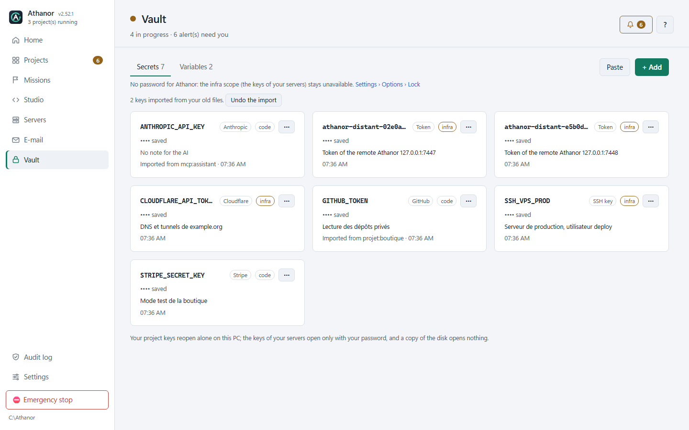
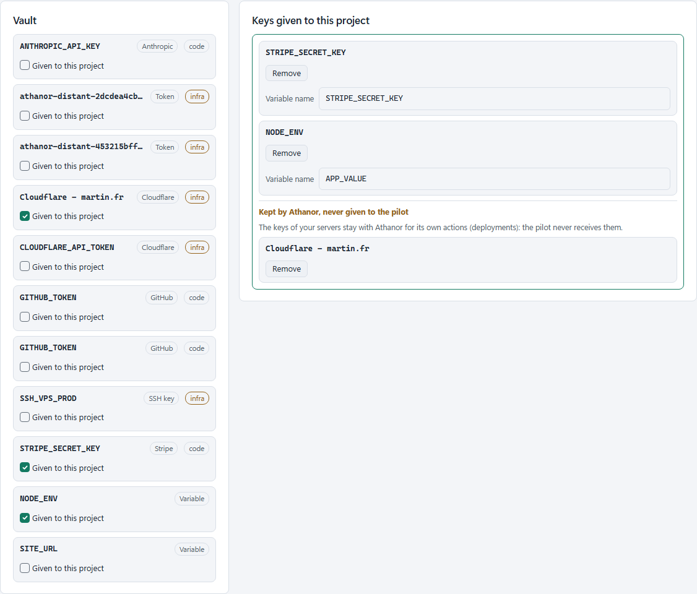

# Le coffre et les accès des projets

Fait partie du [README d'Athanor Hub](../README.fr.md) · [English](VAULT.md)

## Coffre et accès

Le coffre garde les clés ; *Accès* décide quel projet reçoit lesquelles. Une clé porte une seule valeur, et le projet la reçoit partout où il tourne. Les clés *code* sont données au projet, dont le pilote lit la valeur ; les clés *infra* (serveurs, Cloudflare, SSH) restent chez Athanor, qui s'en sert lui-même et ne les donne jamais à Claude.

| | |
|---|---|
|  **Coffre** : chaque clé chiffrée, portée *code* ou *infra* |  **Accès** : cocher une clé pour le projet |

### Le coffre

*Coffre*, dans le menu, garde les clés, jetons et réglages de vos projets et de vos serveurs au même endroit, chiffrés dans le dossier d'Athanor (`hub/coffre.json`). *Guide › Le coffre* le présente pas à pas.

- **Secrets et variables.** La valeur d'un secret n'est montrée que pendant que vous la tapez : ensuite, aucune page, aucune réponse d'API ni aucun journal ne la contient. Les variables (une région, un nom d'utilisateur) sont des réglages ordinaires, lisibles même coffre verrouillé.
- **Coller.** Un bloc `.env` entier, une configuration MCP, un jeton ou une clé privée : Athanor reconnaît chaque valeur (Cloudflare, GitHub, Anthropic, OpenAI, Stripe, AWS, SSH, certificats, URL avec identifiants) et propose un nom, un type et une portée. Seuls les noms reviennent dans la page.
- **Tester.** Vérifie une clé auprès de son propre service et de personne d'autre (Cloudflare et GitHub : si elle marche et ce qu'elle permet ; SSH : le type de clé et la réponse du serveur), puis propose une *note pour Claude*, modifiable : elle dit à Claude à quoi sert la clé sans en montrer la valeur. Une clé Cloudflare montre ensuite ses zones et ses droits sur sa fiche.
- **Un compte SMTP (envoi d'e-mails).** *Coffre › Ajouter*, type *SMTP (envoi d'e-mails)* : choisissez le service (Gmail, Outlook, OVH, Brevo, Mailgun, SendGrid : il remplit le serveur, le port et le chiffrement), donnez le nom d'utilisateur et l'expéditeur, et le mot de passe comme valeur (pour Gmail, Outlook et Yahoo, un *mot de passe d'application*). Donnée à un projet, la clé apporte `SMTP_HOST`, `SMTP_PORT`, `SMTP_SECURE`, `SMTP_USER`, `SMTP_FROM` et `SMTP_PASSWORD` : pendant que Claude le construit, et dans le `.env` d'un déploiement fait avec Docker Compose. Ses réglages sont liés à son mot de passe : changer le serveur ou un autre réglage redemande le mot de passe. *Guide › Envoyer des e-mails depuis vos applis* le détaille.
- **Catégories.** *Catégories* crée, renomme et supprime les vôtres (*Hébergement* et *E-mail* sont proposées) ; en supprimer une laisse ses clés dans le coffre, sans catégorie. Une seule recherche, par nom ou par catégorie, avec son filtre par catégorie, sert le coffre, les mentions `@`, l'onglet *Déploiement* et les cartes de l'accueil.
- **Deux portées : qui voit la valeur.** *code*, lue par Claude et votre appli : les clés que le code d'un projet utilise (une clé d'API, un compte SMTP) ; donnée à un projet, la valeur va dans ses secrets pendant que Claude le construit, et dans l'appli déployée. *infra*, utilisée seulement par Athanor, jamais montrée : les clés de vos serveurs et de vos comptes (SSH, Cloudflare, déploiement GitHub) ; elles ne quittent jamais le processus d'Athanor, Claude demande à Athanor d'agir avec elles, et elles demandent un mot de passe pour Athanor (*Réglages → Options → Verrouiller*). Dans les deux cas, une clé se nomme avec `@` ; le type choisi propose sa portée, et le petit *i* à côté de *Portée* l'explique dans le formulaire.
- **Verrouillage.** Les clés de vos projets se rouvrent seules sur ce PC ; celles de vos serveurs ne s'ouvrent qu'avec votre mot de passe, et une copie du disque n'ouvre rien. En détail : chaque portée a sa propre clé AES-256-GCM aléatoire. La clé *code* est enveloppée par votre mot de passe (PBKDF2-SHA256, 600 000 itérations) et par le coffre du système (DPAPI sous Windows, le Trousseau sous macOS, le Secret Service sous Linux) ; la clé *infra* seulement par votre mot de passe. Elle s'ouvre quand vous déverrouillez Athanor, dans la fenêtre ou depuis un téléphone appairé, et est effacée de la mémoire à l'arrêt d'urgence ou à l'arrêt d'Athanor. Le verrouillage, par le cadenas ou automatique, ne verrouille que la fenêtre : la clé reste, vos projets, missions et tâches serveur continuent pendant votre absence. Le verrouillage automatique (après un temps sans activité) ne verrouille que la fenêtre : les clés restent ouvertes, donc IA, déploiements, tâches et sessions SSH continuent sans redemander le mot de passe. Un téléphone appairé voit la liste, jamais une valeur, et ne peut rien y changer.
- **Vos anciennes clés.** Au démarrage, Athanor copie dans le coffre le `.athanor/secrets.env` de chaque projet, les clés de *Skills & MCP* et celles de son propre `.env`, sans changer ces fichiers. Un nouveau démarrage n'importe rien deux fois ; *Annuler l'import* retire exactement ce qui a été ajouté. Chaque clé de projet importée est aussitôt rendue à son projet (marqué *importé*) : rien ne change pour le pilote. Une clé qui portait une seconde valeur pour la production la garde (*Garder la seconde valeur (anciens projets)*) : seul le site de production d'un ancien projet la reçoit, tout le reste reçoit la première.

Ce que le coffre protège, et ce qu'il ne protège pas, est dans le [modèle de sécurité](SECURITY.fr.md#modèle-de-sécurité).

### Les accès

*Accès*, un onglet de Studio, décide quelles entrées du coffre le projet reçoit. *Guide › Les accès* le parcourt pas à pas.

- **Accorder.** Les entrées du coffre à gauche, les clés données à ce projet à droite : glissez-y une entrée, ou cochez sa case, puis *Enregistrer les modifications* : le mot de passe est demandé une seule fois pour toutes les clés données. Le pilote la reçoit sous le nom de variable affiché, que vous pouvez changer. Une API choisie dans l'onglet *Déploiement* du projet s'affiche ici en lecture seule, sous *Utilisées par le déploiement* : elle se change là-bas.
- **Le badge.** À côté de *Démarrer*, un badge compte les accès (« 4 accès ») et ouvre le panneau, et une phrase dit exactement ce que le pilote recevra (« 2 clés, 1 variable »). Un téléphone appairé les affiche, sans pouvoir les changer.
- **Ce que reçoit le pilote.** Avant chaque démarrage, et à chaque changement, Athanor réécrit lui-même le `.athanor/secrets.env` du projet avec exactement les entrées *code* accordées au projet ; retirer un accès en enlève tout de suite la valeur. Claude ne tient jamais le coffre. Une ligne de l'ancien fichier dont la valeur n'est pas au coffre est gardée, et le panneau propose de l'importer. Tant que la clé *code* est fermée, le fichier reste tel quel et le panneau le dit.
- **Les clés de vos serveurs.** Une entrée *infra* (Cloudflare, SSH…) peut être liée à un projet, mais Athanor la garde pour ses propres actions : le pilote ne la reçoit jamais, et le panneau la range à part.
- ***Pour vous*.** Une clé donnée sur la page *Pour vous* entre au coffre (portée *code*) avec un accès pour le projet, marqué *ajoutée automatiquement*. Sans coffre utilisable, elle va dans le fichier du projet comme avant, et la page le dit. Une clé qui ressemble à une clé d'infrastructure (GitHub, AWS, Cloudflare, SSH…) n'est donnée au pilote qu'après votre confirmation, et elle est refusée en mode Windows natif sauf si *Forcer* est coché pour le projet : donnez-la plutôt dans le *Coffre*.
- ***Tester le coffre*.** *Installation & santé → Tester le coffre* : trois entrées témoins sont accordées comme celles d'un projet (le fichier des accès, puis l'injection : deux à un projet temporaire, une à un projet voisin), puis une courte session Claude (Haiku), avec l'environnement même du pilote, essaie tous les moyens qu'elle connaît de les lire ; elle doit voir celle qui est accordée, et jamais celle du voisin ni celle d'infra. Une entrée infra qu'elle n'a pas pu tester (pas de mot de passe, Athanor verrouillé) n'est pas un succès. Les témoins et les projets temporaires sont toujours retirés ensuite.
