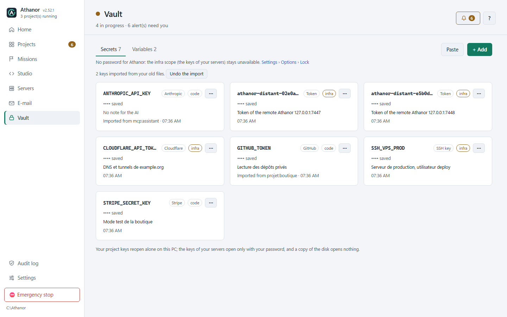
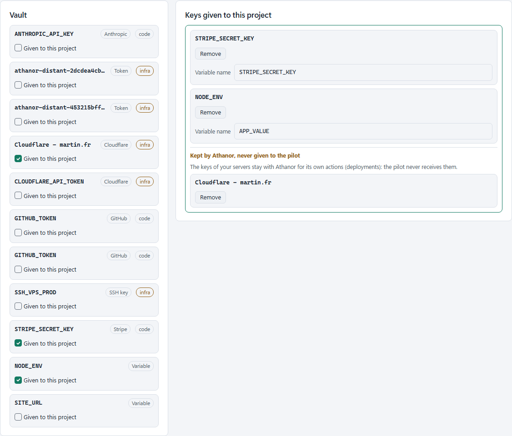

# The vault and project access

Part of the [Athanor Hub README](../README.md) · [Français](VAULT.fr.md)

## Vault and access

The vault keeps the keys; *Access* decides which project gets which. One key holds one value, and the project gets it wherever it runs. *Code* keys are given to the project, whose pilot reads their value; *infra* keys (servers, Cloudflare, SSH) stay with Athanor, which uses them itself and never gives them to Claude.

| | |
|---|---|
|  **Vault**: every key encrypted, scope *code* or *infra* |  **Access**: tick a key for the project |

### The vault

*Vault*, in the menu, keeps the keys, tokens and settings of your projects and servers in one place, encrypted in Athanor's folder (`hub/coffre.json`). *Guide › The vault* walks through it.

- **Secrets and variables.** A secret's value is shown only while you type it: afterwards no page, API answer or log contains it. Variables (a region, a user name) are plain settings, readable even while the vault is locked.
- **Paste.** A whole `.env` block, an MCP configuration, a token or a private key: Athanor recognises each value (Cloudflare, GitHub, Anthropic, OpenAI, Stripe, AWS, SSH, certificates, URLs with credentials) and proposes a name, a type and a scope. Only the names come back to the page.
- **Test.** Checks a key with its own service and nowhere else (Cloudflare and GitHub: whether it works and what it may do; SSH: the key's type and the server's answer), then proposes a *note for Claude* that you can edit: it tells Claude what the key is for without showing the value. A Cloudflare key then shows its zones and its rights on its card.
- **An SMTP account (sending e-mails).** *Vault › Add*, type *SMTP (sending e-mails)*: choose the service (Gmail, Outlook, OVH, Brevo, Mailgun, SendGrid: it fills in the server, the port and the encryption), give the user name and the sender, and the password as the value (for Gmail, Outlook and Yahoo, an *app password*). Given to a project, the key brings `SMTP_HOST`, `SMTP_PORT`, `SMTP_SECURE`, `SMTP_USER`, `SMTP_FROM` and `SMTP_PASSWORD`: while Claude builds it, and in the `.env` of a deployment made with Docker Compose. Its settings are bound to its password: changing the server or another one asks for the password again. *Guide › Send e-mails from your apps* walks through it.
- **Categories.** *Categories* creates, renames and deletes your own (*Hosting* and *E-mail* are suggested); deleting one leaves its keys in the vault, without category. One search, by name or category, with its filter by category, serves the vault, the `@` mentions, the *Deployment* tab and the home cards.
- **Two scopes: who sees the value.** *code*, read by Claude and your app: the keys a project's code uses (an API key, an SMTP account); given to a project, the value reaches its secrets while Claude builds it, and the deployed app. *infra*, used only by Athanor, never shown: the keys of your servers and accounts (SSH, Cloudflare, GitHub deployment); they never leave Athanor's process, Claude asks Athanor to act with them, and they need a password for Athanor (*Settings → Options → Lock*). Either way a key can be named with `@`; the type you choose proposes its scope, and the small *i* beside *Scope* explains it in the form.
- **Locking.** Your project keys reopen alone on this PC; the keys of your servers open only with your password, and a copy of the disk opens nothing. In detail: each scope has its own random AES-256-GCM key. The *code* key is wrapped by your password (PBKDF2-SHA256, 600,000 iterations) and by the system's keystore (DPAPI on Windows, the Keychain on macOS, the Secret Service on Linux); the *infra* key only by your password. It opens when you unlock Athanor, in the window or from a paired phone, and is wiped from memory on the emergency stop or when Athanor stops. Locking, with the padlock or by itself, only locks the window: the key stays, so your projects, missions and server tasks go on while you are away. The automatic lock (after a time without activity) only locks the window: the keys stay open, so AIs, deployments, tasks and SSH sessions go on without asking for the password again. A paired phone sees the list, never a value, and cannot change it.
- **Your old keys.** On start-up, Athanor copies into the vault each project's `.athanor/secrets.env`, the keys of *Skills & MCP* and those of its own `.env`, without changing those files. Starting again imports nothing twice; *Undo the import* removes exactly what was added. Each imported project key is given back to its project at once (marked *imported*), so nothing changes for the pilot. A key that held a second value for production keeps it (*Keep the second value (older projects)*): only the production site of an older project gets it, everything else gets the first.

What the vault protects against, and what it does not, is in the [security model](SECURITY.md#security-model).

### Project access

*Access*, a tab of Studio, decides which vault entries the project gets. *Guide › Project access* walks through it.

- **Grant.** The vault's entries on the left, the keys given to this project on the right: drag an entry there, or tick its box, then *Save the changes*: the password is asked once for every key given. The pilot gets it under the variable name shown, which you can change. An API chosen in the project's *Deployment* tab shows here read only, *Used by the deployment*: it is changed there.
- **The badge.** Next to *Start*, a badge counts the accesses (“4 accesses”) and opens the panel, and a sentence says exactly what the pilot will get (“2 keys, 1 variable”). A paired phone shows them, and cannot change them.
- **What the pilot receives.** Before each start, and at each change, Athanor itself rewrites the project's `.athanor/secrets.env` with exactly the *code* entries granted to the project; removing an access takes its value out at once. Claude never holds the vault. A line of the old file whose value is not in the vault is kept, and the panel offers to import it. While the *code* key is closed, the file is left as it was and the panel says so.
- **Your servers' keys.** An *infra* entry (Cloudflare, SSH…) can be linked to a project, but Athanor keeps it for its own actions: the pilot never receives it, and the panel shows it apart.
- ***For you*.** A key you give on the *For you* page goes into the vault (scope *code*) with an access for the project, marked *added automatically*. Without a usable vault, it goes into the project's file as before, and the page says so. A key that looks like an infrastructure key (GitHub, AWS, Cloudflare, SSH…) is given to the pilot only once you confirm it, and is refused in native Windows mode unless *Force* is ticked for the project: give it in the *Vault* instead.
- ***Test the vault*.** *Setup & health → Test the vault*: three sample entries are granted like any project's (the access file, then the injection: two to a temporary project, one to a neighbour project), then a short Claude session (Haiku) with the pilot's own environment tries every way it knows to read them; it must see the granted one, and never the neighbour's nor the infra one. An infra entry it could not test (no password, Athanor locked) is not a pass. The samples and the temporary projects are always removed afterwards.
